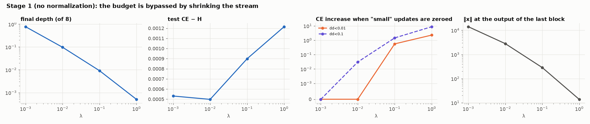
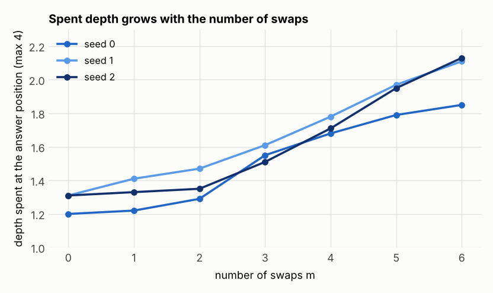
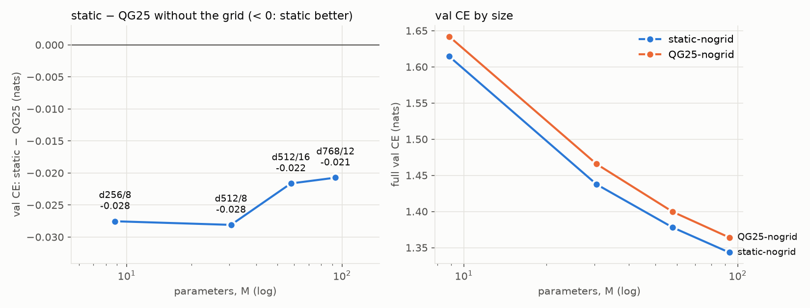

# Fixed vs learned routing in small transformers

*Do models need the specialization we design for them?*

A series of small-scale experiments on conditional computation in transformers: adaptive depth, gated
state groups and mixture-of-experts routing. Several times I gave the model a structure that looks
sensible to a human (compute more where the token is hard, route by meaning, keep experts cleanly
specialized), and each time a fixed rule chosen in advance did as well or better.

## TL;DR

- **A fixed mask beats a learned adaptive gate** at the same compute budget, on TinyStories and Wikipedia
  and at four model sizes (8.8M–93M parameters). The learned gate does track token difficulty, but that
  does not pay for itself.
- **Frozen expert routes beat a learned MoE router.** Whether the frozen route is meaningful (clusters of
  hidden states) or arbitrary (a hash of the token id) makes no measurable difference after 20k steps.
- **More expert specialization did not mean more gain**, and new experts were not better than a LoRA of
  the same size for adding a new domain.

Working conclusion: in these setups, predictability of the structure matters more than its meaning. The
specialization a human finds natural is not what the optimization needs.

> **Scope.** Models from 0.85M to 93M parameters trained from scratch on a synthetic language, TinyStories
> and a Wikipedia + code + TinyStories mix. Main comparisons have 2–3 seeds; the size ladder and the
> Wikipedia check have one seed per point (the gaps there are far above the seed noise measured elsewhere).
> This is an exploration, not a paper.

## Findings

### 1. A compute penalty can be gamed instead of used
Each block adds an update to the state, scaled by a gate `dd`, and the loss penalizes `dd` as "compute
spent". Under a strong penalty the model found a loophole. Every block normalizes its input, so the
overall scale of the state does not matter to it. The model shrank the whole state (×1000 at the output),
and then tiny updates were enough to carry all the information. To the penalty this looked like perfect
behaviour: the measured cost fell 10⁴× and 99.7% of gates looked closed. But zeroing those "closed"
updates costs +2.3 nats/token. Nothing was actually skipped.

**Lesson:** measure skipped computation by ablating it, never by the size of a gate.

The fix was to pin the scale: the state is renormalized after every update and the update itself is
bounded, so a small update really is small. After that the budget is real: gates turn bimodal and zeroing
the closed ones costs ≤10⁻⁴ nats.

Later rounds went one step further and made the gate discrete: each group of the state is either open or
closed, a closed group is copied unchanged, and the fraction of open groups is driven to a target.
Finding 3 uses that gate.

### 2. Spent depth follows difficulty
To check that the budget goes where it is needed, I used a synthetic language with a task whose
difficulty is known exactly. A sentence lists 3 or 4 names in order, then says *m* times which two
positions swap ("first and third swap"), and then asks which name now stands at a given position. The
answer is fully determined, and more swaps mean more steps to work it out.

The depth the model spends at the answer position grows with *m*: from 1.2–1.3 with no swaps to 1.9–2.1
with six, out of a maximum of 4 (Spearman rank correlation ρ = 0.85–0.88, 3 seeds; the effect holds when controlling for
the number of names and the position in the sentence). So the model does spend more compute where the
token is harder. The next finding is that this still does not help.

### 3. A fixed mask beats a learned adaptive gate
TinyStories, 30M-parameter model. The state is split into 8 groups. In each block a group is either open
(updated) or closed (copied unchanged), and only 25% of the groups may be open.

| which groups are open | val CE | vs learned gate |
|---|---|---|
| learned gate, sees the context | 1.4731 (2 seeds) | — |
| learned gate, sees only the current token | 1.4986 (1 seed) | +0.026 |
| random mask | 1.7819 (3 seeds) | +0.309 |
| **fixed mask: the same 2 of 8 groups per block, for every token** | **1.4509** (3 seeds) | **−0.022** |
| dense model, all groups open | 1.3994 | −0.074 |

Seed SD in this table is ≤0.0005 wherever there is more than one seed.

- The learned gate is far better than a random mask, but that whole advantage is the mask being
  predictable. Adaptivity on top of it is a net loss.
- Control: start the learned gate so that at step 0 it opens exactly the groups of the fixed mask, then
  train it as usual. It ends at 1.4651 (2 seeds, SD 0.003), between the two. So about one third of the gap was the
  rough start of training (the normal gate starts with everything open and has to close down to 25%), and
  two thirds is adaptivity itself: the gate moves away from the fixed mask in 13% of its decisions, and
  those changes are not related to token difficulty.
- The normally trained gate does follow difficulty (rank correlation ρ ≈ 0.3 with the dense model's per-token loss).
- Same order on Wikipedia (gap 0.054) and at 8.8M, 30M, 58M and 93M parameters (gap 0.021–0.028).

Caveat: a fixed mask is also a fixed architecture. Each block always writes to the same groups and the
rest of the network adapts to that.

### 4. Frozen expert routes beat a learned router
A learned router keeps changing while the experts train. The idea here was to remove that drift: take the
route from an already trained dense model and freeze it. For each expert block, the hidden states that
the dense model produces at that block are clustered with plain k-means into 64 clusters, and the 64
cluster centers are grouped into 8, one group per expert. A token goes to the expert whose group contains
the center nearest to its hidden state. The centers are computed once and never updated ("per-layer"
below).

Setup: a dense 51M model trained on Wikipedia + code + TinyStories is turned into a mixture of 8 experts
in its upper 4 blocks (experts start as copies of the dense FFN, same compute per token) and trained 10k
more steps. Only the routing differs.

| routing | val CE | vs continuing the dense model |
|---|---|---|
| clusters of the pretrained model's hidden states, frozen codebook ("per-layer") | 2.2686 | −0.032 |
| hash of the token id | 2.2710 | −0.029 |
| residual-VQ codes, random code→expert table | 2.2786 | −0.022 |
| predicted next token, via the frozen output layer | 2.2811 | −0.019 |
| residual-VQ codes, meaning-based code→expert table | 2.2829 | −0.017 |
| continue the dense model | 2.3001 | — |
| learned Switch router | 2.3036 | +0.004 |

- Freezing works: the learned router reassigns 98.6% of tokens during training and ends up worse than no
  experts at all, while the per-layer route is the best in the table.
- But the meaning in the route is not what helps. A plain hash of the token id is 0.002 behind per-layer
  at 10k steps and level with it from 20k on (next finding).
- Other meaningful frozen routes, tested for separate questions, do not win either: meaning-based
  residual-VQ tables lose to random tables, and routing by the predicted next token loses to the hash.

### 5. More specialization does not mean more gain
Continued to 40k steps, per-layer experts keep specializing: in the top block, swapping in another
expert costs 0.43 of removing the FFN entirely, against 0.09 for hash experts, which stay almost
interchangeable. The quality of the two is the same from 20k steps on (difference −0.0005 ± 0.0005 at
40k). Cutting the "foreign topic" part of the gradient to force cleaner experts did not increase
specialization and slightly hurt quality.

### 6. New experts are not better than LoRA for a new domain
Adding a new source (Russian Wikipedia, PubMed) in a short 1000-step run: with the same routing signal
and learning rate, new experts are 0.010 / 0.048 nats worse than a LoRA of the same size, and a
state-based gate works on the dense model just as well as on the expert model.

## A counterexample
When a model is already trained and is only cut down, with no training, its own structure is useful:
grouping FFN neurons by clusters of the model's hidden states beats unstructured pruning by a wide
margin (see the companion repo on training-free LLM pruning). So the claim is narrow: imposing a human
notion of specialization during training did not help; reading the structure a model has already learned
does.

## Repository
- `dd/` — model, data, training, evaluation and analysis code for the rounds described above. `model.py`
  is the transformer with all gate variants, `train.py` / `ts_train.py` train it, `r21_moe.py` and
  `r28_*.py` are the expert-routing experiments, `r29*.py` is the new-domain comparison with LoRA. Modules
  named `report*` and `*_report` generate the tables of the notebook, so their output is in Russian.
- `scripts/` — launchers for the experiment grids of the early rounds (run from the repository root).
- `tests/` — unit tests: `uv run pytest`. 169 tests run on CPU without any data; 21 more need the GPT-2
  tokenizer, trained checkpoints or a GPU and are skipped when those are missing.
- `docs/REPORT_ru.md` — the full lab notebook in Russian: every round, every table, dead ends included.
  It also covers rounds that are outside the scope of this README; their code is not in this repository.
- Data and checkpoints are not included. `wiki_data.py` and `mix_data.py` download and tokenize the public
  datasets from the Hugging Face Hub; `ts_data.py` expects the TinyStories text files in `data_ts/raw/`.

## How this was built
Research questions, hypotheses, experiment design and interpretation of the results are mine. The code
was written by Claude Code under my review; I read the modules whenever a result looked suspicious.

Hardware: one RTX 3090 at home plus rented vast.ai GPUs for multi-seed runs.
