# Бюджет глубины: отчёт

Код: `dd/` (язык, данные, модель, обучение, оценка, отчёт), тесты `tests/test_depth.py` (96 шт., все проходят).
Полные таблицы: [`report/tables.md`](report/tables.md). Методика: [`report/methods.md`](report/methods.md).
Этап 1 подробно: [`report/stage1.md`](report/stage1.md).

## Кратко

1. **Исходная формулировка обходится через сжатие потока.** В схеме `x += dd·(a+u)` с pre-norm модель
   может уменьшить масштаб всего остаточного потока и сделать dd сколь угодно малым. Качество при этом не
   меняется. При λ = 1 норма потока падает в 1000 раз, «стоимость» падает в 10⁴ раз, а 99.7% dd лежат
   ниже 0.01. Но обнуление этих «нулевых» dd стоит +2.3 нат/токен. Значит, порог dd < 0.01 там ничего не
   говорит о пропуске вычислений.
2. **После фиксации масштаба бюджет работает как задумано.** Схема: нормированное состояние,
   `min(dd,1)·tanh(a+u)`, протекающий гейт. Гейты становятся двухвершинными (0 или 1). 71–87% пар
   «координата × токен» в каждом слое имеют dd < 0.01, и обнуление этих dd почти ничего не стоит
   (|ΔCE| ≤ 10⁻⁴).
3. **Главная новая находка: глубина следует за трудностью вычисления.** На позиции, где модель должна
   выдать результат слежения за перестановками, потраченная глубина растёт с числом перестановок m.
   У B со средним λ рост с 1.2–1.3 до 1.85–2.13 (3 сида; ρ = 0.85–0.88; эффект держится при контроле
   длины и числа имён). Так у всех вариантов с λ > 0, которые выучили задачу. При λ = 0 зависимость
   обратная. Токены событий получают мало глубины: модель не обновляет состояние на каждом событии, а
   вычисляет ответ в момент вопроса.
4. **Глубина значимо связана с синтаксисом, эффект умеренный.** Частная ρ с глубиной в дереве 0.16–0.28
   при контроле класса слова и позиции; внутри предложения — так же. Глубже уходят токены, закрывающие
   составляющие, и главные слова. Неглубокие координаты хранят идентичность токена, глубокие — контекст.
5. **Качество в среднем хуже A**, и почти весь проигрыш даёт нормировка состояния, а не бюджет:
   A — 96.4% точности ответа, A_norm — 91.1%, B (средний λ) — 89.7%. Разброс между сидами огромен:
   A от 91.0% до 99.8%.

Ответы на три критерия — в разделе «Критерии успеха» ниже.

**Раунд 3** (несколько вопросов в предложении, общий бюджет на сеть, штраф за реальное изменение, 8 вариантов × 2–3 сида) — раздел 6, краткие выводы — в 6.0.

**Вариант K** (жёсткий гейт «группа сдвинулась» до FFN, доля сдвигов задаётся целью через μ; K25, K50, K25L, K25-free, K25-norm × 2 сида) — раздел 7, краткие выводы — в 7.0.

**Раунд 4** (квантованное состояние Q0 / Q-L1 / Q-L0, I′ с медианой, K-STE, свободные координаты в групповых
вариантах; 10 вариантов × 2 сида) — раздел 8, ответы на вопросы раунда — в 8.0. Коротко: лучший кандидат —
Q-L0 (качество уровня A, цена равна реальному изменению по построению, глубина растёт с трудностью), но
стояние у него по координатам и до FFN не предсказывается.

**Раунд 5** (Q-L0 с ценой с первого шага, по 5 сидов A и Q0, квантованное состояние с гейтом группы до FFN:
QG25, QG50, QG-split25, QG-nogate25 × 2 сида) — раздел 9, ответы — в 9.0. Коротко:
- квантование ускоряет ранние этапы обучения, но не финальный скачок;
- QG25 держит качество Q-L0 (99.9%) и реально пропускает FFN у 75% групп (30% FLOPs блока);
- без гейта ломается двойственный спуск, разрезание блока по группам к 80k стоит качества.

**Раунд 6** (что тормозит QG-split: 4 варианта разреза × 2 сида на синтетике; QG на TinyStories: d = 512,
8 блоков, свой BPE 8k, 328M токенов, реальная скорость генерации; ночной блок — граница «качество — экономия»
и 40k шагов) — раздел 10, ответы — в 10.0. Коротко:
- в синтетике финальный скачок определяет сид, а не разрез; лучший разрез — QG-split (48% экономии блока);
- на TinyStories нужна сетка со своим шагом на слой (общий шаг не работает); с ней Q0 почти равен A (+0.015),
  QG25 отстаёт на 0.074 нат, QG-split25 — на 0.166;
- модель тратит больше групп на трудные токены (особенно перед редкими словами), но связь умеренная (ρ ≈ 0.28);
- реальное ускорение шага генерации — ×1.13 у QG-split25 (FFN ×2.8); у QG25 выигрыша нет: FFN — лишь 35%
  времени шага, а гейт стоит после внимания;
- граница «качество — экономия»: при 25 / 35 / 50% открытых групп QG отстаёт на 0.074 / 0.061 / 0.046;
  для ≤ 0.02 по тренду нужно ~75–85% групп, где экономии почти нет;
- долгое обучение (40k) отставание QG25 почти не меняет (0.074 → 0.070): QG25 учится медленнее в постоянное
  число раз, без потолка.

**Раунд 7** (контроли гейта QG25: random, static, position, tokengate; сиды на vast.ai) — раздел 10.11. Коротко:
QG25 лучше случайных масок на 0.31 ната, но фиксированная маска (2 из 8 групп на блок) лучше QG25 на 0.022:
весь выигрыш гейта над random даёт предсказуемость маски. Гейт только от токена хуже QG25 на 0.026 — контекст
помогает, но не окупает адаптивность.

**Проверки r7 (10.12, 10.13).**
- **Почему static лучше QG25.** Около трети разрыва даёт начало обучения (staticinit без скачка μ), около двух
  третей — сама адаптивность.
- **Не помогают:** hybrid (одна группа на блок всегда открыта) закрывает около половины разрыва, но static не
  догоняет; отдельный поток управления для гейта ничего не даёт.
- **Википедия.** Static снова лучше QG25, на 0.054 ната против 0.022 на TinyStories. Гейт там почти не следит
  за трудностью: ρ = 0.13 против 0.30.

**Откуда разрыв static − адаптивный гейт (10.15, 10.16).**
- **Не причины:** сетка (без неё разрыв не меньше) и выбор «какие группы» (гейт «по очереди» проигрывает столько
  же).
- **Около 45%** разрыва даёт перекос бюджета по блокам из-за общего μ. Свой μ на блок отыгрывает 0.009 из 0.021
  (2 сида, 10.18), а та же неравная раскладка у фиксированной маски стоит лишь 0.002.
- **Около 55%** — сама переменность k по токенам. Сужение k до 1–3 приближает гейт к static: +0.009 без сетки.
- **Случайное k** вместо выученного стоит +0.175.

**Сколько бит нужно (10.21).** Чтобы направление группы состояния A передавалось с косинусом > 0.9, нужно
~640 бит на токен и состояние, и раскладка почти не важна. Защёлкивание одного слоя при этом стоит +0.07.
В VQ-прогонах было 64–80 бит.

**Воронка (10.22).** Фиксированное «блок l пишет только свои группы» (36 записей из 64) стоит +0.025 к A, из
них +0.018 — сам бюджет (static-36). С давлением «решать раньше» (mat) воронка даёт на каждом токене меру
нужной глубины без обучаемых решений: 16% токенов хватает 2 блоков, 35% — 4. Эта мера связана с трудностью
внутри токена на ρ ≈ 0.42 (у гейтов было 0.2–0.26), а с logit lens A — на 0.55.

**Ранний выход с давлением (10.23).**
- Нужная глубина (минимальное k, при котором ранний ответ близок к полному) воспроизводится между сидами на
  ρ = 0.79 (внутри токена 0.72). Это лучше logit lens у A (0.66).
- С трудностью внутри токена она связана на ~0.43.
- Обычная A с давлением (A-mat) даёт ранние ответы бесплатно по полному CE: 19% токенов хватает 2 блоков, ранний
  ответ после 4 блоков совпадает с полным топ-1 в 77% случаев. Воронка для этого не нужна.

**Лестница по размеру (10.17, без сетки).** Static лучше QG25 на всех четырёх размерах, от 8.8M до 93M
параметров: −0.028, −0.028, −0.022, −0.021. Проигрыш адаптивного гейта не свойство маленькой модели; у больших,
возможно, чуть меньше (1 сид на точку).

**Дискретное состояние (VQ, 10.19).** Книга на 1024 состояния или 256 правок на группу из 64 координат стоит
+1.19 и +0.71 ната к A. Это в десятки раз дороже сетки. Без цены число смен символа с трудностью не связано.
Нормированный VQ (10.20) снижает цену до +0.43 (delta) и +1.11 (shared). Дообучение готовой A хуже обучения
с нуля: одна вставка k-means книги стоит +2.6…+4.4. Аттрактор с β до 30 остаётся смесью векторов книги, а
жёсткое защёлкивание его ломает.

**Раунд 8** (цель сменилась: не ускорение, а понимание, на что модель тратит вычисления; только готовые
чекпойнты A, QG25, QG50) — раздел 11. Коротко:
- карта QG умеренно совпадает с тем, где считает A: ρ ≈ 0.24–0.36 с изменением состояния A и 0.32 с блоком, где
  у A устаканивается предсказание; по блокам совпадение слабое (AUROC ≤ 0.63);
- открытые группы нужны везде: закрыть половину стоит +1.6–1.7 нат на тронутых токенах; значение гейта
  причинно осмысленно — группы с наименьшим логитом стоят втрое меньше случайных из открытых;
- ~55–60% разброса карты задаёт сам токен; совпадение с изменением состояния A целиком контекстное.

**Раунд 22** (Qwen3-1.7B без обучения: дальние K/V слоёв выше l по приближённому состоянию) — раздел 13.
Коротко:
- решает прежде всего l: при l ≤ 10 ломается всё, при l = 21–24 любое приближение стоит ≤ 0.09 нат, а факт
  находится в 100% случаев;
- окно W спасает перплексию, но не поиск: при l = 14 вариант a) h_l стоит +0.05 нат при W = 1024, но факт дальше
  окна находит лишь в 6% случаев;
- только линейное отображение c) сохраняет поиск при l = 14 (91–98%); в постановке ТЗ оно ломает сток внимания
  (токен 0, +1.6 нат), а с точным токеном 0 стоит столько же, сколько a).

**Блок r20 (в коде r21)** (смесь экспертов без обучаемого гейта на смеси Википедии, кода и TinyStories; 10 вариантов
этапа 2, пять с двумя сидами) — раздел 14. Коротко:
- лучшее качество у фиксированных маршрутов: per-layer 2.2686 и hash 2.2710 против dense-cont 2.3001; обучаемый
  маршрутизатор хуже плотного продолжения (2.3036); все разности по ряду проходят 2 × SD;
- смысл кода не помогает: смысловые таблицы RVQ хуже случайных, и вырожденные (+0.015), и взвешенные (+0.004);
- per-layer специализирует экспертов по источнику сильнее всех, обучаемый — слабее всех;
- маршруты per-layer устойчивы (эксперт сменился у 5.6% токенов за 10k шагов), коды остаточных ступеней RVQ — нет:
  у них нет запаса выбора (медиана 1–2% расстояния книги); штраф близости увеличивает их дрейф с 32% до 74%;
- эксперты «пробелы в коде» работают на свою позицию, а не на будущее: выключение только на пробелах бьёт по
  предсказанию первого слова строки с последнего пробела отступа, а следующим токенам почти не мешает; признаки
  отступа уже читаются на их входе (14.10).

**Раунд 23** (без обучения: эксперты MoE-perlayer выбираются сразу после блока N по угаданным состояниям) — раздел 15.
Коротко: маршрут наперёд стоит +0.0046 нат с линейным угадыванием (+0.0081 без него), то есть 15% выигрыша от
экспертов; при подгрузке двух экспертов на блок промахов не больше 1.4% токенов на блок.

**Блок r24** (ширина экспертов по «избыточной потере» max(0, CE A-mix − CE A-mix-big) при том же расходе на токен;
маршрут наперёд заморожен; uniform / excess / shuffled × 2 сида) — раздел 16. Коротко:
- excess против uniform — эффект не обнаружен в целом (+0.0002 при 2 × SD 0.0011). Ширина лишь перераспределила
  качество: Википедия −0.0024, код +0.0020, сказки +0.0010;
- excess против shuffled — эффект не обнаружен (−0.0062 при 2 × SD 0.0069);
- мера почти повторяет обычную потерю (Спирмен 0.93). Расширенные области выиграли 0.0018, суженные («пробелы в
  коде» и др.) потеряли 0.0035, итог — ноль;
- маршрут наперёд при обучении ничего не стоит: 2.2692 против 2.2686 у perlayer r21.

**Раунд 25, этап A** (без обучения: верхняя половина Qwen3-0.6B как эксперты с маршрутом по смыслу; эталон Qwen3-1.7B;
смесь r21 в токенах Qwen) — раздел 17. Коротко:
- при 1/4 FFN во всех 14 верхних блоках experts лучше teal на 0.147 и uniform-prune на 0.428 (все разности проходят
  2 SE, и по каждому источнику). Но до исходной далеко: 3.0214 против 2.3965;
- «оракул» (свои 768 нейронов на токен) теряет всего 0.028: ширина на токен почти не нужна, дорого грубое деление на
  8 экспертов;
- маршрут наперёд от блока 14 совпадает с выбором по месту в 93–99% токенов;
- избыточная потеря согласуется с CE на 0.66 (r24: 0.93). Рост CE от урезания области следует за ней (0.47), а не за
  CE (0.10). Больше всего ширины просят куски редких имён в блоках 23–27 и последние блоки.

**Раунд 25, этап A2** (без обучения, тот же расход 1/4: мельче области, ширина по блокам и группам, общие нейроны,
области по нужным нейронам, оракул, покрытие, CMoE, APC, FANG, ширина по всей модели) — разделы 17.7–17.15. Коротко:
- 64 эксперта на блок вместо 8: 2.8057 против 3.0214. До оракула (2.4246) остаётся 0.381;
- ширина по группам по мере, связанной с потерей (кривая A3, разница ошибок 0.6B/1.7B), даёт ещё около −0.03 при равном
  расходе и −0.085…−0.100 против перемешанных. Меры по ошибке выхода FFN (покрытие, средняя потребность) — от −0.008
  до +0.010;
- группы неоднородны: общему набору группы нужно вдвое больше нейронов, чем одному её токену (в блоке 28 — вчетверо);
- общие нейроны, APC и области «по нужным нейронам» при 64 областях не помогают; CMoE в нашем режиме (1/4 FFN, без
  обучения, 0.6B) хуже простого урезания — режим его статьи другой (17.10);
- маршрут наперёд к своей области: 91% (8 областей) и 84% (64) в среднем, 75% и 61% на блоке 28. К кластерам APC —
  28% и 19.5%;
- ширина по блокам по мере FANG лучше нашей раздачи по кривым: −0.010 в верхней половине, −0.122 по всей модели. При
  1/4 по всей модели без обучения теряется 1.16 нат.

**Блок r26** (без обучения: маршрут наперёд и кэш экспертов на настоящей MoE, OLMoE-1B-7B; смесь r21 в токенах OLMoE)
— раздел 18. Коротко:
- гребневая карта + гейт угадывает маршрут далеко вперёд намного лучше гейта на текущем состоянии: от слоя 2 на слой
  16 — 73% настоящих экспертов против 34%, на соседний слой 87–97% против 79–94%. Из 12 угаданных — 84–100%;
- для подкачки экспертов знание будущих слоёв текущего токена почти бесполезно. Если на видеокарте 1/4 экспертов,
  лучшее правило снимает 4.5% промахов, а точное знание всех слоёв токена — 8.3%. Оракул, знающий следующие токены,
  снимает 50%. При 1/8 (ровно один токен) выигрыш точно ноль;
- угаданные эксперты вместо настоящих стоят по val CE: от слоя 12 +0.003, от 8 +0.018, от 4 +0.037, от 2 +0.063.
  Схемы блоками на все 16 слоёв — от +0.127 до +0.261.

**Дополнения r25 и r26** (без обучения) — разделы 17.16 и 18.6. Коротко:
- Qwen, один блок урезан до 1/4: эксперты дешевле простого урезания в каждом из 28 блоков. Сумма +0.97 против +2.50,
  у оракула +0.08. Дороже всех блок 1 (+0.36 / +1.03), блоки 2–5 и 27–28;
- «+1.16 нат при 1/4 по всей модели» — это all_fang: 64 эксперта, доли блоков по FANG без условия на половины;
- блок 1 по номеру токена (свой набор из 768 нейронов у каждого частого токена) в одиночном урезании стоит +0.060
  против +0.238 у 64 групп. Во всей модели при 1/4 блок 1 целым или по номеру токена — 3.497–3.498, на 0.06 лучше
  all_fang; это пока лучший вариант при 1/4;
- нижней половине 1/2 при общем 1/4 некуда деться: на верхнюю остаётся ноль, CE 16.3;
- OLMoE: эксперты следующего токена угадываются на 62% (у текущего токена на тех же слоях — 39%). Для кэша без
  подгрузки это почти ничего не даёт. Из LFU / LRU-2 / ARC лучше всех LRU-2: −1.1…−1.9 промаха на токен к LRU;
- модель времени: подгрузка угаданных заранее снимает до четверти ожидания, если эксперт в 4 битах. В bf16
  (12.58 МБ, как модель хранится) она почти ничего не даёт: шина и так занята. В r26 размер эксперта сначала был
  молча взят для 4 бит; теперь посчитаны оба размера.

**Второй набор дополнений r25 и 12 кандидатов OLMoE** (без обучения) — разделы 17.17–17.24 и 18.7. Расход в
итоговой сборке учтён честно: маршрут, поправка, гейт или предсказатель входят в бюджет. Коротко:
- **итог верхней половины при 1/4 — 2.6064.** Схема:
  - 256 кластеров состояний по месту с двухступенчатым маршрутом (32 единицы);
  - TEAL внутри пула группы из 1024 нейронов;
  - поправка: карта ранга 32 на блок и сдвиг на группу.

  Это −0.149 к ровной ширине. До оракула 0.18, до исходной 0.21. Прежняя лучшая схема (E64 наперёд, жадные
  ширины, 2.7420) не платила за свой маршрут 1088 единиц на блок — 47% бюджета. При 1/3 лучшая — 2.5209;
- **итог всей модели при 1/4 — 2.8756.** Схема:
  - блок 1 целый, доли блоков по FANG;
  - жадные ширины групп внутри блока;
  - поправка ранга 32 на группу.

  Это −0.62 к 3.4970, но поправка добавляет 114M параметров;
- **TEAL в пуле группы почти равен оракулу в пуле.** Без групп TEAL при 1/4 разваливается: 3.387. Предсказатель
  важности (R² 0.2–0.6) и гейт по пулу (CATS) при таком бюджете слабы;
- **число групп:** чем больше, тем лучше, до 256 без насыщения. Три четверти оставшейся потери — выбор нейронов
  внутри группы, а не выбор группы;
- **поправки к урезанным группам:**
  - дешёвая карта на блок даёт −0.05…−0.09;
  - линейная ранга 32 на группу — −0.139, но это 45% параметров FFN;
  - в одиночном урезании блока поправки почти не помогают;
- **жадная раздача ширины по кривым сжимаемости** лучше всех при расходе 1/4–1/2. При 1/8 и 1/16 она хуже ровной:
  кривые сняты для одной урезанной группы;
- **непересекающиеся группы нейронов** даже с оракулом (2.84) хуже наших групп токенов без оракула (2.71);
- **на 1.7B и 4B оракулу 1/4 FFN хватает без потерь.** У 1.7B он даже лучше исходной на 0.05, это проверено
  независимо через HF transformers. У 8B оракул теряет +0.011. Разрыв групп до оракула с размером не уменьшается:
  0.29 / 0.25 / 0.29 / 0.37 (0.6B / 1.7B / 4B / 8B);
- **при равном расходе урезанная большая модель хуже целой меньшей** (17.25, FLOPs на токен со вниманием, маршрутом,
  поправкой и выходным слоем). Урезанная 1.7B хуже целой 0.6B на 0.070, 4B — хуже 1.7B на 0.135, 8B — хуже 4B на
  0.137, и каждая при этом дороже в 1.4–2.1 раза. Урезание FFN верхней половины до 1/4 экономит лишь 15–26% расхода:
  внимание, нижняя половина и выходной слой остаются;
- **OLMoE, 12 угаданных кандидатов:** по качеству вдвое-втрое лучше 8 угаданных (от слоя 8 +0.006 к плотной). По
  времени ожидания они не лучше подгрузки 8 угаданных, в bf16 хуже LRU.

**Раунд 27: проверка на задачах, а не только по CE** (Qwen3-0.6B / 1.7B / 4B, верхняя половина при 1/4, без
обучения) — раздел 19. Коротко:
- **потолок по чат-версиям был завышен.** У Base-моделей оракул 1/4 теряет +0.027…+0.054; выигрыш оракула у
  чат-1.7B связан с дообучением в чат. Вся линия Qwen (r25–r27) мерилась на чат-моделях, которые на сыром тексте
  на 0.37–0.46 нат хуже Base;
- **по CE и пяти задачам на здравый смысл вывод «урезанная большая хуже целой меньшей» держится.** Урезанные
  лежат ниже линии целых моделей: средняя точность на 0.09–0.10 ниже. Они хуже и целой меньшей, которая дешевле:
  −0.022 ± 0.014 и −0.061 ± 0.014;
- **по знаниям — не везде.**
  - Вспоминание фактов (TriviaQA) падает сильнее всего: −40…−61% от своей целой.
  - MMLU держится лучше всего и лежит на линии целых, эффект не обнаружен.
  - Урезанная 1.7B по знаниям лучше целой 0.6B на 0.069 ± 0.017, урезанная 4B равна целой 1.7B;
- **CE плохо упорядочивает схемы по задачам.** TEAL по всему слою на 0.6B по CE хуже лучшей схемы на 0.77, а по
  MMLU лучше на 0.023 ± 0.021;
- **перевороты.** Урезанные меняют 18–27% ответов, при шуме bf16 0.3–3%; верно → неверно в 2–3 раза чаще;
- наш класс модели для lm-eval совпадает с HF: 97–99.7% одинаковых решений, точность ±0.005.

**Раунд 28: что мешает экспертам различаться** (r21 perlayer / hash и OLMoE-1B-7B; 7 вариантов обучения по 10k шагов
дома, продолжение до 40k и 4 маршрута по выходу — на vast) — раздел 20. Коротко:
- **эксперты r21 различаются умеренно.** Чужой эксперт стоит 0.3 от пустого FFN, общий FFN dense-cont заменяет
  эксперта в 2–3 раза лучше чужого. Около половины разницы снимает подбор одного down: входная часть у экспертов
  во многом общая;
- **чужой градиент велик, но держит экспертов похожими не он.** Больше половины градиента эксперта в блоке 5 идёт
  от позиций любых тем. Срез этой части до 0.31–0.40 (своя тема, иерархия тем, ровно 0.3, перемешанные темы)
  различие экспертов не увеличивает: «чужой / ноль» тот же, эффект не обнаружен (в блоке 5 у «только своей темы»
  +0.02, на пределе 2 SE). Эксперты лишь вместе уходят от общего FFN;
- **качество при срезе хуже** на 0.003–0.008, тем больше, чем сильнее срез; шум сидов около 0.001. Правильная
  разметка тем не дешевле перемешанной;
- **общий down** снижает различие (0.19 против 0.29) и качество (+0.010). **Общий FFN + свои добавки:** добавки
  сильно свои, но весят мало. Модель теряет весь выигрыш смеси (на уровне dense-cont, +0.033 к perlayer);
- **различие растёт со временем** (0.04 → 0.19 → 0.29 на 2k / 5k / 10k) и к 10k не насыщается;
- **OLMoE:** чужой эксперт хуже, чем убрать слот (1.1–1.9 от нуля), 9-й по маршрутизатору ненамного лучше
  случайного. Чужой градиент по выходу 0.89 в слое 0 → 0.18 в слое 14.
- **OLMoE, ещё.**
  - Входные признаки чужого эксперта почти бесполезны для его выхода: подбор down объясняет 0.13–0.37 выхода,
    у случайных 0.10–0.26.
  - Отбросить младшего из 8 стоит +0.006, четырёх — +0.13; перенормировка весов вдвое хуже.
  - Убрать главного эксперта токена в одном слое: у 29–39% токенов потеря меняется больше чем на 0.1 нат, в обе
    стороны, при среднем росте 0.01–0.06.
- **этап 3, до 40k шагов:** выигрыш смеси над dense-cont растёт вместе со специализацией, плато к 40k нет
  (+0.031 на 10k → +0.047 на 40k; специализация в блоках 5–6 0.29 → 0.38). Но hash с почти взаимозаменяемыми
  экспертами в блоках 7–8 с 20k по качеству не отличается от perlayer: большая специализация не даёт большего
  выигрыша. На постоянном низком lr dense-cont почти стоит, смеси учатся дальше;
- **этап 4, маршрут по выходу** (через замороженный выходной слой A-mix): хуже маршрута по книгам и хуже hash
  (+0.006…+0.016), специализация ниже, 9–13% токенов меняют эксперта за обучение (у perlayer 1–2%). Ровная нагрузка
  сама по себе не помогает. Подсмотренный следующий токен даёт −0.82 нат — граница эффекта, а не модель.

**Раунд 29: новый источник для perlayer 40k** (быстрая версия, дома; русская Википедия — далёкий, PubMed —
близкий; 1000 шагов) — раздел 21. Коротко:
- **лучший итог (выигрыш на новом − потеря на старых) у новых экспертов по метке документа:** ру +1.61, PubMed
  +0.91. Старые источники побитово как у базы;
- **маршрут по кодам почти так же хорош для далёкого источника** (+1.52; русский сидит на 1–4 своих кодах). Для
  близкого он хуже: коды PubMed общие с wiki, wiki теряет +0.28, итог +0.72;
- **LoRA с тем же числом параметров** учит новое не лучше ж), но портит старое (+0.13 / +0.45): итог +1.34 /
  +0.47;
- **все веса:** наибольший выигрыш на новом, но старое разрушается (+2.3…+2.4), итог −0.5;
- **hash** любой источник размазывает на 5–6 экспертов из 8, perlayer собирает русский в одного эксперта
  на блок.
- **дополнение (21.4).**
  - LoRA по метке документа при lr 1·10⁻³ лучше всех: ру +1.75, PubMed +1.12. При равном lr она не хуже новых
    экспертов.
  - Замороженный классификатор «новый / старый» почти безошибочен на шаге 0, но в блоках 6–8 к концу обучения
    пропускает 42–70% русских и 12–21% PubMed-токенов: новые параметры сдвигают состояния. Поэтому маршрут по
    классификатору хуже метки на 0.06–0.18, зато портит старое мало (+0.002 / +0.05).
  - LoRA на dense-cont учит новое так же, как на perlayer.
- **итог r29 (21.5): для прицельной правки эксперты преимущества не дают, вентиль по состоянию работает на
  плотной модели так же.**
  - Одна отметка от классификатора блока 5 на все блоки 5–8 снимает слепоту вентиля. LoRA с ней даёт ру +1.73
    и PubMed +1.07, в 0.012–0.013 от метки документа.
  - При той же отметке и том же lr новые эксперты на 0.010 / 0.048 хуже LoRA того же размера.

**Раунд 30: сворачивание глубины A и A-mat** (TinyStories d512/8, без обучения) — раздел 22. Коротко:
- **A-mat при сворачивании теряет заметно меньше A, но без обучения не годятся обе.** Блоки 2–8, заменённые
  средним: A-mat +1.34, A +3.84 (разброс сидов A 0.29).
- **Верхние пары соседних блоков у A-mat почти взаимозаменяемы** (+0.10…+0.15 против +0.43…+0.79). Нижняя пара
  2–3, наоборот, дороже (+0.88 против +0.46).
- **Правки соседних блоков у A-mat не более похожи** (косинус 0.24 против 0.27, R² карты 0.34 против 0.42).
  Отличие в другом: ровная длина правок по глубине и более общая раскладка состояний разных глубин.

**Раунд 31: петля из A-mat, из A и с нуля** (TinyStories, дома, 20k шагов) — раздел 23. Коротко:
- **без обучения** средним верхних блоков 5–8 / 4–8 / 3–8 A-mat теряет +0.34 / +0.50 / +0.82, A — +2.0 / +2.6 /
  +3.2;
- **петля** (блоки 1–2 свои, один общий блок 6 раз, эмбеддинг номера шага):
  - из A-mat учится быстрее и чуть лучше, чем из A: перевес 0.05 на 1k шагов, в конце −0.006 ± 0.001;
  - против петли с нуля — −0.043;
  - обходит плотную модель того же числа параметров на 0.054 (с нуля — на 0.011), но считает 8 блоков против 3;
  - хуже самой A-mat на 0.067.

---

## 1. Постановка

Язык и модель менялись по ходу работы — все решения согласованы с вами:

| | Этап 1 | Этап 2 (основной) |
|---|---|---|
| язык | v2: КС-грамматика, вложенность ≤ 5, согласование через PP/RC, копирование имени; словарь 323 | v4: синтаксис v3 (вложенность ≤ 8, центральное вложение объектных RC, 4 типа скобок) + **слежение за перестановками**: k ∈ {3,4} имён, m ∈ 0…6 перестановок, вопрос «кто на позиции q»; словарь 446 |
| модель | d = 256, 8 блоков, 6.4–8.1M параметров | d = 128, 4 блока, 8 голов, 0.85–1.09M параметров |
| обновление | `x += dd·(a+u)` (по спецификации) | `x = normalize(x + min(dd,1)·tanh(a+u))`, `depth += dd`, протекающий гейт |
| обучение | 10k (пилоты) / 40k шагов | 40k шагов × 64 × 128 токенов, одинаково для всех |

Почему пришлось менять язык. На v2, а потом и на v3, даже модель с 0.13M параметров и 2 слоями за ~70 с
выходила на +0.003 нат/токен над точной энтропией языка, и все проверки были на 100%. В однозначной
КС-грамматике каждая зависимость (согласование, закрытие скобки, копирование) решается одним «поиском»
внимания по явной подсказке. Слежение за перестановками требует последовательной композиции, и оно
по-настоящему трудно для трансформера фиксированной глубины. Грамматика однозначна, поэтому
log p(предложения) известен точно; CE − H — это точная мера недоученности, а энтропия в точке ответа
равна 0.

Сетка этапа 2: A ×3 сида, A_norm ×2, B при λ = 0 ×2, B с λ ∈ {0.003, **0.01**, 0.03} (средний — 3 сида),
B_dd (масштаб dd без min), B′ (подтягивание), C, E, F, G (поверх min-версии, λ = 0.01). Плюс пилоты
λ ∈ {0.0003, 0.001 (×2)}. Итого 24 прогона, 108 мин обучения. Лимит 4 ч соблюдён, сетку урезать не
пришлось — наоборот, добавлены сиды.

Два нестабильных места найдено и исправлено (подробно в `methods.md`):
- **Протекающий гейт.** В первой версии суррогатный градиент σ′(clamp z) уходил и в саму сеть: W_depth рос
  без ограничения, фиктивный градиент через него взрывался до 10¹⁵ около шага 4000, и обучение
  расходилось. Теперь протечка идёт только в параметры гейта (W_depth, b) и только для отрицательно
  насыщенных гейтов.
- **Нормировка.** Делится на max(RMS, 0.1) — страховка от почти полного гашения состояния. На практике
  минимальный RMS перед нормировкой ≈ 0.5–0.8, и пол не срабатывает.

## 2. Этап 1: обход бюджета через сжатие потока

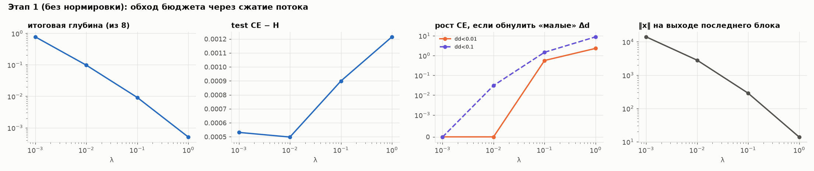

| λ | итог. глубина (из 8) | доля dd<0.01 (мин. по слоям) | test CE−H | ΔCE, обнулить dd<0.01 | ‖x‖ на выходе |
|---|---|---|---|---|---|
| 0.001 | 0.77 | 0.88 | 0.0005 | +0.0000 | 14 071 |
| 0.01 | 0.097 | 0.985 | 0.0005 | +0.0000 | 2 803 |
| 0.1 | 0.0091 | 0.993 | 0.0009 | **+0.56** | 286 |
| 1.0 | 0.0005 | 0.997 | 0.0012 | **+2.28** | 14 |

Каждый блок видит `rmsnorm(x)`, поэтому важен только масштаб поправки относительно ‖x‖. Штраф на dd не
имеет точки отсчёта масштаба. Модель ужимает весь поток (на выходе в 1000 раз) и пропорционально
уменьшает dd; относительный вклад обновлений остаётся прежним. Качество не страдает, а «экономия»
фиктивная.

**Как это ловить.** Тестом обнуления малых dd или мерой изменения относительно нормы состояния — но не
самим dd. Попутно в этом режиме логиты гейтов «умирают» (−16…−234, σ′ < 10⁻⁷).

**Исправление.** Нормированное состояние фиксирует масштаб, `min(dd,1)·tanh` ограничивает поправку,
протекающий гейт оживляет мёртвые логиты. При малых λ (≤ 0.01) пропуски и в исходной схеме были
настоящими.

## 3. Этап 2: результаты

### 3.1 Качество

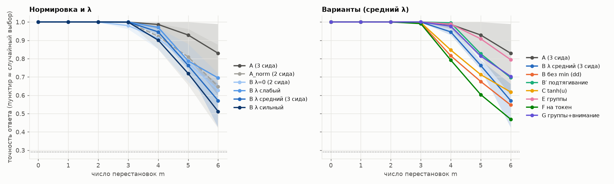

| вариант | сидов | val CE − H | точность ответа | m = 5 | m = 6 |
|---|---|---|---|---|---|
| A | 3 | 0.0052 [0.0033, 0.0080] | **96.4** [91.0, 99.8] | 92.9 | 82.9 [60, 99] |
| A_norm | 2 | 0.0085 [0.0057, 0.0112] | 91.1 [84.7, 97.6] | 80.9 | 64.8 |
| B, λ = 0 | 2 | 0.0092 [0.0075, 0.0109] | 89.9 [86.1, 93.8] | 77.7 | 62.8 |
| B, λ = 0.01 (средний) | 3 | 0.0091 [0.0086, 0.0099] | 89.7 [87.3, 91.4] | 76.3 | 57.1 [42, 66] |
| B, λ = 0.003 / 0.03 | 1 / 1 | 0.0079 / 0.0106 | 92.2 / 87.6 | 78.8 / 72.0 | 69.5 / 51.2 |
| B_dd (без min) | 1 | 0.0108 | 86.2 | 67.5 | 54.7 |
| B′ (подтягивание) | 1 | 0.0072 | 93.1 | 82.7 | 69.6 |
| C (`tanh(u)`, без прямого пути attention) | 1 | 0.0100 | 88.2 | 71.3 | 61.8 |
| **E** (8 групп = головы) | 1 | **0.0071** | **95.6** | 90.8 | 79.4 |
| F (одна глубина на токен) | 1 | 0.0124 | 83.7 | 60.4 | 46.9 |
| G (E + смещение внимания) | 1 | 0.0085 | 92.8 | 81.5 | 70.3 |

В квадратных скобках — минимум и максимум по сидам.

- **Согласование (в том числе с аттракторами и через центральное вложение) и закрытие скобок —
  99.9–100% во всех прогонах.** Эти проверки варианты не различают.
- **Разброс по сидам огромен.** Многошаговое слежение выучивается скачком между 25k и 35k шагами (см.
  `fig_curves.png`), и к 40k шагам этот скачок у одних сидов наступает, у других нет. Пилот λ = 0.001
  на сиде 0 не выучил задачу (65%), а на сиде 1 выучил (90.5%). Разницы в 2–4 п.п. между вариантами с
  одним сидом — в пределах шума.
- **Почти весь проигрыш B даёт нормировка.** A → A_norm: −5.3 п.п. в среднем. A_norm → B (λ = 0) →
  B (λ = 0.01): ещё ≈ −1 п.п., это внутри разброса.
- **Среди вариантов бюджета (по одному сиду) лучшие — E и B′, худший — F.** C (без прямого пути
  attention) не хуже B. Значит, прямой путь attention в состояние не нужен: attention доходит через FFN.

### 3.2 Как модель тратит глубину

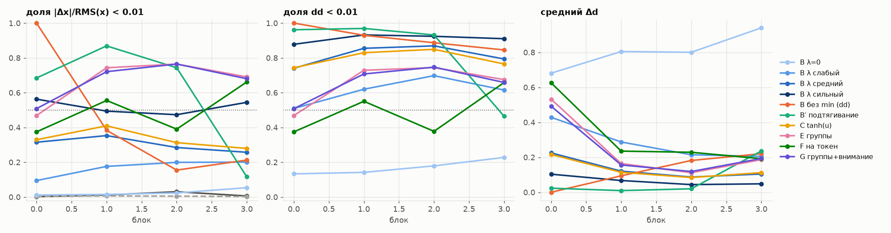
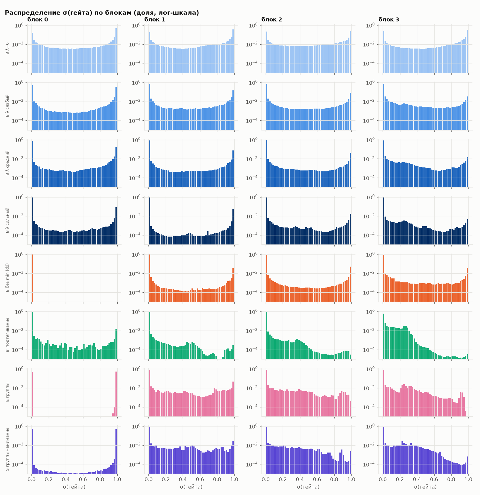

Средняя итоговая глубина (из 4) в зависимости от λ:

| λ | 0 | 0.0003 | 0.001 | 0.003 | 0.01 | 0.03 |
|---|---|---|---|---|---|---|
| итоговая глубина | 3.2 | 2.27 | 1.74–1.88 | 1.14 | 0.47–0.59 | 0.26 |

- **Распределение по слоям.** В среднем по токенам dd больше всего в блоке 0 (B средний: 0.18–0.27,
  дальше ≈ 0.1 на блок). На трудных позициях иначе: основной шаг откладывается в последний блок, где
  dd > 1 возможен благодаря накопленному бюджету. Это видно на траекториях
  (`report/fig_traj_*.png`) и в таблице dd по слоям на позиции ответа. Без ограничения min (B_dd)
  модель откладывает всё: блок 0 пропускается у 100% токенов.
- **Гейты двухвершинны при λ > 0.** У B со средним λ доля σ(гейта) < 0.05 составляет 72–91%, доля
  > 0.95 — 2–26%, середина — 2–10%. При λ = 0 распределение размазано: середина 28–45%.
- **«Замёрзшие» координаты, две меры (B средний):**
  - dd < 0.01 — 71–87% в каждом слое;
  - |Δx|/RMS(x) < 0.01 — только 24–38%.

  Расхождение целиком создаёт перенормировка на токен. Сырое обновление при dd < 0.01 меньше 1% RMS,
  но изменение RMS после обновления других координат масштабирует всех. У E и G нормировка идёт по
  группе, и обе меры совпадают: E 47–76%, G 51–76%. Обнуление всех dd < 0.01 стоит |ΔCE| ≤ 10⁻⁴ во
  всех прогонах, то есть пропуски настоящие.
- **λ = 0, что реально стоит на месте:**
  - по относительному изменению — всего 1–5% координат в слое (по dd < 0.01 — 9–25%);
  - это не фиксированный набор координат: статическая доля дисперсии маски 1–4%, ни одна координата не
    замёрзла всегда; маска зависит от слова (лексическая доля 35–57%) и от контекста (39–64%);
  - мера Жаккара: для одного и того же слова в разных предложениях замёрзшие наборы совпадают на
    0.14–0.23, для разных слов — 0.01–0.02, при случайном уровне 0.01–0.03.

  При λ > 0 картина та же, но резче. У B со средним λ лексическая доля 0.66–0.78, Жаккар для того же
  слова 0.57–0.86 при случайном уровне 0.13–0.23 (`fig_frozen_decomp.png`, таблицы).

### 3.3 Глубина и трудность вычисления: число перестановок

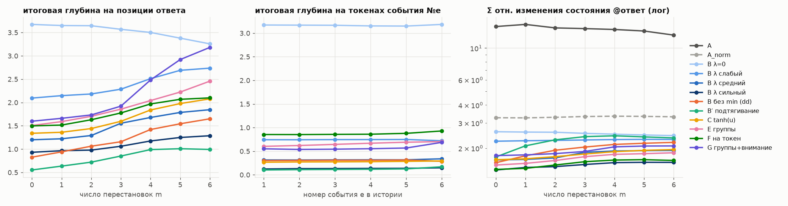

Итоговая глубина на позиции ответа (токен, после которого модель называет имя), по m = 0 … 6:

| прогон | m=0 | 1 | 2 | 3 | 4 | 5 | 6 | ρ |
|---|---|---|---|---|---|---|---|---|
| B λ=0.01, сид 0 | 1.20 | 1.22 | 1.29 | 1.55 | 1.68 | 1.79 | 1.85 | +0.88 |
| B λ=0.01, сид 1 | 1.31 | 1.41 | 1.47 | 1.61 | 1.78 | 1.97 | 2.11 | +0.85 |
| B λ=0.01, сид 2 | 1.31 | 1.33 | 1.35 | 1.51 | 1.71 | 1.95 | 2.13 | +0.87 |
| E | 1.51 | 1.59 | 1.70 | 1.86 | 2.04 | 2.22 | 2.46 | +0.82 |
| G | 1.60 | 1.66 | 1.73 | 1.92 | 2.48 | 2.92 | 3.18 | +0.88 |
| B λ=0 (сид 0 / 1) | 3.67 / 3.49 | | | | | | 3.26 / 3.10 | −0.69 / −0.71 |

- **Рост с m есть у всех вариантов с λ > 0, которые выучили задачу:** B с λ = 0.003, 0.01, 0.03,
  B_dd, B′, C, E, F, G, а также пилот λ = 0.001 на сиде 1. Регрессия глубины на m с контролем числа
  имён и позиции даёт β ≈ 0.41–0.44 ст. откл. на одну перестановку (t > 200), позиция почти ничего не
  объясняет.
- **Рост приходится на поздние блоки.** У B со средним λ блок 2 растёт с 0.06 до 0.31, блок 3 — с 0.84
  до 1.17.
- **При одинаковом m ошибочные ответы получают больше глубины, чем верные** (например, 1.90 против
  1.66). Глубина следует за трудностью и неуверенностью, а не за успехом.
- **Без штрафа (λ = 0), а также в прогоне, не выучившем задачу, глубина с m падает.** Зависимость от
  трудности появляется, только когда глубина стоит денег.
- **Токены событий получают мало глубины, и она почти не растёт с номером события.** У B со средним λ
  0.24–0.37 против 1.2–2.1 на позиции ответа; у E и G небольшой рост (0.55–0.60 → 0.69–0.70). Модель
  не ведёт состояние перестановок инкрементально, а вычисляет ответ «лениво», в момент вопроса.
- **У A аналог глубины — суммарное относительное изменение на позиции ответа — с m не растёт**
  (14.1 → 12.3).

### 3.4 Связь со структурой предложения

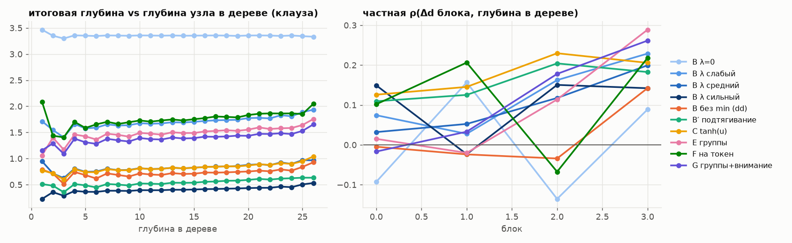

Анализ по токенам клаузы (~0.5 млн токенов). Частная ранговая корреляция итоговой глубины с глубиной
узла в дереве при контроле класса слова, позиции, pos² и log pos; 95% бутстрап-ДИ по предложениям:

| прогон | частная ρ (дерево) | частная ρ (вложенность) | внутри предложения |
|---|---|---|---|
| B λ = 0.01, 3 сида | 0.18 / 0.25 / 0.16 (ДИ ±0.004) | 0.15–0.25 | 0.20–0.29 |
| остальные с λ > 0 | 0.12 (B_dd) … 0.28 (F) | 0.11–0.28 | 0.13–0.31 |
| B λ = 0 | +0.16 / −0.02 | +0.13 / −0.06 | +0.17 / +0.01 |

- **Сильнее всего глубину предсказывает число закрывающихся на токене составляющих:** в регрессии с
  контролем класса, позиции и глубины в дереве t от +60 до +165 (ошибки кластеризованы по
  предложениям). Число открывающихся тоже вносит вклад, но меньше (обычно t ≈ +15…+68; у B_dd ≈ 0).
- **Главные слова глубже неглавных** (B средний: 0.85 против 0.61). Существительные глубже
  прилагательных (0.94 против 0.59).
- **Глубина растёт с глубиной узла в дереве монотонно,** но эффект умеренный: ρ ≈ 0.2.
- **При λ = 0 связь неустойчива:** на двух сидах +0.16 и −0.02.

### 3.5 Устройство потока

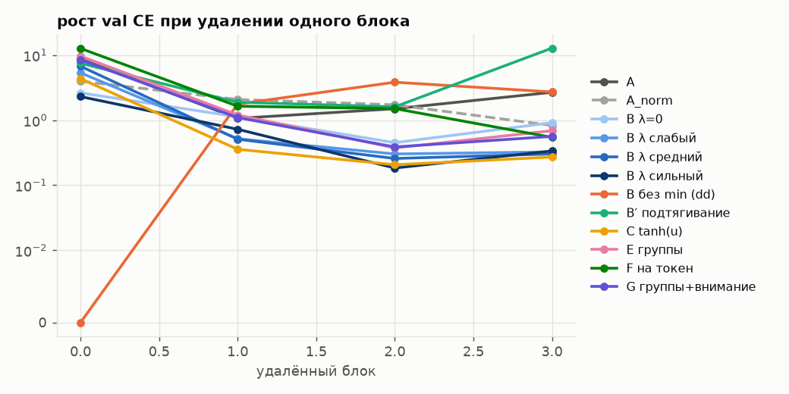

| | A | A_norm | B (средний λ) | E |
|---|---|---|---|---|
| рост CE при удалении блока 0 / 1 / 2 / 3 | 8.5–13 / 0.3–1.1 / 0.7–1.5 / **2.6–2.8** | 3.3–4.0 / 1.4–2.1 / 1.3–1.7 / 0.8–1.1 | 4.1–6.7 / 0.45–0.51 / 0.26–0.32 / **0.25–0.38** | 9.6 / 1.2 / 0.37 / 0.69 |
| эксцесс по координате (в осях / после поворота) | 11.7–13.0 / 5.9–8.4 | 2.6–2.8 / 2.7–2.8 | 4.9–5.5 / 2.8–2.9 | 2.9 / 2.8 |
| разреженность Хойера (в осях / после поворота) | 0.63–0.65 / 0.22 | 0.23–0.24 / 0.22 | 0.32–0.34 / 0.22 | 0.24 / 0.22 |
| ‖x‖ на выходе | 213–291 | 11.3 (фикс.) | 11.3 | 11.3 |

- **Норма потока.** У A она растёт до 213–291. В вариантах с нормировкой фиксирована по построению.
- **Проклятие глубины.** У A удаление последнего блока стоит 2.6–2.8 нат. У B поздние блоки по
  отдельности почти не нужны (0.25–0.5 нат) — это прямое следствие разреженных обновлений.
- **Привязка к осям.** Относительно правильного контроля A_norm бюджет делает признаки заметно более
  привязанными к осям (эксцесс по координате 5 против 2.7) и разреженными; после случайного поворота
  разница исчезает. У A высокие значения другого происхождения: выбросы ненормированного потока.

### 3.6 Группы (E, G) и зонды «какой это токен»

Точность линейного зонда «какой это токен» по 16 координатам финального состояния:

- **B (средний λ), бины координат по их средней глубине:** самые неглубокие (глубина 0.04–0.11) —
  90–95%, самые глубокие (1.44–1.50) — 62–66%. Весь вектор — 99.3%. Для сравнения: группы A ≈ 50%,
  группы A_norm ≈ 67%.
- **E:** неглубокие группы (0.48–0.71) — 86–91%, глубокие (1.19–1.53) — 73–78%.
- **G:** группа с глубиной 0.18 — 93%, с глубиной 1.60 — 73%.
- **Специализация групп в E.** Вступление (имена) использует группы 5–7, клауза — 0, 3, 5–7, история —
  1, 3, 5.
- **Наклоны в G.** В блоке 0 они остаются нулевыми: на входе блока 0 глубина у всех нулевая, градиента
  нет. В блоках 1–3 они в основном положительные, до 0.95, то есть головы предпочитают неглубокие
  ключи; одна голова — −0.85.
- **F (одна глубина на токен) полностью не вырождается:** целиком пропускаются 37–66% пар
  «токен × блок». Но это худший вариант по качеству.

Вывод: «поверхностные» координаты и группы держат лексическую идентичность, «глубокие» — контекстную
информацию. Бюджет даёт встроенное разделение «поверхность / глубина».

## 4. Критерии успеха

**1) Качество не хуже A при том же обучении — в среднем нет.** B со средним λ (3 сида): точность ответа
89.7% и CE − H = 0.0091 против 96.4% и 0.0052 у A (3 сида). Но почти весь проигрыш вносит нормировка
состояния (A_norm: 91.1%, 0.0085), а не бюджет. Варианты E (95.6%, 0.0071), B′ (93.1%, 0.0072) и
B с λ = 0.003 (92.2%, 0.0079) попадают в разброс сидов A (91.0–99.8%, 0.0033–0.0080), но у них по одному
сиду, а разброс огромен. Согласование и закрытие — 100% у всех.

**2) В каждом слое больше половины координат/групп с Δd ≈ 0:**
- **по dd < 0.01 — да** для B при λ ≥ 0.003 (51–93%), C (74–85%), B_dd (85–100%) и G (51–75%).
  Почти да для E (47% в блоке 0, 67–74% дальше) и B′ (93–97%, но 46% в последнем блоке). Нет для
  λ ≤ 0.001, λ = 0 и F;
- **по относительному изменению |Δx|/RMS < 0.01 — только у G** (51–76%). У E 47–76%, у B со средним
  λ 24–38%. Для вариантов с глубиной на каждую координату dd и фактическое изменение расходятся из-за
  нормировки на токен. Нормировка по группам (E, G) это расхождение убирает;
- **пропуски настоящие:** обнуление всех dd < 0.01 стоит |ΔCE| ≤ 10⁻⁴.

**3) Глубина значимо связана со структурой предложения — да,** во всех вариантах с λ > 0. Частная
ρ = 0.12–0.28, ДИ шириной ±0.004 далеко от нуля, внутри предложения — так же. Значимо связаны закрытие
составляющих (t до +165), главное слово и глубина в дереве. Эффект умеренный. При λ = 0 связь
неустойчива. Самая сильная связь с «вычислительной» структурой: глубина на позиции ответа следует за
числом перестановок (ρ ≈ 0.85).

## 5. Что выглядит перспективным

**Для ускорения — осторожно.**
- **В текущем виде вычислений не экономится.** dd считается из скрытого слоя FFN h, то есть после
  attention и up-проекции FFN. Чтобы узнать, что координату можно пропустить, блок уже надо посчитать.
  Пропускается только запись в состояние.
- **Для реальной экономии гейт нужно предсказывать до блока,** например из rmsnorm(x) и depth. Модель
  явно умеет решать заранее: позиции событий, где почти ничего не происходит, отличаются от позиции
  вопроса.
- **Ближе всего к железу — группы = головы (E/G) и пропуск целого токена (F).** У E/G 47–76% пар
  «группа × токен» стоят на месте при качестве не хуже B. У F 37–66% пар «токен × блок» пропускаются
  целиком, но качество проседает до 83.7%.
- **Поздние блоки в B по отдельности почти не нужны** (0.25–0.5 нат при удалении против 2.6 у A), что
  делает варианты с бюджетом более подходящими для выбрасывания слоёв.

**Для понимания модели — более перспективно.**
- **Глубина работает как встроенный индикатор того, где модель «думает».** Она растёт с числом шагов
  композиции и с неуверенностью, сосредоточена на позиции вопроса, а не на событиях («ленивое»
  вычисление), и связана с закрытием составляющих.
- **Неглубокие координаты сохраняют идентичность токена, глубокие несут контекст.**
- **Набор координат, которые «трогает» слово, специфичен для слова,** а не общий для всех токенов.

**Ограничения и что дальше.**
- **Мало сидов при огромном разбросе на задаче слежения.** Для утверждений о качестве нужно 5+ сидов
  или более длинное обучение, после которого задача стабильно выучивается.
- **Маленькая модель (4 блока)** — проверить на 8+ блоках.
- **Гейт до блока** — главный шаг к реальной экономии.
- **Нормировка на токен связывает координаты.** Нормировка по группам (E/G) делает «dd = 0» и
  «состояние не изменилось» одним и тем же. По этой причине, а также по качеству, E/G выглядят лучшей
  основой для следующей итерации.

## 6. Раунд 3: несколько вопросов на предложение, бюджет на всю сеть, штраф за реальное изменение

Таблицы: [`report/r3_tables.md`](report/r3_tables.md). Рисунки: `report/r3_curves.png`,
`report/r3_answer_depth_auroc.png`, `report/r3_standing.png`. Проверка хвостов — `runs5/*/tails.json`,
наклоны G — `runs5/G_s*/slopes.json`.

### 6.0 Кратко

1. **Главный проигрыш в качестве даёт нормировка состояния, а не бюджет.** Скачок на задаче слежения
   (точность при m ≥ 4 выше 80%) у A случился в 3 сидах из 3. У A_norm и A_groupnorm — в 1 из 3.
   Бюджет поверх нормировки по группам не ухудшает: E — 2 из 3, G — 3 из 3.
2. **Лучший по качеству вариант с бюджетом — I** (без нормировки, штраф за относительное изменение):
   99.6% ответов, скачок в 2 сидах из 2. **Но в I есть обход:** модель раздувает хвосты координат, и
   штраф недооценивает реальные изменения в 6–8 раз (раздел 6.3). Само замерзание координат в I при этом
   настоящее: их обнуление ничего не стоит.
3. **H (общий бюджет на всю сеть с нормировкой) не выучил задачу ни в одном сиде:** при m ≥ 4 — уровень
   угадывания (29–34%).
4. **Глубина на позиции ответа следует за числом перестановок у всех нормированных вариантов,** даже у H,
   который задачу не решает. Внутри одного m больше глубины тратится на ответах, которые окажутся неверными:
   AUROC 0.72–0.86 для E/G при m = 4–6.
5. **Решение «группа стоит» можно принять до FFN, по одному лишь токену,** и это ничего не стоит. В E/G/H
   пропуск групп по таблице «токен → средний гейт» не меняет ни точность, ни CE и находит 80–83% стоящих
   групп. Само значение гейта для движущихся групп так не предсказать.
6. **Внимание с учётом глубины в G используется слабо:** обнуление наклонов стоит 0.05–0.4 п.п. точности.

### 6.1 Постановка

- **Язык v5:** то же слежение за перестановками (3 или 4 имени, m = 0…6), но вопрос задаётся после 1-й,
  3-й и последней перестановки. В одном предложении до трёх ответов с разной трудностью; для каждого
  сохраняются m и позиция ответа.
- **Модель:** d = 128, 4 блока, 8 голов, группы = головы (8 × 16 координат). 80k шагов, батч 64,
  lr 2·10⁻³.
- **Сиды:** 3 для A, A_norm, A_groupnorm, E, G; 2 для H, I, J. Скачок у A случился к 54k шагов во всех
  сидах, поэтому обучение не продлевалось.
- **λ:** 0.01 для E/G/H (как в этапе 2). Для I и J λ = 0.03, подобранное на пилотах так, чтобы доля
  стоящих была как у H (0.56 против 0.58 на 20k шагах). Шум в J — 0.02·s_i.

| вариант | что это |
|---|---|
| A | обычный трансформер |
| A_norm / A_groupnorm | A с нормировкой состояния после каждого блока: на токен / по группам |
| E | бюджет по слоям (depth ≤ l+1), гейт и нормировка по группам |
| G | E + смещение внимания: scores += slope_h·(depth_q − depth_k) |
| H | как E, но бюджет общий на всю сеть (depth ≤ 4) |
| I | общий бюджет, **без нормировки**; штраф λ·Σ_l mean_i \|Δx_i\|/s_i, s_i — EMA RMS координаты |
| J | I + шум в состоянии при обучении |

### 6.2 Качество

| вариант | сидов | CE−H | ответ, % | m = 6, % | шаг скачка |
|---|---|---|---|---|---|
| A | 3 | 0.0029 | 100.0 [99.9, 100.0] | 99.5 [99.4, 99.7] | 22k, 54k, 54k |
| A_norm | 3 | 0.0083 | 95.4 [92.9, 99.4] | 51.5 [31.5, 90.6] | 36k, нет, нет |
| A_groupnorm | 3 | 0.0116 | 91.6 [87.5, 98.9] | 50.2 [31.6, 86.3] | нет, 66k, нет |
| E | 3 | 0.0090 | 95.3 [89.7, 99.0] | 62.6 [31.5, 85.6] | 48k, нет, 66k |
| G | 3 | 0.0072 | 97.9 [97.3, 98.6] | 76.2 [69.6, 84.7] | 56k, 72k, 36k |
| H | 2 | 0.0155 | 86.4 [86.1, 86.7] | 29.1 [28.6, 29.5] | нет, нет |
| I | 2 | 0.0054 | 99.6 [99.2, 99.9] | 95.6 [92.3, 99.0] | 30k, 50k |
| J | 2 | 0.0076 | 96.7 [93.4, 100.0] | 73.0 [46.4, 99.6] | нет, 28k |

При m ≤ 3 все варианты отвечают на 99.8–100%. Разница только при m ≥ 4, и почти целиком определяется тем,
случился ли за 80k шагов скачок (`report/r3_curves.png`).

- **Цена нормировки** (A → A_norm / A_groupnorm): скачок в 1 сиде из 3 вместо 3 из 3, CE−H вырастает в
  3–4 раза. Нормировка на токен и по группам ведут себя одинаково плохо.
- **Цена бюджета** (A_groupnorm → E/G): по средним бюджет даже лучше нормированной основы (G — 97.9% против
  91.6%, скачок в 3 сидах из 3). При 3 сидах и таком разбросе это «не хуже», а не «лучше».
- **H:** при m ≥ 4 оба сида на уровне угадывания (для 3–4 имён это ≈ 0.29). λ для H не подбиралось
  отдельно. H тратит мало глубины (итоговая 0.49) и, видимо, просто не набирает вычислений на трудную часть.
- **I и J без нормировки** восстанавливают качество: I — 2 скачка из 2, J — 1 из 2. J_s1 вообще лучший
  отдельный прогон вне A (99.96%).

### 6.3 Проверки на обходы

**Нормированные варианты (E/G/H) чистые.**
- Норма состояния ровно √128 = 11.3 во всех слоях.
- Две меры «стоит» совпадают: dd < 0.01 и |Δx|/RMS группы < 0.01. Доля пар «dd < 0.01, но изменение ≥ 1%»
  — 0.00.
- Обнуление всех стоящих групп меняет CE меньше чем на 10⁻⁴.
- Отдельные координаты чуть «острее», чем у A_groupnorm: max|x_i| / медиана на токене 5.6–8.9 против
  3.1–4.6. Но масштаб зафиксирован, и обхода через масштаб нет.

**I и J: обход через тяжёлые хвосты.** Штраф делит изменение на s_i — RMS координаты по всем токенам. RMS
определяется редкими большими значениями. Если раздуть хвост (у немногих токенов координата огромная), s_i
растёт, и изменение у типичного токена стоит дёшево. Проверка на полных прогонах (среднее по блокам 1–3;
блок 0 — это вход, то есть эмбеддинги):

| | RMS / медиана \|x_i\| (гаусс ≈ 1.25) | доля \|x_i\| > 3·медианы (гаусс ≈ 0.03) | штраф / реальное относительное изменение |
|---|---|---|---|
| A_norm (s0, s1) | 1.2–1.4 | 1–5% | 0.93–0.96 |
| H (s0, s1) | 1.4–1.6 | 6–10% | 0.98–1.10 |
| A (s0, s1) | 1.6–1.8 | 7–9% | 0.33–0.72 |
| **I (s0 / s1)** | **4.0 / 6.0** | **23%** | **0.12–0.16** (блок 1 у s1, где почти всё стоит: 0.67) |
| **J (s0 / s1)** | **5.3 / 4.8** | **23%** | 0.11–0.28 |

- **Хвосты у I в 2.3–3.5 раза тяжелее, чем у A, и на пилотах растут с λ.** На 20k шагах: 3.1 при λ = 0.01,
  6.3 при 0.03, 6.6 при 0.1. По критерию из задания это обход.
- **Хвост одинаков во всех блоках, начиная с эмбеддингов.** Модель делает это через таблицу эмбеддингов:
  обновления ограничены (|Δx_i| ≤ 1), а сам поток крошечный (‖x‖ ≈ 0.2–0.3) с выбросами до 100–135
  медиан.
- **Мера «стоит» по RMS группы в I обманывает.** RMS группы определяется одной большой координатой, и
  изменения остальных координат группы кажутся малыми. Обнуление «стоящих» по этой мере стоит
  +0.011 нат/токен в I и J, против 0.0000 в E/G/H.
- **Замерзание по собственному значению координаты в I настоящее.** Мера |Δx_i| / (|x_i| + 0.1·s_i) < 0.01:
  стоят 30–45 / 97 / 88–94 / 71–82% координат по блокам. Обнуление этих изменений даёт ΔCE = 0.0 и не
  меняет точность (99.88 → 99.88%, 99.22 → 99.23%). Модель действительно оставляет большинство координат
  в покое. Обход затрагивает цену изменений, а не сам факт замерзания.
- **Предложение (следующий раунд): I′ — s_i = скользящая медиана |x_i| с тем же нижним пределом.** Медиану
  редкие выбросы почти не двигают, и раздувание хвоста перестанет удешевлять изменения.

### 6.4 Глубина и трудность; глубина как предсказатель ошибки

| вариант | итоговая глубина на ответе: m = 0 → 3 → 4 → 6 | AUROC «глубина → ошибка» внутри m = 4 / 5 / 6 |
|---|---|---|
| E | 1.34 → 1.65 → 2.49 → 2.97 | 0.85 / 0.75 / 0.72 |
| G | 1.39 → 1.64 → 2.81 → 3.49 | 0.72 / 0.86 / 0.76 |
| H | 1.21 → 1.43 → 2.84 → 2.92 | 0.56 / 0.54 / 0.52 |
| I (сумма отн. изменений) | 2.62 → 3.05 → 3.21 → 3.38 | 0.53 / 0.43 / 0.36 |
| J (итоговая глубина) | 2.83 → 2.92 → 2.96 → 3.01 | 0.79 / 0.84 / 0.68 |

- **У нормированных вариантов глубина на ответе растёт с m, с резким шагом между m = 3 и m = 4,** где и
  начинаются ошибки. Шаг есть и у H, который при m ≥ 4 отвечает наугад. Значит, глубина реагирует на
  трудность входа (сколько перестановок надо учесть), а не на то, получилось ли решить.
- **В I итоговая глубина почти не зависит от m (2.2–2.3),** потому что dd в I бесплатен: модель тратит
  ~2 единицы бюджета сразу в блоке 0. Платная величина — сумма относительных изменений — растёт с m.
- **AUROC по всем вопросам 0.95–0.98, но он завышен:** ошибки сосредоточены на больших m, где глубина и так
  больше. Честная оценка — внутри одного m.
  - У E/G/J, выучивших задачу, AUROC 0.68–0.86: на неверных ответах тратится заметно больше глубины.
  - У H около 0.5 (ошибки — угадывание).
  - У I 0.36–0.53.
  - У A ошибок слишком мало (≤ 18 на значение m), AUROC не оценивается.

### 6.5 Адаптивные вычисления (H–J) и оценка экономии

- **Ни одна группа ни в одном варианте с общим бюджетом не исчерпала бюджет** (0.00 во всех блоках).
  Ранние остановки — это выбор модели, а не упор в предел.
  - В H 63% пар «токен × группа» не меняются вообще.
  - В I/J 46–47% последний раз меняются в блоке 0, ещё 36–40% — в блоке 3.
- **Номер последнего блока, где на позиции ответа что-то меняется, растёт с m у E/G/H**
  (E: 2.18 → 2.71; G: 2.39 → 2.95; H: 2.24 → 2.46). У I он падает (1.62 → 1.38), у J постоянен (≈ 2.25).
- **Доля стоящих троек «токен × блок × группа»:** E 73%, G 74%, H 77%; I/J 64–65% (по мере, которая в I/J
  завышена, см. 6.3).
- **Оценка экономии FLOPs:** E/G/H — 73–77% FFN, 40–42% внимания, 61–64% блока; I/J — 54–55% блока. Это
  оценка для гипотетического блока, разбитого по группам: группа = голова, FFN порезан на 8 независимых
  частей. В текущей архитектуре FFN общий, и пропуск одной группы сэкономил бы только её часть
  down-проекции.

### 6.6 Можно ли решить «стоит / двигается» до FFN

Гейт в E/G/H/I/J вычисляется из скрытого слоя FFN, то есть после того, как блок уже посчитан. Проверялись
два предсказателя, работающих до FFN:
- **таблица** «токен → средний гейт», собранная на обучающих данных;
- **линейная голова** на входе FFN: rmsnorm(x + a) + depth_emb.

И два способа подстановки:
- **пропуск:** группы, предсказанные стоящими, получают гейт 0 и не считаются, остальные — настоящий гейт;
- **полная замена** гейта предсказанием.

| вариант | точность: таблица / голова | найдено стоящих: таблица / голова | ответ: настоящие гейты → пропуск по таблице / голове | ΔCE пропуска: таблица / голова | полная замена: таблица / голова |
|---|---|---|---|---|---|
| E | 86% / 92% | 81% / 89% | 95.4 → 95.4 / 95.3 | +0.0001 / +0.0004 | 0.0 / 86.3 |
| G | 85% / 91% | 80% / 88% | 97.7 → 97.8 / 97.8 | 0.0000 / 0.0000 | 0.0 / 76.0 |
| H | 87% / 91% | 83% / 89% | 86.6 → 86.6 / 86.6 | 0.0000 / 0.0000 | 0.0 / 55.3 |
| I | 95% / 98% | 81% / 85% | 99.5 → 47.2 / 96.8 | +0.113 / +0.008 | 36.0 / 97.0 |
| J | 92% / 99% | 78% / 86% | 96.7 → 78.0 / 96.2 | +0.048 / +0.001 | 2.3 / 94.8 |

- **В E/G/H решение «стоит» почти целиком определяется самим токеном.** Пропуск по таблице находит 80–83%
  стоящих групп и не стоит ничего, по голове — 88–89%. Это сильный довод в пользу гейта до блока.
- **Величину гейта для движущихся групп так не предсказать:** полная замена по таблице ломает модель
  полностью.
- **В I и J пропуск по таблице ломает ответ** (47% и 78%). Видимо, промахи таблицы приходятся на редкие,
  но нужные изменения. Голова справляется ценой 0.5–3 п.п.

### 6.7 Представления

- **Зонд «какой это токен»:** у E/G/H четыре наименее глубокие группы угадывают токен на 92–94%, четыре
  самые глубокие — на 75–77%. Разделение «неглубокие хранят идентичность, глубокие — контекст» из этапа 2
  держится. У I/J разделение слабее или отсутствует: 93/85% и 87/89%.
- **Совпадение наборов стоящих групп в блоке 1** (Жаккар): у E/G/H 0.89–0.96 для одного слова в разных
  контекстах, 0.71–0.75 для разных слов, 0.59–0.66 для случайных пар. Набор во многом специфичен для
  слова. У I/J 0.88–0.98 для всех пар: стоят почти одни и те же координаты при любом токене.

### 6.8 G: наклоны смещения внимания по глубине

Смещение: scores += slope_h·(depth_q − depth_k). При slope > 0 голова предпочитает менее глубокие ключи.
- **В блоке 0 наклоны тождественно 0:** на входе блока 0 глубина у всех токенов одна, и градиента нет.
- **В блоках 1–3 большинство |slope| < 0.5.** В каждом сиде 1–2 головы с |slope| 1.6–2.2:
  - G_s0 — блок 1, голова 2: +2.15;
  - G_s1 — блок 1, голова 4: +1.73, блок 3, голова 0: +1.64;
  - G_s2 — блок 3, голова 6: +1.96.
- **Обнуление всех наклонов:**

| сид | ответ, % | m = 6, % | val CE |
|---|---|---|---|
| G_s0 | 97.56 → 97.38 | 74.9 → 74.0 | 1.8313 → 1.8319 |
| G_s1 | 97.11 → 97.06 | 66.4 → 65.9 | 1.8320 → 1.8350 |
| G_s2 | 98.64 → 98.25 | 84.8 → 82.6 | 1.8308 → 1.8314 |

Смещение используется, но немного даёт. Преимущество G над E (3 скачка из 3 против 2 из 3) при таком
разбросе сидов нельзя уверенно приписать смещению.

### 6.9 Итог раунда 3 и следующий шаг

- **Честный кандидат — G.**
  - Стоят 74% групп, и обнуление стоящих ничего не стоит.
  - Решение «стоит» предсказуемо до FFN по токену, без потерь.
  - Глубина растёт с трудностью и предсказывает ошибку внутри m.
  - Минус — качество: при m = 6 76% против 99.5% у A. Проигрыш дают нормировка и разброс скачка, а не
    бюджет.
- **Кандидат по качеству — I′:** вариант без нормировки, где масштаб для штрафа нельзя раздуть
  (скользящая медиана |x_i|). I уже показал, что без нормировки качество почти как у A, а координаты
  действительно замерзают.
- **K** (сдвиг группы по жёсткому гейту, решение до FFN, цель доли сдвигов через μ) — раздел 7.

## 7. Вариант K: платим за событие «группа сдвинулась»

Таблицы: [`report/k_tables.md`](report/k_tables.md). Рисунки: `report/k_curves.png` (обучение, μ, доля
сдвигов), `report/k_shifts.png` (сдвиги по блокам, сдвиги на позиции ответа, норма градиента).
Дополнительные замеры — `report/k_extra.json`. Сравнение с A, E, G — прогоны раунда 3, не перезапускались.

### 7.0 Кратко

1. **Механика работает точно, как задумано.**
   - Несдвинутые группы не меняются вовсе: max |Δx| = 0.
   - Гейты практически двоичные: при обучении дробных значений 0.06–0.7%.
   - Обучение с сэмплированием и оценка с жёстким порогом расходятся не больше чем на 0.1 п.п. точности и
     10⁻⁴ нат CE. Это верно для всех пяти вариантов, включая K25-free и K25-norm.
   - Доля сдвигов держится ровно на цели: 0.248–0.251 у K25.
2. **По качеству K хуже E и G при той же доле стоящих.**
   - K25: 90.5% ответов, при m = 6 — 42%. Для сравнения, у G 97.9% и 76% при 74% стоящих групп.
   - Ни один сид K25 не дал скачка за 80k шагов. Лучший из K — K50: 93.3%, скачок в одном сиде из двух.
   - Часть прогонов к 80k ещё растёт (точность при m ≥ 4: K25_s0 — 0.76, K25-norm_s0 — 0.79), то есть K
     учится медленнее.
3. **Вероятная причина отставания: расстановка сдвигов замерзает в конце разгона цели (16k шагов).**
   - После разгона доли по блокам меняются не больше чем на 0.02–0.055.
   - μ падает с 0.5–1.8 до ~0.01.
   - CE-градиент в гейт проходит только через дробные сэмплы (≤ 0.7%). Сигнал редкий и шумный, а
     относительный градиент головы гейта в 2–9 раз меньше, чем у FFN.
   - Скачок в задаче у других вариантов происходит позже (36–72k). Расстановка выбирается до того, как
     модель научилась следить за перестановками.
4. **Глубина почти не следует за трудностью.** Число сдвинутых групп на позиции ответа от m почти не
   зависит: у K25_s0 ровно 12 из 32 при любом m. У E/G итоговая глубина на ответе от m = 0 до m = 6
   вырастает более чем вдвое.
5. **Убрать tanh под нормировкой (K25-norm)** — качество как у K25 (91.6% против 90.5%), но это
   единственный вариант с всплесками градиента. Убрать ещё и нормировку (K25-free) — всплесков нет, но
   поток раздувается в сотни раз, и качество худшее (78.0%). Подробнее в 7.6.
6. **Экономия реальная, решение принимается до FFN.**
   - У K25 75% троек «токен × блок × группа» без сдвига.
   - В текущей архитектуре с общим FFN блок FFN целиком пропускается для 20–50% пар «токен × блок».
   - Часть экономии статична: у K25 38–50% групп в блоках 0–1 не сдвигаются никогда.

### 7.1 Постановка

```
a    = Attn(rmsnorm(x) + Dtab_a[depth])          # Dtab — таблица по целым уровням глубины, лин. интерполяция
y    = x + a
zin  = rmsnorm(y) + Dtab_f[depth]
z_g  = gate_head(zin)                            # одно число на группу (8 групп = головы), bias = 2.0
обучение: m_g = clamp(σ((log u − log(1−u) + z_g)/β)·(ζ−γ) + γ, 0, 1),   β = 2/3, γ = −0.1, ζ = 1.1
оценка:   m_g = 1[σ(z_g)·(ζ−γ) + γ > 0.5]        # жёсткий порог
u    = FFN(zin)
x_g  = groupnorm(x_g + m_g·tanh(a_g + u_g)),  если m_g > 0;  иначе x_g без изменений (бит в бит)
depth_g += m_g                                   # при оценке — число сдвигов
cost = μ · доля,  доля = mean P(m_g > 0) = σ(z_g − β·log(−γ/ζ))
μ ← max(0, μ + 0.05·(доля − цель))  каждый шаг;  цель: 1.0 → итоговая линейно за первые 20% (16k шагов)
```
- Смещение внимания по глубине из G включено.
- **K25L** — свой μ на каждый блок, цель для доли в каждом блоке.
- **K25-free** — `x_g + m_g·(a_g + u_g)` без tanh и без нормировки.
- **K25-norm** — `groupnorm(x_g + m_g·(a_g + u_g))`, без tanh.
- Всё по 2 сида, 80k шагов, как в раунде 3.

### 7.2 Качество

| вариант | сидов | CE−H | ответ, % | m = 0…3 | m = 4 | m = 5 | m = 6 | шаг скачка |
|---|---|---|---|---|---|---|---|---|
| A | 3 | 0.0029 | 100.0 [99.9, 100.0] | 100.0 | 100.0 | 99.9 | 99.5 [99.4, 99.7] | 22k, 54k, 54k |
| E | 3 | 0.0090 | 95.3 [89.7, 99.0] | 100.0 | 93.2 | 73.6 | 62.6 [31.5, 85.6] | 48k, нет, 66k |
| G | 3 | 0.0072 | 97.9 [97.3, 98.6] | 100.0 | 99.7 | 92.3 | 76.2 [69.6, 84.7] | 56k, 72k, 36k |
| K25 | 2 | 0.0127 | 90.5 [86.0, 95.0] | 99.9 | 60.2 | 55.2 | 42.3 [28.2, 56.3] | нет, нет |
| K50 | 2 | 0.0103 | 93.3 [87.3, 99.3] | 99.9 | 71.9 | 68.3 | 59.9 [29.2, 90.5] | 46k, нет |
| K25L | 2 | 0.0157 | 86.3 [86.2, 86.3] | 99.9 | 33.6 | 30.7 | 29.3 [29.2, 29.4] | нет, нет |
| K25-free | 2 | 0.0204 | 78.0 [65.8, 90.2] | 87.7 [75.5, 99.9] | 50.4 | 39.0 | 32.9 [30.3, 35.4] | нет, нет |
| K25-norm | 2 | 0.0113 | 91.6 [87.7, 95.5] | 99.3 | 77.7 | 56.3 | 47.5 [29.6, 65.3] | нет, нет |

- **K25 при 75% несдвинутых групп** заметно хуже G (74% стоящих) и E.
- **K50 лучше K25,** вдвое больше сдвигов помогает.
- **K25L хуже всех нормированных:** оба сида при m ≥ 4 на уровне угадывания. Причина в 7.5: K25L не может
  сосредоточить сдвиги в последнем блоке.
- **K25-free_s0 проваливает даже лёгкие вопросы** (75.5% при m ≤ 3).

### 7.3 Проверки

- **Обучение с сэмплированием и жёсткий порог дают одно и то же.**
  - Доля сдвигов совпадает до 0.006.
  - Точность ответа отличается не больше чем на 0.08 п.п., CE — не больше чем на 10⁻⁴.
  - Дробных гейтов при сэмплировании ≤ 0.7% в K25/K50/K25L и ≤ 1.2% в K25-free/K25-norm.
  - Гейты насыщаются, и разрыва между обучением и развёртыванием нет ни в одном варианте.
- **Несдвинутые группы не меняются бит в бит** (max |Δx| = 0 во всех прогонах). Сдвиг — это всегда большое
  изменение: медиана |Δx|/RMS группы 0.80–0.83 (p10 ≈ 0.6) у K/K50/K25L, 1.3 у K25-norm. Сдвигов с
  изменением меньше 10% нет. Подделать сдвиг маленьким изменением модель не пытается, да и выгоды в этом
  нет: платится сам факт сдвига.
- **Нормы.** У нормированных вариантов ‖x‖ = 11.3. Max|x_i|/медиана: 5–9 у K/K50/K25L, 21–32 у K25-norm
  (без tanh координаты острее). У K25-free поток растёт к выходу до 294–371, а max|x_i|/медиана доходит
  до 1400–2000.
- **Группы, которые сдвигаются всегда (> 99% токенов),** почти отсутствуют: одна группа в блоке 0 у
  K25-free и одна в блоке 3 у K25-norm_s0.
- **Группы, которые не сдвигаются никогда (< 1% токенов), встречаются часто:**
  - K25 — 38–50% групп в блоках 0–1;
  - K25-norm — до 75% в блоке;
  - K25-free — 62–75% в блоках 1–2 у s0;
  - K50 — ни одной.
  
  Это статическое отсечение, а не адаптивное решение.

### 7.4 Почему K отстаёт: расстановка сдвигов замерзает после разгона цели

| вариант | μ: макс / в конце разгона / среднее после 20k | дрейф доли сдвигов по блокам после 20k | дробных гейтов при обучении | ‖∇‖/‖W‖: голова гейта / FFN (w1) |
|---|---|---|---|---|
| K25 | 1.75–1.79 / 0.44–1.69 / 0.010 | ≤ 0.025 | 0.06–0.25% | 1.1–1.8·10⁻⁴ / 0.9–1.0·10⁻³ |
| K50 | 0.51–0.84 / 0.07–0.49 / 0.011–0.025 | ≤ 0.034 | 0.07–0.15% | 1.2·10⁻⁴ / 0.6–0.7·10⁻³ |
| K25L | 1.13–1.75 / 1.09–1.50 / 0.005–0.030 | ≤ 0.055 | 0.11–0.23% | 1.1–1.4·10⁻⁴ / 0.5–0.7·10⁻³ |
| K25-free | 0.20–0.33 / 0.18–0.30 / 0.002 | ≤ 0.041 | 0.5–0.7% | 3.5·10⁻⁴ / 0.6–1.1·10⁻³ |
| K25-norm | 0.18–0.55 / 0.18–0.52 / 0.006–0.007 | ≤ 0.043 | 0.3–0.35% | 2.4–3.4·10⁻⁴ / 1.6–1.7·10⁻³ |

- **Пока цель снижается, μ сильно колеблется** и доходит до 1.8 (`report/k_curves.png`).
- **Через 1–4k шагов после конца разгона μ падает почти до нуля,** а доли сдвигов по блокам с этого момента
  стоят. На поддержание цели почти не нужна цена: CE больше не давит на гейты в сторону открытия.
- **Механизм, вероятно, такой.**
  - У hard-concrete градиент CE доходит до логита гейта только через дробные сэмплы (0 < m < 1). Их
    ≤ 0.7%.
  - Градиент штрафа идёт через P(m > 0) и умножается на μ ≈ 0.01.
  - В итоге относительный градиент головы гейта в 2–9 раз меньше, чем у FFN. Adam выравнивает величину
    шага, так что малый градиент сам по себе не значит медленного обучения. Но редкий шумный сигнал даёт
    скорее блуждание, чем направленное движение.
  - Расстановка сдвигов, выбранная к 16k шагов, остаётся почти той же, хотя решать задачу слежения модель
    учится позже: скачок у других вариантов на 36–72k.
- **Это гипотеза.** Промежуточных чекпойнтов нет. Прямо видно только, что доли по блокам не меняются и
  градиент в гейт мал.
- **Проверить и исправить можно так:**
  - растянуть разгон цели за скачок;
  - отжигать β от большей температуры;
  - пропускать градиент через обрезанные сэмплы, как в протекающем гейте E/G.

### 7.5 Глубина и трудность; K25 против K25L

**Сдвинутых групп на позиции ответа (из 32) при m = 0 → 6:**

| вариант | s0 | s1 |
|---|---|---|
| K25 | 12.0 → 12.0, все m | 15 → 19, ступенька между m = 1 и m = 2 |
| K50 | 24.0 → 26.2, рост только при m ≥ 4 | 20.8 → 24.0, ступенька между m = 1 и m = 2 |
| K25L | 19.0, все m | 12.2 → 16.0 |
| K25-norm | 14.0 → 14.1 | 6.3 → 6.7 |
| K25-free | 16.0 → 14.0 | 16.6 → 11.1 |

У E/G итоговая глубина на ответе растёт с 1.3–1.4 до 3.0–3.5 (раздел 6.4). В K число сдвигов на ответе
задаётся токеном и почти не реагирует на трудность. Это согласуется с замерзанием гейтов из 7.4.

**Распределение сдвигов по блокам** (доля сдвигов, блоки 0–3):

| вариант | s0 | s1 |
|---|---|---|
| K25 | 0.27 0.29 0.09 0.35 | 0.05 0.37 0.19 0.38 |
| K25L | 0.20 0.14 0.25 0.25 | 0.02 0.25 0.25 0.25 |
| K50 | 0.48 0.73 0.18 0.61 | 0.74 0.57 0.24 0.45 |

- **С общим μ модель сама кладёт больше всего сдвигов в последний блок** (0.35–0.38) и меньше всего в
  блок 2.
- **K25L режет каждый блок на 25% и не может так сделать.** Там, где сдвиги не нужны (блок 0, у s0 и
  блок 1), он тратит меньше разрешённого: μ = 0, ограничение не работает, всего 0.19–0.21.
- **Запрет на перераспределение между блоками стоит качества:** K25L при m ≥ 4 отвечает наугад в обоих
  сидах.

### 7.6 Без tanh и без нормировки: K25-free и K25-norm

| | K25 | K25-norm | K25-free |
|---|---|---|---|
| ответ, % | 90.5 [86.0, 95.0] | 91.6 [87.7, 95.5] | 78.0 [65.8, 90.2] |
| CE−H | 0.0127 | 0.0113 | 0.0204 |
| ‖x‖ на выходе / max\|x_i\|/медиана | 11.3 / 7–8 | 11.3 / 21–32 | 294–371 / 1400–2000 |
| \|Δx\|/RMS сдвинутой группы, медиана | 0.83 | 1.3 | 13 (p90 — 245–495) |
| норма градиента после 1k шагов: p99 / макс | 0.47–0.51 / 0.70–0.81 | 0.55–0.60 / **4.8; 53** | 0.56–0.59 / 1.35–1.59 |
| всплески градиента (> 3× текущей медианы) | 0; 0 | 2; 4 | 1; 1 |
| разница «сэмпл − порог»: точность / CE | ≤ 0.08 п.п. / 0 | ≤ 0.04 п.п. / ≤ 10⁻⁴ | ≤ 0.08 п.п. / ≤ 10⁻⁴ |

- **Качество.** Без tanh, но с нормировкой качество не хуже K25. Без нормировки заметно хуже. Нормировка
  важнее tanh.
- **Устойчивость.**
  - **K25-norm — единственный вариант с крупными всплесками градиента.** У s1 норма 53 на шаге 8.9k и
    скачок CE на +0.37 нат, у s0 — 4.8 на 18.7k. Кроме того, K25-norm_s1 первые 14k шагов вообще не
    выдавал имя на месте ответа: точность 1–2%, ниже угадывания, CE стоит на 2.016. Учиться он начал только
    к 16–18k. Видимо, дело в том, что без tanh обновление не ограничено, и после нормировки группы оно
    может перевернуть её целиком.
  - **K25-free по градиенту спокоен,** но поток неограниченно растёт к выходу (‖x‖ 294–371), отдельные
    координаты в тысячи раз больше медианы. Сдвиг меняет группу в среднем в 13 раз сильнее её собственного
    RMS. Это та же картина, что у A без нормировки, только хуже.
- **Обучение против жёсткого порога: разницы нет и здесь.** Дробных гейтов при обучении 0.3–0.7%, точность
  при сэмплировании и при пороге совпадает до 0.1 п.п.

### 7.7 Экономия

- **У K гейт решается до FFN** — по rmsnorm(x + a) и таблице глубины. В отличие от E/G, предсказатель не
  нужен. Внимание при этом считается всегда.
- **В архитектуре с FFN, разрезанным по группам,** пропускается доля троек без сдвига: K25 — 75%,
  K25L — 80%, K50 — 50%. Для сравнения, E/G — 73–74%, но с предсказателем.
- **В текущей архитектуре с общим FFN FFN целиком пропускается для (токен, блок) без единого сдвига:**

  | вариант | доля пар «токен × блок» без сдвигов |
  |---|---|
  | K25 | 24–31% |
  | K50 | 20% |
  | K25L | 29–37% |
  | K25-free | 31–37% |
  | K25-norm | 46–50% |

  По блокам очень неравномерно: от 0 до 93%.
- **Значительная часть экономии статична:** группы, не сдвигающиеся никогда (7.3), можно просто вырезать
  из блока.

### 7.8 Итог по K

- **Как механизм K лучший из опробованных.**
  - Ноль — это точный ноль.
  - Обучение совпадает с развёртыванием.
  - Решение принимается до FFN.
  - Доля сдвигов задаётся напрямую и держится.
- **Как модель K пока хуже G:** расстановка сдвигов замерзает рано и почти не зависит от трудности.
- **Если продолжать K,** главное — не дать гейтам замёрзнуть до того, как модель выучит задачу. Варианты:
  разгон цели дольше скачка, отжиг β или пропуск градиента через обрезанные сэмплы.
- **tanh убирать можно только вместе с сохранением нормировки,** и тогда нужна защита от всплесков
  градиента.
- **Общий μ лучше μ на блок.**

## 8. Раунд 4: квантованное состояние, I′, K-STE, канал величины

Таблицы: [`report/r4_tables.md`](report/r4_tables.md). Рисунки: `report/r4_curves.png` (обучение),
`report/r4_depth_by_m.png` (глубина на ответе по m), `report/r4_kste_traj.png` (траектория расстановки K-STE),
`report/r4_q_levels.png` (заселённость уровней Q). Прогоны — `runs6/`. A, E, G, H, I, K25, K50 — прогоны
раундов 3 и K, не перезапускались. Все новые варианты: 2 сида, 80k шагов, чекпойнты каждые 8k.

### 8.0 Ответы на вопросы раунда

1. **Квантованное состояние работает без гейтов и без нормировки.**
   - **Качество.** Q-L0 — 100.0% ответов, CE−H 0.0046, скачок в 2 сидах из 2. Q0 — 100.0%, CE−H 0.0042.
     У A 100.0% и CE−H 0.0029.
   - **Скачок у Q вообще ранний:** в 6 прогонах из 8 — на 8–28k шагов, у A — на 22–54k.
     *Уточнено в раунде 5 (9.2): на 5 сидах A и Q0 финальный скачок не раньше (p = 0.95); раньше проходят
     только этапы m = 1–2 и m = 3–4.*
   - **Q-L1 по качеству хуже.** При цели 0.1 ответы те же (99.8%), но CE−H 0.0125, втрое хуже Q0. При цели
     0.25 один сид не прошёл скачок к 80k. Его точность на трудных вопросах начала расти на 64k и к 80k
     дошла до 0.70.
   - **Оговорка.** 6 из 8 Q-прогонов прошли скачок до включения цены (на 24k). Под ценой задачу выучили
     только Q-L0_s1 (скачок на 40k, при снижении цели) и Q-L1w_s0 (рост с 64k). Включение цены после
     скачка выученного не ломает.
   - **Стояние честное по построению.** Если n = 0, то Δx = 0 ровно. Заплачено ровно столько, сколько
     изменилось: \|\|Δx\|/Δ − n\| ≤ 10⁻⁶. Обнулять стоящие нечего.
   - **Масштаб ограничен.** ‖x‖ по слоям не больше 10.3, у A на выходе 130–150. Хвостов нет: max\|x_i\|/RMS
     1.4–4.6 (у A 3.7–7.5).
   - **Глубина растёт с трудностью только при цене.** На позиции ответа от m = 0 к m = 6: Q-L1 — ×1.8–2.2,
     Q-L0 — ×1.5. Без цены (Q0) роста нет: ×0.90–0.97.
   - **Слабое место — экономия.** Стоят в основном отдельные координаты, а не группы. По таблице токенов
     стояние до FFN почти не предсказывается (8.2).
2. **I′ сохранил качество I, но лазейку через хвосты закрыл лишь частично.**
   - **Качество.** 99.7% против 99.6% у I; скачок на 22k и 46k против 30k и 50k.
   - **Цена честнее.** Отношение «оплачено / реально изменилось» в блоках 0 и 3 стало 0.34–0.52, у I было
     0.12–0.16. Но до ≈ 1 оно не дошло.
   - **Хвосты не уменьшились.** RMS/медиана 5.5–6.1: у I 4.0–6.0, у A 1.6–1.9.
   - **Пол медианы и разреженность.** Пол не включился ни разу. Разреженных координат 0–2%, как у I; у A —
     0%.
   - **Замерзание настоящее.** Обнуление стоящих по собственному значению: ΔCE ≤ 3·10⁻⁵, точность ответа
     не меняется.
3. **STE вернул адаптивность, но качество не улучшилось.**
   - **Адаптивность.** Сдвигов на позиции ответа при m = 6 в 1.7–2 раза больше, чем при m = 0: K25-STE
     14.8 → 29.8 и 14.8 → 25.2 группы из 32. У K25 было ровно 12 при любом m.
   - **Качество.** Точность 92.0% против 90.5% у K25 и 93.1% против 93.3% у K50. Скачок, как и раньше, в
     1 сиде из 2.
   - **Когда замирает расстановка.** Она складывается к концу снижения цели (48k): совпадение с итоговой
     0.92–0.93. Дальше меняется на 3–4% решений за 8k шагов.
   - **Скачок.** У K25-STE_s1 он пришёл на 70k, уже после того, как расстановка устоялась. У K50-STE_s0 —
     на 36k, до того.
   - **Ошибки.** Внутри одного m глубина ошибок не предсказывает: AUROC ≈ 0.5.
4. **Канал величины помогает непостоянно, до уровня A не дотягивает.**
   - **Скачок.** Прошли 5 прогонов из 6, у тех же вариантов без канала — 6 из 9:
     - A_groupnorm: 2 из 2 против 1 из 3;
     - E: 2 из 2 против 2 из 3;
     - G: 1 из 2 против 3 из 3.
   - **CE−H.** В среднем 0.0076 против 0.0093. У A — 0.0029 и скачок в 3 сидах из 3.
   - **Содержание свободных координат.** Специального канала там нет: связь с m, числом имён и позицией
     примерно такая же, как у нормированных координат. Но модель на них сильно опирается: если обнулить их
     обновления, точность падает до 0.4–83%.
5. **Лучший кандидат сейчас — Q-L0.**
   - Он единственный сочетает качество уровня A (100.0%, CE−H 0.0046), честность по построению (ноль — это
     ноль, оплачено = изменено) и рост глубины с трудностью.
   - Гейтов, нормировки и tanh нет, поток ограничен.
   - Чего не хватает: стояние мелкое (по координатам) и токеном не предсказывается. Поэтому как механизм
     экономии он пока хуже E/G и K (8.6).
   - Следующий шаг — Q-L0 с ценой за группу: группа «сдвинулась», если сдвинулась хоть одна её координата.
     Это должно дать стояние целыми группами, которое можно пропускать.

### 8.1 Постановка

**Q — квантованное состояние** (Q0 без цены, Q-L1, Q-L0):
```
y     = x + Attn(rmsnorm(x))
u     = FFN(rmsnorm(y))
x_new = Δ·clamp(round((x + a + u)/Δ), −8, 8)      # 17 уровней; round — прямой проход точный, обратный — тождество
n_i   = |lvl_new − lvl_old|                       #   внутри ±8.5 уровня, ноль снаружи (обрезанный STE)
Q-L1: cost = mean n_i;  Q-L0: cost = доля n_i > 0, градиент через min(|a + u|/Δ, 1)
μ ← max(0, μ + 0.05·(cost − цель));  цель: нет ограничения до 30% шагов (μ = 0), затем линейно
                                     от достигнутой цены к итоговой к 60% шагов
```
- **Δ = 0.15.** Внутренние состояния A (выходы блоков 1–3) имеют RMS 0.27–0.83, в среднем ≈ 0.48. Тогда
  ±8Δ = ±1.2 ≈ 2.5 RMS и покрывает ≈ 99% значений. Выход последнего блока A (RMS ≈ 18, выбросы до 350) не
  учитывался.
- **Эмбеддинги квантуются тоже.** Инициализация std = Δ: при std 0.02 вся таблица округлилась бы в ноль.
- **«Глубина»** — сумма пройденных уровней по координате или по группе. В сеть она не подаётся.
- **Цели.** Q-L1: 0.25 («слабая», Q-L1w) и 0.1 («сильная», Q-L1s). Q-L0: 0.25.
- **Естественная цена без ограничения** (Q0 и все Q к 24k): 3.0–3.5 уровня на координату за блок,
  сдвинуто 70–80% координат.

**I′** — как I, но s_i = max(EMA медианы |x_i|, 0.1·EMA среднего |x_i|). Медиана и среднее берутся по
токенам батча, на входе каждого блока, без градиента. λ = 0.01 подобрано на пилоте (16k шагов) так, чтобы
доля стоящих была как у I: 0.62 против 0.60–0.61 у I. При λ = 0.03 и 0.1 доля стоящих 0.65 и 0.70, и
качество хуже.

**K-STE** — как K25 (гейт на группу до FFN, нормировка по группам, смещение внимания по глубине), но:
- прямой проход: m = 1[z > 0]; обратный: градиент σ(z);
- цена = доля m = 1, градиент через mean σ(z);
- цель 1.0 до 30% шагов (24k), затем линейно до 0.25 (или 0.5) к 60% (48k).

При обучении и при оценке гейт одинаковый. Несдвинутая группа не меняется бит в бит, но градиент получает.

**Канал величины (+free)** — у нас d = 128, а не 256, поэтому «16 свободных координат» = последние 2
координаты каждой группы из 16, то есть 12.5% состояния. Они обновляются так же, как остальные (тот же
гейт/dd и tanh), но не входят в нормировку группы и не нормируются.

### 8.2 Q: результаты

**Движение по сетке** (s0; s1, по блокам 0–3):

| | μ в конце | уровней на коорд. за блок | доля сдвинутых | стоящих групп (все 16 коорд.) | на краях ±8 (выход) | уровней на 99% массы (выход) |
|---|---|---|---|---|---|---|
| Q0 | 0 | 2.4 2.0 3.1 4.6; 2.8 1.4 3.7 4.0 | 0.67–0.82 | 0.00 | 0.44; 0.42 | 16; 17 |
| Q-L1 0.25 | 0.03–0.04 | 0.21–0.31 | 0.20–0.25 | 0.05–0.11 | 0.01 | 14; 15 |
| Q-L1 0.1 | 0.47–0.61 | 0.09–0.12 | 0.08–0.11 | 0.23–0.33 | 0.00 | 10; 9 |
| Q-L0 0.25 | 0.00 | 0.6 0.7 0.4 3.1; 0.8 0.1 0.4 3.1 | 0.23 0.15 0.11 0.52; 0.25 0.07 0.14 0.53 | 0.11 0.51 0.50 0.04; 0.09 0.61 0.46 0.02 | 0.33; 0.31 | 16; 17 |

- **Без цены (Q0) двигается почти всё.** 67–82% координат на блок, в среднем 1.4–4.6 уровня. Ни одна группа
  не стоит.
- **Выход последнего блока Q0 наполовину на краях** (по 22% на +8 и −8, `report/r4_q_levels.png`).
  Последний блок пишет «знаковый» код, упираясь в ограничение сетки. Градиента за краем нет, так что это
  выбор модели, а не обход: стоящая на краю координата действительно не меняется.
- **Q-L1 двигает координаты по одному уровню** (n = 1 в 90–95% сдвигов) и держит состояние у нуля. 99%
  массы на 9–15 уровнях, края пустые.
- **Q-L0 делает немного, но крупных сдвигов.**
  - Блоки 1–2 почти стоят: 46–61% групп целиком.
  - Последний блок двигает половину координат, сдвинутую в среднем на 6 уровней (у 42% всех координат
    n ≥ 3), и кладёт треть значений на края.
  - Платится сам факт сдвига, поэтому выгодно двигать редко и далеко.
- **μ в конце.**
  - У Q-L0 μ ≈ 0: доля 0.25 держится без давления.
  - У Q-L1 при цели 0.1 нужно постоянное давление: μ ≈ 0.5.
- **Мёртвые уровни.** В выходах блоков их почти нет: 1–2 на выходе блока 0 у сидов s1 Q-L1. В
  эмбеддингах не заняты до 4 крайних уровней.

**Проверки.**
- Стоящая координата (n = 0) не меняется вовсе: max\|Δx\| = 0 во всех 8 прогонах.
- n совпадает с \|Δx\|/Δ до 10⁻⁶: платится ровно реальное изменение.
- Поток ограничен построением: \|x_i\| ≤ 1.2, ‖x‖ по слоям ≤ 10.3, max\|x_i\|/RMS на токене 1.4–4.6
  (у A 3.7–7.5).
- Метрика из eval5 «max\|x_i\| / медиана» для Q не имеет смысла: у многих токенов медиана равна нулю.

**Глубина на позиции ответа** (уровней на координату, сумма по блокам; `report/r4_depth_by_m.png`):

| | m = 0 → 3 → 6 (s0; s1) | m = 6 / m = 0 | AUROC «глубина → ошибка» внутри m = 4/5/6 |
|---|---|---|---|
| Q0 | 17.4 → 17.8 → 16.9; 7.4 → 7.4 → 6.7 | 0.97; 0.90 | ошибок нет |
| Q-L1 0.25 | 1.47 → 1.95 → 2.59; 1.06 → 1.33 → 1.97 | 1.77; 1.86 | 0.53 / 0.42 / 0.52 (s0) |
| Q-L1 0.1 | 0.61 → 0.86 → 1.09; 0.51 → 0.67 → 1.12 | 1.78; 2.17 | ошибок ≤ 9 на m |
| Q-L0 0.25 | 2.86 → 3.42 → 4.23; 2.96 → 3.60 → 4.44 | 1.48; 1.50 | ошибок ≤ 4 на m |

- **Под ценой глубина растёт с m в основном плавно.** Ступенька между m = 3 и 4, как у E/G, есть только у
  Q-L1w_s0. Так же растёт и глубина отдельных групп: у Q-L0 от 2.5–3.6 уровня при m = 0 до 3.6–5.1 при
  m = 6.
- **Без цены зависимость слегка обратная,** как у B с λ = 0 в этапе 2.
- **Связь с ошибками почти не проверить:** их мало. У единственного прогона с ошибками (Q-L1w_s0) AUROC
  внутри m ≈ 0.5, то есть глубина ошибок не предсказывает.

**Предсказание стояния до FFN по таблице «токен → доля стояния» и подстановка** (обновление стоящих по
таблице обнуляется):

| | доля стоящих | ответ: как есть → с подстановкой | Δ val CE |
|---|---|---|---|
| Q-L1 0.1, координаты | 0.89–0.92 | 99.8 → 0.0 | +1.8 |
| Q-L1 0.1, группы | 0.23–0.33 | 99.8 → 96.5 / 99.1 | +0.010 / +0.018 |
| Q-L0, координаты | 0.47–0.93 | 100.0 → 20–32 | +0.68 / +0.78 |
| Q-L0, группы | 0.02–0.61 | 100.0 → 93.8 / 95.4 | +0.07 / +0.26 |
| Q-L1 0.25, группы | 0.05–0.11 | без изменений | +0.0002 |
| для сравнения: E/G (раунд 3), группы | 0.73–0.75 | без изменений | ≤ 0.0002 |

- **В Q стояние не задаётся токеном.** Сдвигающиеся 8–11% координат таблица не находит, и подстановка
  ломает модель. По группам терпимо только там, где стоящих групп мало.
- **Экономия.** В блоке, разрезанном по группам, post hoc: Q-L1 0.1 и Q-L0 — 24–25% блока (FFN 28–30%).
  У E/G и K25 — 61–63%. По таблице до FFN у Q-L1 0.1 только 14–16%, и это уже стоит качества.

### 8.3 I′: хвосты и честность цены

Блоки 0–3; блок 0 — вход, то есть эмбеддинги. Полностью — в `report/r4_tables.md`.

| | RMS / медиана \|x_i\| | доля \|x_i\| > 3·медианы | оплачено / реально | разреженных коорд. | коорд., где > 50% токенов < 0.05·RMS |
|---|---|---|---|---|---|
| A (3 сида) | 1.6–1.9 (эмб. 2.3–4.9) | 0.07–0.10 | 0.31–0.72 | 0 | 0 |
| H (2 сида) | 1.4–1.6 | 0.06–0.10 | 0.98–1.10 | 0 | 0 |
| I (2 сида) | 4.0–6.0 | 0.22–0.23 | 0.12–0.16 (блок 1 у s1 — 0.67) | 0–0.03 | 0.07–0.11 |
| **I′ s0** | 5.5 6.0 6.1 6.1 | 0.24–0.25 | 0.34 0.79 0.36 0.41 | 0 | 0.09 |
| **I′ s1** | 5.6 5.5 5.5 5.5 | 0.26–0.27 | 0.36 1.12 0.86 0.52 | 0.02 | 0.11–0.12 |

- **Цена стала честнее в 2.5–3 раза, но не равна реальному изменению.**
  - В блоках 0 и 3 отношение 0.34–0.52 против 0.12–0.16 у I.
  - В блоках 1–2, где почти всё стоит, оно 0.36–1.12.
  - Пол s ≥ 0.1·mean не включился ни для одной координаты. Медиана в среднем ≈ 0.34 от среднего \|x_i\|.
    У гауссовой координаты было бы 0.85.
- **Хвосты не уменьшились и даже немного тяжелее, чем у I.**
  - Медиана хвостом не раздувается, значит выгоды от раздувания у модели больше нет. Видимо, хвосты — свойство
    самого ненормированного крошечного потока I/I′ (‖x‖ ≈ 0.3), а не только обход цены.
  - На пилотах хвосты I′ растут с λ медленнее, чем у I: 4.1 → 5.0 при λ = 0.01 → 0.1 на 16k шагов. У I на
    20k было 3.1 → 6.8.
  - Но при λ = 0.01 они растут с обучением: 4.1 на 16k → 5.5–6.1 на 80k. Отношение при этом падает с
    0.9–1.5 до 0.34–1.12.
- **Откуда остаточная недоплата, выяснено лишь отчасти.**
  - Изменения в I′ идут в основном туда, где координата уже большая: взвешенное по \|Δx\| \|x_i\|/медиана
    = 2.1–4.1, у H 1.1–1.3.
  - «Реальное» относительное изменение (RMS Δx группы / RMS x группы) завышено на почти пустых группах
    токена. Если выбросить половину самых пустых пар «токен × группа», отношение в блоках 0 и 3 растёт до
    0.45–0.73. Остальная часть разрыва не объяснена.
- **Разреженные координаты не появились.** Медиана \|x_i\| < 0.1·среднего: 0–2% координат у I′, 0–3% у I,
  0% у A.
- **Мера «стоит» по собственному значению** (\|Δx_i\| / (\|x_i\| + 0.1·s_i) < 0.01):
  - стоят 33–45 / 97 / 95 / 78–79% координат по блокам;
  - обнуление их изменений даёт ΔCE = +2–3·10⁻⁵ и не меняет точность (99.96 → 99.96%, 99.33 → 99.33%).
- **Мера по RMS группы в I′ обманывает, как и в I:** обнуление «стоящих» по ней стоит до +0.067 нат.
- **Глубина.** Платная величина (сумма относительных изменений) растёт с m сильнее, чем у I: ×1.55–1.65
  против ×1.17–1.41. dd от m не зависит.
- **Подстановка таблицы токенов,** как и в I, ломает модель: ответов 62%.

### 8.4 K-STE: вернулась ли адаптивность

| | сдвигов на ответе, m = 0 → 3 → 4 → 6 (s0; s1) | AUROC внутри m = 4/5/6 | доля сдвигов по блокам |
|---|---|---|---|
| K25 (раунд K) | 12.0 → 12.0 → 12.0 → 12.0; 15.0 → 19.0 → 19.0 → 19.0 | 0.50 | 0.27 0.29 0.09 0.35; 0.05 0.37 0.19 0.38 |
| **K25-STE** | 14.8 → 21.1 → 29.8 → 29.8; 14.8 → 16.6 → 25.4 → 25.2 | 0.49 / 0.51 / 0.49; — / 0.44 / 0.40 | 0.05 0.19 0.26 0.50; 0.06 0.29 0.26 0.37 |
| K50 (раунд K) | 24.0 → 24.0 → 24.9 → 26.2; 20.8 → 24.0 → 24.0 → 24.0 | 0.73–0.82; 0.50 | |
| **K50-STE** | 25.9 → 30.9 → 31.6 → 31.5; 26.8 → 27.0 → 32.0 → 32.0 | —; 0.50 | 0.38 0.48 0.47 0.65; 0.25 0.52 0.56 0.71 |

- **Адаптивность вернулась.**
  - У K25-STE сдвигов на ответе при m ≥ 4 в 1.7–2 раза больше, чем при m = 0, со ступенькой между m = 3 и 4,
    как у E/G.
  - K50-STE упирается в потолок 32.
  - Как и H в раунде 3, глубина растёт и у сидов, которые трудные вопросы не решают (K25-STE_s0,
    K50-STE_s1). Она отвечает на трудность входа, а не на успех.
  - Внутри одного m глубина ошибок не предсказывает.
- **Проверки.**
  - Несдвинутая группа не меняется бит в бит.
  - Логиты при обучении и при оценке совпадают: max\|Δ\| = 0.
  - μ в конце 0.002–0.018.
  - Групп, которые не сдвигаются никогда, почти нет (12% в блоке 0 у K25-STE_s0). У K25 было 38–50% в
    блоках 0–1. Отсечение стало менее статичным.

**Траектория расстановки** (`report/r4_kste_traj.png`, таблица в `report/r4_tables.md`):
- **До 24k цена выключена,** сдвигаются 91–99% групп.
- **24–48k — снижение цели.** Расстановка быстро меняется: от чекпойнта к чекпойнту меняются 13–28%
  решений. Зависимость от m на позиции ответа появляется именно здесь, на 40–48k.
- **После 48k расстановка устоялась.**
  - Совпадение с итоговой — 0.91–0.93 на 48k и 0.96–0.97 на 72k.
  - За 8k шагов меняются 3–4% решений, доли по блокам — не больше чем на 0.05.
- **Скачок от устоявшейся расстановки не зависит.**
  - K50-STE_s0 начал расти ещё без цены (16–24k) и прошёл скачок на 36k, посреди снижения цели.
  - K25-STE_s1 прошёл скачок на 70k, когда расстановка уже стояла. Разница сдвигов m = 6 и m = 0 при этом
    ещё выросла: 7.8 → 10.7.
  - Два других прогона не прошли скачок ни до, ни после.
- **Вывод.** Замерзание в K было не единственной причиной отставания. С STE и поздней целью расстановка
  гибкая и следует за трудностью, но доля сидов со скачком осталась прежней (1 из 2).

### 8.5 Канал величины (+free)

| | ответ, % | m = 6, % | CE−H | скачок | без канала: ответ / скачок |
|---|---|---|---|---|---|
| A_groupnorm + free | 98.0 [96.3, 99.7] | 79.4 | 0.0064 | 38k, 78k | 91.6 / 1 из 3 |
| E + free | 97.4 [96.5, 98.3] | 74.4 | 0.0071 | 66k, 44k | 95.3 / 2 из 3 |
| G + free | 94.4 [88.8, 100.0] | 65.0 | 0.0092 | нет, 40k | 97.9 / 3 из 3 |
| A | 100.0 | 99.5 | 0.0029 | 22k, 54k, 54k | |

- **Качество.**
  - В среднем немного лучше: скачок в 5 прогонах из 6 против 6 из 9, CE−H 0.0076 против 0.0093.
  - Но G + free хуже G, а G + free_s1 — лучший отдельный прогон с группами вообще (100.0%, CE−H 0.0046).
  - При двух сидах и таком разбросе это «не хуже, возможно чуть лучше», но не «как у A». Скачки всё равно
    поздние (38–78k).
- **Что в свободных координатах.**
  - Они растут от эмбеддинга к выходу: RMS 0.1 → 0.85–1.6 (у нормированных 1.0), max\|x\| до 3.8–4.2.
    Обновление ограничено tanh (≤ 1 за блок), так что часть координат получает почти +1 в каждом блоке.
  - По содержанию они похожи на обычные координаты:
    - max\|corr\| с m, позицией и номером вопроса — как у нормированных;
    - с числом имён — обычно слабее: на выходе 0.10–0.19 против 0.23–0.37 в 5 прогонах из 6.
  - Линейный зонд m по 16 свободным координатам обычно немного лучше, чем по 16 случайным нормированным: так
    в 20 из 24 пар «прогон × слой». Для «перестановок до сих пор» в истории R² 0.05–0.30 против
    0.03–0.20. Это скорее слабое предпочтение, чем отдельный счётчик.
  - Модель на них сильно опирается. Если обнулить обновления свободных координат, точность ответа падает:
    A_groupnorm + free 99.7 → 82.6 и 96.3 → 61.8, E + free 96.7 → 0.4 и 98.3 → 45.0, G + free 89.3 → 17.0 и
    100.0 → 70.9. Сравнения с обнулением 16 нормированных координат нет: с нормировкой оно плохо определено.
- **Проверки чистые.**
  - ‖x‖ 10.6–12.4.
  - max\|x_i\|/RMS ≈ 3, как у E/G.
  - Обнуление стоящих групп: ΔCE ≤ 7·10⁻⁵.
  - Таблица токенов, как и в E/G, пропускает группы бесплатно: ΔCE ≤ 10⁻⁴, точность та же, найдено 77–80%
    стоящих.
  - Итоговая глубина на ответе растёт с m так же: ×2.3–2.7.

### 8.6 Экономия: сводка

| | стоящих троек «токен × блок × группа» | экономия блока (разрезанного по группам) | решение до FFN |
|---|---|---|---|
| E/G (+free) | 0.73–0.75 | 61–63% | таблица токенов, бесплатно |
| K25-STE | 0.75 | 63% | гейт, по построению |
| K50-STE | 0.49–0.51 | 41–43% | гейт, по построению |
| I′ | 0.66–0.70 | 55–59% | нет (таблица ломает) |
| Q-L1 0.1 / Q-L0 | 0.28–0.30 | 24–25% | нет (таблица стоит качества) |
| Q0 / Q-L1 0.25 | 0 / 0.08 | 0 / 7% | — |

В текущей архитектуре с общим FFN K25-STE пропускает FFN целиком для 69–84% токенов в блоке 0 и для
0–38% в остальных блоках.

### 8.7 Итог раунда 4

- **Квантованное состояние решает две давние проблемы сразу.**
  - Нет обхода через масштаб и хвосты: масштаб задан сеткой.
  - Нет проигрыша от нормировки: Q0 и Q-L0 по качеству на уровне A.
  - Стоимость равна реальному изменению по построению.
- **Q-L0 — лучший кандидат на честную «глубину».**
- **Как механизм экономии Q пока проигрывает E/G/K.** Стояние у него по координатам, токеном не
  предсказывается, а целых групп стоит мало.
- **I′ не нужен.** По качеству он равен I. Хвосты остались. Честность цены лучше, но меньше 1.
- **K-STE исправил замерзание и адаптивность K,** но качество K определяется не этим.
- **Канал величины — не причина проигрыша групповых вариантов.**
- **Предлагаемый следующий шаг.**
  - Q-L0 с ценой за группу: доля групп, где сдвинулась хоть одна координата.
  - Вариант: решение о сдвиге группы до FFN, как в K-STE, поверх квантованного состояния.
  - Цель — стояние целыми группами, которое можно пропускать, при сохранении честности и качества Q.

## 9. Раунд 5: цена с первого шага, 5 сидов A и Q0, квантованное состояние с гейтом группы (QG)

Таблицы: [`report/r5_tables.md`](report/r5_tables.md). Рисунки: `report/r5_curves.png` (точность при m ≥ 4 по
ходу обучения), `report/r5_cost.png` (оплачиваемая доля), `report/r5_depth_by_m.png` (открытые группы на
ответе по m). Прогоны — `runs7/`. A s0–s2 (раунд 3), Q0 s0–s1, Q-L0 и K25-STE (раунд 4) не перезапускались.
Новые варианты: 2 сида, 80k шагов, чекпойнты каждые 8k. Шаг сетки, зависящий от глубины, в этом раунде не
пробовался.

### 9.0 Ответы на вопросы раунда

1. **Q-L0 учится и с ценой с первого шага. Квантование ускоряет ранние этапы обучения, но не финальный
   скачок.**
   - **Q-L0-start** (цель 1.0 → 0.25 за первые 5k шагов, дальше 0.25):
     - **Качество.** 100.0% ответов в обоих сидах, CE−H 0.0045–0.0046. У Q-L0 с ценой с 24k —
       0.0043–0.0049.
     - **Скачок** на 58k и 40k, у Q-L0 — на 16k и 40k.
     - **Цена.** С 5k шагов сдвигается 25% координат. Без ограничения в это время сдвигается 60–90%.
       μ — пик 0.31–0.52 на 5k, к концу ≈ 0.
   - **A против Q0, по 5 сидов.**
     - **Финальный скачок (m ≥ 4).** У A — 22k, 42k, 54k, 54k и один сид без скачка. У Q0 — 16k, 28k,
       44k и два сида без скачка. Ранговый тест p = 0.95.
     - **Поправка к разделу 8.** Вывод раунда 4 «у Q скачок вообще ранний» был неверен: его дали два
       удачных сида Q0.
     - **Ранние этапы Q0 проходит заметно быстрее.** 80% на m = 1–2 — на 2–6k против 6–12k у A
       (p = 0.016). На m = 3–4 — на 6–16k против 20–46k и одного сида без этапа (p = 0.008).
   - **Выбор расписания для P2 — «с начала».** Q-L0-start_s1 прошёл скачок на 40k: правило «хотя бы один
     сид к 80k» выполнилось. s0 потом прошёл на 58k.
2. **QG25 держит качество Q-L0 и пропускает группы по-настоящему. Глубина с трудностью растёт, но
   неравномерно по сидам.**
   - **Качество.** 99.8–99.9% ответов, CE−H 0.0044–0.0048, скачок на 32k и 70k.
   - **Честность.** Закрытая группа не меняется ни в одном бите. Обучение и оценка дают одни и те же
     логиты. Открыто и не изменилось не больше 1.1% групп.
   - **Использование групп.** Мёртвых и всегда открытых групп нет. Токенов, у которых в блоке закрыты все
     группы, 3–70% в зависимости от блока.
   - **Рост глубины с m:** ×1.79 и ×1.25 открытых групп на позиции ответа.
   - **QG50 к 80k скачок не прошёл ни в одном сиде:** 88.8% и 95.2% ответов. Трудные вопросы он учит по
     очереди: у s1 m = 4 — 99.6%, m = 5 — 89.6%, m = 6 — 40%.
   - **Продление QG50_s1 до 120k (9.8).** Скачок на 84k, 99.0% ответов, но m = 6 только 86.5%.
     Глубина на ответе с m не растёт: ×0.93.
3. **Разрезание блока по группам удваивает реализуемую экономию, но к 80k стоит качества.**
   - **Качество QG-split25:** 87.5% и 94.0% ответов, CE−H 0.0098–0.0143, скачка нет ни в одном сиде. У s0
     точность на m ≥ 4 к 80k всё ещё растёт (0.70).
   - **Продление s0 до 120k (9.8).** Скачок на 98k, 97.4% ответов, m = 6 — 74.8%, и точность всё ещё растёт.
     QG-split учится медленнее, но не упирается в потолок.
   - **Экономия:** 48% FLOPs блока против 30–31% у QG25.
4. **Гейт до FFN нужен, причём не только ради экономии.**
   - **Экономии без гейта нет.** Решение известно только после FFN, так что реализуемая экономия равна 0.
   - **Обучение без гейта ломается.** Гладкий заменитель цены группы насыщается. В обоих сидах μ разгоняется
     до 30–58, блоки 1–2 закрываются полностью. Это длится около 40k и 70k шагов.
   - **Итог:** s0 — 33.7% ответов, s1 вырвался и прошёл скачок на 62k.
5. **Экономия и лучший вариант.**
   - **Реализуемая экономия FLOPs блока** (внимание всех голов считается всегда): QG25 — 30–31%,
     QG-split25 — 48%, K25-STE в тех же условиях — 29–32%, Q-L0 — 0.
   - **«Сопоставимая» экономия раунда 4 (63%) оказалась оптимистичной.** Она предполагала решение до внимания
     и пропуск голов, а гейт читает x + a.
   - **Время шага генерации при d = 128 не уменьшается:** см. 9.7, шаг упирается в накладные расходы.
   - **Лучший вариант сейчас — QG25.** Только он сочетает качество уровня A и Q-L0, честность по построению и
     реальный пропуск FFN у четверти групп.

### 9.1 Постановка

**Q-L0-start** — Q-L0 раунда 4, но цена действует с первого шага: цель = 0.25 + 0.75·max(0, 1 − шаг/5000).
μ растёт по тому же двойственному правилу (шаг 0.05).

**QG — квантованное состояние с гейтом группы до FFN.** Сетка та же, что у Q: Δ = 0.15, 17 уровней.
Группы по 16 координат: у нас d = 128, поэтому 8 групп по 16, а не 8 по 32.
```
y      = x + Attn(rmsnorm(x) + depth_emb_a(depth))
z      = rmsnorm(y) + depth_emb_f(depth)                # depth — вектор из 8 счётчиков групп
m_g    = 1[gate_head(z)_g > 0]                           # обратный проход: σ(z_g)
x_g    = m_g ? Δ·clamp(round((x_g + a_g + u_g)/Δ), −8, 8) : x_g      # u = FFN(z)
depth_g += m_g
cost   = доля m_g = 1 (градиент через mean σ),  μ к цели как у Q-L0-start
```
- Смещение гейта при инициализации +2: сначала все группы открыты.
- Закрытая группа копируется бит в бит, но градиент от цены и от следующих блоков получает.

**Варианты:**
- QG25 и QG50 — цели 0.25 и 0.5.
- **QG-split25** — FFN разрезан на 8 блоков по 43 скрытых нейрона: блок g читает весь z, пишет только в
  группу g. Голова h пишет только в группу h (W_O блочно-диагональная). Срезанные веса при инициализации
  домножены на √8.
- **QG-nogate25** — без гейта. Группа «сдвинулась», если изменилась хоть одна её координата; цена — доля
  сдвинутых групп. Гладкий градиент идёт через max по группе от min(|x + a + u − x|_i/Δ, 1).

**Отклонение от спецификации.** Гейт читает rmsnorm(x + a), то есть решение принимается после внимания.
Поэтому даже в QG-split пропускать можно только работу FFN, головы считаются всегда.

### 9.2 Приоритет 1: Q-L0-start и скачок на 5 сидах

**Этапы обучения** — первый шаг, где точность на валидации больше 80%:

| вариант | m = 1–2 | m = 3–4 | m ≥ 4 |
|---|---|---|---|
| A | 8k, 8k, 6k, 8k, 12k | 20k, 34k, 46k, нет, 28k | 22k, 54k, 54k, нет, 42k |
| Q0 | 2k, 6k, 2k, 2k, 2k | 8k, 10k, 16k, 6k, 16k | 16k, 28k, нет, 44k, нет |
| Q-L0 (цена с 24k) | 2k, 6k | 12k, 18k | 16k, 40k |
| Q-L0-start | 2k, 6k | 12k, 8k | 58k, 40k |
| QG25 | 14k, 8k | 20k, 26k | 32k, 70k |
| QG50 | 8k, 4k | 28k, 8k | нет, нет |
| QG-split25 | 2k, 4k | 18k, 48k | нет, нет |
| QG-nogate25 | 2k, 46k | нет, 50k | нет, 62k |

Ранговый тест A против Q0 («нет» — худший ранг): m = 1–2 — p = 0.016, m = 3–4 — p = 0.008, m ≥ 4 — p = 0.95.

- **Квантование ускоряет только ранние этапы.** Q0 быстрее выходит на простые и средние вопросы, но
  последний скачок к m ≥ 4 у него не раньше и не надёжнее.
- **Провалы у A и Q0 разные.**
  - A_s3 застрял ещё на m ≥ 2: 28–30%, всего 62.3% ответов.
  - Q0_s2 и Q0_s4 выучили m ≤ 3 на 100%, но на m = 4–6 у них 30–42% (87.2% и 86.4% ответов).
  - У этих двух Q0 глубина на позиции ответа при m ≥ 4 падает: с 10–17 до 6 уровней на координату. Модель
    «сдаётся» на трудных вопросах, AUROC «глубина → ошибка» 0.04, то есть ниже глубина — значит
    ошибка.
- **С ценой Q-L0 (Q-L0 и Q-L0-start) скачок прошли 4 прогона из 4, без цены (Q0) — 3 из 5.** Q-L0_s0
  прошёл его ещё до включения цены. Выборка маленькая.

**Q-L0-start по ходу обучения** (блоки 0–3):

| | шаг 2k (цель 0.7) | 5k | 16k | 40k | 80k |
|---|---|---|---|---|---|
| доля сдвинутых, s0 | 0.90 0.67 0.62 0.61 | 0.35 0.17 0.07 0.51 | 0.27 0.14 0.11 0.49 | 0.25 0.13 0.14 0.48 | 0.26 0.13 0.12 0.48 |
| доля сдвинутых, s1 | 0.91 0.67 0.63 0.59 | 0.36 0.07 0.14 0.46 | 0.30 0.12 0.09 0.48 | 0.26 0.17 0.12 0.47 | 0.26 0.15 0.10 0.48 |
| точность m ≥ 4, s0; s1 | 0.30; 0.30 | — | 0.32; 0.29 | 0.39; 0.83 | 1.00; 1.00 |

- **Цена связывает с 5k шагов и до конца.**
  - Модель сразу переходит в режим Q-L0: блоки 1–2 почти стоят, последний блок двигает половину координат.
  - Скачок приходит позже, уже при установившейся расстановке.
- **Сравнение с Q-L0 (цена с 24k):**

| | стоящих групп (блоки 0–3) | на краях ±8 (выход) | глубина на ответе, m = 6 / m = 0 | подстановка по таблице: ответы |
|---|---|---|---|---|
| Q-L0 | 0.09–0.11 0.51–0.61 0.46–0.50 0.02–0.04 | 0.31–0.33 | ×1.48–1.50 | 93.8%, 95.4% |
| Q-L0-start | 0.04–0.11 0.42–0.52 0.53–0.54 0.11–0.13 | 0.24–0.26 | ×1.21–1.26 | 22.3%, 91.9% |

  - Рост глубины с трудностью слабее. У s0 он идёт только до m = 3: 4.25 → 5.43, дальше 5.1–5.3.
  - Решения по-прежнему не определяются токеном. В одном сиде подстановка по таблице ломает задачу.

### 9.3 QG: качество и проверки

| | QG25 | QG50 | QG-split25 | QG-nogate25 |
|---|---|---|---|---|
| ответ, % | 99.9, 99.8 | 88.8, 95.2 | 94.0, 87.5 | 33.7, 99.7 |
| CE−H | 0.0044, 0.0048 | 0.0130, 0.0087 | 0.0098, 0.0143 | 0.0771, 0.0058 |
| скачок | 32k, 70k | нет, нет | нет, нет | нет, 62k |
| открыто (оплачено), блоки 0–3 | 0.27 0.15–0.17 0.11–0.14 0.44–0.46 | 0.61–0.64 0.42–0.55 0.21–0.23 0.60–0.70 | 0.25–0.31 0.19–0.23 0.14–0.19 0.34–0.36 | 0.29–0.32 0.04–0.09 0.06–0.08 0.57–0.58 |
| открыто, но не изменилось | ≤ 0.011 | ≤ 0.006 | 0.030–0.033 в блоке 0, ≤ 0.011 в остальных | 0 по определению |
| токенов без открытых групп, блоки 0–3 | 0.12–0.26 0.46–0.47 0.63–0.70 0.03–0.06 | 0.00 0.07–0.28 0.55–0.66 0.04–0.07 | 0.09–0.11 0.34–0.35 0.41–0.64 0.14–0.15 | 0.49–0.51 0.82–0.88 0.76–0.88 0.01–0.02 |
| на краях ±8 (выход) | 0.31–0.36 | 0.43–0.44 | 0.16–0.20 | 0.08 |
| μ: пик / в конце | 0.14–0.15 / ≤ 0.002 | 0.06–0.09 / 0 | 0.11–0.12 / 0 | 30–58 / 0.008–0.06 |

- **Проверки на обходы чистые у всех четырёх вариантов.**
  - max|Δx| закрытой группы = 0.
  - Обучение и оценка совпадают: max|Δ логит| = 0.
  - Мёртвых групп нет. Всегда открытая группа одна: QG50_s1, блок 0.
  - Мёртвые уровни сетки есть только в эмбеддингах.
- **«Впустую оплачено»** — гейт открыт, но округление оставило группу на месте. У QG этого почти нет, у
  QG-split в блоке 0 — 3%. Срезанный блок FFN даёт группе маленькое обновление, и оно часто не дотягивает
  до полшага сетки.
- **QG50 хуже QG25, хотя ограничение мягче.** У QG50 решение «открыть» стоит меньше. В блоке 0 открыто
  61–64% групп, и ни у одного токена блок 0 не закрыт целиком. Почему это мешает скачку, этот раунд не
  выяснял. Оба сида QG50 к 80k на полпути: m = 4 выучен (71%, 99.6%), m = 6 — нет.
- **Гейт замедляет начало обучения.** 80% на m = 1–2 QG25 достигает на 8–14k, Q-L0-start — на 2–6k.
- **Расстановка решений не замерзает.** Совпадение с итоговой: 0.81–0.82 на 8k, 0.92–0.93 на 48k,
  0.95–0.96 на 72k. За каждые 8k меняется 4–6% решений, чуть больше, чем у K-STE после 48k (3–4%).

### 9.4 Глубина и трудность

Открытых (у QG-nogate — сдвинутых) групп из 32 на позиции ответа:

| | m = 0 | m = 3 | m = 6 | m = 6 / m = 0 |
|---|---|---|---|---|
| QG25_s0 | 6.5 | 6.4 | 8.1 | 1.25 |
| QG25_s1 | 11.9 | 13.9 | 21.2 | 1.79 |
| QG50_s0; s1 | 11.6; 19.7 | 11.5; 18.9 | 10.6; 22.5 | 0.91; 1.15 |
| QG-split25_s0; s1 | 13.9; 13.9 | 14.6; 15.6 | 16.4; 10.3 | 1.18; 0.74 |
| QG-nogate25_s0; s1 | 9.3; 13.9 | 8.7; 28.5 | 10.1; 30.5 | 1.09; 2.19 |
| K25-STE (раунд 4) | 14.8; 14.8 | 21.1; 16.6 | 29.8; 25.2 | 2.02; 1.70 |

- **Глубина растёт с трудностью у прогонов, выучивших задачу.**
  - У QG25_s1 рост появился на 24–32k, задолго до скачка на 70k: 7.7 / 13.5 / 17.1 при m = 0 / 3 / 6.
  - У QG25_s0 рост слабый и только на m = 5–6.
- **У невыучивших прогонов роста нет или он обратный** (QG-split25_s1, QG50_s0), как у Q0_s2/s4.
  Сильнее всего глубина растёт у QG-nogate25_s1: ×2.19, при m ≥ 4 сдвигается почти всё.
- **AUROC «глубина → ошибка» у QG25 0.78–0.88,** но ошибок всего 4 и 10 — оценка ненадёжна.

### 9.5 Можно ли угадать решение гейта по токену

Таблица «токен → открыта ли группa» (блок × группа), построенная на 1500 строках обучающей выборки:

| | доля верных решений (блоки 0–3) | ответы: как есть → с подстановкой | Δ val CE |
|---|---|---|---|
| QG25 | 0.95 0.95 0.95 0.91; 0.96 0.96 0.95 0.88 | 99.9 → 75.1; 99.8 → 18.6 | +0.28 |
| QG50 | 0.87–0.95 | 89.3 → 24.1; 94.9 → 65.5 | +0.26…+0.54 |
| QG-split25 | 0.90–0.95 | 94.2 → 41.3; 87.7 → 8.6 | +0.28…+0.77 |

- **Таблица угадывает 88–96% решений, но подстановка разрушает задачу.** Ошибочные 4–12% приходятся на те
  токены и группы, где решение зависит от контекста.
- **Это решения по существу, а не шум.** Гейт QG — та же история, что и стояние Q-L0 (8.2), только
  пропускаемая.
- **Пропуск по таблице — до внимания и без гейта — даёт 16% (QG) и 49% (QG-split) блока ценой
  качества.** Использовать его нельзя.

### 9.6 QG-nogate: почему без гейта разгоняется μ

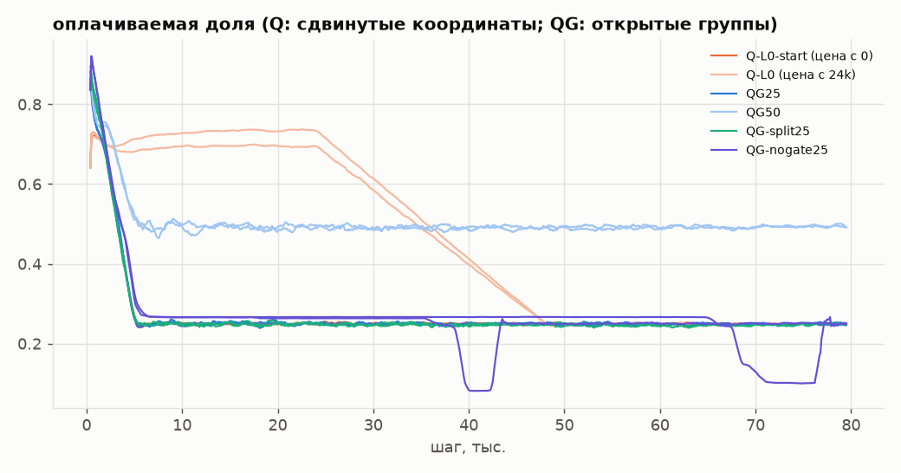

- **Механизм** (оба сида одинаково, `logs/r5_QGnogate25_s0.txt`):
  1. Пока цель снижается (2–5k), модель сначала полностью закрывает блоки 1–2: доля сдвинутых групп
     0.000. Блок 0 — до 0.09.
  2. Блок 3 остаётся на 0.97–0.98, так что итоговая цена 0.267 при цели 0.25.
  3. Сдвиги блока 3 больше Δ, поэтому min(|Δx|/Δ, 1) = 1 и градиент заменителя равен нулю. Max по группе
     насыщается, как только хоть одна координата сдвинута на ≥ Δ.
  4. Блоки 1–2 уже на нуле, и снижать цену больше нечем. μ растёт линейно: 17 на 16k, 44 на 48k, 58 на 66k.
- **Выход из режима.** Блок 3 за несколько тысяч шагов падает с 0.9–0.96 до 0.3: s1 на 37–40k, s0 на 66–72k. После этого цена
  становится ниже цели, μ за несколько тысяч шагов падает к нулю, и блоки 1–2 оживают.
- **Итог.** s1 после выхода выучил задачу (скачок на 62k, 99.7%). s0 вышел слишком поздно: 33.7% ответов.
  Он не держит даже m = 0–3 (36%), потому что при μ ≈ 50 цена забивает CE.
- **Гейт с σ-градиентом от этого защищён.** Градиент есть при любом значении z, и μ у QG не превышает 0.15.
  У Q-L0 по координатам заменитель тот же, но по координатам он насыщается реже: всегда есть координаты у
  границы округления.

### 9.7 Экономия: FLOPs и время

| | закрытых троек «токен × блок × группа» | «сопоставимая» (решение до внимания, раунд 4) | реализуемая: FFN / блок |
|---|---|---|---|
| QG25 | 0.75 | 63% | 47–48% / 30–31% |
| QG50 | 0.50–0.51 | 42–43% | 28–34% / 18–21% |
| QG-split25 | 0.75 | 63% | 75% / 48% |
| QG-nogate25 | 0.75 | 63% | 0 (решение после FFN) |
| K25-STE (раунд 4) | 0.75 | 63% | — / 29–32% |
| Q-L0, Q-L0-start | 0.28–0.33 | 23–27% | 0 (решение после FFN) |

- **Что считается «реализуемым».** Внимание всех голов считается всегда.
  - QG пропускает строки w2 закрытых групп, а у токенов без открытых групп — весь FFN (33–35% пар
    «токен × блок»).
  - QG-split пропускает срез FFN закрытой группы.
  - Стоимость гейта вычтена.
  - FFN — 64% FLOPs блока при средней длине контекста.
- **Оценки раунда 4 для E/G/K были завышены.** Там «сопоставимая» экономия считала и пропуск голов. Для
  гейта, который читает x + a, это невозможно: K25-STE даёт 29–32%, а не 63%.

**Время шага генерации** (`dd/qg_timing.py`: KV-кэш, батч 1, float32, 40 предложений теста, обученные
QG25 и QG-split25):
- **Точность пошагового декодера проверена.** Логиты совпадают с полным прямым проходом до 4·10⁻⁶,
  решения гейта — в 100% случаев.
- **Ускорения нет.**

| | без пропуска, мс/токен | с пропуском | ускорение | работа FFN с пропуском |
|---|---|---|---|---|
| CPU, 1 поток | 1.54–1.73 | 1.54–1.75 | ×0.96–1.00 | 24–25% групп |
| GPU (RTX 3090) | 4.4–5.8 | 6.4–8.8 | ×0.62–0.72 | 24–25% групп |

- **Причина.** При d = 128 токен стоит около 1.7 MFLOP, и время уходит на вызовы операций, а не на
  арифметику. Пропуск добавляет вызовы — по одному на открытую группу, — а на GPU ещё и синхронизацию с
  хостом.

**Синтетический замер одного FFN той же формы** (`dd/ffn_bench.py`, `report/r5_ffn_bench.json`): 8 групп,
hid = 8/3·d, CPU, 1 поток, случайные веса, мкс на вызов.

| d | плотный FFN | срезы, открыто 8 из 8 | 2 из 8 | 0 из 8 | общий FFN (QG), 2 из 8 |
|---|---|---|---|---|---|
| 128 | 13 | 72 | 17 | 0.1 | 15 |
| 512 | 109 | 141 | 29 | 0.1 | 87 |
| 1024 | 887 | 663 | 90 | 0.1 | 655 |
| 2048 | 4176 | 2975 | 544 | 0.1 | 3168 |

- **Срезы и d.** У разрезанного FFN w2 блочно-диагональный, поэтому при больших d «8 из 8» дешевле
  плотного.
  - При d = 128 цикл по срезам медленнее одного плотного умножения.
  - Начиная с d = 512, открыть 2 группы из 8 в 5–7 раз быстрее, чем 8 из 8. FLOP-экономия QG-split
    переводится во время почти пропорционально.
- **Общий FFN (QG).**
  - При 2 открытых группах экономятся только строки w2: на 20–26% быстрее плотного.
  - Токены без открытых групп (33–35%) не стоят ничего.
  - Вместе это близко к расчётным 47–48% FFN.
- **Оговорка.** Это замер одного FFN на синтетических весах, а не модели. Внимание и гейт сюда не
  входят.

### 9.8 Продление QG50_s1 и QG-split25_s0 до 120k

По вашему решению оба прогона продлены с 80k до 120k (`run_r5x.py`, прогоны — `runs7x/`, рисунок —
`report/r5_ext.png`).

- **Как продлено.**
  - С чекпойнта 80k взяты веса и μ. Поток данных продолжен с того же места.
  - LR оставлен на конечном уровне косинуса 80k (0.1·lr = 2·10⁻⁴): на нём модели и росли последние 10k
    шагов.
  - Состояние AdamW в чекпойнтах не хранится, поэтому дан 500-шаговый повторный разогрев.
  - Цель цены прежняя.
  - Это не то же самое, что обучение на 120k с нуля: там косинус был бы растянут.

| | ответ, % (80k → 120k) | m = 4 / 5 / 6, % | val CE−H | скачок (m ≥ 4 > 80%) | μ max | открытых групп на ответе, m = 0 → 6 | реализуемая: FFN / блок |
|---|---|---|---|---|---|---|---|
| QG50_s1 | 95.2 → 99.0 | 99.6 / 89.6 / 40.2 → 99.8 / 99.3 / 86.5 | 0.0087 → 0.0063 | 84k | 0.009 | 18.9 → 17.6 (×0.93) | 28% / 18% |
| QG-split25_s0 | 94.0 → 97.4 | 84.1 / 73.6 / 53.2 → 98.5 / 87.8 / 74.8 | 0.0098 → 0.0076 | 98k | 0.013 | 14.3 → 16.7 (×1.16) | 75% / 47% |

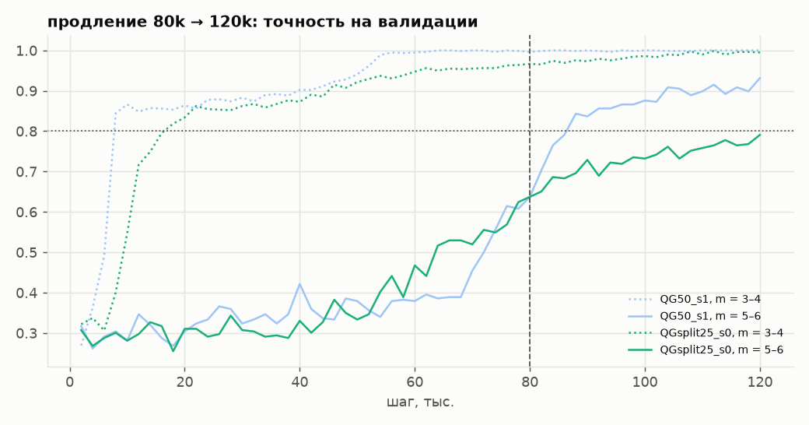

- **Оба прогона отставали по скорости, а не упирались в потолок.**
  - Точность на m = 5–6 росла весь отрезок: к 120k 0.93 и 0.79.
  - До QG25 (99.8–99.9%, CE−H 0.0044–0.0048) не дотянул ни один.
- **Цена и честность сохранились.** Доли открытых групп те же, μ ≈ 0, экономия та же.
- **Подстановка по таблице по-прежнему ломает задачу:** 99.0 → 71.3% и 97.4 → 51.0%.
- **QG50_s1 выучил трудные вопросы без роста глубины на ответе.** Открыто 18–19 групп при любом m. При цели
  0.5 открытых групп хватает везде, и подстраивать их под трудность незачем.
- **Вывод для вопроса 3.** Разрезание по группам замедляет обучение примерно на 30–60k шагов (скачок на 98k
  против 32k и 70k у QG25), но задачу не закрывает.

### 9.9 Итог раунда 5 и следующий шаг

- **Цена с первого шага не мешает Q-L0 выучить задачу.** Но и не помогает: скачок на 40–58k.
- **Квантование ускоряет первые этапы обучения, но не финальный скачок.** Сидов без скачка у Q0 не меньше,
  чем у A (2 из 5 против 1 из 5).
- **QG25 — первый вариант, где одновременно выполнено четыре условия:**
  - качество уровня A и Q-L0;
  - честный ноль по построению;
  - стояние целыми группами с реальным пропуском FFN (30% FLOPs блока);
  - рост глубины с трудностью, хотя и неравномерный по сидам.
- **Остальные варианты к 80k проигрывают.**
  - Мягкая цель (QG50) и физическое разрезание (QG-split) замедляют выход на трудные вопросы.
  - Без гейта (QG-nogate) ломается двойственный спуск.
- **Ограничения.**
  - Решение гейта не определяется токеном.
  - Экономия ограничена FFN, потому что гейт стоит после внимания.
  - При d = 128 пропуск не даёт выигрыша по времени.
- **Что можно делать дальше.**
  - Сделано: QG50_s1 и QG-split25_s0 продлены до 120k (9.8). Скачок прошли оба, но m = 6 к 120k у обоих не
    выучен.
  - Гейт до внимания: читать x, а не x + a, чтобы можно было пропускать и головы. По оценке раунда 4 это
    даёт до 63% блока.
  - Шаг сетки, зависящий от глубины («спуск»), отложенный на следующий раунд.
  - Для QG-nogate — заменитель без насыщения, например сумма по группе вместо max.

## 10. Раунд 6: что тормозит QG-split; QG на TinyStories

Таблицы: [`report/r6_tables.md`](report/r6_tables.md) (часть 1), [`report/r6ts_tables.md`](report/r6ts_tables.md)
(часть 2), генерации — [`report/r6ts_generations.md`](report/r6ts_generations.md). Ночной блок —
[`report/r6n_tables.md`](report/r6n_tables.md), [`report/r6n_generations.md`](report/r6n_generations.md).
Прогоны части 1 — `runs8/`, части 2 и ночного блока — `runs_ts/`.

### 10.0 Ответы на вопросы раунда

1. **Что тормозит QG-split и какой разрез лучший.**
   - **Систематически — ничего.** При одинаковом бюджете (120k с нуля) финальный скачок по одному сиду из
     двух у QG25 (80k) и у QG-split (56k).
   - **Разрезы только FFN и только голов не дали скачка ни в одном из 4 прогонов.** Ни одна часть разреза
     по отдельности не виновата, а частичные разрезы не лучше полного.
   - **Время скачка определяет сид.** С 2 сидами варианты статистически не различимы.
   - **Лучший компромисс — QG-split (FFN + головы):** 48% реализуемой экономии блока при той же скорости
     обучения, что у QG25. Подробно — 10.1–10.3.
2. **Держат ли QG25 и QG-split качество A на TinyStories — не полностью.**
   - **Сетка сама почти бесплатна** (Q0 +0.015 нат), но только после замены правила: свой шаг на слой,
     эмбеддинг ×√d, 81 уровень. Почему общий шаг не подошёл — 10.4.
   - **QG25:** +0.074 нат (perplexity 4.36 против 4.05), оба сида одинаково. Это уровень A на ~2/3
     обучения.
   - **QG-split25:** +0.166. Среди причин — на четверть меньше действующих весов.
   - **Генерации** на глаз одинаково связные (10.5).
3. **Тратит ли модель больше групп на трудные токены — да, умеренно.**
   - От самых лёгких 20% токенов к самым трудным число открытых групп растёт с 12.4 до 18.4 из 64.
     ρ с потерей A ≈ 0.28, AUROC для top-10% трудных 0.63.
   - **Больше всего групп — перед редким словом** (22 из 64), меньше всего — на точке перед началом
     предложения (9–10).
   - **В собственной генерации модель открывает меньше групп,** чем на чужом тексте: 16–20% против 25%.
     Подробно — 10.6.
4. **Реальное ускорение генерации** (batch 1, CUDA graph, A тоже скомпилирован):
   - **QG-split25:** шаг ×1.13, FFN ×2.76 к A, из них ×1.98 даёт сам пропуск.
   - **QG25:** шаг ×0.97 (медленнее A), FFN ×1.19.
   - **Что ограничивает:**
     - FFN — лишь 35% времени шага: внимание и остальное гейт не трогает, потолок ×1.54;
     - гейт и таблицы глубины добавляют ~28 мкс на шаг;
     - при batch 1 ядра FFN упираются в задержку, ~40 мкс на 16 ядер, и пропуск 80% чтений даёт ×2, а не ×5;
     - общий FFN пропускает только строки w2 и токены без открытых групп.

     Подробно — 10.8.
5. **Ночной блок: граница «качество — экономия» и долгое обучение** (10.10).
   - **Отставание ≤ 0.02 не даёт ни одна из проверенных целей 0.25–0.5.**
     - QG50 (49% открытых групп): +0.046 при 14% реализуемой экономии блока.
     - По тренду трёх точек QG нужно ~75–85% открытых групп. Экономия блока там ~3–6%.
     - QG-split не достигает 0.02 ни при какой доле: при 100% открытых групп тренд даёт ~+0.05.
   - **QG25 учится медленнее в постоянное число раз, а не упирается в потолок.**
     - Отставание 0.074 на 20k и 0.070 на 40k шагов.
     - От удвоения обучения QG25 выигрывает столько же, сколько A.
     - Против A с полным расписанием QG25 нужно ~2.4 раза больше шагов.
6. **Что делать дальше.**
   - **Менять механизм, а не цель или длину обучения:** ночной блок показал, что ни то ни другое
     отставание не закрывает.
   - **Гейт до внимания,** чтобы пропускать и головы.
   - **QG-split при равном числе параметров.**
   - **Проверить, не мешает ли сетка дообучению при малом lr.**
   - **Более плотная реализация:** меньше ядер, bf16, batch > 1. Подробно — 10.9, 10.10.

### 10.1 Часть 1: постановка

- **Данные и обучение.**
  - Синтетика data5 и модель d = 128 раунда 5.
  - Все прогоны с нуля: 120k шагов, косинус на 120k.
  - Цена с первого шага, как у QG25 раунда 5: цель 1.0 → 0.25 за первые 5k шагов.
  - 2 сида на вариант, оценка каждые 2k шагов.
- **Варианты.** У всех квантованное состояние и гейт группы до FFN; разница только в том, что разрезано.
  - **QG25.** FFN общий, W_O полная.
  - **QG-split25.** FFN разрезан на 8 блоков: скрытый блок g пишет только в группу g. Голова h пишет только в
    группу h.
  - **QG-splitFFN25.** Разрезан только FFN, W_O полная.
  - **QG-splitHead25.** Только блочно-диагональная W_O, FFN общий.
- **Реализуемая экономия в своей архитектуре.**
  - Разрезанный FFN: для закрытой группы не считается её блок FFN.
  - Общий FFN: не читаются строки w2 закрытых групп; весь FFN пропускается, только если в блоке закрыты все
    группы токена.
  - Разрезание голов экономии само не даёт: гейт читает x + a, так что внимание считается всегда.
- **Запуск.** QG25_s1 и QG-splitHead25_s1 при первом запуске упали из-за нехватки памяти хоста (8 процессов
  разом). Их перезапустили после остальных с теми же настройками.

### 10.2 Часть 1: результаты

Этапы — первый шаг, где точность на валидации > 80%. CE−H — избыток CE над энтропией языка на валидации.

| вариант | ответ, % | m = 0…3 | m = 4 | m = 5 | m = 6 | val CE−H | этапы m = 1–2 / 3–4 / ≥ 4 (s0; s1) |
|---|---|---|---|---|---|---|---|
| QG25 (общий FFN, полная W_O) | 98.8; 89.0 | 100.0; 99.9 | 99.6; 55.4 | 95.8; 44.9 | 86.2; 34.7 | 0.0066; 0.0134 | 20k / 42k / 80k; 6k / 18k / нет |
| QG-split25 (FFN + головы) | 99.9; 87.4 | 100.0; 100.0 | 100.0; 49.4 | 100.0; 30.4 | 98.8; 30.4 | 0.0042; 0.0149 | 2k / 14k / 56k; 2k / 34k / нет |
| QG-splitFFN25 (только FFN) | 86.0; 90.5 | 100.0; 100.0 | 30.5; 96.2 | 29.4; 31.9 | 29.0; 29.0 | 0.0153; 0.0125 | 2k / 14k / нет; 2k / 16k / нет |
| QG-splitHead25 (только головы) | 90.8; 85.8 | 100.0; 98.7 | 66.6; 39.9 | 51.4; 32.5 | 44.2; 30.8 | 0.0121; 0.0169 | 4k / 12k / нет; 92k / 116k / нет |

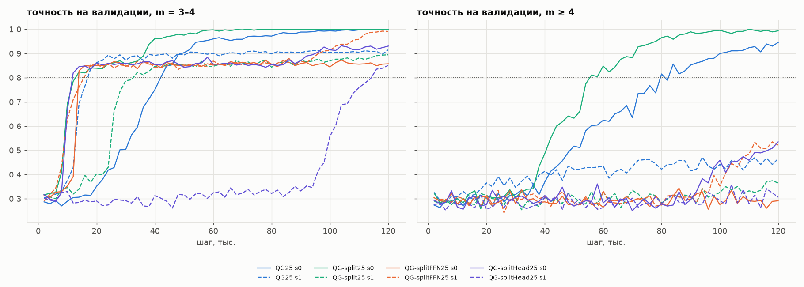

Глубина на позиции ответа, экономия и проверки:

| прогон | открытых групп на ответе, m = 0 … 6 | m=6 / m=0 | оплачено (блоки 0–3) | впустую / открытых | max\|Δx\| закрытой | закрытых троек | токенов без открытых групп | реализуемая: FFN / блок | μ max / в конце | подстановка по таблице |
|---|---|---|---|---|---|---|---|---|---|---|
| QG25_s0 | 9.9 10.2 10.0 10.2 10.2 10.5 10.2 | 1.03 | 0.28 0.22 0.12 0.40 | 0.000 0.000 0.000 0.002 | 0 | 0.74 | 0.34 | 47% / 30% | 0.13 / 0.008 | 98.8 → 28.2 |
| QG25_s1 | 14.1 13.8 15.3 15.3 21.4 22.1 23.1 | 1.63 | 0.22 0.19 0.08 0.51 | 0.001 0.001 0.000 0.000 | 0 | 0.75 | 0.34 | 47% / 30% | 0.14 / 0.001 | 89.3 → 12.9 |
| QGsplit25_s0 | 15.9 15.5 15.7 15.5 16.0 15.9 16.4 | 1.03 | 0.28 0.20 0.14 0.40 | 0.046 0.005 0.000 0.001 | 0 | 0.75 | 0.21 | 75% / 47% | 0.11 / 0.002 | 99.9 → 22.8 |
| QGsplit25_s1 | 13.4 13.2 13.6 13.7 12.7 11.7 11.1 | 0.83 | 0.28 0.19 0.16 0.37 | 0.027 0.006 0.005 0.001 | 0 | 0.75 | 0.33 | 75% / 48% | 0.11 / 0.000 | 87.7 → 0.0 |
| QGsplitFFN25_s0 | 8.3 8.1 9.7 8.5 9.9 9.6 9.6 | 1.16 | 0.23 0.18 0.25 0.31 | 0.026 0.000 0.001 0.002 | 0 | 0.76 | 0.27 | 76% / 48% | 0.07 / 0.000 | 86.4 → 0.6 |
| QGsplitFFN25_s1 | 11.4 11.1 11.1 11.6 11.8 9.0 9.1 | 0.80 | 0.23 0.22 0.28 0.27 | 0.009 0.013 0.001 0.003 | 0 | 0.75 | 0.20 | 75% / 48% | 0.08 / 0.000 | 90.7 → 3.8 |
| QGsplitHead25_s0 | 8.7 9.1 9.3 10.0 20.0 19.5 19.4 | 2.24 | 0.28 0.15 0.21 0.34 | 0.001 0.012 0.006 0.000 | 0 | 0.75 | 0.30 | 45% / 28% | 0.11 / 0.002 | 90.8 → 32.4 |
| QGsplitHead25_s1 | 14.8 16.4 17.2 17.1 15.1 14.6 14.4 | 0.98 | 0.37 0.09 0.15 0.38 | 0.000 0.014 0.000 0.000 | 0 | 0.75 | 0.40 | 52% / 33% | 0.10 / 0.000 | 86.3 → 62.9 |

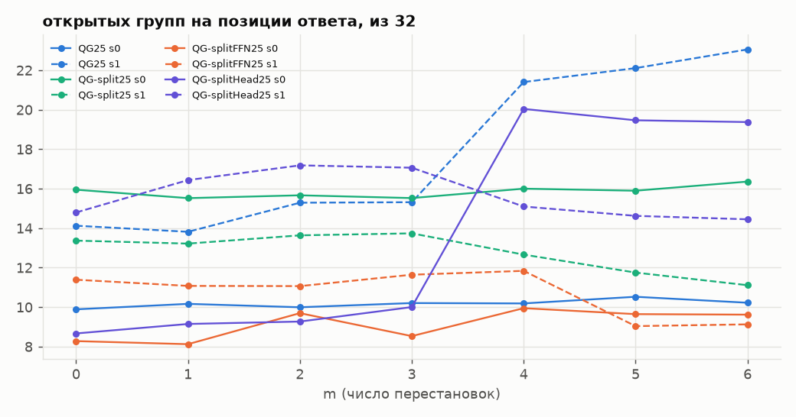

- **Финальный скачок (m ≥ 4 > 80%) к 120k сделали 2 прогона из 8.**
  - QG-split25_s0 — на 56k, раньше всех в этом раунде.
  - QG25_s0 — на 80k, после плавного роста с ~40k.
- **Остальные шесть застряли на плато.**
  - m ≤ 3 решено почти на 100%, m ≥ 4 — на 30–55%.
  - У QG25_s1 плато держится с 24k до конца.
  - QG-splitFFN25_s1 и QG-splitHead25_s0 начали с него сходить около 96k, когда LR по косинусу уже близок
    к минимуму. К 120k m ≥ 4 у них 0.52–0.53.
- **Ранние этапы разрезанные варианты проходят быстрее.** В 5 прогонах из 6 m = 1–2 пройден за 2–4k шагов,
  m = 3–4 — за 12–34k. У QG25 — 6–20k и 18–42k.
  - Исключение — QG-splitHead25_s1: m = 1–2 только к 92k, самый медленный старт за раунд.
- **Глубина растёт с m только у моделей посреди обучения m ≥ 4.**
  - QG25_s1 (m = 4 — 55%): ×1.63.
  - QG-splitHead25_s0 (m = 4 — 67%): ×2.24, с 10 до 20 групп ровно на m = 4.
  - Выучившие задачу (QG25_s0, QG-split25_s0): ×1.03.
  - Не решающие m ≥ 4: ×0.80–1.16.
- **Честность — у всех.**
  - Закрытая группа не меняется ни в одном бите (max |Δx| = 0).
  - Открыто, но не изменилось: в блоке 0 у вариантов с разрезанным FFN 0.9–4.6%, в остальных случаях ≤ 1.4%.
  - μ max 0.07–0.14, к концу ≈ 0.
  - Подстановка решения гейта по таблице «токен → решение» ломает задачу у всех: до 0–63%.
- **Реализуемая экономия.**
  - QG-split25 и QG-splitFFN25: 75–76% FFN, 47–48% FLOPs блока.
  - QG25: 47% / 30%.
  - QG-splitHead25: 45–52% / 28–33%, столько же, сколько у QG25.

### 10.3 Часть 1: что тормозит QG-split и какой разрез лучший

- **При равном бюджете QG-split не медленнее QG25.**
  - Скачок у обоих в одном сиде из двух, у QG-split раньше: 56k против 80k.
  - Средняя точность ответа 93.7% против 93.9%, CE−H 0.0096 против 0.0100.
  - Отставание раунда 5 укладывается в разброс сидов. Там QG25 прошёл скачок в обоих сидах, а QG-split
    к 80k ни в одном, но здесь QG25_s1 не прошёл его вовсе.
- **По отдельности ни одна часть разреза не «виновата».**
  - Разрез только FFN и разрез только голов не дали скачка ни в одном из 4 прогонов.
  - Ни один не лучше полного разреза. Если что-то и видно, то частичные разрезы хуже полного и QG25
    (0 из 4 против 2 из 4), но точный тест Фишера p = 0.43.
- **Главное, от чего зависит скачок, — сид, а не вид разреза.**
  - С 2 сидами варианты не различимы: ранговые тесты p ≥ 0.33, это минимально возможное значение.
  - Устойчивый эффект разреза один: ускорение ранних этапов.
- **Лучший компромисс — QG-split (FFN + головы).**
  - Наибольшая реализуемая экономия: 48% блока, как у QG-splitFFN.
  - Учится не медленнее QG25.
  - QG-splitFFN при той же экономии скачка не дал ни в одном сиде.
  - QG-splitHead экономии сверх QG25 не даёт вовсе.
  - Поэтому в часть 2 идёт QG-split25.

### 10.4 Часть 2: постановка

- **Данные.** TinyStories (roneneldan/TinyStories, файлы `TinyStories-train.txt` / `-valid.txt`).
  - train: 2.12M историй, 458M токенов;
  - val: 22k историй, 4.6M токенов.
- **Токенизатор — свой byte-level BPE на 8192 токена** (HF `tokenizers`), обучен на всём train.
  - id 0 — `<pad>`, id 1 — `<|endoftext|>` перед каждой историей. Маска внимания держит его внутри истории,
    как в синтетике.
  - В среднем 216 токенов на историю. Частые слова и имена — один токен:
    `Once| upon| a| time|,| there| was| a| little| girl| named| Lily|.`
  - Почему не готовый словарь GPT-2 (50k): язык TinyStories маленький. С 50k токенов связанная матрица
    эмбеддинга и выхода заняла бы 25M из ~50M параметров, и большая часть строк почти не обучалась бы. С 8k
    это 4.2M из 30M.
- **Модель.**
  - d = 512, 8 блоков, 8 голов по 64 (группы 8 × 64), SwiGLU FFN со скрытым 1408, контекст 512.
  - pre-norm RMSNorm, RoPE, связанные эмбеддинги.
  - 29.9M параметров у A, 30.5M у QG: гейты и таблицы глубины.
- **Обучение — одинаковый бюджет для всех.**
  - 20k шагов × 32 × 512 = 328M токенов, 0.72 эпохи.
  - AdamW lr 10⁻³, weight decay 0.1, разогрев 500 шагов, косинус до 0.1·lr, bf16.
  - Окна по 513 токенов из потока в случайных местах, порядок окон задаётся сидом.
  - **A сходится отчётливо:** val CE 1.485 → 1.450 → 1.430 → 1.417 на 14k / 16k / 18k / 20k шагах.
- **QG.** Цель 0.25 с первого шага: 1.0 → 0.25 за первые 1250 шагов (6.25% обучения), то же правило μ.

#### Выбор сетки: почему общий шаг не подошёл

**Правило раунда 4 перенесено буквально.** Δ = средний RMS внутренних состояний A / 3.2 = 1.03, K =
max q99 / Δ = 15.

- **С такой сеткой Q0 отстаёт от A на 0.75 нат на шаге 2000.**
- **Первая причина — масштаб.** Остаточный поток A растёт по глубине: RMS эмбеддинга 0.038, после блоков
  0…7 — 1.14, 2.01, 2.66, 3.21, 3.83, 4.59, 5.53, 7.47. Это ×200 от входа к выходу. Одна сетка либо
  грубая для ранних слоёв, либо обрезает поздние.
- **Вторая причина — инициализация.** Эмбеддинг квантованных моделей инициализируется с разбросом Δ,
  чтобы квантованный вход не был нулём. Он же связан с выходным слоем. При Δ = 1.03 логиты в начале
  в ~50 раз больше нормы: начальная потеря 504 вместо 9. Это и есть основная доля отставания крупных
  сеток.
- **Общие сетки помельче учатся лучше, но обрезают поздние слои.** Лучшая из них, Δ = 0.05 (619 уровней),
  даёт Q0 +0.027 к A. Но в двух последних блоках на краях 1.3% и 4.2% значений: состояние Q0 растёт
  по слоям так же, как у A.

**Профиль, как предложено: Δ_l = RMS состояния A на выходе слоя l / 3.2, 17 уровней.** Оказался хуже
всего.

- **Старт замерзает.** В начале обучения обновления блоков порядка 0.03: при общем Δ = 0.05 на шаге 0
  сдвигается 28–50% координат, при Δ = 0.11 — 2–3%. Это намного меньше Δ₁/2 = 0.18. Всё состояние после
  блока 0 округляется в ноль, градиент через RMSNorm нулевого вектора взрывается (‖g‖ = inf), и первые
  ~600 шагов модель не учится.
- **Потом не хватает уровней.** Значения упираются в края: 70–93% в блоках 0–4 у Q0.

**Эмбеддинг ×√d (Δ₀ тоже ×√d) снимает разницу масштабов между входом и блоком 0.**
- Старт нормальный: потеря 9.05, ‖g‖ 0.7.
- Качество близко к A: +0.046.
- Но при 17 уровнях на краях всё равно 4–35% значений. Квантованные модели держат состояния крупнее A:
  RMS после блока 0 — 2.0 против 1.14.

**Больше уровней при том же шаге.**
- При K = 26 у Q0 на краях 2.45% в блоке 0.
- При K = 40 (81 уровень, диапазон ±12.5 RMS_A) — не больше 0.6% в каждом слое.
- Качество от K не зависит: 1.963 / 1.961 / 1.960.

| проба | потеря / ‖g‖ на шаге 0 | val CE 500 / 1000 / 1500 / 2000 | ΔCE к A на 2000 | max доля на краях (слой) | состояния: доля на краях, % (emb, b0 … b7) |
|---|---|---|---|---|---|
| A (без сетки) | 9.1 / 13.7 | — / 2.138 / — / 1.917 | — | — | — |
| Q0, общий Δ = 1.03, K = 15 (правило раунда 4) | 504.5 / 27.4 | — / 3.371 / — / 2.666 | +0.749 | модель не сохранена | модель не сохранена |
| Q0, общий Δ = 0.355, K = 44 | 173.8 / 17.8 | 3.394 / 2.603 / — / — | — | модель не сохранена | модель не сохранена |
| QG25, общий Δ = 0.355, K = 44 | 174.8 / 18.3 | 3.429 / — / — / — | — | модель не сохранена | модель не сохранена |
| Q0, общий Δ = 0.11, K = 141 | 50.1 / 22.1 | 2.662 / 2.255 / 2.090 / — | — | модель не сохранена | модель не сохранена |
| QG25, общий Δ = 0.11, K = 141 | 50.4 / 23.1 | 2.681 / 2.345 / 2.228 / 2.099 | +0.181 | 0.48% (b7) | 0.00 0.02 0.02 0.02 0.02 0.02 0.03 0.20 0.48 |
| Q0, общий Δ = 0.05, K = 309 | 11.9 / 43.2 | 2.519 / 2.164 / 2.025 / 1.944 | +0.027 | 4.18% (b7) | 0.00 0.00 0.13 0.18 0.24 0.30 0.56 1.31 4.18 |
| QG25, общий Δ = 0.05, K = 309 | 12.0 / 43.5 | 2.545 / 2.248 / 2.183 / 2.060 | +0.143 | 0.34% (b7) | 0.00 0.01 0.01 0.01 0.01 0.03 0.04 0.10 0.34 |
| Q0, профиль Δ_l = RMS_A/3.2, K = 8 | 9.0 / inf | 9.011 / 3.554 / 2.966 / 2.659 | +0.742 | 92.97% (b0) | 2.41 92.97 91.95 74.79 76.17 70.35 42.53 19.74 16.14 |
| QG25, профиль, K = 8 | 9.0 / 8.22e+18 | 9.011 / 5.032 / 3.409 / 2.924 | +1.007 | 80.75% (b0) | 2.89 80.75 19.33 0.00 0.00 0.00 0.00 0.92 2.94 |
| Q0, профиль, эмбеддинг ×√d, K = 8 | 9.1 / 0.72 | 2.800 / 2.236 / 2.056 / 1.963 | +0.046 | 35.38% (b0) | 1.28 35.38 13.96 9.02 9.65 9.56 9.41 7.99 4.43 |
| Q0, профиль, эмбеддинг ×√d, K = 26 | 9.1 / 0.72 | 2.814 / 2.244 / 2.052 / 1.961 | +0.044 | 2.45% (b0) | 0.00 2.45 0.16 0.06 0.07 0.11 0.13 0.10 0.17 |
| QG25, профиль, эмбеддинг ×√d, K = 26 | 9.1 / 0.72 | 2.763 / 2.274 / 2.158 / 2.041 | +0.124 | 0.81% (b0) | 0.00 0.81 0.01 0.00 0.04 0.00 0.02 0.00 0.00 |
| Q0, профиль, эмбеддинг ×√d, K = 40 | 9.1 / 0.72 | 2.815 / 2.245 / 2.058 / 1.960 | +0.043 | 0.60% (b0) | 0.00 0.60 0.02 0.01 0.01 0.04 0.03 0.00 0.04 |

**Выбрано:**
- свой шаг на каждое состояние, Δ_l = RMS_A(l) / 3.2: 0.265 (эмбеддинг ×√512), 0.355, 0.628, 0.831,
  1.00, 1.20, 1.43, 1.73, 2.33;
- уровни −40…40;
- одна и та же сетка для Q0, QG25 и QG-split25.

Против лучшей общей сетки (Δ = 0.05):
- QG25 на профиле лучше: +0.124 против +0.143 к A;
- Q0 чуть хуже: +0.043 против +0.027, зато без обрезки на краях.

**Следствие для проверок QG.** При разных шагах открытая группа переводится на сетку следующего слоя.
Поэтому «открыта, но не изменилась» почти не бывает по построению, и сравнение «оплачено против
реального» здесь слабее, чем в синтетике. Строгая проверка остаётся строгой: закрытая группа не меняется
ни в одном бите. Вывод `ts_eval`: `max_abs_change_closed_group`.

### 10.5 Часть 2: качество

Все числа ниже — на всём val (4.6M токенов, неперекрывающиеся окна по 512). Кривые на рисунке посчитаны по
256 фиксированным окнам во время обучения.

| прогон | val CE | perplexity | ΔCE к A |
|---|---|---|---|
| A | 1.3994 | 4.053 | — |
| Q0 (сетка по слоям, без гейта) | 1.4146 | 4.115 | +0.015 |
| QG25 s0 | 1.4731 | 4.363 | +0.074 |
| QG25 s1 | 1.4730 | 4.362 | +0.074 |
| QG-split25 | 1.5654 | 4.785 | +0.166 |

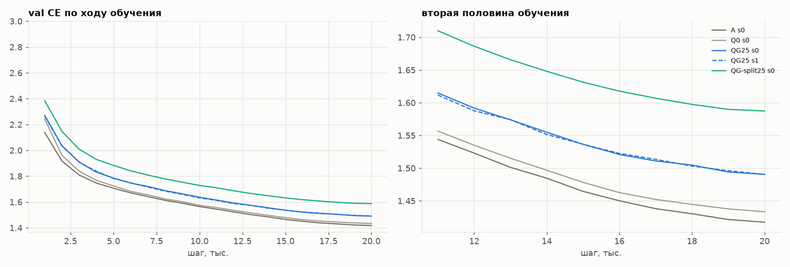

- **Сама сетка почти бесплатна:** Q0 отстаёт от A на 0.015 нат.
- **QG25 держит качество A не полностью.**
  - Отставание 0.074 нат, оба сида совпадают до 10⁻⁴.
  - По кривой это уровень A примерно на 13–14k шагах из 20k.
  - μ до конца остаётся 0.15–0.17. В синтетике он падал к нулю, а здесь модели всё время нужно больше 25%
    открытых групп.
- **QG-split25 отстаёт вдвое больше (+0.166).**
  - Часть объяснения — у блочно-диагональных W_O и w2 используется только 1/8 весов. Действующих
    параметров ~23M против 30M у A.
  - В синтетике это не мешало. На языке с настоящим словарём мешает.
- **Где теряется качество.** У QG25 потеря растёт сильнее всего на редких словах (+0.19 нат к A) и на
  «прочих» содержательных словах (+0.10). На пунктуации, служебных словах и началах предложений —
  +0.03–0.05. Подробно — в [`report/r6ts_tables.md`](report/r6ts_tables.md).
- **Генерации на глаз одинаково связные** у всех вариантов. 6 затравок, жадно и с T = 0.8 — в
  [`report/r6ts_generations.md`](report/r6ts_generations.md).

  Пример, затравка «Lily and Tom went to the park. They», жадно:
  - *A*: They saw a big pond with many ducks. Lily liked the ducks. She wanted to feed them. Tom liked the
    ducks too. He had some bread in his bag. "Can I feed the ducks, Tom?" Lily asked. "OK, but be careful.
    Don't go too close to the water," Tom said…
  - *QG25 s0*: They saw a big pond with many ducks. Lily liked the ducks. She wanted to feed them some bread.
    "Can I feed the ducks, Tom?" Lily asked. "OK, but be careful. The pond is deep and wet. You have to hold
    my hand and wait for the ducks to come," Tom said…
  - *QG-split25*: They saw a big pond with many ducks. Lily wanted to feed the ducks. She had some bread in
    her bag. She broke the bread into small pieces and threw them to the ducks. "Look, Tom, ducks!" Lily
    said…

  Огрехи есть у всех. Например, у QG25 s1 повтор с противоречием: «I don't want to go on the slide… I want
  to go on the slide».

### 10.6 Часть 2: тратит ли модель больше групп на трудные токены

Полная сводка по адаптивности всех 7 прогонов — в [`report/r6_adaptivity.md`](report/r6_adaptivity.md). Там же
досчитанные метрики: ρ по блокам, ошибка топ-1, позиция в истории, разброс против случайных гейтов,
предсказуемость по токену.

**Позиция и трудность.** Гейт в позиции t решает по состоянию токена t. Трудность — потеря предсказания
токена t+1:
- своя;
- или потеря A на том же токене (опорная).

Анализ — на 307k токенах, первые 600 окон val, одинаковые для всех прогонов. Открытых групп — сумма по
8 блокам × 8 группам, из 64.

| | QG25 s0 | QG25 s1 | QG-split25 |
|---|---|---|---|
| открыто в среднем, из 64 | 15.9 | 15.9 | 15.9 |
| ρ(открыто, потеря A) | 0.295 | 0.279 | 0.264 |
| ρ(открыто, своя потеря) | 0.312 | 0.294 | 0.297 |
| AUROC «открыто → токен из top-10% по потере A» | 0.635 | 0.626 | 0.614 |
| открыто по квинтилям потери A, от лёгких к трудным | 12.4 → 15.2 → 16.2 → 17.2 → 18.4 | 12.7 → 18.3 | 12.8 → 17.9 |

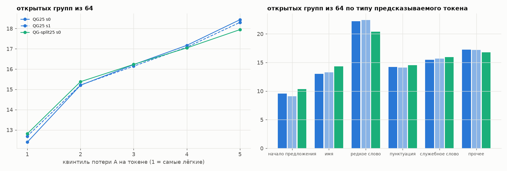

- **Да, умеренно и одинаково у всех трёх прогонов.**
  - На самых трудных 20% токенов открыто в 1.5 раза больше групп, чем на самых лёгких.
  - Связь монотонная по всем квинтилям, но слабая: ρ ≈ 0.28, AUROC 0.63. Решение гейта лишь отчасти
    следует за трудностью.
- **По типу предсказываемого токена** (из 64, QG25 s0 / s1 / QG-split25):

  | тип | открыто |
  |---|---|
  | редкое слово | 22.2 / 22.4 / 20.4 |
  | прочее | 17.2 / 17.2 / 16.8 |
  | служебное слово | 15.5 / 15.7 / 16.0 |
  | пунктуация | 14.2 / 14.1 / 14.6 |
  | имя | 13.0 / 13.3 / 14.3 |
  | начало предложения | 9.6 / 9.1 / 10.4 |

  - Больше всего групп модель тратит перед редким словом, а это и самый трудный тип: потеря A 3.38 против
    0.7–1.8 у остальных.
  - Меньше всего — перед началом предложения. Там текущий токен — точка или кавычка, и на нём в среднем
    открыто только 10–11 групп.
- **Внутри типа связь с трудностью сохраняется** (ρ 0.12–0.39) у всех типов, кроме редких слов: там
  ρ ≈ −0.13…−0.02. Перед редкими словами модель открывает много групп всегда, независимо от того, насколько
  трудно конкретное слово.
- **Где тратятся группы по блокам** ([рисунок](report/r6ts_blocks.png)).
  - У QG25 доли 0.16–0.32. Чаще всего открыт блок 0, реже всего — блок 3.
  - Распределение по блокам между сидами не совпадает: блок 7 — 0.30 и 0.17. Устойчиво только
    суммарное число открытых групп.
  - QG-split25 больше тратит в блоках 0–1 (0.34, 0.42) и меньше всего в блоке 7 (0.12).
- **В генерации модель открывает меньше групп, чем на val:** 15.8% у QG25 и 20.4% у QG-split25 против
  24.8% на val (замер скорости, 400 жадных шагов). Собственное самое вероятное продолжение для модели
  легче чужого текста. Это согласуется с адаптивностью.

### 10.7 Часть 2: проверки

| | QG25 s0 | QG25 s1 | QG-split25 |
|---|---|---|---|
| max \|Δx\| закрытой группы | 0 | 0 | 0 |
| логиты train против eval | совпадают | совпадают | совпадают |
| мёртвых / всегда открытых групп, из 64 | 0 / 0 | 0 / 0 | 0 / 0 |
| оплачено по блокам | 0.16–0.32 | 0.17–0.32 | 0.12–0.42 |
| токенов без открытых групп, по блокам | 0.01–0.35 | 0.03–0.36 | 0.02–0.51 |
| μ max / в конце | 0.77 / 0.17 | 0.77 / 0.17 | 0.77 / 0.15 |
| max доля значений на краях сетки | 0.15% (b0) | 0.12% (b0) | 0.05% (b0) |

- **Закрытая группа не меняется ни в одном бите.** Средняя оплаченная доля 0.248 при цели 0.25.
- **«Оплачено против реального» здесь проверка слабая** (см. 10.4). Открытая группа переводится на сетку
  следующего слоя, поэтому меняется почти всегда.
- **μ без разгона.** Пик 0.77 приходится на выход цели на 0.25 (шаг ~1250), потом медленно спадает.
- **Q0:** max доля на краях 0.35% (после блока 0).

### 10.8 Часть 2: реальная скорость генерации

**Как мерилось.**
- **Шаг:** batch 1, один новый токен с KV-кэшем длины 512, жадный выбор следующего токена внутри графа.
- **Сборка:** шаг собран в один CUDA graph. Мелкие поэлементные операции слиты `torch.compile` для всех
  моделей, включая A. Без этого шаг A — ~3.9 мс из-за ~45 запусков ядер на блок.
- **Повторы:** 400 шагов после разогрева, медиана по CUDA events, fp32.
- **FFN считается в ядрах Triton,** которые сами читают маску гейта и не трогают закрытое:
  - разрезанный FFN — только блоки открытых групп;
  - общий FFN — w1/w3 целиком, если в блоке открыта хоть одна группа токена, иначе FFN пропускается
    целиком; из w2 читаются только строки открытых групп.
- **Точность.** Тот же декодер, принуждённый идти по тексту, совпадает с полным прямым проходом: логиты
  до 1.6·10⁻⁵, решения гейта и argmax — 100%.
- **Код** — `dd/ts_speed.py`.

| | шаг, мкс | шаг: ускорение к A | FFN 8 блоков, мкс | FFN: к A | FFN: пропуск в тех же ядрах | пропускаемая доля чтений FFN |
|---|---|---|---|---|---|---|
| A (cuBLAS) | 331.8 | — | 115.7 | — | — | — |
| QG25, без пропуска | 368.6 | ×0.90 | 127.3 | ×0.91 | | |
| QG25, с пропуском | 341.0 | **×0.97** | 97.3 | ×1.19 | ×1.31 (ожидалось ×2.15) | 53.5% |
| QG-split25, без пропуска | 329.7 | ×1.01 | 82.9 | ×1.40 | | |
| QG-split25, с пропуском | 293.9 | **×1.13** | 42.0 | **×2.76** | ×1.98 (ожидалось ×4.9) | 79.6% |

Доля открытых групп при генерации: 15.8% у QG25, 20.4% у QG-split25.

- **QG-split25 генерирует на 13% быстрее A, FFN считается в 2.8 раза быстрее.**
  - ×1.4 даёт сама блочно-диагональная w2: в 8 раз меньше весов.
  - ×2.0 — пропуск закрытых групп.
- **QG25 по шагу медленнее A на 3%,** хотя его FFN быстрее на 19%.
- **Что ограничивает ускорение.**
  1. **FFN — лишь 35% времени шага A** (116 из 332 мкс), хотя это 51% байт весов. Остальное — внимание с
     KV-кэшем, нормировки, выходной слой 8192 × 512 и запуски ядер, ~216 мкс. Гейт стоит после внимания и
     эту часть не трогает. Даже при нулевом FFN шаг A ускорился бы не больше чем в 1.54 раза.
  2. **Гейт стоит денег.** Голова гейта, таблицы глубины и квантование добавляют ~28 мкс на шаг: часть шага
     без FFN у QG25 — 244 мкс против 216 у A. У QG25 это съедает почти весь выигрыш FFN.
  3. **При batch 1 ядра упираются в задержку, а не в полосу памяти.** 16 ядер FFN на шаг по ~2.5 мкс
     минимум — это ~40 мкс. FFN QG-split25 с пропуском (42 мкс) уже на этом полу, поэтому пропуск 80%
     чтений дал ×2, а не ×5.
  4. **Общий FFN почти не пропускается.** w1 и w3 нужны, если открыта хоть одна группа токена. Целиком FFN
     пропускается только у токенов без открытых групп: 20% на val, 38% в генерации на блок.
- **Реализуемая экономия FLOPs**, по учёту раунда 5, средний контекст внимания 90 токенов:
  - QG25: 38% FFN, 25% блока;
  - QG-split25: 75% FFN, 49% блока.

  По времени из этого получено 13% шага у QG-split25 и ничего у QG25.

### 10.9 Итог раунда 6 и следующий шаг

- **Часть 1.**
  - Финальный скачок задачи слежения определяется сидом, а не видом разреза.
  - QG-split не медленнее QG25.
  - Частичные разрезы (только FFN, только головы) не лучше полного.
  - Лучший разрез — QG-split: 48% реализуемой экономии блока.
- **Часть 2.**
  - **Сетка.** Правило сетки раунда 4 на языковой модели d = 512 не работает. Рабочая схема — свой шаг на
    каждый слой по масштабу A, эмбеддинг ×√d, 81 уровень. С ней квантование почти бесплатно: +0.015 нат.
  - **Качество.** QG25 отстаёт от A на 0.074 нат, QG-split25 — на 0.166.
  - **Адаптивность.** Модель адаптивно тратит больше групп на трудные токены, особенно перед редкими
    словами, но связь умеренная: ρ ≈ 0.28.
  - **Скорость.** Реальное ускорение генерации — только у QG-split25: ×1.13 на шаг, ×2.8 на FFN.
- **Что делать дальше.**
  - **Ночной блок (10.10) уже сделан.**
    - Для отставания ≤ 0.02 нужно ~75–85% открытых групп, где экономии почти нет.
    - Долгое обучение отставание не закрывает: 0.074 → 0.070.
    - Значит, улучшать надо сам механизм.
  - **Гейт до внимания.** Читать x, а не x + a, чтобы закрытая группа пропускала и свою голову. Внимание и
    прочее — 65% времени шага, без этого ускорение шага ограничено ×1.5.
  - **Сравнение QG-split при равном числе параметров.** Например, шире FFN, чтобы отделить цену разреза от
    цены меньшего числа весов.
  - **Реализация.** Слить блок в меньшее число ядер, перейти на веса bf16, мерить ещё и batch > 1, где
    ядра упираются в полосу памяти и пропуск должен давать почти пропорциональный выигрыш.

### 10.10 Ночной блок: граница «качество — экономия» и долгое обучение

**Состав и материалы.**
- Таблицы — [`report/r6n_tables.md`](report/r6n_tables.md), генерации — [`report/r6n_generations.md`](report/r6n_generations.md).
  Прогоны — `runs_ts/`.
- Сетка та же, что в 10.4: свой шаг на слой, эмбеддинг ×√d, 81 уровень.
- Все 7 прогонов прошли без сбоев, по одной задаче на GPU, с 02:22 до 09:13:
  - QG35, QG50, QG-split35, QG-split50 — по 20k шагов;
  - A-40k, QG25-40k и QG-split25-40k.
- Пункт 2 урезать не пришлось: QG-split25-40k по оценке времени укладывался до 10:00.

**Ответы.**

1. **Какая доля открытых групп нужна, чтобы отставать от A не больше чем на ~0.02 по val CE.**
   - **Ни одна из проверенных.** При 20k шагах лучшая точка, QG50 с 49% открытых групп, отстаёт на 0.046.
   - **Сама сетка уже стоит 0.015:** Q0, где все группы открыты, отстаёт на столько. Гейту остаётся ~0.005.
   - **Оценка по тренду.**
     - У QG отставание от Q0 растёт с долей закрытых групп: 0.031 / 0.045 / 0.058 при 51 / 65 / 75% закрытых.
     - Продолжение этих трёх точек даёт ≤ 0.02 к A при **~75–85% открытых групп**: линейное — при 73%,
       степенное — при 84%.
     - Это экстраполяция: такие цели не обучались.
   - **Экономии там почти нет.** Реализуемая экономия блока у QG при такой доле — ~3–6%:
     - закрытая группа экономит лишь свои строки w2, то есть треть FFN;
     - токенов без открытых групп почти не остаётся.
   - **QG-split не достигает 0.02 ни при какой доле.** Продолжение его линии до 100% открытых групп даёт
     ~+0.05 к A — цену самого разреза: на четверть меньше действующих весов.
   - **Долгое обучение этого не меняет** (п. 2).
2. **Учится ли QG25 просто медленнее или упирается в потолок.**
   - **Учится медленнее в постоянное число раз, потолка в пределах 40k шагов нет.**
     - От удвоения обучения QG25 выигрывает столько же, сколько A: −0.060 нат против −0.056.
     - Кривая на плато не выходит.
   - **Но отставание в натах почти не сокращается:** 0.074 на 20k, 0.070 на 40k.
   - **В шагах это постоянный множитель.**
     - На кривой того же расписания QG25 в конце равен A на 69–70% пути, при обеих длинах.
     - Против A с полным расписанием QG25 нужно ~2.4 раза больше шагов. QG25-40k (1.413) всё ещё хуже A-20k
       (1.399).
   - **Удлинением обучения отставание до 0.02 не сократить:** темп — −0.004 за удвоение.
   - **QG-split25 ведёт себя так же:** 0.166 → 0.153.

#### Граница «качество — экономия» (20k шагов)

Как в части 2: 1 сид, та же сетка и тот же разгон цели. Все числа — на всём val.

| прогон | открыто групп | val CE | perplexity | ΔCE к A | ΔCE к Q0 | экономия блока / FFN | уровень A на шаге |
|---|---|---|---|---|---|---|---|
| Q0 (без гейта) | 100% | 1.4146 | 4.115 | +0.015 | — | 0 | 17.6k |
| QG25 s0 / s1 | 24.8% | 1.4731 / 1.4730 | 4.36 | +0.074 | +0.058 | 25.0% / 38.4% | 13.7k |
| QG35 | 34.6% | 1.4600 | 4.306 | +0.061 | +0.045 | 20.1% / 30.8% | 14.3k |
| QG50 | 49.4% | 1.4456 | 4.245 | +0.046 | +0.031 | 13.8% / 21.3% | 15.1k |
| QG-split25 | 24.8% | 1.5654 | 4.785 | +0.166 | +0.151 | 49.1% / 75.2% | 9.1k |
| QG-split35 | 34.6% | 1.5497 | 4.710 | +0.150 | +0.135 | 42.7% / 65.4% | 9.8k |
| QG-split50 | 49.4% | 1.5279 | 4.609 | +0.129 | +0.113 | 33.0% / 50.6% | 10.9k |

- **Экономия** — реализуемая доля FLOPs по учёту раунда 5, как в 10.8:
  - внимание всех голов считается всегда;
  - в общем FFN закрытая группа не читает свои строки w2, а токен без открытых групп пропускает FFN
    целиком;
  - в разрезанном FFN закрытая группа пропускает свой блок;
  - стоимость гейта добавлена.
- **«Уровень A на шаге»** — шаг, на котором кривая val прогона A-20k (256 окон) достигает такого же
  val CE. Мера грубая: до 20k у A косинус ещё не дошёл до конца.

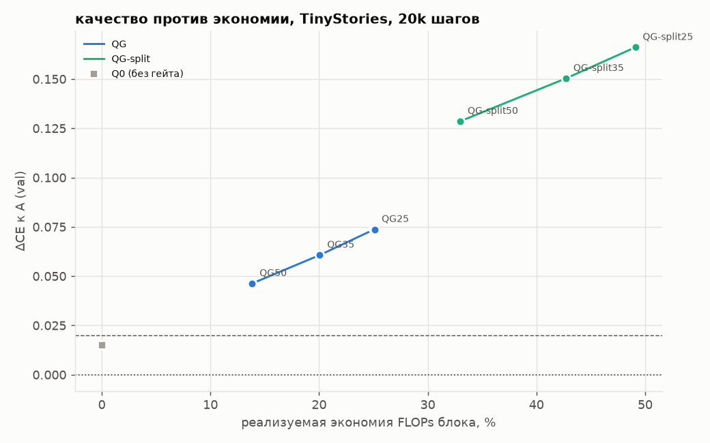

- **Отставание почти линейно по доле закрытых групп.**
  - У QG каждые 10 п.п. закрытых групп стоят 0.010–0.014 нат, у QG-split — около 0.015.
  - Шум сидов мал: два сида QG25 совпадают до 10⁻⁴. Поэтому разница между целями (0.013–0.015 нат)
    надёжна и при одном сиде.
- **QG с общим FFN почти ничего не экономит, если открыть больше групп.**
  - При 49% открытых групп экономия блока 13.8%: закрытая группа экономит только свои строки w2.
  - Доля пар «токен, блок» без единой открытой группы, где FFN пропускается целиком, падает: 20% при цели
    0.25, 13.5% при 0.35, 6.7% при 0.5.
- **QG-split даёт в 2–2.4 раза больше экономии при той же доле открытых групп, но отстаёт на 0.07–0.09 нат
  больше.**
  - Линии не пересекаются: при 33% экономии QG-split50 отстаёт на 0.129.
  - Продолжение линии QG-split до 25% экономии даёт около +0.11, хуже QG25 (+0.074).
  - По этой границе за 20k шагов QG выгоднее QG-split везде, где их можно сравнить.
  - Оговорка из 10.5 в силе: у QG-split на четверть меньше действующих весов. Сравнения при равном числе
    параметров не было.
- **Где теряется качество.**
  - От QG25 к QG50 отставание сокращается сильнее всего на редких словах (+0.19 → +0.11 нат к A) и на
    прочих содержательных словах (+0.10 → +0.06).
  - На пунктуации, служебных словах и началах предложений оно и так 0.02–0.05.
- **Адаптивность сохраняется, но лишние группы распределяются почти равномерно.**
  - ρ(открытые группы, потеря A) ≈ 0.29 при всех целях, AUROC для top-10% трудных 0.61–0.63.
  - От QG25 к QG50 в самой лёгкой пятой части токенов открывается на 13 групп больше (12.4 → 25.8 из 64),
    в самой трудной — на 17 (18.4 → 35.2).
  - Относительный разброс уменьшается: отношение «редкое слово / начало предложения» падает с 2.3 до 1.6.
- **Генерации QG50 и QG-split50.** 6 затравок, жадно и с T = 0.8, рядом с A — в
  [`report/r6n_generations.md`](report/r6n_generations.md).
  - На глаз одинаково связные с A.
  - Огрехи похожие у всех трёх: повторы при жадном выборе (у A — «He ran outside and saw a big, green field»
    дважды, у QG50 — круг «залез на дерево»), отдельные нелепые слова («the Jane» у QG50, «a reveal bird» у A).

#### Долгое обучение: 20k против 40k шагов

- **Постановка.** 40k шагов с нуля, косинус растянут на 40k, 1 сид, та же сетка.
  - Разгон цели — те же 1250 шагов.
  - val (256 окон) каждые 2k шагов, итог — на всём val.

| вариант | val CE 20k | ΔCE к A-20k | val CE 40k | ΔCE к A-40k | улучшение 20k → 40k | уровень A того же расписания, шаг (20k / 40k) |
|---|---|---|---|---|---|---|
| A | 1.3994 | — | 1.3431 | — | −0.056 | — |
| QG25 | 1.4731 / 1.4730 | +0.074 | 1.4127 | +0.070 | −0.060 | 13.7k / 28.0k |
| QG-split25 | 1.5654 | +0.166 | 1.4957 | +0.153 | −0.070 | 9.1k / 18.8k |

Perplexity на 40k: A 3.83, QG25 4.11, QG-split25 4.46.

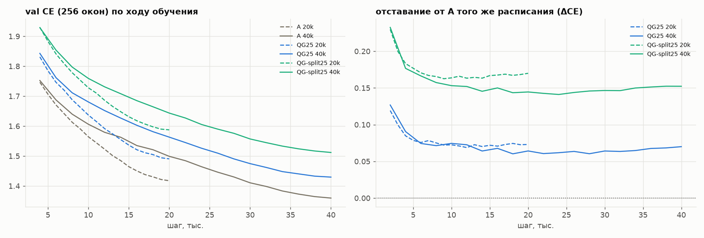

- **Отставание QG25 почти держится.** Было 0.074 на 20k, стало 0.070 на 40k: −0.004 за удвоение обучения.
  - От удвоения QG25 выигрывает столько же, сколько A: −0.060 нат против −0.056.
  - Кривая не выходит на плато, признаков потолка нет.
- **В шагах это постоянный множитель.**
  - На кривой того же расписания QG25 в конце равен A на 69–70% пути, при обеих длинах.
  - Между полными прогонами разрыв больше: QG25-40k (1.4127) всё ещё хуже A-20k (1.3994). Вдвое большего
    обучения не хватает, чтобы догнать A.
  - Если интерполировать A между 20k и 40k в логарифме шагов (−0.056 на удвоение), QG25-40k соответствует A
    с полным расписанием примерно на 17k шагах. То есть QG25 нужно в ~2.4 раза больше шагов.
- **QG-split25 ведёт себя так же, отставание сокращается чуть больше:** 0.166 → 0.153 (−0.014).
  - Это уровень A того же расписания на 46–47% пути при обеих длинах.
  - QG-split25-40k (1.4957) всё ещё хуже QG25-20k (1.473).
- **Внутри прогона отставание меняется.**
  - В фазе большого шага обучения оно сокращается. В 40k-прогонах — до ~0.060 у QG25 и ~0.141 у QG-split25
    на 18–28k шагах. В 20k-прогоне QG25 — до 0.065–0.069 к середине.
  - В конце косинуса, при малом шаге, оно растёт обратно: у QG25 до 0.070 и 0.073, у QG-split25 до 0.152.
  - У Q0 то же самое: 0.010 на 10k → 0.016 на 20k.
  - Значит, дообучение с малым шагом даёт A больше, чем квантованным моделям.
  - Вероятная причина — сетка: поправка состояния меньше шага Δ не меняет квантованное значение, и при малом
    lr модель хуже доводит детали. Это гипотеза, отдельно не проверялась.

#### Проверки новых прогонов

Те же, что в части 2. Чисто во всех 6 новых прогонах QG.

| прогон | max\|Δx\| закрытой | train/eval Δлогит | мёртвых / всегда открытых групп | впустую / открытых | μ max / в конце | max на краях сетки |
|---|---|---|---|---|---|---|
| QG35 | 0 | 0 | 0 / 0 | 0 | 0.435 / 0.105 | 0.10% (блок 0) |
| QG50 | 0 | 0 | 0 / 0 | 0 | 0.178 / 0.061 | 0.09% (блок 0) |
| QG-split35 | 0 | 0 | 0 / 0 | 0 | 0.427 / 0.102 | 0.03% (блок 0) |
| QG-split50 | 0 | 0 | 0 / 0 | 0 | 0.172 / 0.060 | 0.05% (блок 0) |
| QG25-40k | 0 | 0 | 0 / 0 | 0 | 0.784 / 0.151 | 0.07% (блок 0) |
| QG-split25-40k | 0 | 0 | 0 / 0 | 0 | 0.788 / 0.134 | 0.02% (блок 0) |

- **μ.** Чем выше цель, тем слабее давит ограничение: максимум 0.77 при цели 0.25, 0.43 при 0.35, 0.17 при 0.5.
  Но и при 0.5 оно активно до конца обучения.
- **Адаптивность на 40k та же,** что на 20k: ρ(открытые группы, потеря A) = 0.29 у QG25 и 0.26 у QG-split25.

#### Вывод

- **Гейт с общим FFN не даёт рабочей точки «почти как A».**
  - Отставание ≤ 0.02 требует открывать ~75–85% групп, где экономии блока ~3–6%.
  - Долгое обучение отставание не закрывает: множитель по шагам постоянный.
- **Чтобы сдвинуть границу, нужно менять сам механизм, а не цель или длину обучения.**
  - Гейт до внимания, чтобы закрытая группа экономила и голову.
  - QG-split при равном числе параметров, чтобы проверить, сколько из его 0.08–0.09 нат лишнего отставания —
    цена меньшего числа весов.
  - Сетка: проверить, не она ли мешает дообучению при малом lr. Например, Q0 с более мелким шагом в конце
    обучения.

### 10.11 Раунд 7: контроли гейта

Что запускалось (20k шагов, сетка по слоям как в r6):
- **Контроли гейта при доле открытых групп 25%:**
  - random — каждая группа открыта с p = 0.25 независимо;
  - static — 2 из 8 групп на блок, одни и те же для всех токенов;
  - position — p зависит от позиции в истории, профиль как у QG25;
  - tokengate — обучаемый гейт, как у QG25, но на входе только эмбеддинг текущего токена.
- **Сиды.** random s0–s2, static s0–s2, position s1–s2, tokengate s0, QG25 s0–s1. Всё, кроме QG25 и random s0,
  обучено на vast.ai: тот же код, те же токены (sha256 потоков совпадает с домашними). A, обученная на vast,
  отличается от домашней на +0.0006 по полному val, это в пределах шума сидов.
- **Как сравнивается.** По среднему по сидам обучения. У random и position val CE прогона — среднее по 3 сидам
  маски при оценке. Правило: если разность меньше 2 × SD по сидам, пишем «эффект не обнаружен».
- **Что отменено.** Q0 со 161 и 321 уровнем, A-split, Q0-split, QG-split25-wide и position s0 убраны из плана:
  цель проекта сменилась (раздел 11).

| прогон | сидов | val CE (среднее ± SD) | − QG25, нат | % разрыва QG25 − A | 2 × SD | вывод |
|---|---|---|---|---|---|---|
| QG25 | 2 | 1.4731 ± 0.0001 | — | — | — | — |
| QG25-tokengate | 1 | 1.4986 | +0.026 | +35% | 0.0002 | QG25 лучше |
| QG25-static | 3 | **1.4509 ± 0.0003** | **−0.022** | **−30%** | 0.0006 | QG25 хуже |
| QG25-position | 2 | 1.7792 ± 0.0004 | +0.306 | +415% | 0.0006 | QG25 лучше |
| QG25-random | 3 | 1.7819 ± 0.0005 | +0.309 | +419% | 0.0008 | QG25 лучше |
| A | 1 | 1.3994 | −0.074 | −100% | — | — |

Разложение выигрыша гейта над случайной маской (W = random − QG25 = 0.309 нат) по цепочке
random → static → tokengate → QG25:

| часть | нат | доля W | вывод |
|---|---|---|---|
| (а) предсказуемость маски: random − static | +0.331 | 107% | static лучше |
| (б) сам токен: static − tokengate | −0.048 | −15% | tokengate хуже |
| (в) контекст: tokengate − QG25 | +0.026 | 8% | QG25 лучше |
| для сравнения — позиция: random − position | +0.003 | 1% | position лучше |

Главный вывод:
- **QG25 намного лучше случайных масок:** на 0.31 ната относительно random и position, это в 4 раза больше
  всего разрыва QG25 − A.
- **Но весь этот выигрыш даёт предсказуемость маски,** а не адаптивность. Фиксированная маска (static) при той
  же доле групп лучше обученного гейта на 0.022 ната, это 30% разрыва QG25 − A; эффект обнаружен, порог 0.0006.
- **Гейт только от токена хуже фиксированной маски на 0.048.** Контекст возвращает около половины: QG25 лучше
  tokengate на 0.026.
- **Позиция в истории почти ничего не даёт:** 0.003.

Проверки:
- У всех новых прогонов закрытые группы не меняются (max|Δx| = 0).
- У static и tokengate логиты в train и eval совпадают. У random и position расходятся, как и должно быть:
  маска случайная.
- Доля открытых групп 0.25 по каждому блоку. У tokengate 0.25 только в среднем: по блокам от 0.12 до 0.43.

Оговорки:
- У tokengate один сид. Его SD взято у QG25 (0.0001), а SD по двум сидам, вероятно, занижено. Но 0.026 ≫
  разброса сидов у других вариантов (0.0003–0.0005).
- Static — не просто маска: каждый блок всегда пишет в одни и те же 2 группы, и сеть под это
  подстраивается.

### 10.12 Почему static лучше QG25: начало обучения или сама адаптивность

Варианты (TinyStories, 20k шагов, сетка как в r7, обучены на vast.ai):
- **QG25-noramp** — обычный QG25, но цель 25% с первого шага, без разгона от 100% (1 сид).
- **QG25-staticinit** — гейт QG25, смещение ±2. На старте открыты ровно группы static (2l, 2l+1 в блоке l),
  цель 25% с первого шага. Гейт обучается как обычно (2 сида).
- **QG25-hybrid** — группа 2l в блоке l открыта всегда, остальные 7 решает гейт при общей цели 25%, то есть в
  среднем ещё одна группа (1 сид).

Сравнение по среднему по сидам, правило 2 × SD как в 10.11:

| прогон | сидов | val CE | − static | − QG25 | вывод |
|---|---|---|---|---|---|
| static | 3 | **1.4509 ± 0.0003** | — | −0.022 | лучше всех |
| hybrid | 1 | 1.4612 | +0.010 | −0.012 | между static и QG25 |
| staticinit | 2 | 1.4651 ± 0.0034 | +0.014 | −0.008 | между static и QG25 |
| QG25 | 2 | 1.4731 ± 0.0001 | +0.022 | — | — |
| noramp | 1 | 1.5359 | +0.085 | +0.063 | хуже всех |

Все разности больше 2 × SD. У staticinit сиды разошлись на 0.005, это заметно больше, чем у других
вариантов.

Разложение разрыва QG25 − static = 0.022:
- **QG25 → noramp: +0.063 — шаг не изолирует разгон.** Без разгона удар сильнее, а не слабее. На старте открыты
  все группы при цели 25%, и μ к шагу 100 взлетает до 1.72 (у QG25 пик 0.77 на шаге ~1400). Доля открытых
  падает до 0.09. Блоки 1, 4 и 6 закрываются насовсем и до конца остаются на 0%, так что модель фактически
  работает на 5 блоках. Значит, разгон цели в QG25 смягчает удар, а не создаёт его.
- **Начало обучения: QG25 − staticinit = 0.008 (36% разрыва).** Staticinit стартует сразу с 25%, удара нет
  (μ ≤ 0.15). Это чистая оценка вклада «разгон + скачок μ + старт со всеми открытыми группами».
- **Сама адаптивность с хорошей точки: staticinit − static = 0.014 (64% разрыва).** Даже начав с маски static,
  обучаемый гейт к концу хуже фиксированной маски.
- **hybrid.** Одна гарантированно открытая группа на блок закрывает около половины разрыва (−0.012 к QG25),
  но static не догоняет (+0.010).

**Насколько staticinit ушёл от static.** Решение здесь — одна тройка позиция × блок × группа. Сиды s0 / s1:
- **Доля решений, отличных от static:** 13.6% / 13.0%. Из них лишние открытия — 6.6% / 6.4%, закрытые группы
  static — 7.0% / 6.6%. Отличия есть у каждой позиции, в среднем 8.7 / 8.3 решения из 64.
- **Где.** Группы static закрывают в основном поздние блоки (s0): блок 1 — 13%, блок 6 — 29%, блок 7 — 47%,
  блок 8 — 67%. Лишние открытия распределены ровнее, 3–12% по блокам.
- **На каких токенах.**
  - Больше всего отличий в начале истории: на токене начала истории и на первых пяти позициях 14–15
    отличий против ~8.3 дальше.
  - По входному токену: «Once», «upon», «there», «named», «the», «this», «my».
  - Меньше всего — на глаголах прошедшего времени: «made», «heard», «took», «saw», «found», 3.5–4.4.
- **С трудностью отличия не связаны:** ρ с потерей A от −0.09 до −0.02, внутри токена от −0.05 до 0.02.
  Отличия на 55% задаёт сам токен.
- **Карта отклонений от static.** Staticinit хуже static, но карта всё равно построена по запросу: страница
  https://claude.ai/artifact/Q8eAzkQg1LJTAL8eZSsCrF, вкладка «Истории».
  - Карта «staticinit: отличия от static» — сколько решений на позиции, сгенерировавшей токен, не как у static.
  - Карта «staticinit − static: потеря» — где отклонение помогло, а где навредило.
  - При наведении — сетка 8×8 с наложением static: лишние открытия и закрытые группы static.

**QG25-ctrl** (1 сид) — отдельный поток управления c ∈ ℝ⁶⁴ без сетки, свой у каждого токена:
- c₀ = 0; в каждом блоке сначала c ← c + W_c·zin, потом гейт читает [zin, RMSNorm(c)];
- c не попадает ни во внимание, ни в FFN, ни в логиты; цена и цель как у QG25.

Результат:
- **val CE 1.4746** — на уровне QG25: +0.0015, на грани порога. Порог взят по SD двух сидов QG25, а оно,
  скорее всего, занижено.
- Static лучше на 0.024.
- Скачок μ (0.76 на шаге 1400), связь с трудностью (ρ 0.28) и разброс долей по блокам (0.18–0.33) — как у QG25.
- **Гейт поток c использует.** Это видно по опыту на 256 окнах val: среднее RMSNorm(c) по батчу сохранено, а
  различия между токенами убраны.
  - Меняется 9.2% решений (6–11% по блокам), доля открытых падает с 0.24 до 0.18, потеря растёт на +0.35.
  - Если c просто обнулить, меняется 34% решений, доля открытых растёт до 0.58, потеря +0.32. Но это
    выкидывает и общее смещение от c.
  - Норма весов гейта на c составляет 40–75% нормы весов на zin.
- **Но итоговое качество то же, что у QG25.** Гейт перенёс часть своих решений на c, а лучше они не стали.
  Дополнительная память, не привязанная к сетке, дублирует то, что гейт и так видит. Узкое место — не нехватка
  информации о прошлых решениях.

**Итог.** Примерно треть отставания QG25 от static — начало обучения. Две трети — сама адаптивность: гейт
уходит от фиксированной маски в местах, не связанных с трудностью (начало истории, поздние блоки), и это стоит
качества.

### 10.13 Проверка на Википедии: сохраняется ли static < QG25

**Постановка.**
- **Данные.** Английская Википедия, wikimedia/wikipedia 20231101.en, шарды 0–3 из 41: 556M токенов train и
  5.6M val. В val идёт каждая сотая статья, её не видно в train.
- **Токенизатор — GPT-2 BPE, словарь 50 257.**
  - Наш BPE на 8192 обучен на TinyStories. На тексте Википедии он даёт 369 токенов на 1000 символов против 232
    у GPT-2: имена, термины и числа дробятся в 1.6 раза мельче.
  - Id сдвинуты на 2, чтобы 0 оставался паддингом, а 1 — границей документа (<|endoftext|> перед каждой
    статьёй).
- **Выборка без повторов.** Окна по 513 токенов не перекрываются, каждое используется один раз. За 20k шагов
  уходит 328M токенов из 556M.
- **Модель та же:** d = 512, 8 блоков, FFN 1408, 20k шагов. Из-за словаря эмбеддинг больше: 51.4M параметров
  против 29.9M, и шаг медленнее — 0.17–0.21 с против 0.10–0.13 на 3090.
- **Сетка — от своей A по рецепту TinyStories:** δ = RMS состояния / 3.2, K = 40, эмбеддинг × √512.
  Получилось 0.24, 0.438, 0.592, 0.736, 0.845, 0.984, 1.2, 1.57, 2.53; профиль похож на TinyStories.
- **Сиды.** По одному у Q0, static и QG25. Всё обучено на vast.ai, блок стоил $1.19.

| | TinyStories: val CE | − A | % разрыва QG25 − A | Википедия: val CE | − A | % разрыва QG25 − A |
|---|---|---|---|---|---|---|
| A | 1.3994 | — | — | 3.4172 | — | — |
| Q0 | 1.4146 | +0.015 | 21% | 3.4412 | +0.024 | 19% |
| static | 1.4509 (3 сида) | +0.052 | 70% | 3.4902 | +0.073 | 57% |
| QG25 | 1.4731 (2 сида) | +0.074 | 100% | 3.5444 | +0.127 | 100% |

**Главный ответ: порядок static < QG25 на Википедии сохраняется, и разрыв больше.**
- **Размер разрыва.** static − QG25 = −0.054 ната против −0.022 на TinyStories. Это 43% отставания QG25 от A
  против 30%.
- **Шум.** У каждой модели один сид, разброс сидов на Википедии не измерен. На TinyStories SD по сидам
  ≤ 0.0005, а A на vast и дома расходилась на 0.0006. Разность 0.054 примерно в сто раз больше.
- **Отставание от A по ходу обучения** (256 окон; Q0 / static / QG25):

  | шаг | Q0 | static | QG25 |
  |---|---|---|---|
  | 4k | +0.033 | +0.062 | +0.134 |
  | 12k | +0.020 | +0.058 | +0.114 |
  | 20k | +0.025 | +0.076 | +0.132 |

  Отставания устоялись рано, порядок от длины обучения не зависит. A к 20k ещё учится: 3.48 на 16k, 3.42 на
  20k. Больше шагов снизит все потери, но для вопроса «static или QG25» не нужно.

**Адаптивность QG25 — разбор как в r6_adaptivity** (трудность — потеря A на том же токене):

| | ρ(открыто, потеря A) | внутри токена | средние по токенам | R² самого токена | открыто по квинтилям потери A (из 64) |
|---|---|---|---|---|---|
| TinyStories | 0.30 | 0.24 | 0.49 | 0.54 | 12.4 / 15.2 / 16.2 / 17.2 / 18.4 |
| Википедия | **0.13** | **0.13** | 0.43 | 0.55 | 15.0 / 16.1 / 16.4 / 16.6 / 16.7 |

- **На Википедии гейт почти не следит за трудностью.** От лёгких токенов к трудным число открытых групп
  растёт всего с 15.0 до 16.7, на TinyStories — с 12.4 до 18.4.
- **Доля, которую объясняет сам токен, та же:** 55%.
- **Бюджет по блокам собран в одном месте.** Блок 7 открыт на 74%, блок 8 почти закрыт (2%), блок 2 — 10%.
- **Скачок μ после разгона цели — 0.91** (на TinyStories 0.77).

Проверки:
- закрытые группы не меняются (max|Δx| = 0);
- логиты в train и eval совпадают;
- доля значений на краях сетки ≤ 0.02%.

### 10.14 Обучение гейта по мотивам H-Net и ограничение μ

**Цель.** Проверить, догонит ли адаптивный гейт static, если у решения появится честный путь градиента через
прямой проход. Условия: TinyStories, 20k шагов, сетка и всё остальное как у QG25 r7, по 1 сиду, vast.ai.
Таблицы — [`report/r9_gate_variants.md`](report/r9_gate_variants.md).

**Варианты.** У hnet и dimmer: p = sigmoid(z), решение m = 1[p > 0.5], закрытая группа побитово не меняется.
- **Открытая группа** пишет `δ·clamp(round((x + s·(a+u))/δ), ±40)`. Градиент CE идёт через s(p): у hnet s = p,
  у dimmer s = 2p − 1.
- **Закрытая группа** вперёд ничего не пишет. Назад её гейт получает градиент как у QG25 — через сигмоиду, будто
  открытие записало полную правку.
- **Цена, μ и разгон цели — как у QG25;** начальное смещение гейта +2.
- **QG25-mulimit** — обычный QG25, но изменение μ за шаг ограничено ±0.002.

**История запуска.**
- **Первая постановка без пути градиента у закрытых групп** остановлена по ошибке в задании.
  - hnet к шагу 3500 держал 0.19 открытых при цели 0.25 и μ = 0: открывать группы было нечем.
  - Его проба на 300 шагов закрыла почти всё.
- **Проба исправленной версии в сжатом режиме** (600 шагов, разгон 300) не прошла критерий «в каждом блоке ≥ 5%
  открытых к концу пробы»: у hnet блок 2 дошёл до 0.001, у dimmer блок 7 — до 0.035.
- **Обычный QG25 в том же сжатом режиме** тоже почти гасит блок: блок 8 — 0.027. Сжатая проба жёсткая для любого
  гейта.
- **Пробы с полным разгоном** (первые 2000 шагов основного прогона) критерий прошли: минимум 0.09 у hnet и 0.08 у
  dimmer. Основные прогоны запущены после них.
- **Стоимость блока** с остановленной парой и пробами — $1.11.

| прогон | val CE | − static | − QG25 | − staticinit | открыто по блокам 1–8 | μ: пик (шаг) / конец |
|---|---|---|---|---|---|---|
| static (3 сида) | **1.4509** | — | −0.022 | −0.014 | 0.25 везде | — |
| staticinit (2 сида) | 1.4651 | +0.014 | −0.008 | — | 0.27 0.28 0.31 0.27 0.28 0.26 0.21 0.10 | 0.15 |
| QG25 (2 сида) | 1.4731 | +0.022 | — | +0.008 | 0.32 0.24 0.21 0.17 0.27 0.26 0.29 0.23 | 0.77 (1400) / 0.17 |
| QG25-mulimit | 1.4701 | +0.019 | −0.003 | +0.005 | 0.32 0.25 0.21 0.15 0.28 0.23 0.28 0.26 | 0.78 (1400) / 0.17 |
| QG25-smooth-hnet | 1.4745 | +0.024 | +0.001 | +0.009 | 0.29 0.11 0.17 0.18 0.21 0.29 0.31 0.43 | 1.12 (1500) / 0.26 |
| QG25-smooth-dimmer | 1.4769 | +0.026 | +0.004 | +0.012 | 0.43 0.08 0.17 0.18 0.18 0.24 0.29 0.42 | 2.54 (1700) / 0.52 |

**Ограничение μ почти не срабатывало.** Пик копится примерно за 400 шагов, а за шаг μ и так меняется не больше
чем на ~0.001–0.002. Поэтому траектория mulimit совпадает с QG25 (пик 0.78 против 0.74–0.77), и вопрос «мешают
ли скачки μ» этот прогон не проверил.

**Уверенность решений** — p = sigmoid(z) открытых групп, 64 окна val:

| прогон | медиана p открытых | p > 0.9 | p в 0.5–0.6 | закрытые с p < 0.1 | p > 0.9 по блокам 1–8 |
|---|---|---|---|---|---|
| QG25 | 0.68 | 12% | **31%** | 66% | 6 7 7 16 10 17 19 14% |
| QG25-mulimit | 0.69 | 12% | 31% | 66% | 3 5 9 14 10 24 18 13% |
| QG25-smooth-hnet | 0.68 | 6% | 31% | 71% | 1 11 5 9 7 7 6 8% |
| QG25-smooth-dimmer | **0.80** | **27%** | **12%** | **88%** | 1 60 31 45 49 44 31 19% |

**Уверенность и дрейф раскладки у QG25.**
- **Гейт уверенно закрывает и неуверенно открывает.** Треть открытий (31%) стоит у самого порога, p в 0.5–0.6.
- **Раскладка дрейфует до конца обучения.** Решения гейта сравнивались на чекпойнтах 10k, 15k и 20k, на тех же 64
  окнах. Между 10k и 15k меняется 4.9% решений, между 15k и 20k — 3.5%, хотя lr к концу уже мал.
- **Плывут почти только решения у порога.** 87% перемен между 15k и 20k приходится на решения с финальным p в
  0.4–0.6. Их всего 13.5%, и каждое четвёртое-пятое переключилось. Уверенные решения (p < 0.1 или > 0.9)
  почти не меняются: доли процента от тысячной.
- **Итог.** Неуверенные открытия — это и есть подвижная часть раскладки. Сети приходится подстраиваться под
  маску, которая всё ещё меняется, а у static такой проблемы нет.
- **Для hnet и dimmer дрейф не посчитан:** их промежуточные чекпойнты остались на машине и были удалены вместе
  с ней.

**Обещание градиента против реального переключения.** Те же 200 позиций, что в 12.1, решение «закрыть открытую
группу». У hnet и dimmer обещание — −s·∂L/∂s, градиент через s; у QG25 и mulimit — straight-through. Знак сверяется
среди решений с |реальное| > 10⁻³, эффект меряется на окно, гейты реагируют.

| прогон | закрытий | знак совпал | Спирмен | знак по блокам 1–8 | знак, свой токен |
|---|---|---|---|---|---|
| QG25 | 3136 | 67% | 0.38 | 55 64 61 67 64 65 75 90 | 76% |
| QG25-mulimit | 3144 | 65% | 0.37 | 58 55 53 64 64 68 74 85 | 74% |
| QG25-smooth-hnet | 3181 | 66% | 0.38 | 52 59 58 62 64 65 72 81 | 76% |
| QG25-smooth-dimmer | 3184 | 63% | 0.36 | 58 65 57 61 62 62 68 72 | 74% |

Ответы:
- **(а) Догоняет ли кто-то static — нет.** Лучший из новых, mulimit, лучше QG25 на 0.003, но хуже static на
  0.019. hnet на уровне QG25, dimmer хуже на 0.004. Все три уступают и staticinit.
- **(б) Стал ли градиент точнее — нет.** Градиент через s угадывает знак эффекта закрытия так же, как
  straight-through: 63–66% против 67%. В блоках 1–3 по-прежнему 52–65%, почти монетка. В блоке 8 даже хуже:
  72–81% против 90%. Честный путь градиента через прямой проход от каскадов округления не спасает.
- **(в) Отличается ли hnet от dimmer — по уверенности сильно, по качеству нет.**
  - Dimmer, у которого на пороге запись плавно уходит в ноль, принимает куда более уверенные решения: p > 0.9 у
    27% открытых против 6% у hnet, у порога 12% против 31%, уверенно закрытых 88% против 71%.
  - Но μ у него взлетает до 2.54, а качество чуть хуже (1.4769 против 1.4745).
  - Гладкость на пороге делает решения увереннее, но static не догоняет. Значит, неуверенность решений
    сама по себе не главная причина проигрыша.

### 10.15 Без сетки и гейт «по очереди»

**Цель.** Два вопроса о том, откуда разрыв static − QG25 = −0.022:
- не создаёт ли его сетка (округление состояния);
- не мешает ли гейту выбор, *какие* группы открыть, если оставить ему только *сколько*.

Условия как у QG25 r7: TinyStories, 20k шагов, по 1 сиду, vast.ai (2×3090). Блок стоил $0.72. Таблицы —
[`report/r10_tables.md`](report/r10_tables.md).

**Варианты.**
- **QG25-nogrid и static-nogrid** (флаг `q_nogrid`) — то же, что QG25 и static, но без квантования.
  - Эмбеддинг не округляется.
  - Открытая группа пишет ровно x + a + u: без округления и без обрезки ±40δ.
  - Закрытая группа не пишется, побитово, как раньше.
  - Инициализация, `emb_scale`, гейт, цена и μ — как с сеткой.
  - Обрезка ±40δ на результат не влияет: без неё за ±40δ выходит ≤ 0.06% значений. Значит, разница сводится
    к округлению.
- **QG25-ordered** (флаг `qg_ordered`) — группы блока l стоят в очереди 2l, 2l+1, … (mod 8).
  - Голова гейта выдаёт одно число z на токен и блок. Группа на месте j в очереди открыта, если z > j, так
    что открыты ровно первые k = #{j: z > j} групп.
  - Обучение — straight-through через sigmoid(z − j). Цена — доля открытых (k/8), цель и разгон как у QG25.
  - Начальное смещение 7 + 2: на старте открыто всё, у последней группы тот же запас, что у QG25.
  - При k = 2 на всех токенах маска совпадает со static, логиты побитово равны (тест).

**Качество.**

| прогон | val CE | − static | − QG25 | − A |
|---|---|---|---|---|
| A (2 сида) | 1.3981 | | | — |
| static (3 сида) | **1.4509** ± 0.0003 | — | −0.022 | +0.053 |
| QG25 (2 сида) | 1.4731 ± 0.0001 | +0.022 | — | +0.075 |
| static-nogrid | **1.4375** | −0.013 | −0.036 | +0.039 |
| QG25-nogrid | 1.4656 | +0.015 | −0.008 | +0.068 |
| QG25-ordered | 1.4721 | +0.021 | −0.001 | +0.074 |

**(а) Без сетки разрыв не исчезает.**
- **Разрыв static − QG25:** с сеткой −0.022, без сетки −0.028.
- **Сетка стоит обоим вариантам,** static сильнее: 0.013 против 0.008 у QG25. Без гейта (Q0 против A) — 0.017.
- **Разрыв держится всё обучение.** По 256 окнам val:

  | шаг | 4k | 8k | 12k | 16k | 20k |
  |---|---|---|---|---|---|
  | с сеткой | −0.041 | −0.034 | −0.025 | −0.021 | −0.021 |
  | без сетки | −0.060 | −0.039 | −0.033 | −0.030 | −0.029 |

- **Шум.** Разрыв без сетки по одному сиду на вариант. По сидам с сеткой SD ≤ 0.0003, а у A без сетки сиды
  расходятся на 0.0025 (SD 0.0017). Если сиды без сетки такие же шумные, разность −0.006 — около 2.5 SD.
  Вывод «разрыв не меньше» надёжен. Вывод «разрыв больше на 0.006» требует вторых сидов.
- **Гейт без сетки ведёт себя так же,** как с сеткой — см. таблицу ниже.
  - ρ(открыто, потеря A) 0.32 против 0.30; R² самого токена 0.55 против 0.55.
  - У порога (p 0.5–0.6) — 31% открытых, как у QG25.
  - Дрейф раскладки 15k → 20k — 3.3% решений против 3.5%.
  - Отличие одно: блок 1 открыт на 11% против 32%.
- **Итог.** Сетка не причина проигрыша адаптивного гейта: каскады округления, неточный градиент через
  округление и «открыл, но ничего не изменилось» здесь ни при чём. Разрыв живёт в самой адаптивной маске.

**(б) Гейт «по очереди» — на уровне QG25.**
- **Качество.** 1.4721 против 1.4731 у QG25 и 1.4509 у static.
  - Разность с QG25 0.001 меньше разброса сидов у вариантов с адаптивной маской (у staticinit SD 0.0034):
    эффект не обнаружен.
  - Отставание от static (+0.021) почти такое же, как у QG25.
- **Структура соблюдается.** Открытые группы — всегда начало очереди: 100% решений во всех блоках.
- **Разброс k:**
  - k = 2 (раскладка static) — лишь 27% пар «токен × блок»;
  - k = 0 — 20%, k = 1 — 22%, k = 3 — 16%, k ≥ 4 — 15%;
  - ни у одного токена все 8 блоков не стоят на k = 2.
- **Бюджет по блокам неравный,** как у QG25.

  | блок | 1 | 2 | 3 | 4 | 5 | 6 | 7 | 8 |
  |---|---|---|---|---|---|---|---|---|
  | среднее k | 2.4 | 2.4 | 2.9 | 1.3 | 2.4 | 1.6 | 2.1 | 0.7 |

  Блок 8 на 63% токенов не пишет ничего. Хвост очереди почти не используется: в блоке 4 половина групп открыта
  меньше чем на 1% токенов.
- **Решения устойчивее, но качество от этого не растёт.**
  - Дрейф раскладки 15k → 20k — 2.3% решений против 3.5% у QG25; 10k → 15k — 3.3% против 4.9%. 90% перемен —
    решения у порога.
  - Если заменить решения средними по токену (таблица с train), ordered теряет +0.13 ната, QG25 — +0.38.
  - Уверенность по p здесь с QG25 напрямую не сравнима: первые группы очереди получают запас по построению.
    Всё же у порога лишь 18% открытых против 31%.
- **Следит за трудностью чуть слабее QG25.** ρ(открыто, потеря A) 0.27 против 0.28–0.30, внутри токена 0.19
  против 0.21–0.24. От лёгких к трудным токенам открыто 12.9 → 17.6 групп из 64 против 12.4 → 18.4.
- **Итог.** Выбор «какие группы» — не источник проигрыша. Гейт, которому оставили только «сколько», маска
  которого вложена в раскладку static и плывёт на треть меньше, проигрывает static столько же, сколько QG25.

**Что остаётся.** Сетка и выбор групп — не причины проигрыша. Остаются переменное по токенам k и неравный
бюджет по блокам: у static 2 группы в каждом блоке на каждом токене, у всех адаптивных — от 0 до 8 и перекос
между блоками (у staticinit тоже: блок 8 — 0.10). Этот блок их не разделяет. Прямой тест — ordered с k,
закреплённым по блокам в среднем (цель 25% в *каждом* блоке, свой μ на блок), или static с переменным по
токенам k.

Проверки:
- закрытые группы не меняются (max|Δx| = 0 у всех трёх);
- решения при повторном прогоне совпадают с сохранёнными в tok.npz (100%);
- пробы на 300 шагов со сжатым разгоном прошли без ошибок.
  - Сжатый разгон, как и у прошлых проб, гасил блоки: у ordered блоки 2–5 к 300 шагам ≤ 1%, блок 1 — 9%.
  - В основных прогонах с полным разгоном минимум по блокам к шагу 3500 — 0.12 у nogrid (блок 1) и 0.08 у
    ordered (блок 8).

### 10.16 Бюджет по блокам и переменное k

**Цель.** После 10.15 остались два подозреваемых в проигрыше ordered (и QG25) статической маске:
- неравный бюджет по блокам: у ordered среднее k по блокам от 0.7 до 2.9;
- переменное по токенам k: у static всегда k = 2.

Три прогона их разделяют. Условия как у QG25 r7: TinyStories, 20k шагов, сетка r7, по 1 сиду, vast.ai (2×3090).
Блок стоил $0.67: $0.66 сам прогон и $0.01 сорвавшийся первый запуск (хост не скачал образ). Таблицы —
[`report/r11_tables.md`](report/r11_tables.md), подмена маски — [`report/r11_swap.json`](report/r11_swap.json).

**Варианты.**
- **QG25-ordered-perblock** (флаг `qg_mu_per_block`) — ordered, но цель 25% в *каждом* блоке и свой μ_l на блок.
  - Цена: среднее по блокам μ_l · (доля открытых в блоке l). При равных μ_l это ровно цена ordered.
  - Шаг двойственного подъёма свой у каждого блока: μ_l += 0.05·(доля_l − цель). Разгон цели тот же.
- **static-randk** (`qg_mask="randk"`) — без гейта: в блоке l открыты первые k групп очереди ordered.
  - k тянется заново для каждой пары «токен × блок» на каждом прямом проходе, независимо по блокам, в том
    числе на оценке. Оценка — среднее по 3 сидам маски, как у random и position.
  - Распределение k — общее по блокам распределение ordered (k = 0…8: 0.197 0.218 0.270 0.160 0.089 0.038
    0.016 0.008 0.003, среднее 1.964), чуть сдвинутое к среднему ровно 2. Сдвиг экспоненциальный,
    KL = 0.0003: 0.191 0.215 0.270 0.163 0.092 0.040 0.017 0.009 0.004.
- **static-unequal** (`qg_static_k`) — без гейта, фиксированное k_l = округлённое среднее k ordered по блоку:
  2, 2, 3, 1, 2, 2, 2, 1 — первые k_l групп очереди.
  - Это 15 из 64 групп, 23.4%, а не 25%: бюджет записи на 1/16 меньше, чем у static.

**Качество.** Разброс по сидам известен только для static (SD 0.0003), QG25 (0.0001), A (0.0017) и staticinit
(0.0034). Остальные прогоны — по 1 сиду.

| прогон | val CE | − static | − ordered |
|---|---|---|---|
| static (3 сида) | **1.4509** ± 0.0003 | — | −0.021 |
| static-unequal | 1.4525 | +0.002 | −0.020 |
| QG25-ordered-perblock | 1.4650 | +0.014 | −0.007 |
| QG25-ordered | 1.4721 | +0.021 | — |
| QG25 (2 сида) | 1.4731 ± 0.0001 | +0.022 | +0.001 |
| static-randk (3 сида маски) | 1.6262 ± 0.0002 | **+0.175** | +0.154 |

По 256 окнам val вдоль обучения:

| шаг | 4k | 8k | 12k | 16k | 20k |
|---|---|---|---|---|---|
| static | 1.7939 | 1.6552 | 1.5653 | 1.5013 | 1.4698 |
| static-unequal | 1.7911 | 1.6552 | 1.5681 | 1.5008 | 1.4699 |
| QG25-ordered-perblock | 1.8180 | 1.6745 | 1.5842 | 1.5138 | 1.4830 |
| QG25-ordered | 1.8246 | 1.6816 | 1.5911 | 1.5220 | 1.4897 |
| static-randk | 1.9842 | 1.8323 | 1.7429 | 1.6757 | 1.6460 |

**(а) Неравный бюджет по блокам сам по себе почти бесплатен.**
- static-unequal − static = +0.0017. Это больше 2·SD static (0.0007), так что эффект обнаружен, но он мал:
  8% разрыва ordered − static.
- Часть этой разницы может давать просто меньший бюджет (23.4% против 25%). Вдоль обучения кривые
  совпадают до третьего знака.

**(б) Свой μ на блок помогает гейту, но static он не догоняет.**
- perblock − ordered = −0.007.
  - Оба прогона по 1 сиду. Если сиды адаптивных масок расходятся как у staticinit (SD 0.0034), это 2.1 SD —
    на границе порога.
  - Вдоль обучения perblock впереди на 0.007–0.008 на каждой точке начиная с 4k. Точки не независимы,
    второй сид нужен.
  - Второй сид (10.18) подтвердил: perblock 1.4628 ± 0.0031, против ordered −0.009, против static +0.012 — оба
    эффекта обнаружены.
- **Бюджет выровнен:** доля открытых 0.24–0.25 в каждом блоке и на обучении, и на оценке.
  - μ_l: пик 0.32–0.84 на шагах 1300–1400 (у ordered общий 0.65); к концу от 0.04 (блок 1) до 0.18 (блок 7).
  - Мёртвых блоков нет. На шаге 3500 доли 0.24–0.26, у ordered было 0.08–0.37.
- **Переменное k осталось.** Среднее k в каждом блоке 1.9–2.0, но k = 2 лишь у 29% пар «токен × блок»
  (у ordered 27%). k = 0 — 15%, k = 1 — 27%, k = 3 — 15%, k ≥ 4 — 13%.
- **Гейт ведёт себя как у ordered:**
  - ρ(открыто, потеря A) 0.25, внутри токена 0.19; R² самого токена 0.58;
  - дрейф раскладки 10k → 15k 3.2%, 15k → 20k 2.3%;
  - p > 0.9 у 23% открытых, у порога (0.5–0.6) 19%;
  - замена решений таблицей токена стоит +0.138.
- **Отставание от static +0.014** — две трети разрыва ordered.

**(в) Случайное переменное k очень дорого.**
- randk − static = +0.175, в 8 раз больше разрыва ordered. Выученное k много лучше случайного (ordered на 0.154
  лучше randk), но всё ещё хуже фиксированного k = 2.
- **Подмена маски на готовых весах** (608 окон анализа; без обучения; `dd/r11_swap.py`): у каждого прогона
  первые k групп очереди открыты во всех блоках.

  | прогон | своя маска | k ≡ 2 (маска static) | k ≡ 8 (всё открыто) |
  |---|---|---|---|
  | static | 1.490 | 1.490 (проверка) | 5.43 |
  | static-randk | 1.659 | **1.566** | 1.98 |
  | QG25-ordered | 1.512 | 1.861 | 3.94 |
  | QG25-ordered-perblock | 1.504 | 1.866 | 4.89 |

  - Из ~0.17 проигрыша randk на этих окнах ~0.09 даёт шум маски на инференсе: с k ≡ 2 те же веса лучше на
    0.093. Ещё ~0.08 — сами веса, выученные под случайным k: с k ≡ 2 они на 0.076 хуже static.
  - Выученные модели опираются на своё k. Если навязать ordered и perblock k ≡ 2, они теряют +0.35.

**Разложение разрыва ordered − static = +0.021:**
- перекос бюджета по блокам в выученном гейте (ordered − perblock): +0.007, около трети;
- переменное по токенам k при ровном бюджете (perblock − static): +0.014, около двух третей.

Тот же перекос у фиксированной маски стоит лишь +0.002 (unequal). Значит, перекос ordered вредит не как
раскладка, а как след динамики общего μ. Во время разгона и пика μ блок 8 сжался с 0.24 (шаг 500) до
0.05–0.07 (шаги 1300–1500) и до конца остался на 0.07–0.09. Блок 4 так же застрял на 0.15.

**Итог.** Главная оставшаяся цена адаптивного гейта — сама переменность k по токенам, даже выученная и даже при
точном бюджете в каждом блоке. При фиксированной маске каждая открытая группа пишет всегда, и следующие блоки
могут на неё рассчитывать. При переменной это похоже на dropout записи. Это гипотеза, не проверено. Случайная
переменность здесь катастрофична (+0.175). Выученный гейт отыгрывает девять десятых этого, но не всё.

**Проверки:**
- закрытые группы не меняются (max|Δx| = 0 у всех трёх);
- решения perblock при повторном прогоне совпадают с tok.npz (100%);
- у randk реальное распределение k на оценке совпадает с заданным: 0.191 0.215 0.270 0.163 …, во всех блоках
  среднее 2.00, доля 0.25. Это всегда начало очереди (100%), R² токена 0.02, то есть маска случайна;
- у unequal маска ровно k_l в каждом блоке;
- пробы на 300 шагов прошли.
  - У perblock сжатый разгон (18 шагов) к шагу 300 закрыл блок 2 целиком. Так было и у прошлых проб со сжатым
    разгоном.
  - В основном прогоне на шаге 3000 доли 0.24–0.26 во всех блоках.

### 10.17 Лестница по размеру: static − QG25 без сетки

**Цель.** Проверить, держится ли разрыв static − QG25 при росте модели. Главный график — разрыв против числа
параметров. Без сетки: по 10.15 сетка разрыв не объясняет, а без неё не нужны калибровка и A на каждом размере.

**Условия.**
- TinyStories, 20k шагов × 32 × 512, по 1 сиду на вариант, гиперпараметры как сейчас (lr 1e-3, цель и разгон
  QG25).
- Без сетки (`q_nogrid`). Шаг δ₀ = 0.265 задаёт только начальный масштаб эмбеддинга, эмбеддинг × √d.
- На всех размерах G = 8 групп (`--depth_groups 8`): 25% — это всегда 2 группы из 8 на блок. Голова 64
  измерения, FFN ≈ 8/3·d.

| размер | d | блоков | голов | FFN | параметров | без эмбеддинга |
|---|---|---|---|---|---|---|
| маленькая | 256 | 8 | 4 | 704 | 8.8M | 6.7M |
| текущая (из 10.15) | 512 | 8 | 8 | 1408 | 30.5M | 26.3M |
| глубже | 512 | 16 | 8 | 1408 | 57.9M | 53.7M |
| шире | 768 | 12 | 12 | 2048 | 93.2M | 86.9M |

- **Память.** Эмбеддинг глубины на новых размерах пересчитывается в обратном проходе (`depth_lookup_recompute`).
  Прямой проход и градиенты не меняются (тест), меняется только память. Первая проба wide без этого упала по
  памяти: промежуточные (B, T, G, d) в fp32 занимали ~19 ГБ.
- **Пробы перед основными** — первые 2000 шагов полного расписания (deep и wide, QG25):

  | | deep | wide | d512/8 для сравнения |
  |---|---|---|---|
  | память | 8.3 ГБ | 9.5 ГБ | |
  | val на 2k | 1.941 | 1.942 | 2.014 |
  | минимальная доля блока | 0.08 | 0.06 | |

  Пробы пройдены.
- **Стоимость.** ~$1.75 при лимите $1.9. Из них ~$0.22 — неудачные попытки:
  - упавшая проба;
  - два хоста, к которым не поднялся SSH;
  - одна машина, остановленная для смены плана.

  Драйвер последней машины убила нехватка памяти на домашнем компьютере. Последний прогон (small QG25) забран
  вручную по scp со сверкой размеров, машина удалена, `vastai show instances` пуст.

**Результат.** График — [`report/r12_ladder.png`](report/r12_ladder.png), таблицы —
[`report/r12_tables.md`](report/r12_tables.md).

| размер | параметров | static-nogrid | QG25-nogrid | static − QG25 |
|---|---|---|---|---|
| d256/8 | 8.8M | 1.6145 | 1.6420 | **−0.028** |
| d512/8 | 30.5M | 1.4375 | 1.4656 | **−0.028** |
| d512/16 | 57.9M | 1.3779 | 1.3996 | **−0.022** |
| d768/12 | 93.2M | 1.3433 | 1.3640 | **−0.021** |

- **Разрыв не исчезает с размером.** Static лучше QG25 на всех четырёх размерах, от 8.8M до 93M параметров: на
  0.021–0.028 ната при том, что сама CE падает на 0.27.
- **Возможно, разрыв немного сокращается:** −0.028 у двух малых, −0.021…−0.022 у двух больших.
  - Это по 1 сиду на точку. Разброс сидов без сетки неизвестен; у A сиды расходятся на 0.0025, у perblock — на
    0.0044.
  - Разница 0.006–0.007 — на границе шума. Вывод «разрыв держится» надёжен, вывод «разрыв уменьшается» требует
    сидов.
- **Глубина и ширина ведут себя одинаково:** deep и wide при 58M и 93M дают почти один разрыв.
- **Вдоль обучения** (256 окон) разрыв на всех размерах самый большой в начале и сходится к концу:

  | шаг | 2k | 4k | 8k | 12k | 16k | 20k |
  |---|---|---|---|---|---|---|
  | d256/8 | −0.055 | −0.046 | −0.037 | −0.030 | −0.028 | −0.027 |
  | d512/8 | −0.075 | −0.060 | −0.039 | −0.033 | −0.030 | −0.029 |
  | d512/16 | −0.040 | −0.032 | −0.030 | −0.023 | −0.023 | −0.021 |
  | d768/12 | −0.056 | −0.044 | −0.033 | −0.022 | −0.022 | −0.022 |

**Гейт QG25 на каждом размере.** Трудность — потеря A_s0 (d512/8) на тех же токенах; во второй строке ρ —
потеря static того же размера.

| размер | ρ(открыто, потеря A) | внутри токена | ρ со static своего размера | внутри токена | R² токена | доля открытых, от лёгких к трудным | дрейф 10k→15k | 15k→20k |
|---|---|---|---|---|---|---|---|---|
| d256/8 | 0.22 | 0.17 | 0.27 | 0.21 | 0.62 | 0.21 → 0.27 | 4.2% | 2.9% |
| d512/8 | 0.32 | 0.22 | 0.33 | 0.23 | 0.55 | 0.19 → 0.29 | 4.7% | 3.3% |
| d512/16 | 0.32 | 0.25 | 0.31 | 0.25 | 0.63 | 0.18 → 0.29 | 5.5% | 3.7% |
| d768/12 | 0.33 | 0.26 | 0.31 | 0.25 | 0.57 | 0.18 → 0.29 | 5.5% | 3.8% |

- **Связь с трудностью чуть растёт с размером,** сильнее всего внутри токена: 0.17 → 0.26. Маленькая модель
  следит за трудностью слабее всех, у трёх больших ρ ≈ 0.32.
- **Маска плывёт чуть больше у больших моделей:** 15k → 20k от 2.9% до 3.8% решений. Как и раньше, 84–91% перемен —
  решения у порога (p 0.4–0.6).
- **Общее у всех размеров:**
  - самый закрытый — блок 1 (0.08–0.12);
  - пик μ 0.69–0.87 на шаге 1400;
  - около 55–63% разброса числа открытых групп задаёт сам токен.

**Скорость** (с/шаг, 1×3090, static / QG25): d256/8 0.061 / 0.069, d512/8 0.118 / 0.129, d512/16 0.250 / 0.222,
d768/12 0.278 / 0.324. У deep и wide включён пересчёт эмбеддинга глубины.

**Итог.** Проигрыш адаптивного гейта статической маске — не свойство маленькой модели. Он держится от 8.8M до
93M параметров, при больших размерах, возможно, слегка меньше (−0.021 против −0.028; 1 сид). Гейт больших
моделей немного лучше следит за трудностью внутри токена, но маска у них плывёт чуть сильнее.

### 10.18 Второй сид perblock и k ∈ [1, 3]

**Цель.**
- Проверить вторым сидом разницы perblock из 10.16 (с ordered она была на границе порога).
- Сузить переменность k: ordered-perblock-k13 — k только 1, 2 или 3, цель 25% в каждом блоке.

TinyStories, 20k шагов, vast.ai (2×3090). Блок стоил $0.39.

**Варианты.**
- **QG25-ordered-perblock, сид 1** — с сеткой, как сид 0.
- **QG25-ordered-perblock-k13** — без сетки (`q_nogrid`), 1 сид, флаг `qg_k_range = (1, 3)`.
  - Первая группа очереди открыта всегда, жёстко и без градиента; группы с места 3 и дальше всегда закрыты.
  - Места 1 и 2 решает гейт (z > j), остальное как у perblock: свой μ на блок, цель 25%.
  - Начальное смещение (3 − 1) + 2 = 4: на старте открыто k = 3, у последней решаемой группы запас как у QG25.
    При смещении ordered (9) сигмоиды решаемых групп были бы насыщены.
  - Тест `test_r13_ordered_k_range`.
- **perblock без сетки** (опорный для k13) стоял в плане как необязательный и ждал вашего «да». Ответа не было,
  и его сняли, чтобы машина не простаивала. Поэтому k13 без сетки напрямую сравнивается только со
  static-nogrid и QG25-nogrid.

**Качество.**

| прогон | val CE | − static своего типа |
|---|---|---|
| static (с сеткой, 3 сида) | 1.4509 ± 0.0003 | — |
| perblock (с сеткой, 2 сида: 1.4650, 1.4606) | 1.4628 ± 0.0031 | **+0.012** |
| ordered (с сеткой) | 1.4721 | +0.021 |
| static-nogrid | 1.4375 | — |
| **k13 (без сетки)** | **1.4461** | **+0.009** |
| QG25-nogrid | 1.4656 | +0.028 |

- **Разницы perblock подтверждены.** Сиды perblock расходятся на 0.0044 (SD 0.0031), 2·SD = 0.0062.
  - perblock − static = +0.012: эффект обнаружен.
  - perblock − ordered = −0.009: эффект обнаружен.
- **Уточнённое разложение ordered − static = 0.021:**
  - перекос бюджета по блокам из-за общего μ: 0.009, около 45%;
  - переменное по токенам k при ровном бюджете: 0.012, около 55%.
- **k13 ближе к static, чем все прежние адаптивные варианты, но не догоняет его:** +0.009 против static-nogrid.
  Это 1 сид; при SD как у perblock эффект обнаружен.
  - Насколько сужение k помогло, точно сказать нельзя: нет perblock без сетки.
  - Оценка, а не измерение: в 10.15 без сетки разрыв static − гейт был не меньше, чем с ней (−0.028 против
    −0.022). Тогда perblock без сетки был бы примерно на +0.012…+0.018 от static, и сужение k экономит
    0.003–0.009.

**Поведение k13.**
- **k = 2 стало большинством:** k = 1 / 2 / 3 у 24 / 53 / 23% пар «токен × блок» (у perblock k = 2 лишь
  29–30%). Среднее k по блокам 1.97–2.05.
- **Связь с трудностью чуть слабее:**
  - ρ(открыто, потеря A) 0.24 против 0.25 у perblock; внутри токена 0.16 против 0.19–0.20;
  - R² самого токена 0.59;
  - от лёгких к трудным токенам открыто 14.5 → 17.1 групп из 64 (perblock 13.0 → 17.6).
- **Маска стабильнее и предсказуемее:**
  - дрейф раскладки 10k → 15k 2.4%, 15k → 20k 1.6% (perblock 3.2–3.4% и 2.2–2.3%); 99% перемен — решения у
    порога;
  - замена решений таблицей токена стоит лишь +0.03 (perblock +0.12–0.14);
  - у порога (p 0.5–0.6) 22% открытых, p > 0.9 у 8.5%.
- **μ:** пик 0.77 на шаге 1500 (максимум по блокам), к концу 0.05–0.16.

**Второй сид perblock ведёт себя как первый:**
- ρ 0.25, внутри токена 0.20, R² 0.59;
- дрейф 3.4% / 2.2%;
- p > 0.9 у 21% открытых, у порога 20%;
- k = 2 у 30%, среднее k по блокам 1.91–2.02.

**Итог.** Чем меньше переменность k, тем ближе качество к static: ordered +0.021, perblock +0.012,
k13 ≈ +0.009 (без сетки). При этом даже k ∈ {1, 2, 3} со сдвигом к 2 ещё не бесплатно. Цена переменного k
убывает вместе с его разбросом, но к нулю пока не пришла.

**Проверки:**
- закрытые группы не меняются (max|Δx| = 0);
- решения совпадают с tok.npz (100%);
- открытые группы — всегда начало очереди, а k у k13 только 1–3 (100%);
- проба на 300 шагов: с k = 3 на старте доли к шагу 300 0.19–0.28, все блоки живы.

### 10.19 Цена дискретности: VQ-состояние

**Цель.** Понять, сколько стоит дискретное состояние само по себе: без сетки, без гейта и без цены за изменение.
Основа — A (d = 512, 8 блоков, гиперпараметры A), состояние делится на 8 групп по 64 координаты.
TinyStories, 20k шагов, по 1 сиду, vast.ai (2×3090). Блок стоил $0.38. Таблицы —
[`report/r14_tables.md`](report/r14_tables.md).

**Варианты.**
- **books-shared** (`vq="shared"`, K = 1024): у каждой группы одна книга на все глубины.
  - Состояние после эмбеддинга и после каждого блока защёлкивается в ближайший вектор книги своей группы.
  - Так что на любой глубине токен — это 8 символов из 1024 (80 бит).
- **books-delta** (`vq="delta"`, K = 256): у каждой группы в каждом блоке своя книга правок.
  - Вектор 0 — нулевая правка, закреплён.
  - К состоянию прибавляется ближайшая правка: состояние непрерывно, а запись блока — 8 символов из 256
    (64 бита).
- **Обучение книг — стандартный VQ:**
  - straight-through: значение ровно вектор книги, градиент как у тождества;
  - штраф близости 0.25 · MSE(z, sg(q)), средний по всем квантованиям;
  - книги обновляются скользящим средним (0.99, сглаживание Лапласа);
  - на шаге 0 книги заполняются случайными векторами батча;
  - вектор, на который в среднем приходится меньше 1 вектора за шаг, перезапускается из батча;
  - расстояния считаются точно в fp32, без TF32.
- Тест: `test_r14_vq_shared_and_delta`.

**Качество.**

| прогон | val CE | − A | 2k | 4k | 8k | 16k | 20k (256 окон) |
|---|---|---|---|---|---|---|---|
| A (2 сида) | 1.3981 ± 0.0017 | — | 1.917 | 1.746 | 1.613 | 1.450 | 1.417 |
| books-delta | 2.1114 | **+0.713** | 2.687 | 2.464 | 2.331 | 2.161 | 2.130 |
| books-shared | 2.5875 | **+1.189** | 3.274 | 2.970 | 2.776 | 2.628 | 2.605 |

**Оговорка: штраф близости рос всё обучение.** Он в абсолютных единицах.
- К концу MSE = 9.5 у delta и 11.1 у shared, то есть 0.25 · MSE = 2.4–2.8 ната, больше самой CE.
- Модель раздула масштаб состояния: у shared RMS ≈ 10–11 на всех глубинах (у A 1.1–7.5).
- Относительная ошибка квантования у shared при этом мала (0.02–0.18): штраф велик из-за масштаба, а не из-за
  ошибки.
- Стандартное β = 0.25 рассчитано на латенты масштаба ~1. Поэтому +0.71 и +1.19, вероятно, завышены. Следующая
  проверка — штраф, не зависящий от масштаба (‖z − q‖²/‖z‖²), или β ≈ 0.05.

**Символы** (608 окон анализа, `dd/r14_vq.py`). Для shared смена символа — другой вектор книги, чем до блока; для
delta — ненулевая правка.

| | books-shared | books-delta |
|---|---|---|
| доля смен по блокам 1–8 | 1.00 0.06 0.09 0.37 0.77 0.72 0.55 0.99 | 0.99–1.00 во всех |
| смен на токен (из 64) | 36.4 | 63.6 |
| используется векторов книги | 1024 из 1024 в каждой группе | 256 из 256 в каждом блоке |
| перплексия | эмб. 76; блоки 1–3: 160–200; 4–7: 245–436; 8: 236 | 150–200 |
| относительная ошибка ‖z − q‖²/‖z‖² | эмб. 0.39; блоки 0.02–0.18 | 0.22–0.62 |
| ρ(смены, потеря A) | 0.09 | 0.07 |
| то же внутри токена | 0.00 | 0.00 |
| R² самого токена | 0.64 | 0.27 |
| смены по квинтилям трудности A | 35.7 → 36.8 | 63.4 → 63.6 |

- **shared: блоки 2–3 почти ничего не пишут.** Символ меняется лишь у 6–9% пар «токен × группа»: правка блока
  меньше расстояния до соседнего вектора книги и теряется при защёлкивании. Градиент по straight-through при этом
  идёт так, будто правка записана.
  - Книга действительно общая: 82% векторов встречаются на 2+ глубинах.
  - Различных векторов на глубину — от 100 (эмбеддинг) до 810 (блок 7).
- **delta: нулевую правку почти не выбирают** (0.1–1.1%). Без цены за изменение ближайшая к правке с RMS 3.4–8
  точка книги почти никогда не ноль.
  - В средних блоках квантование теряет 60% энергии правки.
- **Связи с трудностью нет.** Без цены число смен не следит за трудностью токена: внутри токена ρ = 0.00 у
  обоих. У shared число смен на 64% задаёт сам токен (и глубина).

**Итог.**
- Дискретность такой зернистости (8–10 бит на 64 координаты) очень дорога: +0.71 и +1.19 ната к A. Это в 30–55
  раз больше разрыва static − QG25.
- Даже с поправкой на завышенный штраф цена здесь на порядок выше цены сетки (Q0: +0.017).
- delta дешевле shared: дискретна только запись, а состояние непрерывно.
- Где символ застывает (shared, блоки 2–3), блок фактически выключен.
- Без цены «менять или нет» никак не связано с трудностью.

**Что дальше:**
- β, не зависящее от масштаба;
- более мелкие группы (G = 16–32) или две ступени VQ (residual VQ);
- цена за ненулевую правку в delta — так «не менять» станет реальным выбором.

### 10.20 Нормированный VQ, дообучение A и аттрактор

**Цель.** Повторить books-shared и books-delta из 10.19 так, чтобы штраф не зависел от масштаба, и проверить,
помогает ли старт с готовой A. Отдельно — мягкое притяжение к книге (аттрактор).

TinyStories, d = 512, 8 групп по 64 координаты, по 1 прогону. Таблицы —
[`report/r14_tables.md`](report/r14_tables.md), [`report/r16_tables.md`](report/r16_tables.md),
[`report/r17_insert.json`](report/r17_insert.json).

**Варианты.**
- **Нормированный VQ с нуля** (20k шагов, гиперпараметры A; флаг `vq_norm`; `Avqsharednorm`, `Avqdeltanorm`).
  - Векторы книги единичной длины, символ — вектор с наибольшим косинусом к направлению группы.
  - Длина группы — отдельный непрерывный скаляр, значение |z|·e_k. Градиент через длину точный, через
    направление — straight-through.
  - Штраф 0.05·|u − e|² на единичных векторах, книга — скользящим средним с перенормировкой, перезапуск
    неиспользуемых.
  - У delta нулевого вектора в книге нет: «не менять» — это длина → 0.
- **Дообучение A s0 на 5k шагов по вашему рецепту.** Рецепт:
  - k-means книга: сферический k-means со стартом k-means++ по направлениям групп A s0 на 200 окнах train;
    shared — все 9 глубин, 923k векторов на группу; delta — направления правок каждого блока, 103k;
  - плавный ввод x = (1−γ)x + γ·snap(x), γ от 0 до 1 за 2k шагов;
  - lr 1e-4, разогрев 200, косинус до 1e-5;
  - контроль: A s0 + 5k шагов без книги по тому же расписанию.

  Первый рецепт дообучения (случайная книга из батча, резкая вставка, lr 3e-4) не запускался: эти задания сняты
  с машины r15 до старта.
- **Аттрактор** (`Aattract`, дообучение A s0 5k шагов, lr 3e-4):
  - у каждой группы одна обучаемая книга из 1024 единичных векторов на все блоки;
  - после блока l: x_g ← s_l · C·softmax(β·Cᵀ·норм(x_g + правка_g));
  - s_l — постоянная норма группы A s0 на этой глубине. Без неё правки A (длина 5–60) затёрли бы единичное
    состояние;
  - β растёт линейно от 1 до 30; книга стартует со случайных направлений состояний A.
- **Стоимость:** r15 $0.37 (из них $0.09 — хост, не поднявший SSH), аттрактор $0.18 (из них $0.04 — мой сбой в
  проверке загрузки чекпойнта: исправлен, теперь покрыт тестом), дообучения с k-means $0.13.

**Качество** (полная val):

| прогон | val CE | − A | − контроль (A s0 + 5k) |
|---|---|---|---|
| A (2 сида) | 1.3981 | — | |
| контроль: A s0 + 5k, lr 1e-4 | 1.3737 | −0.025 | — |
| books-shared (10.19) | 2.5875 | +1.19 | |
| **shared-norm с нуля** | 2.5090 | +1.11 | |
| books-delta (10.19) | 2.1114 | +0.71 | |
| **delta-norm с нуля** | **1.8245** | **+0.43** | |
| shared-norm, дообучение (k-means, плавный ввод) | 3.6474 | +2.25 | +2.27 |
| delta-norm, дообучение (k-means, плавный ввод) | 2.3020 | +0.90 | +0.93 |
| аттрактор, мягкий (β = 30) | 1.9741 | +0.58 | +0.60* |
| аттрактор, жёсткий (argmax) | 6.3616 | +4.96 | |

\* Контроль с lr 1e-4; у аттрактора lr 3e-4, контроль с этим lr не запускался.

**Сколько стоит одна вставка книги** — пункт 4 вашего рецепта: CE на 256 окнах val сразу после вставки в A s0,
без дообучения. A = 1.4174, при γ = 0 совпадает с A точно.

| | случайная книга из батча | k-means книга | цена k-means книги |
|---|---|---|---|
| shared-norm | 7.41 | 5.77 | **+4.35** |
| delta-norm | 5.31 | 4.03 | **+2.61** |

k-means книга заметно лучше случайной, но сама дискретность направлений на вставке стоит 2.6–4.4 ната.

**Плавный ввод только растягивает потерю.**
- shared: при γ = 0.25 / 0.5 / 0.75 / 1 CE на обучении 1.70 / 2.19 / 3.01 / 4.08; к 5k шагам отыгрывает до
  3.66.
- delta: γ 0.25 → 1.53, 0.5 → 1.56, 0.75 → 1.88, 1 → 2.50; к 5k — 2.32.
- С нуля за 20k шагов выходит лучше: delta 1.82 против 2.30, shared 2.51 против 3.65.

**Почему так дорого.** Направление 64-мерной группы книга из 256–1024 векторов передаёт грубо.
- |u − e|² = 2 − 2cos ≈ 0.7–1.1, то есть косинус между направлением и ближайшим вектором книги лишь 0.45–0.65.
- Каждое защёлкивание теряет около половины направления, и ошибки копятся по 8–9 квантованиям.
- shared-norm с нуля уводит информацию в длину: |z| растёт примерно вдвое на блок, от 0.37 у эмбеддинга до
  1443 после блока 8.
- Нормировка помогла delta (2.11 → 1.82) и почти не помогла shared (2.59 → 2.51).

**Символы.**
- **shared-norm с нуля:** смены символа по блокам 1.00 0.51 0.55 0.60 0.66 0.66 0.74 0.99. В отличие от
  books-shared, блоки 2–3 больше не стоят: правка уходит в длину и направление. Используются все 1024 вектора,
  все — на нескольких глубинах.
- **shared-norm после дообучения:** 0.99 0.31 0.24 0.18 0.19 0.18 0.32 0.61.
- **delta-norm** (с нуля и после дообучения): каждая правка велика, 0.2–0.6 длины состояния. Короткой («не менять»)
  не бывает: доля правок короче 0.05 длины состояния ≈ 0. Используются все 256 векторов, перплексия 220–250.
- **Аттрактор:**
  - мягкий: средний максимальный вес softmax при β = 30 лишь 0.28 в блоке 1 и 0.04–0.11 в остальных.
    Состояние — смесь многих векторов книги, а не символ.
  - жёсткий: символ выбирается в блоке 1 и дальше почти не меняется (0.1–8% смен в блоках 2–8). Состояние
    застывает, отсюда CE 6.36.
- **Связи смен с трудностью нет нигде:** внутри токена ρ = −0.03…0.04 у всех вариантов, по всем токенам
  ≤ 0.09. Без цены за изменение ничто не заставляет смены следовать за трудностью.

**Итог.**
1. Дискретное направление 64-мерной группы при K = 256–1024 теряет около половины информации на каждом
   квантовании. Даже нормированный VQ стоит +0.43 (delta) и +1.11 (shared) — в 20–50 раз больше разрыва
   static − QG25.
2. Готовая A не помогает: вставка книги сразу стоит +2.6…+4.4, и 5k шагов отыгрывают лишь часть. Обучение с
   нуля лучше.
3. Аттрактор с β до 30 так и не становится дискретным. Мягкий вариант — это непрерывное узкое горло, +0.58,
   а жёсткое защёлкивание ломает модель.
4. **Что дальше:**
   - уменьшить ошибку направления: книги на подвекторы (product quantization) или вторая ступень (residual VQ);
   - ввести цену за ненулевую правку, чтобы «не менять» стало реальным выбором.

### 10.21 Сколько бит нужно направлению группы: диагностика на A s0

**Цель.** Без обучения узнать, при каком размере группы и книги дискретное направление передаёт состояние A
достаточно точно (косинус > 0.9), и сколько стоит одно такое защёлкивание.

**Как.** `dd/r19_codebook.py`, только домашняя GPU.
- **Данные:** состояния A s0 после каждого из 8 блоков. Книги учатся на 400 окнах train, мерятся на 100
  отложенных окнах val.
- **Книги:** группы из 8, 16, 32 и 64 подряд идущих координат; у каждой группы одна книга на все блоки.
  - Первый код — сферический k-means по направлениям (K = 256, 1024, 4096, 16384; до 300k векторов на книгу,
    15 итераций).
  - 2-й…4-й коды — жадный остаточный VQ: k-means по остатку «направление минус сумма уже выбранных кодов», тот же
    K.
- **Мера:** средний косинус направления с суммой 1, 2 или 4 кодов.
- **CE:** всё состояние после блока 4 из 8 заменяется: у каждой группы длина прежняя, направление —
  восстановленное. На этих 100 окнах A даёт 1.122.

**Косинус** (по всем блокам; на среднем слое почти то же) и **рост CE** от защёлкивания одного слоя:

| группа | коды | K = 256 | 1024 | 4096 | 16384 |
|---|---|---|---|---|---|
| 8 | 1 | 0.868 (+0.124) | **0.912** (+0.070) | **0.942** (+0.042) | **0.962** (+0.028) |
| 8 | 2 | **0.962** (+0.027) | **0.982** (+0.012) | **0.991** (+0.006) | **0.996** (+0.002) |
| 8 | 4 | **0.996** (+0.003) | **0.999** (+0.001) | **1.000** (+0.000) | **1.000** (+0.000) |
| 16 | 1 | 0.746 (+0.425) | 0.802 (+0.277) | 0.845 (+0.193) | 0.881 (+0.132) |
| 16 | 2 | 0.854 (+0.161) | **0.903** (+0.091) | **0.935** (+0.056) | **0.957** (+0.033) |
| 16 | 4 | **0.951** (+0.038) | **0.975** (+0.018) | **0.987** (+0.009) | **0.994** (+0.004) |
| 32 | 1 | 0.677 (+0.888) | 0.736 (+0.635) | 0.785 (+0.441) | 0.830 (+0.301) |
| 32 | 2 | 0.751 (+0.490) | 0.812 (+0.311) | 0.857 (+0.199) | 0.895 (+0.122) |
| 32 | 4 | 0.854 (+0.180) | **0.902** (+0.101) | **0.935** (+0.060) | **0.959** (+0.033) |
| 64 | 1 | 0.651 (+1.323) | 0.717 (+0.920) | 0.767 (+0.651) | 0.817 (+0.446) |
| 64 | 2 | 0.686 (+0.980) | 0.760 (+0.610) | 0.810 (+0.404) | 0.858 (+0.253) |
| 64 | 4 | 0.768 (+0.489) | 0.825 (+0.310) | 0.870 (+0.191) | **0.910** (+0.111) |

Жирным — косинус ≥ 0.9.

**Где косинус выходит за 0.9:**
- 1 код: только группа 8 при K ≥ 1024;
- 2 кода: группа 8 при любом K, группа 16 при K ≥ 1024;
- 4 кода: группы 8 и 16 при любом K, группа 32 при K ≥ 1024, группа 64 только при K = 16384.

**Решают биты, а не раскладка.** Бит на токен и состояние = (512 / группа) · коды · log₂K. При равных битах
косинус почти одинаков (мелкие группы чуть лучше):

| бит на состояние | раскладки | косинус | рост CE |
|---|---|---|---|
| 640 | 8×1×1024, 16×2×1024, 32×4×1024 | 0.902–0.912 | +0.07…+0.10 |
| 768 | то же с K = 4096 | 0.935–0.942 | +0.04…+0.06 |
| 896 | то же с K = 16384 | 0.957–0.962 | +0.03 |
| ≥ 1280 | | ≥ 0.975 | ≤ +0.02 |

**Что это значит для 10.19–10.20.** Там было 80 бит на состояние (shared: 8 групп по 64, K = 1024) и 64 бита
на запись (delta, K = 256). Это клетки с косинусом ~0.7 и ростом CE +0.9…+1.3 за одно защёлкивание. На
состояниях A для косинуса 0.9 нужно в ~8 раз больше бит (~640). Даже тогда одно защёлкивание стоит +0.07, а
защёлкиваний 8–9.

**Итог.** Чтобы дискретное состояние стоило меньше ~0.03 ната за слой, нужно ~900+ бит на токен и состояние:
например, группы по 8 с книгой 16384 или два остаточных кода по 256. Книга на 64-мерную группу с одним кодом
этого не даёт ни при каком разумном K.

### 10.22 Воронка: расслоённое состояние без гейтов

**Цель.** Модель, в которой разные части состояния обрабатываются разным, но фиксированным числом блоков.
- (а) Сколько это стоит по качеству.
- (б) Мера «какой глубины хватило» на каждом токене без обучаемых решений.

Никаких гейтов, μ, цены и сетки.

**Устройство** (как A, кроме отмеченного; флаг `write_groups`).
- d = 512, 8 групп по 64 подряд идущие координаты, 8 блоков, 8 голов, FFN 1408.
- Одна запись на блок: x ← x + a + u, FFN читает x + a, как в QG.
- Вход внимания, FFN и выход модели читают весь вектор.
- Блок пишет только в свои группы через выходные проекции нужной ширины: W_O[l] — w_l × 512, W2[l] — w_l × 1408,
  результат прибавляется к своим столбцам. Остальные столбцы после блока побитово те же (тест и проверка на
  данных).

| вариант | какие группы пишет блок l | записей групп | параметров |
|---|---|---|---|
| A | все | 64 | 29.89M |
| static-36 | 5,5,5,5,4,4,4,4 групп по кругу, каждая 4–5 раз | 36 | 26.45M |
| funnel-narrow | l..7 (группа g окончательна после блока g) | 36 | 26.45M |
| funnel-wide | 0..l | 36 | 26.45M |
| funnel-narrow-mat | как narrow + головы по префиксу | 36 | 26.46M |

**mat:**
- на каждом шаге k ∈ 1..8 (одно на батч);
- logits_k = RMSNorm_k(x[:64k])·E[:, :64k]ᵀ, где E — общая матрица эмбеддингов, RMSNorm_k своя для каждого k;
- потеря CE + 0.2·CE(logits_k).

**Условия.** TinyStories, 20k шагов, гиперпараметры A, по 1 сиду. Пробы на 300 шагов прошли дома: val 2.859–2.869
у всех, A 2.860. Основные прогоны на vast (2×3090), блок стоил $0.52. Таблицы —
[`report/r18_tables.md`](report/r18_tables.md).

**(а) Качество.**

| прогон | val CE | − A | − static-36 |
|---|---|---|---|
| A (2 сида) | 1.3981 ± 0.0017 | — | −0.018 |
| static-36 | 1.4160 | +0.018 | — |
| funnel-narrow | 1.4230 | +0.025 | +0.007 |
| funnel-wide | 1.4247 | +0.027 | +0.009 |
| funnel-narrow-mat | 1.4340 | +0.036 | +0.018 |

- **36 записей из 64 стоят 0.018** даже при равномерной раскладке (static-36, на 3.4M параметров меньше A).
- **Воронки дороже равномерной раскладки ещё на 0.007–0.009.** Это больше 2·SD сидов A (0.0034), так что эффект
  обнаружен (по 1 сиду на вариант).
- **Давление mat стоит 0.011** полного CE против funnel-narrow.

**(б) Сужающаяся или расширяющаяся.**
- По качеству разница 0.0017 < 2·SD: эффект не обнаружен.
- Но место они используют противоположно: решает группа, в которую пишут все 8 блоков. Вклад групп (замена
  группы g на финальном состоянии её средним, рост CE):

| | g0 | g1 | g2 | g3 | g4 | g5 | g6 | g7 |
|---|---|---|---|---|---|---|---|---|
| A | +0.16 | +0.13 | +0.12 | +0.23 | +0.11 | +0.11 | +0.15 | +0.10 |
| static-36 | +0.26 | +0.19 | +0.15 | +0.10 | +0.09 | +0.13 | +0.12 | +0.11 |
| funnel-narrow | +0.10 | +0.03 | +0.04 | +0.08 | +0.15 | +0.22 | +0.26 | **+0.53** |
| funnel-wide | **+0.46** | +0.22 | +0.08 | +0.10 | +0.09 | +0.10 | +0.10 | +0.16 |
| funnel-narrow-mat | **+0.28** | +0.08 | +0.07 | +0.07 | +0.08 | +0.08 | +0.09 | +0.10 |

- У A вклад групп ровный. У funnel-narrow редкие слова держатся на поздних группах (g7: +1.63, g4–g6:
  +0.4–0.5). Давление mat переносит вес в первую группу.

**(в) Нужная глубина.** Определение: минимальное k, при котором KL(полное ‖ голова по первым k группам) < 0.1;
k = 8 — полный выход. У funnel-narrow первые k групп окончательны после блока k, поэтому k — это блок, после
которого можно выйти.
- **Ранний выход проверен:** группы 0..k после блока k побитово совпадают с финальными при всех k = 0..7, на
  обеих моделях.
- **Головы:** у mat — свои, обученные вместе с сетью. У funnel-narrow — обучены после основного обучения на
  замороженной сети, 1k шагов: RMSNorm_k и линейное отображение, начатое с E[:, :64k]. Эти головы гибче головы
  mat (своя матрица, а не общая E), и всё равно им нужно больше глубины.

| хватает ≤ k блоков | 1 | 2 | 3 | 4 | 5 | 6 | 7 | 8 | среднее |
|---|---|---|---|---|---|---|---|---|---|
| funnel-narrow | 1% | 5% | 8% | 15% | 23% | 35% | 53% | 100% | 6.6 |
| funnel-narrow-mat | **9%** | **16%** | **25%** | **35%** | **46%** | **59%** | **79%** | 100% | **5.3** |

- **Какая доля обходится ранними группами (mat):**
  - 16% токенов хватает 2 блоков, 35% — 4, 59% — 6;
  - по сравнению с narrow давление сдвигает нужную глубину в среднем на 1.3 блока раньше, ценой +0.011 CE.
- **Совпадает с трудностью — и внутри токена тоже**, впервые в этой работе так сильно:

| | ρ(глубина, потеря A) | внутри токена | ρ(глубина, logit lens A) | внутри токена |
|---|---|---|---|---|
| funnel-narrow | 0.60 | 0.41 | 0.57 | 0.52 |
| funnel-narrow-mat | 0.58 | 0.42 | 0.55 | 0.45 |

  - Logit lens A — «нужно блоков» у A при τ = 0.1, из r9_agree.
  - Для сравнения, у гейтов QG25 внутри токена было 0.17–0.26.
  - По квинтилям трудности A нужная глубина mat растёт: 2.9 → 4.8 → 5.9 → 6.4 → 6.6 (narrow: 4.6 → 7.5).
- **По типам токенов (mat):** пунктуация 4.2 блока (≤ 2 блоков у 30%), служебные слова 5.0, начало предложения
  4.7, имена 5.1, прочие 5.8, редкие слова 7.1 (≤ 2 блоков менее 1%). Порядок тот же, что у logit lens A
  (7.1…7.9), но разброс шире.
- **Качество голов по префиксу:** CE при k = 1..7 у mat 2.82 2.32 1.98 1.81 1.70 1.61 1.55 (полный выход 1.47 на
  этих окнах); у narrow 3.85 3.12 2.66 2.20 1.91 1.72 1.58 (полный 1.46).

**Итог.**
- (а) Фиксированная воронка с 36 записями из 64 стоит +0.025 к A, из которых +0.018 — сам меньший бюджет (как
  у static-36), а +0.007…+0.009 — именно воронка.
- (б) Сужающаяся и расширяющаяся по качеству не различимы (1 сид). Нагрузку берёт группа, в которую пишут все
  блоки.
- (в) Воронка с давлением mat даёт на каждом токене меру «какой глубины хватило» без единого обучаемого
  решения. Эта мера связана с трудностью сильнее всего, что мы видели у гейтов: внутри токена ρ ≈ 0.42 против
  0.2–0.26. С logit lens A она совпадает на 0.55, внутри токена 0.45.
- Ранние группы обходятся 16% токенов при 2 блоках и 35% при 4. Цена — +0.011 CE против воронки без давления.

### 10.23 Воронка с давлением: строгая голова, сиды, Википедия и A-mat

**Цель.** Уточнить «нужную глубину» из 10.22.
- Головы по префиксу — строго та же основная голова.
- Проверить воспроизводимость по сидам и поведение на Википедии.
- Сравнить с обычной A, у которой то же давление на ранний выход по глубине.

**Варианты** (TinyStories, 20k шагов, без гейта и сетки, гиперпараметры A).
- **mat-strict** (флаг `mat_strict`): воронка funnel-narrow.
  - Ранний ответ по первым k группам: RMSNorm_strict(x[:64k])·E[:, :64k]ᵀ. Коэффициенты γ[:64k] — обрезанные
    основные, длина считается только по первым 64k координатам.
  - При k = 8 это ровно основная голова (тест); отдельных параметров нет.
  - Сиды 0 и 1 с λ = 0.2, сид 0 с λ = 0.1; на Википедии (GPT-2 BPE, как в 10.13) λ = 0.2.
- **A-mat** (флаг `exit_weight`): обычная A, потеря CE(голова(x_8)) + λ·CE(голова(x_k)). Здесь x_k — состояние
  после блока k (k случайное, одно на батч), голова основная. λ = 0.2 и 0.1, по 1 сиду.
- **Ранний ответ k:** у воронок — голова по первым k группам; у A, A-mat — основная голова после блока k (logit
  lens).
- **Нужная глубина:** минимальное k, при котором KL(полное ‖ ранний ответ k) < 0.1.
- **Стоимость:** блок обошёлся в $1.60 при лимите $2. Из них $0.26 — сбои хостов (три машины не дали SSH).
  Визуализация — https://claude.ai/artifact/BQ8Kj5Xon45Wf1o7TWkRZQ, переключатель моделей: funnel-narrow-mat s0,
  mat-strict s0, A-mat s0. Таблицы — [`report/r20_tables.md`](report/r20_tables.md).

**Качество (полная val).**

| прогон | val CE | − A (2 сида) | − funnel-narrow |
|---|---|---|---|
| A (2 сида) | 1.3981 ± 0.0017 | — | |
| **A-mat λ 0.2** | **1.3975** | −0.001 | |
| **A-mat λ 0.1** | **1.3944** | −0.004 | |
| funnel-narrow | 1.4230 | +0.025 | — |
| funnel-narrow-mat (10.22, свои головы) | 1.4340 | +0.036 | +0.011 |
| mat-strict λ 0.2 (2 сида: 1.4322, 1.4307) | 1.4314 ± 0.0011 | +0.033 | +0.008 |
| mat-strict λ 0.1 | 1.4289 | +0.031 | +0.006 |
| A-вики | 3.4172 | | |
| mat-strict, Википедия | 3.4756 | +0.058 к A-вики | |

- **Строгая голова ничего не стоит:** mat-strict на 0.0026 лучше прежнего mat с отдельными головами. Это около
  2·SD, по сути вровень.
- **Давление на воронку стоит 0.006–0.008** полного CE против funnel-narrow.
- **У обычной A давление бесплатно:** A-mat λ 0.2 вровень с A, эффект не обнаружен; λ 0.1 даже на 0.004 лучше
  (2·SD = 0.0034, 1 сид).

**Нужная глубина и ранние ответы** (608 окон анализа).

| прогон | средняя глубина | хватает ≤ 2 / 4 / 6 блоков | CE раннего ответа k = 1 / 2 / 4 / 6 | топ-1 = полному, k = 1 / 2 / 4 / 6 |
|---|---|---|---|---|
| A (logit lens) | 7.32 | 3% / 6% / 15% | 5.95 / 5.09 / 3.81 / 2.63 | 18% / 23% / 36% / 59% |
| **A-mat λ 0.2** | **4.96** | **19% / 37% / 68%** | **2.51 / 2.17 / 1.75 / 1.54** | **57% / 65% / 77% / 86%** |
| A-mat λ 0.1 | 5.47 | 15% / 30% / 55% | 2.87 / 2.35 / 1.88 / 1.60 | 49% / 61% / 73% / 83% |
| funnel-narrow (головы после обучения) | 6.60 | 5% / 15% / 35% | 3.85 / 3.12 / 2.20 / 1.72 | 33% / 45% / 64% / 77% |
| mat-strict λ 0.2, s0 | 5.25 | 15% / 35% / 62% | 2.77 / 2.31 / 1.79 / 1.59 | 54% / 62% / 77% / 85% |
| mat-strict λ 0.2, s1 | 5.26 | 15% / 35% / 61% | 2.78 / 2.30 / 1.80 / 1.59 | 53% / 63% / 76% / 85% |
| mat-strict λ 0.1 | 5.76 | 11% / 28% / 51% | 3.09 / 2.51 / 1.92 / 1.64 | 48% / 58% / 73% / 82% |
| mat-strict, Википедия | 6.82 | 2% / 10% / 27% | 5.97 / 5.20 / 4.24 / 3.89 | 34% / 44% / 63% / 75% |

- **Ранний выход у воронок точен:** группы 0..k−1 после блока k побитово равны финальным при всех k, у всех
  четырёх mat-strict, включая Википедию.
- **Для самоспекулятивного декодирования:** у A-mat λ 0.2 ранний ответ после 2 блоков совпадает с полным топ-1
  в 65% токенов, после 4 — в 77%, после 6 — в 86%. У mat-strict чуть меньше, у A без давления — 23% / 36% / 59%.
- **A-mat лучше воронки по всем мерам раннего выхода:** глубина 4.96 против 5.25, CE раннего ответа ниже при каждом
  k. При этом полный CE A-mat не хуже A.

**Связь с трудностью.**

| прогон | ρ(глубина, потеря A) | внутри токена | ρ(глубина, logit lens A) | внутри токена | по квинтилям трудности A |
|---|---|---|---|---|---|
| A-mat λ 0.2 | 0.55 | 0.40 | 0.53 | 0.43 | 2.7 → 6.1 |
| mat-strict s0 | 0.59 | 0.43 | 0.55 | 0.44 | 2.9 → 6.6 |
| mat-strict s1 | 0.58 | 0.43 | 0.54 | 0.44 | 3.0 → 6.6 |
| mat-strict λ 0.1 | 0.60 | 0.43 | 0.56 | 0.47 | 3.4 → 7.0 |
| mat-strict, Википедия | 0.50 (с A-вики) | 0.33 | — | — | 5.0 → 7.5 |

У всех вариантов с давлением внутри токена ρ ≈ 0.40–0.47 против 0.17–0.26 у гейтов QG25.

**Главное: нужная глубина воспроизводится между сидами лучше, чем logit lens у A.**

| пара | ρ по всем токенам | внутри токена | точно совпадает | ±1 блок |
|---|---|---|---|---|
| mat-strict s0 – s1 | **0.79** | **0.72** | 41% | 80% |
| потолок: A s0 – A s1, logit lens (τ = 0.1) | 0.66 | 0.66 | 73% | |

Точное совпадение у logit lens выше лишь потому, что у A почти всем токенам нужно 8 блоков.

**По типам токенов** (средняя нужная глубина, блоков):

| | начало предложения | имя | редкое | пунктуация | служебное | прочее |
|---|---|---|---|---|---|---|
| A (logit lens) | 7.64 | 7.76 | 7.90 | 6.95 | 7.19 | 7.41 |
| A-mat λ 0.2 | 4.44 | 4.56 | 6.48 | 4.05 | 4.72 | 5.36 |
| mat-strict s0 | 4.78 | 5.08 | 6.77 | 4.19 | 4.92 | 5.76 |

- **На Википедии (mat-strict):** имена 7.50 и редкие термины 7.45 — самые глубокие; служебные слова 6.58, числа
  6.56, даты 6.66, прочее 6.65.
- Энциклопедический текст в среднем требует глубины больше: 6.82 против 5.26.

**Вклад групп** (замена группы финального состояния её средним, рост CE):

| | g1 | g2 | g3 | g4 | g5 | g6 | g7 | g8 |
|---|---|---|---|---|---|---|---|---|
| funnel-narrow | +0.10 | +0.03 | +0.04 | +0.08 | +0.15 | +0.22 | +0.26 | **+0.53** |
| mat-strict s0 / s1 | **+0.42 / +0.40** | +0.07 | +0.06 | +0.08 | +0.07–0.08 | +0.07 | +0.07 | +0.08 / +0.09 |
| A-mat λ 0.2 | +0.09 | +0.16 | +0.12 | +0.24 | +0.10 | +0.11 | +0.12 | +0.13 |

Давление полностью снимает зависимость от последней группы (+0.53 → +0.08). Нагрузка переходит на первую
группу, которая готова уже после блока 1. У A-mat вклад групп ровный, как у A.

**Итог.**
- Нужная глубина с давлением — устойчивая мера. Между сидами она согласуется на 0.79 (внутри токена 0.72), то есть
  лучше logit lens у A; с трудностью внутри токена связана на ~0.43.
- Строгая голова не хуже отдельных.
- Воронка для этого не нужна: обычная A с тем же давлением (A-mat) даёт более ранние ответы (4.96 блока, 19%
  токенов хватает 2 блоков) при полном CE на уровне A. Воронка же стоит ~0.03 к A.
- Согласие A-mat между сидами не проверено (1 сид) — следующий шаг, как и самоспекулятивное декодирование на A-mat
  с порогом уверенности.

## 11. Раунд 8: на что модель тратит вычисления

Цель проекта сменилась: не ускорение, а понимание, где модель считает. Обучения нет, всё на готовых чекпойнтах
A_s0, QG25_s0, QG50_s0. Используются 608 окон val по 512 токенов (311 296 позиций), те же, что в `tok.npz`. Счёт
идёт на GPU в bf16, как в `ts_eval`: решения гейта совпадают с сохранёнными на 100%. Вычисления на позиции
токена служат предсказанию следующего токена, поэтому потеря позиции — потеря на следующем токене. Полные
таблицы: [`report/r8_map_tables.md`](report/r8_map_tables.md).

**Визуализация.** Цвет сгенерированного токена — цена его появления: число групп, открытых в позиции, которая
его сгенерировала (на её входе был предыдущий токен). Первый токен истории серый. Потеря A — потеря на этом
токене. Страница: https://claude.ai/artifact/Q8eAzkQg1LJTAL8eZSsCrF (приватная), локально — `report/r8_viz.html`.
Вкладки:
- **Истории.** 30 историй из val. Переключатель QG25 / QG50, весь проход или один блок. Для сравнения — карты A:
  изменение состояния и потеря. При наведении:
  - контекст до токена;
  - топ-3 предсказаний A и QG50 с вероятностями;
  - сетки 8×8 открытых групп;
  - изменение состояния A по блокам и блок, где у A в последний раз меняется топ-1.
- **Контрасты.** 20 частых токенов: для каждого 3 самых дешёвых и 3 самых дорогих появления у QG50. Контекст
  ~12 токенов и топ-3 A.
- **Крайние.** 40 самых дорогих и 40 самых дешёвых токенов среди тех, где потеря A ≥ 0.1 нат.

Во всём разделе «токен» — сгенерированный токен, а его цена и потеря относятся к позиции, которая его
породила.

### 11.1 Совпадает ли карта QG с тем, где считает A

Как считались метрики A:
- **Изменение состояния A** — ‖Δx‖/‖x‖ в каждом блоке. Сумма берётся по блокам 2–8: в блоке 1 знаменатель —
  эмбеддинг с маленькой нормой, отношение там в среднем 29 против 0.5–1 дальше.
- **Logit lens** — финальная нормировка и выходной слой A после каждого блока. Метрика — последний блок, в
  котором топ-1 A ещё меняется; в среднем 5.4, у 24% токенов — в блоке 8.

| ρ (Спирмен) числа открытых групп QG50 с… | все токены | внутри токена | средние по токенам |
|---|---|---|---|
| изменением состояния A | 0.24 | 0.36 | 0.08 |
| последним блоком смены топ-1 A | 0.32 | 0.27 | 0.41 |
| потерей A (для сравнения, как в 10.6) | 0.29 | 0.20 | 0.51 |

У QG25 то же в пределах ±0.10.

По блокам совпадение слабое, но есть:
- **Тот же блок.** ρ «открыто в блоке l ↔ изменение A в блоке l» в среднем 0.21 по диагонали против 0.10 вне
  её. В блоках 3 и 7 — 0.41 и 0.47, в блоке 2 — −0.49: там QG открывает больше, где A меняется меньше; это
  не объяснено.
- **Блок, где у A меняется топ-1.** Число открытых групп отличает его с AUROC 0.52–0.63 в блоках 2–8, а внутри
  токена — 0.50–0.60.
- **Блок, где топ-1 A устаканивается.** Там QG50 открывает в среднем на 0.34 группы больше своего среднего
  по блокам для этого токена.

### 11.2 Причинная проверка на QG50

Как ставился опыт:
- **Что закрывали.** В каждом блоке у 20% токенов каждого окна закрывалась половина групп, которые открыл
  гейт. Группы выбирались случайно среди открытых.
- **Какие токены.** (а) с наибольшей глубиной (числом открытых групп за все блоки), (б) с наименьшей,
  (в) случайные (3 сида).
- **Дополнительно.** На тех же случайных токенах при том же числе групп закрывались группы с наименьшим
  логитом гейта. И ещё условие ctx_top: токены с наибольшей глубиной сверх средней для этого токена, то есть
  контекстная часть глубины.

| условие | закрыто групп на тронутый токен | ΔCE тронутых | ΔCE остальных позиций | ΔCE тронутых на группу |
|---|---|---|---|---|
| (а) наибольшая глубина (44 из 64) | 20.4 | +1.69 | +0.053 | +0.083 |
| (б) наименьшая глубина (16 из 64) | 8.1 | +1.69 | +0.028 | +0.209 |
| (в) случайные, 3 сида | 15.0 | +1.58 ± 0.007 | +0.048 | +0.106 |
| ctx_top: глубина сверх средней для токена | 18.2 | +1.60 | +0.041 | +0.088 |
| те же, что (в), группы с наименьшим гейтом, 3 сида | 15.4 | **+0.52 ± 0.003** | +0.018 | +0.034 |

Тронутые токены у условий разные по трудности: средняя потеря A 1.97 у (а) и 0.91 у (б). Поэтому
сравнение сделано и внутри квинтилей потери A:
- **(а) против (в).** (а) вредит больше на 0.10–0.20 ната, закрывая на 5 групп больше.
- **(б) против (в).** Разница от −0.07 до +0.21 ната, при том что групп закрыто вдвое меньше.
- **Гейт против случайных.** Группы с наименьшим гейтом стоят 0.42–0.58 ната против 1.16–1.77 у случайных,
  в каждом квинтиле.

Выводы:
- **Открытые группы нужны.** Закрыть половину стоит +1.6–1.7 ната на тронутом токене при базовой потере
  ~1.5. Через внимание задеты и остальные позиции: +0.03–0.05.
- **Значение гейта причинно осмысленно.** Из открытых групп наименее уверенные стоят втрое меньше случайных.
  Гейт не только выбирает, что открыть, но и ранжирует важность.
- **Глубина почти не говорит, где потеря вычислений вредит сильнее.** Урон на токен примерно одинаков при
  одинаковой доле закрытых групп. У мелких токенов каждая из немногих групп в 2.5 раза дороже. Лишних
  открытых групп гейт мелким токенам не даёт.

### 11.3 Что задаёт токен, а что контекст

- **Сам токен.**
  - Средние по токену объясняют 58% разброса числа открытых групп у QG50 (54% у QG25).
  - У A токен объясняет 62% разброса изменения состояния, но только 23% разброса блока, где устаканивается
    предсказание, и 8% разброса потери.
  - На уровне типов токенов QG и A согласны в трудности и в позднем выборе предсказания (ρ 0.51 и 0.41).
  - Но не в том, насколько меняется состояние (0.08): по типам токенов они распределяют работу по-разному.
- **Контекст.**
  - Внутри одного токена QG открывает больше там, где A сильнее меняет состояние (ρ 0.36) и позже выбирает
    предсказание (0.27).
  - Совпадение с изменением состояния A целиком контекстное.
  - Причинно контекстная добавка глубины (ctx_top) нужна не меньше обычных групп, но не важнее их: на группу
    0.088 против 0.106 у случайных.
- **Качество (10.11).**
  - Гейт, который видит только токен (QG25-tokengate), хуже QG25 на 0.026 ната. Значит, контекст гейту нужен.
  - Его карта почти не следит за трудностью: ρ числа открытых групп с потерей A 0.09 против 0.29 у QG25.
  - Но фиксированная маска с той же долей групп лучше обоих: лучше QG25 на 0.022, tokengate на 0.048.
  - Адаптивная карта, хоть и осмысленна (11.1–11.2), по качеству стоит дороже неадаптивной.

Оговорки:
- У каждой модели по одному сиду.
- Вмешательство сильное: половина открытых групп во всех блоках сразу.
- Корреляции посчитаны на 311k позиций, статистический шум пренебрежим; ограничения у опыта систематические,
  а не случайные.

## 12. Раунд 9: обучение гейта и причинная карта вычислений

Только готовые чекпойнты, домашняя карта, fp32. Полные таблицы — [`report/r9_tables.md`](report/r9_tables.md).

### 12.1 Говорит ли градиент гейту правду

**Постановка.** QG25 s0, 200 позиций val (25 окон по 8 позиций), в каждой 64 решения (8 блоков × 8 групп), всего
12 800 решений. Для каждого решения сравниваются два числа:
- **Обещанное** изменение потери при переключении: dL/dm через straight-through, как при обучении, умноженное на
  +1 (открыть) или −1 (закрыть). Учитывается только CE; цена одного решения в тех же единицах — μ/64 = 0.0027
  ната.
- **Реальное** изменение: переключено только это решение, потеря пересчитана.

Каждое — для потери этого токена и для суммарной потери по окну. Два варианта опыта:
- **«Остальные заморожены»:** все прочие решения фиксированы — чистая проверка линейного прогноза.
- **«Гейты реагируют»:** как в модели, а градиент идёт и через суррогаты нижележащих гейтов, как при обучении.

| вариант | потеря | Спирмен | знак совпал (|реальное| > 10⁻³) | медиана |обещанное| | медиана |реальное| |
|---|---|---|---|---|---|
| остальные заморожены | этот токен | 0.75 | 80% | 0.049 | 0.065 |
| гейты реагируют | этот токен | 0.64 | 76% | 0.050 | 0.073 |
| остальные заморожены | всё окно | 0.36 | 65% | 0.080 | 0.241 |
| гейты реагируют | всё окно | **0.29** | **64%** | 0.082 | 0.300 |

**По блокам** (гейты реагируют, всё окно):

| блок | 1 | 2 | 3 | 4 | 5 | 6 | 7 | 8 |
|---|---|---|---|---|---|---|---|---|
| Спирмен | 0.14 | 0.16 | 0.18 | 0.24 | 0.34 | 0.41 | 0.59 | 0.96 |
| знак совпал | 56% | 56% | 56% | 58% | 61% | 63% | 70% | 91% |

Выводы:
- **Для своего токена градиент — сносный прогноз:** знак верен в 76–80% решений.
- **Для полного эффекта, который и копится при обучении, градиент плох.** Знак верен лишь в 64% решений, а
  реальный эффект в 3–4 раза больше обещанного. Переключение одной группы в одной позиции меняет потерю окна в
  среднем на 0.24–0.30 ната, и знак этой добавки градиент почти не угадывает. Похоже, сказываются каскады
  округлений на сетке в следующих позициях и блоках: straight-through их не видит.
- **Чем дальше блок от выхода, тем хуже.** В блоках 1–3 знак угадан в 56% решений, почти монетка; в блоке 8 —
  в 91%.
- **Открытия и закрытия ведут себя одинаково:** 63% и 67%.
- **Решения гейта далеки от локально лучших.** Примерно у половины решений (44–52%) переключение по отдельности
  снизило бы потерю окна, даже с учётом μ·цены. Это не значит, что можно переключить половину сразу: эффекты
  не складываются. Но шум в обучающем сигнале гейта велик.
- **Ответ на вопрос:** да, способ обучения гейта — правдоподобная часть причины проигрыша static. Для
  ранних блоков обучающий сигнал гейта по знаку близок к шуму.

### 12.2 Причинная карта без гейта: A и static

**Постановка.** Для каждой позиции и блока запись блока на этой позиции выкидывается тремя способами: только
внимание, только FFN, весь блок. У static «весь блок» — его запись в 2 группы. Остальные позиции и блоки не
трогаются. Рост потери меряется на собственном токене (предсказание из этой позиции) и суммарно по окну.
Позиции: все 5143 позиции 30 историй визуализации и 1024 случайные; статистика — по случайным. Ручной прямой
проход совпадает с моделью побитово.

ΔCE своего токена без записи всего блока (среднее по случайным позициям):

| блок | 1 | 2 | 3 | 4 | 5 | 6 | 7 | 8 |
|---|---|---|---|---|---|---|---|---|
| A | **+5.15** | +0.08 | +0.11 | +0.08 | +0.17 | +0.15 | +0.30 | +0.39 |
| static | +0.81 | +0.25 | +0.21 | +0.16 | +0.22 | +0.27 | +0.39 | +0.42 |

- **A без FFN блока 1 на одной позиции разваливается:** +5.2 ната на своём токене, +7.5 по окну. Этот FFN
  строит представление из маленького эмбеддинга.
- **Дальше блоки A по отдельности дёшевы** (0.08–0.17 ната) и дорожают к выходу (блоки 7–8: 0.30–0.39).
- **Внимание у A важнее в нечётных блоках** 3, 5, 7: 0.10–0.20 ната против 0.05–0.09 в чётных.
- **Каждый блок static дороже среднего блока A:** запись в 2 фиксированные группы незаменима.

**Совпадает ли с картой QG25** (число открытых групп в том же блоке на той же позиции), ρ Спирмена:

| сравнение | все пары позиция × блок | по блокам | сумма по позиции | внутри токена |
|---|---|---|---|---|
| A, весь блок, по окну | 0.16 | от −0.03 до 0.21 (лучше всего блок 7) | 0.10 | 0.14 |
| A, только внимание, по окну | 0.08 | от −0.01 до 0.16 | **0.27** | 0.18 |
| static, весь блок, по окну | 0.10 | от −0.07 до 0.23 | 0.19 | 0.24 |

Выводы:
- **Карта QG25 почти не совпадает с тем, где обычной модели причинно нужны вычисления:** ρ ≈ 0.1–0.2. Это
  слабее, чем совпадение с размером изменения состояния A в 11.1 (0.24).
- **Лучше всего совпадает с важностью внимания:** 0.27 по сумме на позиции.
- **A и static между собой согласны тоже слабо:** ρ = 0.28 по позициям, по блокам от 0.05 до 0.33; поздние
  блоки согласнее.
- **Причинная карта A задаётся токеном лишь на 27%,** а карта QG25 — на 55%. Гейт сильнее привязан к самому
  токену, чем реальная потребность в вычислениях.

**Визуализация:** вкладка «Причинная карта A» на https://claude.ai/artifact/Q8eAzkQg1LJTAL8eZSsCrF.
- Цвет — стоимость появления токена: рост потери, если в породившей его позиции выкинуть запись блока.
- Переключатели: весь блок, внимание или FFN; свой токен или всё окно; один блок или все.
- При наведении — полосы по блокам, рядом число групп QG25 и стоимость блока у static.

### 12.3 Округляется только правка

**Вариант «updround».** `x_new = clamp(x_old + δ·round((a + u)/δ), ±40δ)`. Шаг δ тот же, каким блок пишет
сейчас. Само состояние на сетку следующего блока не переокругляется. В обычной схеме округляется всё значение
`x + a + u`, а шаг растёт с глубиной от 0.355 до 2.33. Значит, поздние блоки огрубляют то, что накопили ранние.

**Прогоны.** Q0, static и QG25, TinyStories, 20k шагов, сетка r7, по 1 сиду, vast.ai, вместе $0.48.

| | обычное округление | только правка |
|---|---|---|
| Q0, отставание от A | 1.4146 (+0.015) | 1.4152 (+0.016) |
| static | 1.4509 ± 0.0003 (3 сида) | 1.4515 |
| QG25 | 1.4731 ± 0.0001 (2 сида) | 1.4725 |
| static − QG25 | −0.022 | −0.021 |

Доля открытых по блокам 1–8:

| | 1 | 2 | 3 | 4 | 5 | 6 | 7 | 8 |
|---|---|---|---|---|---|---|---|---|
| QG25-updround | 0.34 | 0.18 | 0.33 | 0.26 | 0.21 | 0.23 | 0.21 | 0.22 |
| QG25 s0 | 0.32 | 0.26 | 0.22 | 0.16 | 0.24 | 0.21 | 0.26 | 0.30 |
| QG25 s1 | 0.31 | 0.21 | 0.20 | 0.18 | 0.29 | 0.31 | 0.32 | 0.17 |
| staticinit | 0.29 | 0.28 | 0.30 | 0.23 | 0.27 | 0.26 | 0.21 | 0.12 |

Ответы:
- **Отставание Q0 от A не уменьшается.** По ходу обучения кривые Q0 и Q0-updround совпадают, включая рост к
  концу (0.010 → 0.016).
- **Разрыв static − QG25 не меняется.**
- **Закрытия поздних блоков не меньше.** У самого QG25 закрытие блока 8 нестабильно (0.30 и 0.17 у двух сидов),
  QG25-updround внутри этого разброса. Сильного закрытия, как у staticinit (0.12), ни у кого из них нет.
- **Итог.** Переокругление всего состояния на всё более грубую сетку ни одну из трёх вещей не объясняет.
  Проверки: закрытые группы не меняются, логиты в train и eval совпадают, значений на краю сетки нет.

### 12.4 Потолок согласия карт: A s0 против A s1

**Зачем.** Чтобы понять, много ли совпадение карт QG25 и A, нужен потолок: насколько согласны две обычные
модели, отличающиеся только сидом. Для этого на vast обучен A s1 ($0.15). Его полный val 1.3969, у A s0 —
1.3994. Таблицы — [`report/r9_agree.md`](report/r9_agree.md).

Две меры на позицию:
- **«Сколько блоков нужно» (logit lens).** Самый ранний блок, начиная с которого KL(финальное ‖ lens) ≤ τ и
  дальше не поднимается; lens — финальная нормировка и выходной слой на промежуточном состоянии. Плюс гладкий
  вариант — сумма KL по состояниям 0–7. Все 311k позиций анализа.
- **Причинная карта** из 12.2: рост потери окна без записи всего блока; 1024 случайные позиции.

| мера (ρ Спирмена) | A s0 — A s1 (потолок) | A — static | A — QG25 (её logit lens) | A — карта гейта QG25 |
|---|---|---|---|---|
| «нужно блоков», τ = 0.1 | **0.66** | 0.58–0.60 | 0.43–0.46 | 0.33–0.37 |
| сумма KL | **0.87** | 0.55–0.57 | 0.56–0.57 | 0.33–0.36 |
| сумма KL внутри токена | **0.82** | 0.67–0.68 | 0.64 | 0.21–0.23 (по «нужно блоков») |
| причинная карта: сумма по позиции | **0.60** | 0.28 | — | 0.10–0.12 |
| причинная карта: позиция × блок (блоки 2–8) | **0.30** | 0.14–0.16 | — | 0.09–0.10 |
| причинная карта: внутри токена | **0.52** | 0.23–0.28 | — | 0.14–0.20 |

Выводы:
- **Мера по logit lens устойчива.** Два сида A согласны на 0.66 по «нужно блоков» и на 0.87 по сумме KL.
- **Причинная карта по отдельным блокам почти не воспроизводится даже между сидами A:** 0.30. Устойчивы блоки 1
  и 8 (0.55 и 0.58), средние блоки — лишь 0.15–0.26. Устойчива только сумма по позиции (0.60). Где именно
  внутри сети сидит вычисление, зависит от сида; сколько его нужно позиции — меньше.
- **Static с A** согласен примерно на половину потолка по причинной карте (0.28 из 0.60) и почти на потолок по
  logit lens (0.60 из 0.66).
- **Карта гейта QG25 с A:**
  - по logit lens — примерно на половину потолка (0.33–0.37 из 0.66);
  - по причинной карте — на пятую-шестую часть (0.10–0.12 из 0.60);
  - внутри токена — на треть (0.14–0.20 из 0.52).
- **Итог.** Карта гейта отражает воспроизводимую часть того, где обычной модели нужны вычисления, хуже, чем
  другая архитектура без гейта (static). Самой модели QG25 по её собственному logit lens это не мешает быть
  близкой к A (0.43–0.46): решение гейта и то, где модель в итоге «додумывает» предсказание, — разные вещи.

## 13. Раунд 22: дальние K/V верхних слоёв по приближённому состоянию (Qwen3-1.7B, без обучения)

Вопрос: можно ли для слоёв j > l считать ключи и значения далёких токенов (дальше W позиций от текущего)
собственными матрицами слоя j, но не по настоящему состоянию, а по приближению из слоя l? Приближения:
a) h_l как есть (SwiftKV без дистилляции); b) h_l + μ_j, μ_j — среднее (h_{j−1} − h_l) по калибровке;
c) A_j h_l + b_j — линейное отображение, подобранное на калибровке. W = 0 (все прежние токены приближены, как
префилл SwiftKV), 256, 1024 и «без ограничения» (W = ∞ — это сама модель). Всё дома, на 3090.

### 13.0 Коротко

1. **Решает прежде всего l.**
   - При l ≤ 10 ломается всё: даже с W = 1024 потеря на дальних позициях +0.08…+3 нат, а факт дальше окна не
     находится.
   - При l = 21–24 всё дёшево: W = 0 стоит не больше 0.09 нат/токен, W = 1024 — не больше 0.023. Факт находится
     в 100% случаев. Это 25% и 14% слоёв с приближёнными дальними K/V.
2. **Окно W спасает перплексию, но не поиск.** При l = 14 вариант a) стоит +0.57 / +0.11 / +0.05 нат на позициях
   дальше окна (W = 0 / 256 / 1024). Но факт дальше окна a) и b) находят в 0–6% случаев. Точность 0.11 и 0.41 при
   W = 256 и 1024 — это ровно доля запросов, где факт оказался внутри точного окна.
3. **Только линейное отображение c) сохраняет поиск при l = 14.**
   - c) находит факт в 91–94% случаев на любом расстоянии; с точным стоком (п. 4) — в 94–98%. У a) и b) за
     окном 0–6%.
   - Приближённые ключи у c) ближе к настоящим: косинус 0.94–0.97 против 0.79–0.86 у a) в верхних слоях. Значения
     тоже: 0.51–0.90 против 0.28–0.83.
4. **Но c) в постановке ТЗ ломает сток внимания.**
   - Токен 0 несёт огромные активации. Я исключил его из калибровки, и отображение A_j даёт для него ключ
     с косинусом всего 0.2–0.5 к настоящему.
   - Отсюда +1.6 нат по перплексии при l = 14, причём уже на позициях 0–256.
   - Если оставить точным один токен 0 (вне ТЗ, диагностика), потеря c) падает до +0.61 (W = 0) и +0.065
     (W = 1024). Это как у a), а при l = 18 уже лучше a) (у обоих сток точный): +0.20 / +0.03 против
     +0.22 / +0.04.
5. **b) хуже a) везде**, хотя ошибка состояния у него меньше (по сырому состоянию).
   - Вероятная причина — RMSNorm слоя. После нормировки общий сдвиг μ_j занимает заметную долю входа и
     заглушает собственное направление токена.
   - Ключи и значения b) в средних слоях дальше от настоящих, чем у a): например, при l = 14 в слое 22 косинус
     ключа 0.82 против 0.86.
6. **Курьёз, без выводов.**
   - При l ≥ 21 и W = 1024 варианты из ТЗ слегка снижают NLL на дальних позициях: a) −0.004…−0.005, c) −0.023…−0.051
     (больше 2 SE).
   - Это снова сток: с точным токеном 0 те же варианты дают +0.001…+0.022.
   - То есть испорченный сток в верхних слоях немного помогает предсказывать далёкие позиции наших документов.

Оговорки: одна модель; 48 документов (Википедия и Python-код из нашего val), 108 запросов со спрятанным фактом
(искусственная фраза-иголка); шум самого bf16-пути около 0.001 нат.

### 13.1 Как устроено

- **Нумерация.** Слои 1..28; h_k — состояние после k слоёв, вход слоя j — h_{j−1}. Для слоя l + 1 приближение точное:
  его вход и есть h_l. Слои ≤ l не меняются.
- **Внимание в слоях j > l.**
  - Запрос текущего токена всегда настоящий.
  - Ключи и значения токенов в пределах W позиций (и самого токена) настоящие.
  - Для более далёких токенов K/V считаются из приближённого входа через RMSNorm слоя, k/v-проекции, k-norm и
    RoPE на позиции этого токена.
  - Один проход с учителем воспроизводит онлайн-систему: каждый токен, будучи текущим, считал весь стек с таким
    же гибридным вниманием.
- **Проверки.**
  - Мой послойный проход против transformers: top-1 совпадает в 99.2% токенов, NLL 2.4745 против 2.4762.
  - Гибридное внимание в fp32 совпадает с перебором до 2·10⁻⁶.
  - Гибрид, где «приближение» — настоящее состояние, сдвигает средний NLL на ≤ 0.001.
- **Калибровка.**
  - 40 других документов: 121 тыс. токенов на обучение и 27 тыс. отложенных; позиция 0 исключена.
  - c) — гребневая регрессия поправки h_{j−1} − h_l со сжатием к A = I. α подбирается для каждой пары (l, j)
    по отложенным документам, так что c) там не хуже b).
  - Сначала я сжимал к нулю с общим α. Тогда c) получался хуже a) для близких слоёв, и я переделал.
- **Данные.**
  - Документы по 2–8 тыс. токенов Qwen: Википедия из `data_wiki/val.bin` и Python-файлы из `data_mix/val.bin`,
    без скачиваний.
  - Факт: «The special magic number for {город} is {5 цифр}.» на глубине 0.1 / 0.5 / 0.9 текста длиной
    2k / 4k / 8k, по 12 фактов на клетку. Вопрос в конце.
  - Точность = все цифры ответа — argmax. Точная модель находит 108 из 108.

### 13.2 Перплексия: ΔNLL к точной модели на позициях дальше W (нат/токен)

Точная модель по позициям 0–256 / –512 / –1k / –2k / –4k / –8k: 2.302 / 2.512 / 2.251 / 2.239 / 2.114 / 1.784.
Разброс — SE по документам, «≈» — меньше 2 SE.

| l | a) W 0 | a) 256 | a) 1024 | b) W 0 | b) 256 | b) 1024 | c) W 0 | c) 256 | c) 1024 |
|---|---|---|---|---|---|---|---|---|---|
| 7 | +1.84 | +0.23 | +0.10 | +4.33 | +0.53 | +0.36 | +6.68 | +3.62 | +2.97 |
| 10 | +1.12 | +0.19 | +0.08 | +3.47 | +0.50 | +0.31 | +3.60 | +3.08 | +2.62 |
| 14 | +0.57 | +0.11 | +0.046 | +2.43 | +0.44 | +0.26 | +1.59 | +1.84 | +1.70 |
| 18 | +0.19 | +0.033 | +0.011 | +0.59 | +0.16 | +0.10 | +0.84 | +1.30 | +1.32 |
| 21 | +0.056 | +0.006 | −0.004 | +0.087 | +0.028 | +0.023 | +0.043 | −0.007 ≈ | −0.023 |
| 24 | +0.029 | +0.001 ≈ | −0.005 | +0.030 | +0.013 | +0.012 | −0.024 | −0.044 | −0.051 |

По источнику (l = 14): код страдает сильнее Википедии у a) и b): W = 0 +0.81 против +0.44 у a), +3.77 против +1.72
у b).

### 13.3 Спрятанный факт: точность

| l | a) W 0 | a) 256 | a) 1024 | b) W 0 | b) 256 | b) 1024 | c) W 0 | c) 256 | c) 1024 |
|---|---|---|---|---|---|---|---|---|---|
| 7 | 0.00 | 0.11 | 0.41 | 0.00 | 0.11 | 0.41 | 0.00 | 0.10 | 0.38 |
| 10 | 0.00 | 0.11 | 0.41 | 0.00 | 0.11 | 0.41 | 0.03 | 0.10 | 0.37 |
| 14 | 0.02 | 0.19 | 0.44 | 0.00 | 0.11 | 0.41 | 0.91 | 0.94 | 0.94 |
| 18 | 0.91 | 0.93 | 0.97 | 0.83 | 0.81 | 0.89 | 1.00 | 1.00 | 0.99 |
| 21, 24 | 1.00 | 1.00 | 1.00 | 1.00 | 1.00 | 1.00 | 1.00 | 1.00 | 1.00 |

Запросов по расстоянию от вопроса до факта: ≤ 256 — 12, 256–1024 — 31, 1024–4096 — 47, дальше — 18.
- l = 14, a), W = 1024: до 1024 токенов 1.00, дальше 0.06.
- l = 14, c), W = 0: 0.75 / 0.97 / 0.91 / 0.89 по тем же интервалам.

### 13.4 Диагностики (вне ТЗ)

| l | вариант | W | ΔNLL, сток (токен 0) точный | ΔNLL, как в ТЗ | факт, сток точный | факт, как в ТЗ |
|---|---|---|---|---|---|---|
| 14 | a) | 0 / 1024 | +0.61 / +0.069 | +0.57 / +0.046 | 0.02 / 0.44 | 0.02 / 0.44 |
| 14 | b) | 0 / 1024 | +2.15 / +0.13 | +2.43 / +0.26 | 0.00 / 0.41 | 0.00 / 0.41 |
| 14 | c) | 0 / 1024 | +0.61 / +0.065 | +1.59 / +1.70 | 0.94 / 0.98 | 0.91 / 0.94 |
| 18 | a) | 0 / 1024 | +0.22 / +0.036 | +0.19 / +0.011 | 0.91 / 0.97 | 0.91 / 0.97 |
| 18 | c) | 0 / 1024 | +0.20 / +0.029 | +0.84 / +1.32 | 1.00 / 1.00 | 1.00 / 0.99 |
| 24 | c) | 0 / 1024 | +0.014 / +0.001 | −0.024 / −0.051 | 1.00 / 1.00 | 1.00 / 1.00 |

Косинус приближённого ключа с настоящим (8 документов, среднее по головам; через «/» — сток):

| l | слой | a) | b) | c) |
|---|---|---|---|---|
| 14 | 16 | 0.98 / 1.00 | 0.99 / 1.00 | 0.99 / 0.77 |
| 14 | 22 | 0.86 / 1.00 | 0.82 / 0.99 | 0.94 / 0.47 |
| 14 | 28 | 0.79 / 0.97 | 0.94 / 0.80 | 0.97 / 0.26 |
| 18 | 28 | 0.80 / 0.97 | 0.95 / 0.83 | 0.97 / 0.22 |

Полные таблицы — [`report/r22_tables.md`](report/r22_tables.md); рисунки: `report/r22_by_l.png` (всё против l),
`report/r22_positions.png` (l = 14 по позициям).

### 13.5 Что дальше (предложения)

- Хранить сток точным (или откалибровать для него отдельное отображение) — это нужно любому приближению K/V.
- Подбирать отображение не по состоянию, а по тому, что видит слой: по входу после RMSNorm или прямо по K/V.
- Двухзонная схема: при l = 14 c) уже держит поиск, а точное окно W = 1024 снимает почти всю перплексионную цену.

## 14. Блок r20 (в коде r21): эксперты без обучаемого гейта

Вопрос: может ли маршрутизация, которая зависит от содержания, но не учится по потере модели, дать:
- (а) качество не хуже обычной смеси экспертов;
- (б) осмысленную специализацию;
- (в) устойчивые маршруты, известные заранее.

Схема: смесь Википедии, кода и TinyStories → плотная A-mix (20k шагов) → 10 вариантов этапа 2 по 10k шагов, пять из
них с двумя сидами. Всё на vast (1×3090). Блок стоил $2.46 из $3, из них $0.34 — неудачные первые попытки.

### 14.0 Коротко

1. **(а) Лучшее качество у фиксированных маршрутов per-layer и hash, худшее — у обучаемого маршрутизатора.**

   | вариант | val CE | − dense-cont |
   |---|---|---|
   | MoE-perlayer (1 сид) | 2.2686 | −0.0316 |
   | MoE-hash | 2.2710 ± 0.0004 | −0.0291 |
   | MoE-rvq-random | 2.2786 ± 0.0001 | −0.0215 |
   | MoE-rvq-semantic-weighted (1 сид) | 2.2829 | −0.0172 |
   | MoE-rvq-semantic | 2.2932 ± 0.0004 | −0.0069 |
   | dense-cont | 2.3001 ± 0.0004 | — |
   | MoE-learned | 2.3036 ± 0.0006 | +0.0035 |

   - Все разности по ряду hash → путь → per-layer → learned проходят 2 × SD.
   - per-layer лучше hash на 0.0025 в целом и на 0.011 на TinyStories, но хуже на Википедии (+0.0045); на коде эффект
     не обнаружен.
   - Оговорка: SD — по двум сидам этапа 2 (другой порядок окон) при общем A-mix и общих книгах; оно мало (0.0001–0.0006)
     и разброс A-mix не включает.
2. **(б) Смысл кода качеству не помогает.**
   - Смысловые таблицы ступеней RVQ 2–4 вырождены: 99% токенов идут к одному эксперту. rvq-semantic на 0.015 хуже
     rvq-random.
   - С невырожденными смысловыми таблицами (сверхкластеры, взвешенные по частоте кодов) — всё равно на 0.004 хуже
     случайных. Обе разности проходят 2 × SD.
   - При этом специализация по источнику со смысловыми таблицами выше: NMI 0.17 против 0.07 в блоке 5.
3. **(в) По источнику сильнее всего специализируются эксперты per-layer** (NMI 0.20–0.36), слабее всего — обучаемые
   (0.01–0.04).
   - Выключение «википедийного» эксперта per-layer бьёт по Википедии в 5–6 раз сильнее, чем по другим источникам.
   - Редкие эксперты варианта 4 — узкие специалисты (`self`, `init`, годы), но вклада в CE не дают.
4. **(г) Маршруты.**
   - У hash маршрут не меняется по построению.
   - У per-layer за 10k шагов дообучения эксперт сменился у 5.6% токенов, собственный код — у 15.9%.
   - У обучаемого маршрутизатора эксперт сменился у 98.6% токенов.
   - **Ожидание, что у per-layer коды дрейфуют заметно сильнее, не подтвердилось:** коды RVQ в тех же условиях
     сменились у 30–34% токенов, со штрафом близости — у 74%. Обе разности проходят 2 × SD.
5. **Почему коды RVQ дрейфуют.**
   - Остаточные ступени неоднозначны по построению. Медиана запаса выбора — 1–2% расстояния между точками книги, и
     51–65% токенов лежат у самой границы ячейки. У книг per-layer и первой ступени RVQ медиана 8–12%, у границы
     10–15% токенов.
   - Штраф близости (β = 1e-4) сжимает остаток ступеней 2–4 на 10–11% и собирает коды к частым точкам книги:
     энтропия кодов −0.3…−0.4 бита. Смены кода он увеличивает в 2.3 раза (73.6% против 31.8% при β = 0, проходит
     2 × SD), на CE не влияет (эффект не обнаружен).
   - Мерцание кодов при этом не растёт. Лишний дрейф однонаправленный и идёт в ногу со сжатием остатка: к 5k шагам
     набрано 81% и того, и другого.
6. **Подгрузка экспертов.**
   - Обучаемый маршрутизатор использует почти все 4096 путей, но у соседних токенов эксперт чаще общий.
   - У per-layer 8 путей покрывают половину токенов.
   - Маршрут per-layer можно выбрать сразу после блока N за +0.005 нат (раздел 15).

### 14.1 Как устроено

- **Данные `data_mix`.** GPT-2 BPE (id + 2); каждый 100-й документ — в val; по 166M токенов train и 1.5M val на
  источник.
  - Источники: Википедия (wikimedia/wikipedia 20231101.en), код — **codeparrot/codeparrot-clean** (Python;
    the-stack-smol закрыт условиями доступа), TinyStories (TinyStories-train.txt).
  - Метка источника хранится для каждого токена val.
  - За A-mix и этап 2 модель видит 491.5M из 498M токенов train — ничего не повторяется.
- **A-mix:** A (d 512, 8 блоков, 8 голов, SwiGLU 1408, без гейтов и сетки), 51.4M параметров, 20k шагов.
  Val CE 2.3495 (Википедия 3.962, код 1.483, TinyStories 1.603).
- **Этап 2:** 10k шагов, lr 3e-4 → 3e-5, разогрев 200; блоки 1..N — lr × 0.1, эмбеддинг — полный lr.
  - MoE-блоки N+1..8: 8 экспертов по 1408 (у rvq-shared 8 по 704 плюс общий 704), top-1, все эксперты — копии FFN
    A-mix.
  - На шаге 0 каждый вариант совпадает с A-mix: |ΔCE| < 4·10⁻⁵.
  - Параметров 112.0M (у rvq-shared 81.7M), расход на токен как у плотной модели. Шаг 0.18 с против 0.147 у dense
    (диспетчеризация экспертов).
- **Маршруты.**
  - learned — обычный Switch (линейный слой, top-1, вес гейта в прямом проходе 1, штраф за баланс α = 0.01).
  - hash — сбалансированный хеш id токена: токены по убыванию частоты, каждый к наименее загруженному эксперту, своя
    случайная развязка на блок.
  - rvq-* — коды RVQ (4 ступени × 64) по RMS-нормированному состоянию после блока N. Книги построены по 4.98M токенов
    train A-mix и не обновляются; код ступени j через таблицу выбирает эксперта блока N + j.
  - perlayer — своя книга на 64 кода по нормированному входу каждого MoE-блока (из A-mix), эксперт — номер
    сверхкластера.
- **Второй сид** — другой порядок окон этапа 2 (и инициализация маршрутизатора у learned).
- Дополнительно к ТЗ:
  - rvq-semw — сверхкластеры, взвешенные по частоте кодов;
  - rvq-semantic с β = 0 — проверка штрафа.

### 14.2 Проба, книги, β

| после блока | 1 | 2 | 3 | **4** | 5 | 6 | 7 | 8 |
|---|---|---|---|---|---|---|---|---|
| NMI(код, источник) | 0.205 | 0.229 | 0.224 | **0.282** | 0.267 | 0.307 | 0.345 | 0.370 |
| NMI(код, тип токена) | 0.514 | 0.486 | 0.492 | **0.490** | 0.469 | 0.433 | 0.371 | 0.302 |

N = 4 (лучший NMI с источником среди блоков 2..4), MoE-блоки 5–8, M = 4. С глубиной код больше говорит об источнике и
меньше — о типе токена.

- **Книги RVQ.** Относительная ошибка после ступеней 1–4 — 0.574 / 0.517 / 0.476 / 0.445: три остаточные ступени
  снимают лишь 0.13 доли энергии.
- **Смысловые таблицы ступеней 2–4 вырождены.**
  - k-means по 64 центрам остаточной книги даёт один сверхкластер из 56–57 кодов и 7 одиночек. 99% токенов уходят к
    одному эксперту (MaxVio 6.93–6.96). У ступени 1 нагрузка 35 / 32 / 12 / 7 / 5 / 4 / 4 / 0%.
  - Поэтому варианты 4, 6 и 8 — по сути смесь экспертов только в блоке 5, а в блоках 6–8 работает один эксперт.
  - ТЗ это допускало («нагрузка — какая получится»). Взвешенные таблицы rvq-semw дают MaxVio 1.49–3.72.
- **β.** С β = 1e-3 CE за 300 шагов на 0.011 хуже, чем без штрафа (порог 0.01), поэтому в основных прогонах β = 1e-4.
  Штраф на старте — 227.8 на токен при |u|² = 512.

### 14.3 (а) Качество

Весь val (8789 окон, 4.5M токенов), CE по источнику предсказываемого токена; среднее по сидам.

| вариант | сидов | val CE | Википедия | код | TinyStories | − dense-cont |
|---|---|---|---|---|---|---|
| A-mix (старт этапа 2) | 1 | 2.3495 | 3.9621 | 1.4832 | 1.6033 | |
| dense-cont | 2 | 2.3001 ± 0.0004 | 3.8945 | 1.4442 | 1.5617 | |
| MoE-learned | 2 | 2.3036 ± 0.0006 | 3.9017 | 1.4468 | 1.5624 | +0.0035 |
| MoE-hash | 2 | 2.2710 ± 0.0004 | 3.8546 | 1.4199 | 1.5387 | −0.0291 |
| MoE-rvq-semantic | 2 | 2.2932 ± 0.0004 | 3.8861 | 1.4400 | 1.5535 | −0.0069 |
| MoE-rvq-random | 2 | 2.2786 ± 0.0001 | 3.8684 | 1.4273 | 1.5401 | −0.0215 |
| MoE-rvq-shared | 1 | 2.2958 | 3.8890 | 1.4417 | 1.5568 | −0.0043 |
| MoE-perlayer | 1 | 2.2686 | 3.8590 | 1.4195 | 1.5272 | −0.0316 |
| MoE-rvq-semantic-frozen | 1 | 2.3126 | 3.9234 | 1.4523 | 1.5622 | +0.0125 |
| MoE-rvq-semantic, β = 0 | 1 | 2.2927 | 3.8854 | 1.4394 | 1.5532 | −0.0075 |
| MoE-rvq-semantic-weighted | 1 | 2.2829 | 3.8740 | 1.4300 | 1.5446 | −0.0172 |

Разности (второй − первый) и правило 2 × SD (объединённое SD пары; у варианта с одним сидом — SD другого):

| первый → второй | разность | 2 × SD | вывод | Википедия / код / TinyStories |
|---|---|---|---|---|
| dense-cont → hash | −0.0291 | 0.0008 | hash лучше | −0.040 / −0.024 / −0.023, все проходят |
| dense-cont → rvq-semantic | −0.0069 | 0.0008 | путь лучше | −0.008 / −0.004 / −0.008, все проходят |
| dense-cont → per-layer | −0.0316 | 0.0007 | per-layer лучше | −0.035 / −0.025 / −0.035, все проходят |
| dense-cont → learned | +0.0035 | 0.0010 | learned хуже | +0.007 / +0.003 / +0.001, все проходят |
| hash → rvq-semantic | +0.0222 | 0.0008 | путь хуже | все проходят |
| hash → rvq-random | +0.0076 | 0.0006 | путь хуже | +0.014 / +0.007 / +0.001, все проходят |
| hash → per-layer | −0.0025 | 0.0008 | per-layer лучше | +0.0045 хуже / −0.0004 не обнаружен / −0.011 лучше |
| rvq-random → per-layer | −0.0100 | 0.0002 | per-layer лучше | все проходят |
| per-layer → learned | +0.0351 | 0.0012 | learned хуже | все проходят |
| rvq-semantic → rvq-shared | +0.0026 | 0.0009 | общий эксперт хуже | все проходят |
| rvq-semantic → frozen | +0.0194 | 0.0009 | заморозка начала хуже | +0.037 / +0.012 / +0.009 |
| rvq-semantic → β = 0 | −0.0006 | 0.0009 | эффект не обнаружен | −0.0008 не обнаружен / −0.0006 и −0.0003 проходят впритык |

- **Ряд (а):** per-layer ≈ hash (per-layer лучше на 0.0025) > путь со случайными таблицами > путь со смысловыми >
  learned.
- **Обучаемый маршрутизатор хуже даже плотного продолжения**, хотя у него в 2.2 раза больше параметров. Его маршруты
  так и не устоялись (14.6), а эксперты почти не специализированы (14.5).
- **Почему фиксированные маршруты выигрывают, здесь не выяснено.** Ровная нагрузка сама по себе не объясняет: у
  learned она тоже ровная.
- **Дообучение начала нужно:** с замороженными блоками 1–4 путь хуже на 0.019.

### 14.4 (б) Смысловые таблицы против случайных

| первый → второй | разность | 2 × SD | вывод |
|---|---|---|---|
| rvq-random → rvq-semantic | +0.0146 | 0.0006 | смысловые (вырожденные) хуже |
| rvq-random → rvq-semantic-weighted | +0.0043 | 0.0002 | смысловые (взвешенные) хуже |
| rvq-semantic → rvq-semantic-weighted | −0.0103 | 0.0009 | взвешенные лучше вырожденных |

- **Большая часть проигрыша смысловых таблиц — от вырождения.** Почти весь поток идёт к одному эксперту, и
  дополнительные эксперты блоков 6–8 простаивают.
- **Но и с невырожденными таблицами смысл не помогает:** взвешенные хуже случайных на 0.004, хотя по источнику и типу
  они специализированы сильнее (NMI с источником 0.17 / 0.10 / 0.11 / 0.03 против 0.07 / 0.05 / 0.06 / 0.05).
- **Их нагрузка всё ещё неровная** (MaxVio 1.7–4.7 против 0.2–1.6). Отделить «смысл» от «ровности» эти прогоны не
  позволяют.
- **Ответ на (б):** смысл кода качество не улучшил. Важна, по-видимому, ровная загрузка экспертов, но это гипотеза, а
  не вывод.

### 14.5 (в) Специализация экспертов

| вариант | NMI(эксперт, источник), блоки 5 / 6 / 7 / 8 | NMI(эксперт, тип) |
|---|---|---|
| learned | 0.042 / 0.011 / 0.020 / 0.030 | 0.04–0.07 |
| hash | 0.085 во всех блоках | 0.21 |
| rvq-random | 0.074 / 0.048 / 0.062 / 0.051 | 0.05–0.17 |
| rvq-semantic | 0.170 / 0.011 / 0.009 / 0.005 (6–8 вырождены) | 0.46 в блоке 5 |
| rvq-semantic-weighted | 0.167 / 0.097 / 0.107 / 0.032 | 0.05–0.49 |
| perlayer | 0.223 / 0.200 / 0.320 / 0.363 | 0.32–0.47 |

- **Обучаемый маршрутизатор почти не специализирует экспертов по источнику.** У каждого эксперта доли Википедии, кода
  и TinyStories близки к 1/3, и выключение любого эксперта блока 8 бьёт по всем трём (+0.06…+0.27 нат).
- **У perlayer самые «предметные» эксперты.**
  - Есть эксперты на 100% из кода (пробелы и отступы).
  - Эксперт блока 8 на 94% из TinyStories: выключение стоит +0.21 на TinyStories и +0.02 на Википедии.
  - Эксперт блока 8 на 72% из Википедии: +0.47 на Википедии, +0.07 на коде, +0.10 на TinyStories.
- **hash по источнику почти не специализирован.** Исключение — эксперты, куда попали частые токены отступов (96% код).
  Сбалансированный хеш раскладывает частые токены в одни и те же группы во всех блоках, меняются только номера
  экспертов: 75–79% массы токенов блоков 6–8 лежит в той же группе, что и в блоке 5.
- **Редкие эксперты варианта 4 — узкие специалисты без вклада.**

  | блок | эксперт | нагрузка | источники | частые токены |
  |---|---|---|---|---|
  | 5 | 7 | 0.32% | 99% код | `' self'`, `'self'` |
  | 6 | 5 | 0.00% | 100% код | `'ns'` |
  | 7 | 5 | 0.01% | 100% код | `'init'` |
  | 8 | 4 | 0.03% | 86% Википедия | `'19'` (годы) |

  Это одиночные выбросы книги, ставшие отдельным сверхкластером; их выключение меняет CE меньше чем на 0.001.

### 14.6 (г) Устойчивость маршрутов при дообучении начала

Доля токенов 64 фиксированных окон val (32.7 тыс. токенов), у которых маршрут изменился с шага 0 этапа 2 (хоть одна
ступень или хоть один блок), @10k; ± SD по двум сидам.

| вариант | коды RVQ | по ступеням 1 / 2 / 3 / 4 (сид 0) | свои эксперты | свои коды per-layer (по блокам) |
|---|---|---|---|---|
| dense-cont (β 0) | 29.7 ± 0.2 | 2.9 / 10.1 / 11.9 / 16.3 | — | — |
| learned (β 0) | 29.2 ± 0.3 | 3.0 / 9.7 / 11.7 / 16.2 | **98.6 ± 0.1** | — |
| hash (β 0) | 32.5 ± 0.4 | 3.1 / 11.1 / 13.4 / 17.8 | 0 | — |
| perlayer (β 0) | 33.5 | 3.1 / 11.5 / 13.7 / 18.2 | 5.6 | **15.9** (2.8 / 3.6 / 5.2 / 7.3) |
| rvq-semantic, β = 0 | 31.8 | 3.0 / 10.8 / 13.0 / 17.2 | 0.7 | — |
| rvq-semantic (β 1e-4) | **73.6 ± 0.3** | 7.6 / 27.1 / 36.1 / 37.9 | 1.5 ± 0.0 | — |
| rvq-random (β 1e-4) | 75.2 ± 0.2 | 7.8 / 27.8 / 37.3 / 39.0 | 74.4 ± 0.1 | — |
| rvq-semantic-weighted (β 1e-4) | 75.1 | 7.7 / 27.7 / 37.0 / 38.7 | 62.5 | — |
| frozen (β 1e-4, блоки 1–4 заморожены) | 35.7 | 4.1 / 12.8 / 15.5 / 19.5 | 0.8 | — |

| сравнение | разность, п.п. | 2 × SD | вывод |
|---|---|---|---|
| коды RVQ варианта 4 → свои коды per-layer | −57.7 | 0.6 | у per-layer меньше |
| коды RVQ dense-cont → свои коды per-layer | −13.8 | 0.3 | у per-layer меньше |
| свои эксперты: вариант 4 → per-layer | +4.1 | 0.1 | у per-layer больше |
| свои эксперты: rvq-random → per-layer | −68.8 | 0.2 | у per-layer меньше |
| коды RVQ: β = 0 → β 1e-4 | +41.8 | 0.6 | со штрафом больше |
| коды RVQ: вариант 4 → заморозка блоков 1–4 | −37.9 | 0.6 | с заморозкой меньше |
| свои эксперты: learned → hash | −98.6 | 0.2 | у hash меньше |

- **Без штрафа коды почти устоялись к 1k шагов.** Изменилось 26–27% токенов, к 10k — 30–34%. Первая ступень меняется
  у 3% токенов, остаточные — у 10–18%. Между соседними снимками (1k шагов) меняется около 8.5% токенов у всех
  вариантов, но без штрафа это мерцание туда-обратно, а не уход.
- **Штраф близости раскачивает коды, а не закрепляет их.** С β = 1e-4 сменилось 74% токенов, и рост к 10k не
  остановился. С β = 0 — 32%, как у вариантов без кодов; по качеству разница не обнаружена. Заморозка блоков 1–4
  (учится только эмбеддинг) возвращает дрейф к 36%. Механизм — в 14.7.
- **Маршрут, а не код.**
  - У hash маршрут неизменен по построению.
  - У rvq-semantic, rvq-shared и frozen маршрут меняется лишь у 0.8–1.6% токенов: таблицы ступеней 2–4 вырождены,
    и важна только ступень 1.
  - У rvq-random каждая смена кода — смена эксперта (74%).
  - У обучаемого маршрутизатора эксперт к 1k шагам сменился у 95% токенов, и маршруты продолжают перетекать: 32%
    токенов меняют эксперта между соседними снимками.
- **per-layer.** Ожидание, что дрейф кодов здесь заметно больше, не подтвердилось, и разность проходит 2 × SD.
  - Свои коды per-layer изменились у 15.9% токенов (хоть в одном из 4 блоков; 2.8–7.3% на блок).
  - Это меньше, чем коды RVQ в той же модели (33.5%), и много меньше, чем у вариантов со штрафом (74%).
  - Эксперт сменился лишь у 5.6% токенов: соседние коды обычно лежат в одном сверхкластере.
  - Причина — в запасе выбора кода (14.7).

### 14.7 Почему меняются коды: запас выбора и остаток

Те же 64 окна val. Запас — расстояние до второй ближайшей точки книги минус расстояние до выбранной; размер — средняя
длина входа (у per-layer — нормированное состояние, |s| = 22.6; у RVQ — остаток на входе ступени). Всё — в долях
среднего расстояния между точками своей книги. Через «/» — A-mix и обученный perlayer.

| книга | среднее расстояние в книге | запас: среднее | запас: медиана | доля с запасом < 0.02 | размер | до выбранной точки |
|---|---|---|---|---|---|---|
| RVQ ступень 1 | 18.98 | 0.150 / 0.144 | 0.117 / 0.113 | 10.3 / 10.9% | 1.19 | 0.88 / 0.88 |
| RVQ ступень 2 | 15.99 | 0.059 / 0.055 | 0.019 / 0.019 | 51.2 / 51.5% | 1.04 | 0.98 / 0.98 |
| RVQ ступень 3 | 15.74 | 0.041 / 0.039 | 0.013 / 0.013 | 63.3 / 64.3% | 0.99 / 1.00 | 0.95 / 0.96 |
| RVQ ступень 4 | 13.22 | 0.036 / 0.034 | 0.013 / 0.012 | 63.0 / 64.6% | 1.13 / 1.14 | 1.09 / 1.11 |
| per-layer, блок 5 | 19.15 | 0.158 / 0.152 | 0.123 / 0.119 | 10.1 / 10.5% | 1.18 | 0.86 / 0.87 |
| per-layer, блок 6 | 17.37 | 0.139 / 0.128 | 0.108 / 0.099 | 11.1 / 12.1% | 1.30 | 1.01 / 1.03 |
| per-layer, блок 7 | 16.64 | 0.126 / 0.115 | 0.099 / 0.089 | 11.4 / 12.8% | 1.36 | 1.09 / 1.11 |
| per-layer, блок 8 | 17.09 | 0.122 / 0.111 | 0.094 / 0.083 | 13.2 / 14.5% | 1.32 | 1.07 / 1.10 |

- **Отношение «размер к расстоянию между точками» книги почти не различает:** у всех 1.0–1.4, и расстояние до
  выбранной точки тоже близкое.
- **Различает запас.** У остаточных ступеней RVQ медиана запаса — 1–2% расстояния книги, и больше половины токенов
  лежат у самой границы ячейки. У книг per-layer и первой ступени RVQ медиана 8–12%, у границы 10–15% токенов.
- **Остаток ведёт себя как шум без кластеров:** две ближайшие точки остаточной книги почти равноудалены. Поэтому коды
  остаточных ступеней меняются даже без штрафа (10–17%), а коды per-layer держатся (3–7% на блок). Обучение perlayer
  слегка сужает запас (на 0.006–0.011).

**Штраф близости: шаг 0 (A-mix) против шага 10k** (веса bf16; смены кода совпадают с логом обучения в пределах 0.1 п.п.):

| | вход ступени 1 | 2 | 3 | 4 | после ступени 4 (абс.) | энтропия кодов ступеней 2 / 3 / 4, бит |
|---|---|---|---|---|---|---|
| \|остаток\| / расстояние в книге, A-mix | 1.192 | 1.039 | 0.993 | 1.132 | 14.44 | 4.40 / 4.18 / 4.71 |
| rvq-semantic β 1e-4, сид 0 / 1 | 1.192 | 0.936 | 0.888 | 1.005 | 12.78 | 4.03 / 3.89 / 4.33 |
| rvq-semantic β 0 | 1.192 | 1.040 | 0.997 | 1.139 | 14.56 | 4.35 / 4.16 / 4.69 |
| dense-cont | 1.192 | 1.037 | 0.994 | 1.135 | 14.50 | 4.36 / 4.16 / 4.69 |

- **Гипотеза о сжатии остатка подтвердилась частично.**
  - Смены растут к поздним ступеням — и со штрафом (7.6 → 27 → 36 → 38%), и без него (3.0 → 10.8 → 13.0 → 17.2%).
  - Остаток со штрафом сжимается на 10–11%, без штрафа — нет (+0.1…+0.8%).
  - Но сжатие почти одинаково на ступенях 2, 3, 4 и после 4-й (×0.90 / 0.89 / 0.89 / 0.89), а не сильнее на поздних.
- **Запас выбора от сжатия не уменьшился** (0.057 / 0.040 / 0.035 против 0.059 / 0.041 / 0.036), то есть
  неоднозначность не выросла.
- **Похоже, при штрафе коды не мерцают, а уходят к частым точкам книги.** Энтропия кодов ступеней 2–4 падает на
  0.3–0.4 бита, доля 8 самых частых кодов растёт на 3–4 п.п., и изменившиеся токены в 85–97% случаев уходят в эти
  8 кодов (без штрафа — в 76–91%).
- **Простое объяснение отвергнуто.** «Жадный RVQ не переживает сдвига к собственной реконструкции» не подтвердилось:
  такой сдвиг на неподвижной A-mix меняет коды у 8.5% токенов, а случайный сдвиг впятеро короче — у 14%.

**По ходу обучения.** Варианты 4 с β = 1e-4 и β = 0 я повторил с записью остатков каждые 1k шагов (тот же сид). Смены
кода в повторах совпадают с исходными прогонами в пределах 0.2 п.п.

| шаг | β 1e-4: смены по ступеням 1 / 2 / 3 / 4, % | β 1e-4: \|остаток\| / расстояние, входы 2 / 3 / 4 | β 0: смены, % | β 0: \|остаток\| / расстояние | смены от предыдущего снимка, ступени 2–4: β 1e-4 / β 0, % |
|---|---|---|---|---|---|
| 0 | — | 1.039 / 0.993 / 1.132 | — | 1.039 / 0.993 / 1.132 | — |
| 1k | 3.5 / 13.3 / 14.8 / 19.5 | 1.002 / 0.955 / 1.087 | 2.9 / 8.7 / 10.5 / 14.4 | 1.045 / 1.000 / 1.141 | 13–20 / 9–14 |
| 2k | 4.4 / 17.1 / 19.3 / 24.4 | 0.984 / 0.937 / 1.065 | 3.2 / 9.7 / 11.4 / 15.6 | 1.045 / 1.001 / 1.143 | 9.5–16 / 9–14 |
| 3k | 5.1 / 19.8 / 22.5 / 27.3 | 0.974 / 0.926 / 1.052 | 3.1 / 9.7 / 11.7 / 15.9 | 1.047 / 1.003 / 1.145 | 9–15 / 9–14 |
| 5k | 6.0 / 23.1 / 27.8 / 31.6 | 0.956 / 0.908 / 1.030 | 3.0 / 10.0 / 12.2 / 16.4 | 1.045 / 1.002 / 1.144 | 7–13 / 7.5–12.5 |
| 7k | 6.9 / 25.4 / 31.9 / 35.2 | 0.945 / 0.897 / 1.016 | 2.9 / 10.0 / 12.1 / 16.2 | 1.043 / 1.000 / 1.142 | 4.6–10 / 5.5–9 |
| 10k | 7.6 / 27.0 / 36.1 / 37.9 | 0.936 / 0.888 / 1.005 | 3.0 / 10.8 / 13.0 / 17.3 | 1.040 / 0.997 / 1.139 | 2.3–4.9 / 2.4–4.6 |

- **Мерцание кодов от штрафа не растёт.** Доля смен между соседними снимками почти одинакова со штрафом и без него
  (на ступенях 2–4: 9.5–16% против 9–14% на 2k, 2.3–4.9% против 2.4–4.6% на 10k). Обе падают вместе с lr.
- **Разница в накоплении.** Без штрафа смены туда-обратно, и доля изменившихся с шага 0 к 2k выходит на полку
  (10–17%). Со штрафом смены однонаправленные и копятся до конца.
- **Лишний дрейф идёт в ногу со сжатием остатка.** Доля итогового сжатия остатка на входе ступени 2 к 1k / 2k / 3k /
  5k шагам — 36 / 53 / 63 / 81%. Доля итогового лишнего дрейфа ступени 2 (со штрафом минус без) — 28 / 46 / 62 / 81%.
- **Запас выбора со штрафом даже чуть больше, чем без него** (0.057 против 0.056 на ступени 2), так что
  неоднозначность не растёт.
- **Итог по гипотезе.**
  - Смены растут к поздним ступеням в обоих случаях: это свойство остаточных ступеней, а не штрафа.
  - Остаток со штрафом сжимается заметно сильнее, чем без него (−10…−11% против +0.1…+0.8%), но одинаково на
    ступенях 2–4, а не сильнее на поздних.
  - Штраф тянет состояния к точкам книги и постепенно переводит токены к частым кодам (энтропия падает монотонно,
    4.40 → 4.03 бита на ступени 2), а не делает выбор кода шатким.

Полностью — [`report/r21_resid.md`](report/r21_resid.md), `report/r21_resid.png`.

### 14.8 Пути и подгрузка экспертов

| вариант | путей из 4096 | на 50% / 90% / 99% токенов | сосед в том же эксперте | LRU-2 попадания (перемешано) |
|---|---|---|---|---|
| learned | 4093 | 664 / 2509 / 3688 | 0.34–0.39 | 0.52–0.56 (0.33–0.34) |
| hash | 3772 | 6 / 288 / 2154 | 0.22–0.23 | 0.35 (0.32) |
| rvq-random | 3971 | 358 / 1664 / 3056 | 0.17–0.33 | 0.33–0.54 (0.32–0.45) |
| rvq-semantic-weighted | 1050 | 30 / 199 / 535 | 0.40–0.59 | 0.61–0.78 (0.56–0.75) |
| perlayer | 387 | 8 / 32 / 111 | 0.41–0.55 | 0.61–0.74 (0.58–0.68) |
| rvq-semantic | 42 | 2 / 6 / 13 | 0.44 (блок 5) | 0.62 (0.61) в блоке 5; 0.99 в 6–8 |

LRU-2 — доля попаданий, если держать на карте 2 эксперта из 8 на блок; в скобках — то же при перемешанном порядке
токенов (только перекос нагрузки, без локальности).
- **Выигрыш от локальности больше всего у обучаемого маршрутизатора:** +0.2. Соседние токены у него чаще идут к одному
  эксперту.
- **У perlayer попаданий больше всего, но почти всё — от перекоса нагрузки** (локальность даёт +0.00…+0.07).
- **У hash локальности нет.**
- **Подгрузка по угаданному маршруту** (раздел 15) даёт 98.6–99.9% попаданий при тех же 2 экспертах на блок.

### 14.9 Что дальше (предложения)

- Отделить «смысл» от «ровности» в (б): смысловые таблицы с принудительно ровной нагрузкой (сверхкластеры
  равного веса).
- RVQ без остаточных ступеней (несколько независимых книг по одному состоянию) или per-layer по угаданному
  состоянию (раздел 15): у остаточных ступеней нет запаса выбора.
- Второй сид per-layer и hash с другим A-mix, чтобы оценить полный разброс.

Таблицы — [`report/r21_tables.md`](report/r21_tables.md); рисунки — `report/r21_drift.png` (дрейф),
`report/r21_loads.png` (нагрузка). Страница «эксперты perlayer» (карточки экспертов, раскраска текстов, маршруты,
разнообразие маршрутов против hash) — `report/r21_perlayer.html`, опубликована:
https://claude.ai/artifact/SkMJXFoFeCyL3xz87Pkxah.

**Разнообразие маршрутов (весь val, 4.5M токенов).**

| | perlayer | hash |
|---|---|---|
| NMI экспертов соседних блоков 5→6 / 6→7 / 7→8 | 0.674 / 0.507 / 0.573 | 0.609 / 0.580 / 0.603 |
| разных маршрутов из 4096 | 550 | 4080 |
| маршрутов на 50% / 90% / 99% токенов | 8 / 32 / 112 | 6 / 287 / 2282 |
| то же, если блоки независимы при тех же нагрузках (50% / 90%) | 218 / 1346 | 2037 / 3682 |

- У perlayer эксперты соседних блоков сильно связаны, и маршруты сосредоточены: 32 маршрута покрывают 90% токенов.
- У hash связь соседних блоков того же порядка, но с длинным хвостом: на 90% токенов нужно 287 маршрутов. Его связь —
  следствие жадного сбалансированного хеша: частые токены во всех блоках попадают в одни и те же группы, редкие — в
  разные.

### 14.10 Эксперты «пробелы в коде» (perlayer, val Python, дома)

В GPT-2 BPE каждый пробел отступа — отдельный токен ' ', последний приклеен к слову (' def'). Поэтому пробелы
составляют 35.8% токенов Python. Эксперты, у которых ≥ 50% токенов — пробелы Python: блок 5 — E3, блок 6 — E1,
блок 7 — E4 и E6, блок 8 — E5 и E3. Они берут 95–99.5% пробелов. Пробелы отступа стоят на строках четырёх типов:
логические строки — 48%, продолжения в скобках — 35%, внутри docstring — 12%, комментарии — 5%. Замер — на 2929
окнах val, целиком лежащих в Python-части (1.5M токенов, 239 файлов). У perlayer один сид, поэтому ± — это шум
измерения (бутстрэп по окнам или по файлам), а не разброс по сидам. Выводы делаются только там, где разница > 2 SE.

**1. Кому нужен.** Эксперт выключали только на позициях пробелов. (а) — рост CE на самих этих позициях; (б) — на
не-пробельных токенах той же строки (первом и дальше). Рост CE, нат на токен:

| выключены | (а) на токен | (б) на токен | (б) − (а) | весь рост CE Python | доля (б) в нём |
|---|---|---|---|---|---|
| блок 5 | +0.0144 ± 0.0004 | +0.0049 ± 0.0001 | −0.0095 ± 0.0004 | +0.0077 | 31% |
| блок 6 | +0.0132 ± 0.0003 | +0.0024 ± 0.0001 | −0.0108 ± 0.0003 | +0.0060 | 20% |
| блок 7 | +0.0340 ± 0.0005 | +0.0014 ± 0.0001 | −0.0326 ± 0.0005 | +0.0125 | 5% |
| блок 8 | +0.1416 ± 0.0016 | 0 | −0.1416 ± 0.0016 | +0.0483 | 0 |
| все четыре | +0.2905 ± 0.0026 | +0.0114 ± 0.0002 | −0.2791 ± 0.0026 | +0.1099 | 5% |

- По критерию задания эксперт на будущее не работает: на токен (а) больше (б) во всех блоках, разница проходит 2 SE.
  В блоке 8 (б) = 0 по построению: выход последнего блока никто не читает.
- Почти весь рост (а) — на последнем пробеле отступа, откуда предсказывается первое слово строки:
  +0.11 / +0.09 / +0.34 / +1.18 нат, все четыре блока вместе — +2.21.
  - На решение «пробел или нет» приходится 29–43% этого роста, остальное — на выбор слова.
  - На пробелах внутри отступа (30% позиций Python) следующий пробел и так почти известен (CE 0.02), рост там
    не больше +0.03.
- (б) рассеян по 49% позиций, поэтому в сумме это 31% / 20% / 5% всего роста CE Python в блоках 5 / 6 / 7. Польза
  для следующих токенов есть, но на токен она в 3–24 раза слабее, чем на самом пробеле.

**2. Читают ли его.** В основном нет.
- В блоках 5–8 не-пробельные токены отдают пробелам 7–22% внимания (среднее по головам). Среди видимых им ключей
  пробелов 30%, так что отношение — 0.24 / 0.73 / 0.51 / 0.43.
- Из 32 голов выше доли пробелов только две: голова 5 блока 6 (×1.33 ± 0.01) и голова 1 блока 7 (×1.31 ± 0.01).
- Первый токен строки смотрит на свой отступ в 1.9–4 раза чаще, чем отступ представлен среди видимых ключей.
  Но обычный токен отдаёт столько же ближайшим соседям даже больше: 0.28 против 0.54 в блоке 5, 0.21 / 0.28,
  0.26 / 0.41, 0.13 / 0.26 в блоках 6–8. Значит, это эффект близости, а не особый интерес к пробелам. SE контроля
  не считал; разрыв 0.07–0.26 при SE долей ≤ 0.002.

**3. Что он записывает.** Линейные пробы на пробелах отступа, которые взял эксперт; около 87k позиций на логических
строках. Сравниваются вход эксперта z = RMSNorm(поток), его выход и поток после блока. Метрика — сбалансированная
точность, 4 фолда по файлам.
- Все признаки уже читаются на входе, и намного лучше, чем по одному счётчику набранных пробелов (в скобках):
  - глубина вложенности — 0.80–0.81 (0.50);
  - охватывающая конструкция def / class / for / if / while / другое — 0.74–0.76 (0.31);
  - тип строки — 0.81–0.82 (0.36);
  - отступ как у предыдущей строки — 0.89 (0.57);
  - строка начнётся с return — 0.72–0.76 (0.54);
  - отступ кончается здесь — 0.96–0.97 (0.85);
  - сам счётчик — 0.985–0.999.
- Выход читается лучше входа только для «следующий токен — return» в блоке 5 (+0.013 ± 0.005). Для остальных
  признаков он хуже на 0.004–0.095 или разница не проходит 2 SE.
- По критерию задания эксперт эти признаки не вычисляет: их посчитало внимание нижних блоков.
- Поток после блока читается почти как вход (±0.01). Устойчиво лучше становится только «следующий токен — return»
  (+0.008…+0.014 во всех блоках) и «строка начнётся с return» в блоках 5–6 (+0.006, +0.008).
- Хуже всего читается, совпадёт ли отступ следующей строки: 0.67–0.68 против 0.57 по счётчику.

Итог. Эксперты «пробелы» — местные предсказатели. На последнем пробеле отступа они превращают то, что о структуре
кода уже лежит в потоке, в прогноз первого слова строки. Строителями признаков для других позиций они не являются.

Полные таблицы — [`report/r21_ws.md`](report/r21_ws.md). Итог добавлен отдельной карточкой на вкладку «Эксперты»
страницы https://claude.ai/artifact/SkMJXFoFeCyL3xz87Pkxah (версия 3).

## 15. Раунд 23: эксперты MoE-perlayer, выбранные сразу после блока N (без обучения)

Вопрос: сколько стоит выбрать экспертов всех верхних блоков сразу после блока N по угаданным состояниям, а не каждого
по месту? Замер сделан дома на обученном MoE-perlayer из r21 (сид 0). Модель, книги и таблицы не менялись.

### 15.0 Коротко

1. **Угадывать нужно только блоки 6–8.** perlayer выбирает эксперта блока l по нормированному входу этого блока. У
   блока 5 = N + 1 вход и есть состояние после блока N, так что для него «наперёд» и «по месту» совпадают.
2. **Цена маршрута наперёд — +0.0046 нат с линейным угадыванием и +0.0081 без него** (± 0.0001, SE парной разности по
   окнам, весь val). Это 15% и 26% выигрыша perlayer над dense-cont (0.0316).
   - С угадыванием perlayer наперёд (2.2732) всё ещё на 0.027 лучше dense-cont (2.3001 ± 0.0004).
   - Но он на 0.002 хуже hash (2.2710 ± 0.0004), у которого маршрут известен заранее по построению. Разность проходит
     2 × SD hash (0.0008). Оговорка: perlayer наперёд не обучался.
   - Дороже всего Википедия: +0.0066 против +0.0040 у кода и +0.0032 у TinyStories.
3. **Эксперт угадывается в 98.9 / 95.9 / 92.7% токенов** (блоки 6 / 7 / 8). Код угадывается реже (95 / 88 / 79%):
   большинство промахов по коду остаются в том же сверхкластере, то есть у того же эксперта.
4. **Подгрузка двух экспертов на блок надёжна.** Настоящий эксперт попадает в пару лучших угаданных в 99.9 / 99.4 /
   98.6% токенов. Хуже всего блок 8 на Википедии — 97.8%. Без угадывания (держать 2 самых нагруженных эксперта)
   попаданий 50–64%.
5. **Линейное отображение заметно помогает только дальним блокам.** В блоке 8 оно сокращает ошибки эксперта с 11.2% до
   7.3%, а R² угадывания состояния поднимает с 0.32 до 0.61. Перенормировка угаданного состояния ничего не меняет.

### 15.1 Как устроено

- **Калибровка.**
  - 2.0M токенов train: 3906 случайных окон по 513 токенов, по 1302 на источник. Окна вырезаны из `train.bin` на
    машине r21 и скачаны с проверкой sha256 (`data_mix/calib_train.bin`). Это тексты, которые модель видела при
    обучении.
  - Каждое 5-е окно отложено: 0.4M токенов.
  - Цель — нормированный вход блока l (ровно то, по чему perlayer выбирает код), признак — нормированное состояние
    после блока N.
  - Гребневая регрессия с константой (константа не штрафуется). λ из {0, 1e-5 … 1} × среднее диагонали X'X
    подбиралась по MSE на отложенной части: вышло 0 для блоков 5–6 и 1e-4 для 7–8. При 1.6M примеров на 512
    признаков регуляризация почти не нужна.
- **Замер 1** — 2.0M токенов val (3906 окон, равномерно по val, источники поровну), на настоящих состояниях
  обычной модели. Для «2 лучших» эксперты упорядочены по расстоянию от угаданного состояния до ближайшей точки
  своего сверхкластера.
- **Замер 2** — весь val (8789 окон, 4.5M токенов). Эксперты блоков 5–8 фиксируются сразу после блока N, всё остальное
  считается как обычно.
- **Сверка.** Веса — bf16, как скачаны. CE «по месту» = 2.2686, то же, что в r21. Доля токенов, где эксперт наперёд
  отличается от выбора по состоянию в самом прогоне, совпадает с замером 1: 1.1 / 4.1 / 7.3%.

### 15.2 Калибровка и совпадения

| блок | λ | R² угадывания состояния: P / I | код: P / I | эксперт: P / I | настоящий эксперт в 2 лучших: P / I | 2 самых нагруженных (без угадывания) |
|---|---|---|---|---|---|---|
| 5 | 0 | 1.000 / 1.000 | 1.000 / 1.000 | 1.000 / 1.000 | 1.000 / 1.000 | 0.605 |
| 6 | 0 | 0.869 / 0.795 | 0.952 / 0.929 | 0.989 / 0.984 | 0.999 / 0.999 | 0.641 |
| 7 | 1e-4 | 0.707 / 0.560 | 0.884 / 0.838 | 0.959 / 0.941 | 0.994 / 0.991 | 0.496 |
| 8 | 1e-4 | 0.611 / 0.324 | 0.793 / 0.697 | 0.927 / 0.888 | 0.986 / 0.978 | 0.539 |

P — гребневое отображение, I — состояние после блока N как есть. R² — на отложенной части калибровки, совпадения — на val.

По источникам (P; Википедия / код / TinyStories):

| блок | эксперт | эксперт в 2 лучших |
|---|---|---|
| 6 | 0.991 / 0.994 / 0.982 | 1.000 / 0.999 / 0.999 |
| 7 | 0.948 / 0.965 / 0.963 | 0.993 / 0.994 / 0.995 |
| 8 | 0.901 / 0.932 / 0.949 | 0.978 / 0.989 / 0.991 |

### 15.3 Цена на качестве (весь val)

| маршрут | val CE | Википедия | код | TinyStories | − по месту | неверный эксперт, блоки 6 / 7 / 8 |
|---|---|---|---|---|---|---|
| по месту (обычный perlayer) | 2.2686 | 3.8591 | 1.4194 | 1.5272 | — | — |
| наперёд, P·s_N | 2.2732 | 3.8657 | 1.4234 | 1.5304 | +0.0046 ± 0.0001 | 1.1 / 4.1 / 7.3% |
| наперёд, s_N без отображения | 2.2767 | 3.8704 | 1.4268 | 1.5330 | +0.0081 ± 0.0001 | 1.6 / 5.9 / 11.2% |
| наперёд, P·s_N перенормированное (диагностика) | 2.2733 | 3.8658 | 1.4241 | 1.5299 | +0.0047 ± 0.0001 | 1.1 / 4.4 / 7.4% |

Разность с «по месту» по источникам: P — +0.0066 / +0.0040 / +0.0032; без отображения — +0.0113 / +0.0074 / +0.0058
(Википедия / код / TinyStories, SE ≤ 0.0002).

**Вывод.** Выбрать маршрут сразу после блока N стоит около 0.005 нат, если угадывать состояния дешёвым линейным
отображением. Это 15% выигрыша от экспертов. Подгрузка двух экспертов на блок по этому угадыванию промахивается не
больше чем в 1.4% токенов на блок, а без угадывания промахов было бы 36–50%. Оговорки:
- одна модель;
- без обучения (модель, обученная с выбором наперёд, могла бы приспособиться);
- калибровка на текстах, которые модель видела.

Полные таблицы — [`report/r23_tables.md`](report/r23_tables.md).

## 16. Блок r24: ширина экспертов по «избыточной потере»

Вопрос: если раздать ширину экспертам там, где большая модель реально выигрывает (высокая потеря у A-mix и низкая у
большей), выиграем ли мы при том же расходе на токен? Мера потребности токена:
excess = max(0, CE(A-mix) − CE(A-mix-big)).

### 16.0 Коротко

- **(а) Excess против uniform: эффект не обнаружен.** val CE 2.2694 ± 0.0007 против 2.2692 ± 0.0004, разница
  +0.0002 при 2 × SD 0.0011. Ширина только перераспределила качество между источниками (все три разницы проходят
  2 × SD):
  - Википедия лучше на 0.0024;
  - код хуже на 0.0020;
  - сказки хуже на 0.0010.
- **(б) Excess против shuffled: эффект не обнаружен** в целом (−0.0062 при 2 × SD 0.0069). У shuffled большой разброс
  между двумя перестановками: 2.2722 и 2.2791. Разница проходит 2 × SD только на сказках: excess лучше на 0.0092. Вывод
  «важно, кому дана ширина» по сумме не подтверждён. Сама неравномерность (shuffled против uniform) тоже не проходит
  2 × SD: +0.0064 при 0.0069.
- **(в) Нуждающимися мера считает служебные слова Википедии и «the», пунктуацию кода «_» и начала слов; наименее
  нуждающимися — эксперты «пробелы в коде».** По CE это подтвердилось по направлению, но не по выгоде:
  - расширенные области (62% токенов) стали лучше на 0.0018 (2 × SD 0.0017);
  - суженные (37%) стали хуже на 0.0035 (2 × SD 0.0004).

  Потери на суженных съели выигрыш, итог — ноль. CE области очень послушно следует её ширине: Спирмен между
  log(w/1408) и ΔCE равен −0.89. Но мера не нашла областей, где лишний нейрон даёт больше, чем стоит нейрон, отнятый
  у другой.
- **Мера почти повторяет обычную потерю.** По 32 областям excess и CE A-mix согласуются со Спирменом 0.93 (внутри
  блоков 0.92), excess и вклад блока по logit lens — 0.69. Excess по train и по val совпадает (1.00).
- **Попутно: маршрут наперёд при обучении ничего не стоит.** Uniform с маршрутом наперёд (P_l·s_N, заморожен) дал
  2.2692 ± 0.0004. Это то же, что perlayer r21 со своим маршрутом в каждом блоке: 2.2686, один сид, разница 0.0006
  меньше 2 × SD uniform. Без обучения (r23) выбор наперёд стоил +0.0046.

### 16.1 Как устроено

- **Данные и A-mix.** Смесь r21 и A-mix (d512, 8 блоков) из r21. Смесь собирается на каждой машине тем же
  `dd.mix_data`, sha256 train / val / val_src совпадают с r21. Дома она тоже собрана и сверена.
- **A-mix-big.** d768, 12 блоков, 12 голов, FFN 2048, 123.6M параметров, 20k шагов на тех же окнах train, что A-mix
  (perm, сид 0), 0.97 ч на RTX 4090.
- **Области.** Эксперты блоков 5–8 при маршруте наперёд r23 на самой A-mix. Эксперт блока l — ближайшая точка книги
  r21 к P_l·s_N, затем таблица r21. P_l подогнаны заново на состояниях A-mix по рецепту r23 (ridge,
  калибровочные окна train), потому что этап 2 стартует с A-mix. Эксперт наперёд совпадает со своим per-layer у
  100 / 98.9 / 96.1 / 93.3% токенов в блоках 5–8.
- **Меры по области:** средний excess, средний CE A-mix и средний вклад блока по logit lens (CE линзы до блока минус
  после блока). Считаются на калибровочных окнах (train, 2M токенов) и на всём val (4.5M).
- **Ширины.**
  - w_e ∝ средний excess области по калибровке. Масштаб подбирается для каждого блока так, чтобы
    Σ доля_e · w_e = 1408. Пределы 256…4096, кратно 8.
  - Эксперт уже 1408 оставляет нейроны, самые важные на токенах своей области (среднее |активация| × норма столбца
    down_proj).
  - Эксперт шире 1408 получает все 1408 нейронов плюс новые с down_proj = 0.
  - Проверка шага 0: эксперты шириной ≥ 1408 дают выход A-mix с относительной ошибкой ≤ 2.5·10⁻⁶; uniform на шаге 0
    даёт CE 2.34063 против 2.34066 у A-mix.
- **Shuffled.** Тот же набор ширин, переставленный между экспертами блока. Простая перестановка меняет расход на
  токен, поэтому берётся случайная перестановка с расходом в пределах 1% от 1408. На каждый сид перестановка своя,
  так что разброс shuffled включает и разброс по перестановкам.
- **Этап 2 — как в r21:** 10k шагов, lr 3e-4, блоки 1–4 с lr × 0.1, окна train после 20k × 32 этапа 1; сид меняет
  порядок окон и инициализацию новых нейронов. Маршрут наперёд, книги, таблицы и P_l заморожены, так что ширины не
  сдвигают маршрут.
- **Оценка.** Весь val. CE на токенах каждой области считается на одних и тех же токенах во всех вариантах — по
  областям A-mix.

### 16.2 Большая модель и мера

| модель | val CE | Википедия | код | сказки |
|---|---|---|---|---|
| A-mix | 2.3495 | 3.9621 | 1.4832 | 1.6033 |
| A-mix-big | 2.2485 | 3.8206 | 1.4091 | 1.5159 |
| средний excess | 0.268 | 0.372 | 0.201 | 0.232 |

Большая модель лучше A-mix на 57.8% позиций.

Самые нуждающиеся области (val, подписи со страницы экспертов):

| блок / эксперт | область | excess | CE A-mix | доля токенов | ширина |
|---|---|---|---|---|---|
| 7 / E1 | код · пунктуация «_» | 0.408 | 3.28 | 4.7% | 2176 |
| 7 / E2 | Википедия · служебные | 0.404 | 4.81 | 12.4% | 2168 |
| 6 / E4 | сказки + Википедия · «␣the» | 0.384 | 3.96 | 5.8% | 2072 |
| 5 / E7 | сказки + Википедия · «␣the» | 0.379 | 3.90 | 5.9% | 2040 |
| 8 / E4 | Википедия · служебные | 0.365 | 3.90 | 23.4% | 1952 |
| 5 / E4 | сказки + Википедия · «,» | 0.337 | 3.49 | 4.8% | 1776 |

- Начала слов Википедии и кода (блоки 5–7): excess 0.32–0.33, 26–44% токенов, ширина 1664–1680.
- Наименее нуждающиеся — «пробелы в коде» (5/E3, 6/E1, 7/E4, 7/E6, 8/E5): excess 0.04–0.05, ширина 256–288.
- Ширины в итоге лежат от 256 до 2176. Предел 4096 не достигнут ни разу, а нижний предел 256 срабатывает только на
  «пробелах» и на почти пустой области «upon».

### 16.3 Качество (этап 2, по 2 сида, весь val)

| вариант | val CE по сидам | среднее ± SD | Википедия | код | сказки | CE на шаге 0 | расход на токен (val) |
|---|---|---|---|---|---|---|---|
| ahead-uniform | 2.2689, 2.2695 | 2.2692 ± 0.0004 | 3.8593 | 1.4207 | 1.5277 | 2.3406 | 1408 |
| ahead-excess | 2.2689, 2.2699 | 2.2694 ± 0.0007 | 3.8569 | 1.4228 | 1.5286 | 2.3464 | 1412 |
| ahead-shuffled | 2.2722, 2.2791 | 2.2757 ± 0.0048 | 3.8632 | 1.4259 | 1.5379 | 2.3548, 2.3854 | 1411 |

Реальный расход считается по своей маршрутизации обученных моделей; у всех вариантов он совпадает с точностью 0.3%.

Разницы (второй − первый, нат; SD по сидам, объединённое по паре):

| вопрос | разность | 2 × SD | вывод | Википедия | код | сказки |
|---|---|---|---|---|---|---|
| (а) uniform → excess | +0.0002 | 0.0011 | эффект не обнаружен | −0.0024 (лучше) | +0.0020 (хуже) | +0.0010 (хуже) |
| (б) shuffled → excess | −0.0062 | 0.0069 | эффект не обнаружен | не обнаружен | не обнаружен | −0.0092 (лучше) |
| uniform → shuffled | +0.0064 | 0.0069 | эффект не обнаружен | не обнаружен | не обнаружен | +0.0102 (хуже) |

### 16.4 По областям (excess против uniform)

| области | доля токенов | ΔCE по сидам | среднее | 2 × SD | вывод |
|---|---|---|---|---|---|
| расширенные (w > 1408) | 61.7% | −0.0024, −0.0011 | −0.0018 | 0.0017 | лучше |
| суженные (w < 1408) | 36.8% | +0.0033, +0.0036 | +0.0035 | 0.0004 | хуже |

- Больше всех выиграли самые широкие области: 7/E1 код «_» (−0.006), 7/E2 служебные Википедии, 6/E4 и 5/E7 «the»
  (−0.004 каждая).
- Больше всех потеряли суженные:
  - 8/E3 код (+0.009 при ширине 1000);
  - «пробелы в коде» на ширине 256–288 (+0.006…+0.007), хотя их CE всего ~0.4. Малый excess не значит, что области
    хватает малой ширины: мера показывает, где выигрывает большая модель, а не сколько ёмкости область использует.
- У shuffled против uniform: расширенные +0.0034, суженные +0.0099, оба не проходят 2 × SD. Здесь разброс считается по
  разницам сидов, потому что перестановки у сидов разные. Связь с шириной слабее: Спирмен −0.44.

### 16.5 Деньги и логистика

- Итого $2.35 из лимита $3 (оценки драйвера; баланс vast $11.15 → $9.17, он отстаёт на несколько минут):
  - этап 1 — $0.59, 1×4090;
  - этап 2 — $0.69, 2×4090;
  - $1.07 ушло на машины, которые сорвались: шесть из восьми созданных. Причины:
    - сброс ssh при загрузке архива — одна;
    - не открыли ssh за 8–20 минут — три;
    - ошибка Docker на хосте — одна;
    - зависший `torch` / `nvidia-smi` — одна.
  - Ещё пять запусков драйвер остановил до создания машины: оценка выше лимита или предложение уже снято. Они ничего
    не стоили.
  - Все машины уничтожены, плохие хосты внесены в `runs_vast/.bad_machines.json`.
- Загрузка из дома по одному ssh-потоку на хосты vast сбрасывается. `dd/vast_run.py` теперь шлёт архив кусками по
  16 МБ с повторами и проверкой md5 (1.2–2.2 МБ/с). Смесь собирается на машине, ~3 мин.
- Этап 2 задумывался как 6 прогонов параллельно. Машин с 6×4090 не было, а машины на 4 и 2 карты срывались. В итоге все
  6 прогонов прошли на одной 2×4090 в три волны (0.073 с/шаг, ~13 мин на прогон): после первой волны драйвер был
  остановлен без уничтожения машины, на неё поставлена вторая очередь, и драйвер подключён заново.

Полные таблицы — [`report/r24_tables.md`](report/r24_tables.md).

## 17. Раунд 25, этапы A и A2: верхняя половина Qwen3-0.6B как эксперты с маршрутом по смыслу (без обучения)

Вопрос: можно ли разрезать FFN верхней половины готовой модели на «экспертов по смыслу» и выбирать эксперта наперёд, сразу
после нижней половины? Какие области нуждаются в ширине и согласуются ли меры потребности между собой? Всё дома, без
обучения. Этап B (дистилляция) не начат — жду решения.

### 17.0 Коротко

- **A4: при одинаковом расходе эксперты лучше обоих конкурентов, но без обучения 1/4 ширины стоит дорого.** Во всех 14
  верхних блоках оставлена 1/4 FFN, val CE:

  | вариант | val CE | Δ к исходной |
  |---|---|---|
  | исходная | 2.3965 | — |
  | experts (маршрут наперёд) | 3.0214 | +0.625 |
  | teal | 3.1683 | +0.772 |
  | uniform-prune | 3.4493 | +1.053 |

  - experts лучше teal на 0.147 ± 0.006 и лучше uniform-prune на 0.428 ± 0.003 (± 2 SE по окнам val). Обе разницы
    проходят и на каждом источнике.
  - Против teal выигрыш почти весь на сказках (−0.313). На Википедии он −0.037, на коде −0.060.
- **Ширина на токен почти не нужна; проблема в грубом делении.** Диагностика «оракул»: каждый токен держит свои 768
  нейронов с наибольшим |a|·‖down‖. Это стоит всего +0.028. Расход у оракула не тот же: активации считаются целиком. Восемь
  общих наборов на блок теряют 0.597 из 0.625 — здесь большой запас для обучения.
- **A1: маршрут наперёд почти не ошибается.**
  - Эксперт, выбранный по выходу блока 14, совпадает с выбором по месту в 93–99% токенов val. Верный эксперт входит в
    угаданные два в ≥ 98.3%.
  - В A4 маршрут наперёд даже чуть лучше, чем по месту: −0.0025 ± 0.0005. По месту эксперт выбирается по уже испорченному
    урезанием входу.
- **A3, ключевое число: Спирмен(избыточная потеря, CE) = 0.66 по 112 областям** (0.81 по 100 областям с долей ≥ 0.5%). В
  r24 было 0.93. Здесь мера заметно отличается от обычной потери.
  - Рост CE от урезания области связан с избыточной потерей (0.47 при 1/4) и почти не связан с CE (0.10).
  - Самые нуждающиеся области — куски редких имён и слов Википедии и кода в блоках 23–27. В блоках 24–27 урезание до
    1/4 стоит +0.25…+0.41 нат. У трёх из них самая большая избыточная потеря (0.73–0.83).
  - Не нуждаются концы строк кода: CE 0.4–0.6, рост ≈ 0.
  - Не нуждаются и концы предложений в сказках: CE до 3.6, а рост ≈ 0. Их высокая потеря — неопределённость начала
    следующей фразы, ширина её не снимает.
- **Потребность растёт с глубиной.** Средний рост CE при урезании одного блока до 1/4: 0.008 в блоке 15, 0.03 в блоках
  20–26, 0.07 и 0.10 в блоках 27 и 28.
- **Для этапа B:** по A3 мера различает области (с CE совпадает лишь отчасти, с кривой ширины согласуется). По заданному
  правилу в B стоит добавить experts-excess и experts-shuffled. Ширины — из калибровки (train), как в r24.

### 17.1 Постановка и отличия от задания

- **Модели.**
  - Qwen/Qwen3-0.6B: 28 блоков, d 1024, FFN 3072 (SwiGLU), 16 голов запроса и 8 голов K/V по 128.
  - Нижняя половина — блоки 1–14, верхняя — 15–28.
  - Эталон — Qwen/Qwen3-1.7B. Словари токенизаторов совпадают.
  - Обе — выпущенные дообученные модели (не `-Base`), как и в r22.
  - Прямой проход написан заново, батчами (`dd/r25_qwen.py`). С transformers он совпадает: top-1 0.991, CE 2.6780 против
    2.6794 (шум bf16).
- **Данные.**
  - Смесь r21: документы GPT-2 раскодированы и закодированы токенизатором Qwen без добавленных токенов, так что
    `<|endoftext|>` внутри текста остаётся текстом. Перед каждым документом стоит `<|endoftext|>`. Обратное декодирование
    совпадает с текстом в 100% документов.
  - val: 3.85M токенов. Википедия 1.56M, код 0.84M, сказки 1.46M. Qwen склеивает отступы, поэтому кода в 1.8 раза меньше,
    чем в GPT-2. Окна по 1025 токенов, CE на 1024 позициях, 3763 окна.
  - Калибровка: 5.0M токенов train, по 1627 окон на источник, случайные документы.
  - Из всех калибровочных статистик выброшена позиция 0 окна: там сток внимания и массивные активации.
- **Книги.**
  - k-means на 64 кода по RMS-нормированному входу блока, 5.0M токенов. Затем 8 сверхкластеров центров без весов, как
    таблицы perlayer r21.
  - Сверхкластеры без весов дали 12 крошечных экспертов из одного кода (< 1% токенов), из 112 областей. Среди них —
    область «`<|endoftext|>`» в блоках 15–18. В согласии мер они отмечены отдельно (строка «доля ≥ 0.5%»).
- **Маршрут наперёд.** Гребневая регрессия P_l из нормированного выхода блока 14 во вход блока l. Свободный член
  есть, λ выбрана по каждому пятому окну калибровки. Для блока 15 P = I: его вход и есть выход блока 14.
- **Важность нейрона для области:** среднее |silu(gate)·up| по калибровочным токенам области × норма столбца `down_proj`.
- **Кривые ширины.**
  - Урезается только блок области и только на её токенах. Остальные токены и блоки полные. CE меряется на токенах
    области.
  - Считается на 480 равномерно выбранных окнах val (492k токенов). Опорный проход при повторе совпал побитно.
- **teal.**
  - Пороги по величине на входе FFN (z после `post_attention_layernorm`) и на активации a. Каждый в среднем оставляет 1/4,
    так что все три матрицы FFN читаются на 1/4.
  - Пороги подобраны блок за блоком на 512 окнах калибровки, с уже урезанными предыдущими блоками.
  - Фактически на val оставлено 0.242–0.248 входа и 0.247–0.253 активаций.
- **Сравнения.** Обучения нет, сидов нет. Разности считаю парно по окнам val и сравниваю с 2 SE. Меньше 2 SE — «эффект
  не обнаружен».

### 17.2 A1. Книги и маршрут наперёд

| блок | R² P_l | эксперт наперёд = по месту (val) | верный в top-2 | NMI(эксперт, источник) |
|---|---|---|---|---|
| 15 | 1.000 | 1.000 | 1.000 | 0.36 |
| 16 | 0.937 | 0.991 | 1.000 | 0.29 |
| 17 | 0.872 | 0.987 | 1.000 | 0.38 |
| 18 | 0.855 | 0.985 | 1.000 | 0.32 |
| 19 | 0.787 | 0.986 | 0.999 | 0.32 |
| 20 | 0.743 | 0.971 | 0.998 | 0.39 |
| 21 | 0.687 | 0.974 | 0.998 | 0.52 |
| 22 | 0.638 | 0.958 | 0.996 | 0.50 |
| 23 | 0.578 | 0.952 | 0.995 | 0.51 |
| 24 | 0.539 | 0.947 | 0.990 | 0.56 |
| 25 | 0.504 | 0.946 | 0.991 | 0.61 |
| 26 | 0.478 | 0.934 | 0.983 | 0.57 |
| 27 | 0.456 | 0.946 | 0.993 | 0.64 |
| 28 | 0.436 | 0.946 | 0.995 | 0.63 |

- R² угадывания падает от 0.94 до 0.44, но эксперты крупнее кодов. Совпадение кодов падает до 0.80, а экспертов
  держится ≥ 0.93.
- Отложенные окна калибровки дают те же числа (±0.005).
- Хуже всего угадывается код в блоках 23–27: 0.90–0.94.
- Чем глубже блок, тем сильнее эксперты делятся по источнику: NMI растёт от 0.3–0.4 до 0.6.

### 17.3 A2. Области

Полная таблица (112 строк: доля, источники, типы, частые токены, метка) — в
[`report/r25_tables.md`](report/r25_tables.md). Общая картина:

- **Блоки 15–19:** деление по типу токена поверх источника.
  - Местоимения и служебные слова сказок (`␣He`, `␣She`, `␣it`).
  - Служебные слова Википедии и сказок (`␣the`, `,`, `.`).
  - Числа Википедии (Qwen режет числа по цифрам).
  - Продолжения в коде (`␣self`, `␣=`, кавычки).
  - Переводы строк и отступы.
  - Отдельная область `<|endoftext|>`.
  - Блок 15 самый неравный: одна область держит 51% токенов.
- **Блоки 20–28:** эксперты всё сильнее делятся по источнику. Отдельные области:
  - «Википедия · служебные / начала слов» (около трети токенов);
  - «сказки · служебные»;
  - «код · продолжения»;
  - «код · пунктуация» — 2% токенов: концы строк `)↵`, `:↵`;
  - «сказки · пунктуация» — конец предложения;
  - числа;
  - небольшая (3.5–7%) область кусков редких имён и слов: `L`, `␣K`, `␣B`, `␣M`, `#`. Это Википедия 62–74% и код 21–29%,
    самый частый токен — всего 1% области.

### 17.4 A3. Меры потребности

На val CE 0.6B 2.3965, 1.7B 2.2658. 1.7B лучше на 69.6% позиций. Средняя избыточная потеря (обрезка у нуля по токену,
как в r24) 0.497.

| источник | CE 0.6B | CE 1.7B | избыточная |
|---|---|---|---|
| Википедия | 3.0104 | 2.8241 | 0.560 |
| код | 1.5770 | 1.4658 | 0.367 |
| сказки | 2.2123 | 2.1297 | 0.506 |

Согласие мер, Спирмен по областям:

| пара | все 112 | 100 с долей ≥ 0.5% | среднее внутри блоков |
|---|---|---|---|
| **избыточная ~ CE** | **0.66** | **0.81** | 0.62 |
| рост при 1/4 ~ избыточная | 0.47 | 0.45 | 0.40 |
| рост при 1/4 ~ CE | 0.10 | 0.19 | 0.10 |
| рост при 1/8 ~ избыточная | 0.50 | 0.50 | 0.44 |
| рост при 1/2 ~ избыточная | 0.38 | 0.35 | 0.35 |
| рост при 1/4 ~ рост при 1/8 | 0.77 | 0.96 | 0.64 |
| рост при 1/4 ~ рост при 1/2 | 0.83 | 0.89 | 0.80 |

- Три точки кривой ширины между собой согласованы: 0.71–0.96.
- Кривая согласуется с избыточной потерей и почти не связана с CE. CE выделяет концы предложений сказок (3.4–3.6) и
  служебные слова, а ширина им почти не нужна. Из восьми областей с самым высоким CE у пяти рост при 1/4 ≤ 0.018, у
  остальных — 0.025, 0.066 и 0.089.
- Избыточная потеря стоит между ними. Кроме кусков имён, в её верхушке есть области с высоким CE и малым ростом:
  - `␣the` в блоке 21: CE 3.37, рост +0.015;
  - служебные слова сказок в блоках 22 и 28: рост +0.011 и +0.040.

Самые нуждающиеся по росту CE при 1/4 (области с долей ≥ 0.5%):

| блок, эксперт | доля | CE | избыточная | рост 1/8 / 1/4 / 1/2 | что это |
|---|---|---|---|---|---|
| 26 E7 | 3.5% | 2.09 | 0.832 | +0.58 / +0.41 / +0.19 | куски имён: `␣of` `#` `␣K` `␣B` |
| 25 E4 | 5.2% | 1.93 | 0.733 | +0.43 / +0.31 / +0.14 | куски имён: `,` `␣B` `␣K` `-` |
| 24 E3 | 5.2% | 2.04 | 0.761 | +0.37 / +0.25 / +0.12 | куски имён: `L` `␣of` `␣K` |
| 27 E2 | 6.8% | 1.46 | 0.535 | +0.35 / +0.25 / +0.12 | куски имён: `L` `␣L` `2` `␣Tim` |
| 28 E2 | 18.3% | 1.64 | 0.382 | +0.24 / +0.16 / +0.06 | код: `,` отступы `␣=` |
| 28 E4 | 30.0% | 3.30 | 0.584 | +0.23 / +0.13 / +0.04 | Википедия: `␣the` `,` `␣of` |
| 28 E5 | 12.1% | 1.41 | 0.387 | +0.19 / +0.13 / +0.05 | числа Википедии и кода |
| 23 E0 | 6.8% | 1.48 | 0.537 | +0.22 / +0.13 / +0.05 | куски имён: `L` `␣L` `␣Tim` |

SE этих чисел — 0.002–0.028.

Наименее нуждающиеся: «код · пунктуация» (концы строк) в блоках 19–25 — рост от −0.003 до +0.002, CE 0.4–0.6,
избыточная 0.11–0.14. Затем конец предложения в сказках в блоках 22–24: рост ≈ 0 при CE 3.0–3.6.

Средний по блоку рост CE (взвешен по долям областей), 1/8 / 1/4 / 1/2:

| блоки | 1/8 | 1/4 | 1/2 |
|---|---|---|---|
| 15 | +0.014 | +0.008 | +0.003 |
| 18 | +0.028 | +0.018 | +0.005 |
| 20–22 | +0.058…+0.066 | +0.033…+0.036 | +0.011 |
| 23–26 | +0.050…+0.059 | +0.027…+0.037 | +0.010…+0.016 |
| 27 | +0.121 | +0.072 | +0.030 |
| 28 | +0.184 | +0.103 | +0.031 |

Полные кривые со стандартными ошибками — в [`report/r25_tables.md`](report/r25_tables.md).

### 17.5 A4. Сравнение при одинаковом расходе

1/4 FFN во всех 14 верхних блоках сразу, весь val.

| вариант | val CE | Δ к исходной ± 2 SE | Википедия | код | сказки |
|---|---|---|---|---|---|
| исходная | 2.3965 | — | 3.0104 | 1.5770 | 2.2123 |
| a) experts, маршрут наперёд | 3.0214 | +0.6250 ± 0.0063 | 3.7936 | 2.1207 | 2.7154 |
| a′) experts по месту (диагн.) | 3.0239 | +0.6275 ± 0.0063 | 3.7986 | 2.1145 | 2.7202 |
| b) uniform-prune | 3.4493 | +1.0529 ± 0.0072 | 4.2113 | 2.5462 | 3.1555 |
| c) teal | 3.1683 | +0.7719 ± 0.0046 | 3.8309 | 2.1807 | 3.0287 |
| оракул (диагн., расход больше) | 2.4246 | +0.0282 ± 0.0007 | 3.0458 | 1.5867 | 2.2434 |

Парные разности ± 2 SE:

| пара | всего | Википедия | код | сказки |
|---|---|---|---|---|
| experts − uniform-prune | −0.428 ± 0.003 | −0.418 ± 0.004 | −0.426 ± 0.011 | −0.440 ± 0.002 |
| experts − teal | −0.147 ± 0.006 | −0.037 ± 0.006 | −0.060 ± 0.014 | −0.313 ± 0.003 |
| uniform-prune − teal | +0.281 ± 0.006 | +0.380 ± 0.008 | +0.366 ± 0.016 | +0.127 ± 0.004 |
| experts наперёд − по месту | −0.0025 ± 0.0005 | −0.0050 ± 0.0007 | +0.0062 ± 0.0012 | −0.0048 ± 0.0006 |
| оракул − experts | −0.597 ± 0.006 | −0.748 ± 0.007 | −0.534 ± 0.015 | −0.472 ± 0.002 |

- Все разности проходят 2 SE.
- teal близок к experts на Википедии и коде, но сильно хуже на сказках.
- Выигрыш experts над uniform-prune больше на областях с низким CE: Спирмен с CE −0.47, с избыточной +0.17, с ростом
  при 1/4 +0.22.

### 17.6 Что дальше

Этап B (дистилляция) не начат. Варианты по заданию:
- experts-uniform, uniform-prune, teal;
- по правилу A3 — ещё experts-excess и experts-shuffled. Мера различает: с CE совпадает на 0.66, с кривой ширины
  согласуется на 0.47.

Ширины для experts-excess — из избыточной потери на калибровке. Для этого нужен один проход 1.7B по 5M токенам train,
~10 мин.

Отдельный вопрос для B — распределение по блокам. Блоки 27–28 нуждаются в 4–13 раз больше, чем 15–19. Общая 1/4 на
каждый блок, возможно, хуже, чем 1/8 внизу и 1/2 наверху при том же итоге.

Код: `dd/r25_qwen.py`, `dd/r25_report.py`, тесты `tests/test_r25.py` (7 шт.).

### 17.7 Этап A2: коротко

Всё без обучения, Qwen3-0.6B, val смеси (3763 окна). Расход — 1/4 FFN верхней половины на токен в среднем, если не
сказано иное. Разности — парные по окнам val, ± 2 SE. Против перемешанных ширин — разница со средним трёх перестановок
и 2 SD между ними. Полные таблицы: [`report/r25_a2.md`](report/r25_a2.md), [`report/r25_all.md`](report/r25_all.md),
группы — [`report/r25_groups.md`](report/r25_groups.md).

- **Главный выигрыш — мельче области.** 8 → 16 → 32 → 64 эксперта на блок: 3.0214 → 2.9548 → 2.8866 → 2.8057. E64
  лучше E8 на 0.216 ± 0.002, на всех трёх источниках. До оракула (2.4246) остаётся 0.381 ± 0.005.
- **Ширина по группам помогает, только если мера связана с потерей.** На E64 при том же бюджете:
  - по кривой A3 (рост CE области A3 при 1/4): 2.7708, −0.035 ± 0.004 к «поровну», −0.100 против перемешанных
    (2 SD 0.047);
  - по разнице ошибок 0.6B и 1.7B: 2.7589, но на val тратит 0.2595 вместо 0.25. Против ровной ширины с тем же
    расходом (797 нейронов) −0.028 ± 0.003, против перемешанных −0.085 (2 SD 0.011);
  - по ошибке выхода FFN (покрытие группы, покрытие важности, средняя потребность токена): от −0.008 до +0.010.
- **Группы неоднородны.** Чтобы у 90% токенов группы ошибка выхода FFN была ≤ 10%, общему набору нужно в медиане 2688
  нейронов из 3072. Одному токену — в среднем 1252. Однородность (отношение) 2.0; в блоках 15–21 — 1.7–1.9, в блоке
  28 — 4.3. С разницей ошибок эти меры не связаны (Спирмен 0.04), с кривой A3 — обратно (−0.23).
- **Ошибка выхода FFN — слишком строгая мера.** Токену для ≤ 10% ошибки нужно в медиане 1300–2100 нейронов в блоках
  1–21 и 215 в блоке 28. Но оракул с 768 своими нейронами стоит всего +0.028 CE, а с 1536 даже лучше исходной
  (−0.0025 ± 0.0002).
- **Не помогли:**
  - общие нейроны: +0.015 … +0.060 на E64, +0.010 … +0.072 на E8;
  - области «по нужным нейронам» при 64 областях: +0.005 ± 0.001 к E64. При 8 областях они лучше: −0.040 ± 0.001 к
    E8. Дальше, по правилу пункта 8, использован E64;
  - APC: лучший 3.0971 (512 кластеров), хуже E8 на 0.076. Даже с маршрутом по настоящим активациям — 2.9414, хуже E64
    на 0.136;
  - CMoE в нашем режиме (1/4 FFN, без обучения, 0.6B): лучший 3.6346, хуже E8 на 0.613 и хуже простого урезания
    (uniform-prune, 3.4493).
- **Маршрут наперёд к «своей» области.** Наши области, 8 штук, линейный маршрут: 91% в среднем по блокам, 75% на блоке
  28. 64 штуки: 84% и 61%. Кластеры APC, 64 штуки, линейный маршрут: 28% и 19.5%. «~93%» в задании, видимо, взято из
  A1: там эксперт E8 наперёд совпадает с выбором по месту в 93–99% токенов. Это другая мера: там «свой» эксперт
  определяется по состоянию, а здесь — по настоящим активациям.
- **Ширина по блокам.** Мера FANG (1 − cos(вход, выход блока)) раздаёт ширину лучше нашей раздачи по кривым:
  - в верхней половине −0.010 ± 0.002;
  - по всей модели −0.122 ± 0.004 (3.5559 против 3.6775 при 1/4 по всем 28 блокам).

  Наша раздача по кривым одиночного урезания отдаёт блоку 1 всю ширину, а блоки 12–15 режет до 1/16. При урезании всех
  блоков сразу это хуже, чем почти ровная раздача FANG (блоку 1 — 10/16, остальным 3–4/16).

### 17.8 Пункты 1–3, 8: число экспертов, ширина по блокам и областям, области по нужным нейронам

| вариант | val CE | Википедия | код | сказки | Δ к E8 ± 2 SE | Δ к оракулу ± 2 SE | нейроны: копии / объединение |
|---|---|---|---|---|---|---|---|
| исходная | 2.3965 | 3.0104 | 1.5770 | 2.2123 | −0.6250 ± 0.0063 | — | 1 / 1 |
| оракул (диагн.) | 2.4246 | 3.0458 | 1.5867 | 2.2434 | −0.5968 ± 0.0061 | — | — |
| E8 (A4) | 3.0214 | 3.7936 | 2.1207 | 2.7154 | — | +0.5968 ± 0.0061 | 2 / 0.68 |
| E16 | 2.9548 | 3.7348 | 2.0642 | 2.6347 | −0.0666 ± 0.0013 | +0.5302 ± 0.0059 | 4 / 0.81 |
| E32 | 2.8866 | 3.6756 | 2.0114 | 2.5478 | −0.1349 ± 0.0021 | +0.4619 ± 0.0059 | 8 / 0.90 |
| **E64** | **2.8057** | 3.5621 | 1.9562 | 2.4871 | −0.2157 ± 0.0024 | +0.3811 ± 0.0050 | 16 / 0.95 |
| E8, ширина по блокам (A3) | 3.0410 | 3.8005 | 2.1109 | 2.7652 | +0.0196 ± 0.0015 | +0.6164 ± 0.0057 | 2 / 0.63 |
| E64, ширина по блокам (A3) | 2.8103 | 3.5531 | 1.9310 | 2.5232 | −0.2111 ± 0.0024 | +0.3857 ± 0.0044 | 16 / 0.87 |
| E64, ширина по блокам (FANG) | 2.8002 | 3.5679 | 1.9350 | 2.4786 | −0.2212 ± 0.0024 | +0.3756 ± 0.0053 | 16 / 0.92 |
| E64, по разнице ошибок (расход 0.2595) | 2.7589 | 3.4287 | 2.0297 | 2.4635 | −0.2625 ± 0.0043 | +0.3343 ± 0.0042 | 15.6 / 0.96 |
| E64, ровно 797 (тот же расход 0.2594) | 2.7869 | 3.5377 | 1.9424 | 2.4713 | −0.2345 ± 0.0025 | +0.3623 ± 0.0049 | 16.6 / 0.95 |
| E64, по кривой A3 (расход 0.2507) | 2.7708 | 3.4016 | 1.9267 | 2.5827 | −0.2507 ± 0.0048 | +0.3461 ± 0.0025 | 15.2 / 0.97 |
| области по нужным нейронам, 8, линейный | 2.9814 | 3.7572 | 2.0873 | 2.6675 | −0.0401 ± 0.0011 | +0.5567 ± 0.0059 | 2 / 0.65 |
| то же, 64, ближайший центр | 2.8106 | 3.5648 | 1.9650 | 2.4921 | −0.2108 ± 0.0021 | +0.3860 ± 0.0051 | 16 / 0.94 |
| teal (A4) | 3.1683 | 3.8309 | 2.1807 | 3.0287 | +0.1469 ± 0.0059 | — | 1 / 1 |
| uniform-prune (A4) | 3.4493 | 4.2113 | 2.5462 | 3.1555 | +0.4279 ± 0.0030 | — | 1 / 1 |

- **Параметры.** FFN верхней половины — 43 008 нейронов, 132.1M параметров. «Копии» — сколько FFN верхней половины
  занимают эксперты, если каждый хранит свои нейроны отдельно: у E64 это 16 копий, 2.1 млрд параметров. «Объединение» —
  доля нейронов блока, нужных хоть одному эксперту: у E64 почти все (0.95). Если FFN хранится один раз, а эксперт — это
  список номеров нейронов, памяти нужно не больше, чем исходной модели.
- **Ширина по блокам по кривой A3.** Доли 1/16 1/16 3/16 2/16 3/16 4/16 5/16 5/16 4/16 4/16 4/16 4/16 8/16 8/16 для
  блоков 15..28. По кривым A3 сумма роста должна была упасть с 0.470 до 0.387, но на деле стало хуже и с 8, и с 64
  экспертами. Доли FANG (3 3 5 5 4 5 5 5 4 3 3 2 2 7) лучше: −0.0055 ± 0.0012 к E64, −0.0101 ± 0.0017 к раздаче по
  кривой A3.
- **По разнице ошибок, как в r24.** Ширины областей подобраны на калибровке под средний расход 768. На val токены
  чаще попадают в широкие области, и расход вырос до 0.2595. При честном сравнении с ровной шириной того же расхода
  выигрыш −0.028 ± 0.003. Против трёх перестановок тех же ширин (расход 0.249–0.250): −0.085 (2 SD 0.011). Выигрыш на
  Википедии (−0.133 к E64), на коде проигрыш (+0.074).
- **Области по нужным нейронам (п. 8).**
  - Токены делятся k-means по нормированному вектору важности нейронов |a|·‖down‖. Каждая область держит свои 768
    самых важных нейронов.
  - Три маршрута: ближайший центр среднего угаданного состояния, линейный классификатор, ячейки (512 кодов по
    угаданному состоянию, код отнесён к области большинства).
  - При 8 областях все три маршрута лучше E8 на 0.032–0.040. При 64 — не лучше E64: ближайший центр 2.8106, линейный
    2.8115, ячейки 2.8263.

### 17.9 Маршрут наперёд к «своей» области; APC

«Своя» область токена определяется по его настоящим активациям. Для наших областей это ближайший центр вектора
важности, для APC — центроид с наибольшим перекрытием узора top-1/4. Маршрут же видит только угаданное по блоку 14
состояние. Ниже — доля токенов val, попавших в свою область.

| вариант | среднее по блокам 15–28 | блок 15 | блок 21 | блок 28 | val CE |
|---|---|---|---|---|---|
| наши, 8, линейный | 0.914 | 0.949 | 0.929 | 0.746 | 2.9814 |
| наши, 8, ближайший центр | 0.851 | 0.870 | 0.866 | 0.641 | 2.9827 |
| наши, 8, ячейки | 0.843 | 0.829 | 0.864 | 0.683 | 2.9899 |
| наши, 64, линейный | 0.842 | 0.897 | 0.874 | 0.613 | 2.8115 |
| наши, 64, ближайший центр | 0.741 | 0.776 | 0.776 | 0.487 | 2.8106 |
| наши, 64, ячейки | 0.680 | 0.651 | 0.720 | 0.487 | 2.8263 |
| APC, 64, линейный | 0.283 | 0.351 | 0.280 | 0.195 | 3.2806 |
| APC, 64, ячейки | 0.276 | 0.293 | 0.274 | 0.204 | 3.2647 |
| APC, 512, линейный | 0.231 | 0.263 | 0.222 | 0.198 | 3.1267 |
| APC, 512, ячейки | 0.227 | 0.208 | 0.244 | 0.204 | 3.0971 |

- **Маршрут наперёд к кластерам APC почти не угадывается.** На блоке 28 линейный маршрут к 64 кластерам APC
  попадает в 19.5% токенов. У наших областей — 61% (64 области) и 75% (8 областей).
  - В прогоне, который был убит до сохранения, было 25%. Сохранённый повтор дал 19.5%.
  - Кластеры узоров активаций мелко делят одни и те же состояния, поэтому по угаданному состоянию их не различить.
- **Точность маршрута почти не влияет на CE.** У наших 64 областей линейный маршрут точнее ближайшего центра на 10 п.п.,
  а CE у них одинаковый. Вероятно, ошибочно выбранная область обычно соседняя и держит почти те же нейроны (не
  проверял).
- **APC повторён по их коду** (`nobeldhar/Activation-Aware-Clustering`).
  - Узор токена — его top-1/4 нейронов по |a|. Расстояние учитывает только активные позиции.
  - Назначение жадное, с ограничением ёмкости. Центроид смешивается с прежним и бинаризуется на top-1/4. 10 итераций.
  - Начальные центроиды — узоры случайных токенов: их файл инициализации не опубликован.
  - Кластеры свои в каждом блоке, а не общие на все слои, как у них. Маршрут из APC нет (у них предсказатель
    обучается), поэтому взяты наши маршруты наперёд.
- **APC с маршрутом по настоящим активациям** (диагностика: нужны полные активации) — 3.1323 (64 кластера) и 2.9414
  (512). Даже так хуже E64 на 0.136 ± 0.002.

### 17.10 Пункты 4–5: общие нейроны и CMoE

| вариант | общих нейронов в блоке | val CE | Δ к своей базе ± 2 SE |
|---|---|---|---|
| E8 + общие 1/4 | 192 | 3.0318 | +0.0103 ± 0.0004 |
| E8 + общие 1/2 | 384 | 3.0742 | +0.0527 ± 0.0008 |
| E8 + общие по блоку | 341–544 | 3.0936 | +0.0722 ± 0.0009 |
| E64 + общие 1/4 | 192 | 2.8205 | +0.0148 ± 0.0004 |
| E64 + общие 1/2 | 384 | 2.8657 | +0.0599 ± 0.0009 |
| E64 + общие по блоку | 211–443 | 2.8510 | +0.0453 ± 0.0007 |
| CMoE S2A2E16, по статье | — | 3.6346 | +0.6132 ± 0.0064 к E8 |
| CMoE S2A2E16, по коду | — | 3.8160 | +0.7946 ± 0.0091 к E8 |
| CMoE S1A1E8, по статье | — | 3.6385 | +0.6170 ± 0.0059 к E8 |
| CMoE S1A1E8, по коду | — | 3.8796 | +0.8582 ± 0.0105 к E8 |

- **Общие нейроны.** Это самые важные нейроны в среднем по всем токенам. Остаток бюджета каждая область берёт из своих
  самых важных, не входящих в общие.
  - Кандидатов в общие (нейроны в топ-1/4 у ≥ 5 из 8 областей) в блоках 15..28 — 341–544 из 3072. Общие 1/4 почти
    целиком из них (0.75–1.00), общие 1/2 — на 0.60–0.95.
  - Любая доля общих хуже: общие отнимают место у нейронов, нужных области. Поэтому в п. 7 общих нет. Строка «E8 +
    общие по блоку» восстановлена из `ce_a2_sharedblk_E8.npy`: из a2.json она пропала из-за гонки записи.
- **CMoE** (Pei et al., arXiv 2502.04416 v3, код JarvisPei/CMoE).
  - Как сделано:
    - нейрон активен для токена, если он в топ-10 по |h|;
    - общие — нейроны с самой большой частотой активности;
    - остальные делятся на равные группы сбалансированным назначением (LAP) по столбцам активности;
    - маршрутизатор — «представительный» нейрон группы;
    - блоки переводятся по очереди, 16 окон калибровки.
  - Два прочтения:
    - по статье: L2, знаковый счёт маршрутизатора;
    - по коду: L1, нормированные строки, |счёт|.
  - В нашем режиме (1/4 FFN, без обучения, 0.6B) CMoE хуже простого урезания (uniform-prune). Общие у него активны
    на 2.2–2.6% токенов против 0.33% в среднем.
    Видимо, слабое место — маршрутизируемые группы, собранные по совместным активациям. У нас эксперт выбирается по
    состоянию и держит нейроны, важные для его токенов.
  - **Чем наш режим отличается от статьи.** Сверено по v3 (arXiv 2502.04416, 23.04.2026; теперь она называется
    «Analytical FFN-to-MoE Restructuring via Activation Pattern Analysis», ACL 2026):
    - доля активных нейронов: у них по умолчанию «25% sparsity», то есть активны 75% нейронов FFN на токен
      (S3A3E8); у нас активна 1/4 (S2A2E16 и S1A1E8) — втрое меньше;
    - модели: Llama-2 7B и 70B, Qwen-2.5-7B, Qwen-3-30B-A3B; у нас Qwen3-0.6B;
    - их основные таблицы получены после дообучения LoRA (ранг 8, 2048 примеров WikiText-2, одна эпоха);
    - без обучения у них есть только MMLU и перплексия. Для Llama-2 7B перплексия WikiText-2 7.32 без обучения
      против 5.92 после дообучения;
    - без обучения их метод сравнивается только с LLaMA-MoE-v2, с простым урезанием не сравнивается;
    - калибровка: у них 8 примеров по 2048 токенов WikiText-2, у нас 16 окон по 1024 токена нашей смеси;
    - мы переводили верхнюю половину блоков и отдельно все 28; какие слои переводят они, в прочитанном тексте
      не сказано.

    Наш результат говорит только о нашем режиме. Как CMoE ведёт себя при 75% активных нейронов или после
    дообучения, мы не проверяли.

### 17.11 Оракул и сколько нейронов нужно токену (дополнения, п. 1)

Оракул: каждый токен в каждом урезанном блоке держит свои top-w нейронов по |a|·‖down‖. Это диагностика — у оракула
активации считаются целиком.

| урезаны | 1/32 | 1/16 | 1/8 | 1/4 | 1/2 |
|---|---|---|---|---|---|
| оракул, верхняя половина | 3.0238 | 2.7503 | 2.5611 | 2.4246 | 2.3940 |
| оракул, все 28 блоков | 7.3692 | 4.7142 | 3.5408 | 2.6524 | 2.4109 |
| E64, верхняя половина | 4.5950 | 3.6757 | 3.1675 | 2.8057 | 2.5144 |
| отставание E64 от оракула | +1.571 | +0.925 | +0.606 | +0.381 | +0.120 |

- При 1/2 оракул в верхней половине лучше исходной модели: −0.0025 ± 0.0002. Видимо, самые слабые для токена нейроны
  в сумме только шумят.
- **Один блок урезан оракулом** (480 окон).
  - Почти бесплатно уже при 1/8: в верхней половине рост ≤ +0.011.
  - Дорогой блок один — блок 2: +0.68 при 1/32, +0.15 при 1/16.
  - Блоки 14, 15, 17, 19 и 28 при 1/8–1/4 даже чуть лучше полных: от −0.001 до −0.004, больше 2 SE.
- **Мера FANG.** 1 − cos(вход, выход блока) велика только у блока 1 (0.945), у остальных 0.03–0.13. Спирмен с ростом
  оракула при 1/16: 0.66 по 28 блокам, 0.01 по верхней половине.
- **Сколько нейронов нужно токену** — минимальное число своих нейронов, при котором выход FFN отличается от полного не
  больше чем на 5% / 10% (98 304 токена val). Медиана при 10%:

  | блоки | медиана |
  |---|---|
  | 1–16 | 1679–2138 |
  | 17–21 | 1319–1488 |
  | 22–27 | 918–1169 |
  | 28 | 215 |

  - Источник и тип токена почти ничего не меняют. В верхней половине медиана 1319 и у Википедии, и у кода, и у сказок.
  - По этой мере 768 нейронов мало почти любому токену, а CE с ними теряет всего 0.028. Ошибка выхода FFN в 10% для
    потери почти безразлична.

### 17.12 Раздача бюджета по группам E64 (дополнения, п. 2 и правка очереди, п. 3)

Ширина группы пропорциональна её мере, как в r24: один масштаб на блок, ширины 144–2224 с шагом 16, средний расход
768 на токен по калибровке. Контроль — те же ширины, перемешанные между группами блока (3 перестановки).

| способ | val CE | расход на val | Δ к «поровну» ± 2 SE | перемешанные: среднее ± SD | Δ к перемешанным (2 SD) |
|---|---|---|---|---|---|
| поровну (E64) | 2.8057 | 0.2500 | — | — | — |
| по разнице ошибок | 2.7589 | 0.2595 | −0.0468 ± 0.0030 | 2.8439 ± 0.0054 | **−0.0850** (0.0108) |
| по кривой A3 | 2.7708 | 0.2507 | **−0.0349 ± 0.0040** | 2.8707 ± 0.0233 | **−0.1000** (0.0465) |
| по покрытию группы (ошибка) | 2.7980 | 0.2485 | −0.0077 ± 0.0018 | 2.8136 ± 0.0057 | −0.0156 (0.0113) |
| по покрытию важности | 2.8032 | 0.2483 | −0.0025 ± 0.0019 | 2.8268 ± 0.0085 | −0.0236 (0.0170) |
| по средней потребности токена | 2.8161 | 0.2494 | +0.0104 ± 0.0009 | 2.8132 ± 0.0056 | +0.0029 (0.0112): эффект не обнаружен |

- **Меры.**
  - Разница ошибок — max(0, CE 0.6B − CE 1.7B) на токенах группы в калибровке; 1.7B прогнан один раз,
    `calib_big_ce.npy`.
  - Кривая A3 — рост CE при урезании до 1/4 той области A3 (из 8), куда попадают токены группы.
  - Покрытие группы — наименьший общий набор (нейроны по средней важности в группе, шаг 96), при котором у 90% токенов
    группы ошибка выхода FFN ≤ 10%.
  - Покрытие важности — то же, но токен считается покрытым, если набор даёт ≥ 90% важности его собственных нужных
    нейронов (определение из дополнений, п. 2).
  - Средняя потребность — среднее по токенам группы их числа нужных нейронов при 10%.
- **Сравнение.**
  - Обе меры, связанные с потерей, выигрывают у перемешанных с запасом. Значит, важно, какой группе дать ширину, а не
    только неравенство ширин.
  - Между собой при равном расходе их сравнить можно только примерно. Кривая A3 даёт −0.035 при расходе 0.2507.
    Разница ошибок даёт −0.028 к ровной ширине того же расхода 0.2595. Кривая A3 не хуже.
  - Меры по ошибке выхода FFN почти ничего не дают. В блоках 15–21 ширины у них почти ровные (528–880 при среднем
    768): всем группам там нужен почти весь FFN. Разброс есть только в блоках 22–28 (144–2224).
- **Согласие мер между группами** (Спирмен, 891 группа с ≥ 50 токенами):

  | пара | Спирмен |
  |---|---|
  | покрытие ошибки ~ покрытие важности | 0.94 |
  | покрытие ошибки ~ средняя потребность | 0.75 |
  | покрытие ~ кривая A3 | −0.23 |
  | средняя потребность ~ кривая A3 | −0.42 |
  | меры покрытия ~ разница ошибок | 0.04 и −0.02 |
  | кривая A3 ~ разница ошибок | 0.18 |

  Меры «по ошибке выхода» и меры «по потере» смотрят на разное. Глубокие блоки нужны потере больше (кривая A3), а по
  ошибке выхода им нужно меньше нейронов.

### 17.13 Группы лучшего способа (E64): однородность и нужная ширина

Однородность = покрытие группы / средняя потребность её токенов. 1 — все токены группы нуждаются в одних и тех же
нейронах, 2 — общему набору нужно вдвое больше, чем одному токену. По блокам 15..28 медианы: 1.75 1.74 1.89 1.80 1.81
1.89 1.91 2.21 2.42 2.43 2.72 2.55 2.67 4.27.

Нужная ширина (покрытие) и средняя потребность, взвешенные по токенам, по группам, где один источник ≥ 80%:

| блок | Википедия | код | сказки | смешанные |
|---|---|---|---|---|
| 15 | 2954 / 1705 | 2982 / 1684 | 2947 / 1720 | 2955 / 1675 |
| 21 | 2687 / 1317 | 2707 / 1376 | 2543 / 1380 | 2638 / 1343 |
| 25 | 2628 / 964 | 2647 / 948 | 2155 / 860 | 2820 / 963 |
| 28 | 1472 / 325 | 1642 / 380 | 664 / 174 | 2069 / 622 |

Примеры групп (все 64 × 14 — в [`report/r25_groups.md`](report/r25_groups.md), блоки 15, 21, 28 — в
[`report/r25_a2.md`](report/r25_a2.md)):

| блок | группа | доля | Вики / код / сказки, % | частые токены | нужная ширина | средняя потребность | однородность |
|---|---|---|---|---|---|---|---|
| 15 | 12 | 1.8% | 4 / 0 / 96 | `␣happy` `␣smiled` `␣loved` `␣fun` | 2976 | 1740 | 1.7 |
| 15 | 9 | 2.1% | 0 / 100 / 0 | `.get` `␣raise` `␣%` `init` | 2976 | 1689 | 1.8 |
| 15 | 54 | 2.2% | 97 / 2 / 1 | `␣American` `␣United` `␣States` `␣World` | 2976 | 1711 | 1.7 |
| 21 | 46 | 3.2% | 88 / 7 / 5 | `␣Ch` `att` `␣St` `ab` | 2592 | 1037 | 2.5 |
| 21 | 4 | 3.0% | 2 / 0 / 98 | `␣She` `␣He` `␣They` `␣he` | 2400 | 1342 | 1.8 |
| 28 | 53 | 2.1% | 81 / 13 / 6 | `␣S` `␣M` `␣K` `␣B` | 2688 | 736 | 3.7 |
| 28 | 15 | 2.8% | 66 / 22 / 12 | `L` `M` `␣didn` `S` | 2592 | 725 | 3.6 |
| 28 | 0 | 1.0% | 0 / 100 / 0 | `␣Web` `ID` `␣LOG` `Test` | 2304 | 425 | 5.4 |
| 28 | 3 | 3.0% | 100 / 0 / 0 | `,` `␣of` `␣and` `␣by` | 1056 | 171 | 6.2 |
| 28 | 14 | 2.8% | 0 / 0 / 100 | `␣and` `␣She` `␣He` `␣They` | 480 | 156 | 3.1 |
| 28 | 31 | 2.4% | 0 / 0 / 100 | `.` `!` `!"` `."` | 384 | 163 | 2.4 |

- Уже в блоке 15 группы E64 почти все делятся по источнику: 42 из 64 групп на ≥ 80% из одного источника.
- В блоках 15–21 нужная ширина почти у всех групп — 2400–2976 из 3072, независимо от источника и типа токена.
- В блоке 28 разброс большой.
  - Шире всего — куски редких имён (`␣S` `␣M` `␣K`; 2600–2700) и код.
  - Уже всего — сказки: местоимения и концы предложений, 384–480.
  - Служебные слова Википедии (`,` `␣of` `␣and`) неоднородны сильнее всех (6.2): каждому токену нужно ~170 нейронов,
    но у разных токенов они разные.

### 17.14 Пункты 6–7: кривые ширины всех блоков и ширина по всей модели

Кривые для блоков 1–14 построены так же, как A3. Книги свои в каждом блоке, по месту (k-means 64 по входу блока, 8
сверхкластеров). Для блоков 2–4 есть ещё вариант «кластер номера токена» (k-means по эмбеддингам слов). 480 окон val,
опорный CE совпал с A3 (2.3948).

- **Нижняя половина дешёвая,** кроме блока 1. Средний рост при 1/4: блок 1 +0.382, блоки 2–5 +0.034…+0.039, блоки 6–14
  +0.007…+0.020.
- **Блок 1 при урезании областями очень дорог,** а оракулом — нет (+0.006 при 1/4). Видимо, его вход (эмбеддинг)
  слишком разнороден внутри области, и общего набора на все её токены не хватает.
- **Кластер номера токена не лучше деления по месту:** в блоке 2 при 1/16 +0.192 против +0.078. Поэтому везде взято
  деление по месту.

Ширина по всей модели: средний расход 1/4 FFN по всем 28 блокам, 64 эксперта в блоке. Блоки 1–14 — по месту, 15–28 —
наперёд от блока 14. Общих нейронов нет: в п. 4 они не помогли.

| вариант | средний расход FFN | val CE | Википедия | код | сказки | Δ к раздаче по кривым ± 2 SE |
|---|---|---|---|---|---|---|
| исходная | 1 | 2.3965 | 3.0104 | 1.5770 | 2.2123 | −1.2811 ± 0.0113 |
| только верхняя половина, лучший из A2 (E64 по кривой A3) | 0.625 | 2.7708 | 3.4016 | 1.9267 | 2.5827 | −0.9068 ± 0.0100 |
| только верхняя половина, E8 (A4) | 0.625 | 3.0214 | 3.7936 | 2.1207 | 2.7154 | −0.6561 ± 0.0081 |
| все блоки, доли FANG | 0.25 | **3.5559** | 4.4014 | 2.5037 | 3.2584 | **−0.1217 ± 0.0038** |
| все блоки, доли по кривым | 0.25 | 3.6775 | 4.5030 | 2.5753 | 3.4303 | — |
| все блоки, 1/4 везде | 0.25 | 3.7511 | 4.6085 | 2.6625 | 3.4620 | +0.0736 ± 0.0123 |
| все блоки, CMoE S2A2E16 (по статье) | 0.25 | 5.8380 | 6.3631 | 5.0659 | 5.7214 | +2.1605 ± 0.0249 |
| оракул, все блоки (диагн.) | 0.25 | 2.6524 | 3.2775 | 1.7239 | 2.5189 | −1.0251 ± 0.0103 |

- **Доли по кривым** (×1/16, блоки 1..28): 16 4 4 3 5 3 2 2 2 2 2 1 1 1 1 2 3 3 4 5 6 6 4 5 4 5 8 8. По сумме
  одиночных ростов ожидалось 0.689 против 1.126 при 1/4 везде. На деле выигрыш к «1/4 везде» всего −0.074: при
  урезании всех блоков сразу блоки с 1/16 стоят гораздо больше, чем поодиночке.
- **Доли FANG:** 10 4 4 4 4 4 4 4 4 4 4 4 3 3 4 4 4 4 4 4 4 4 4 3 3 3 3 4.
- **Итог.** При 1/4 по всей модели без обучения теряется 1.16 нат: до оракула (2.65) далеко. Урезание только верхней
  половины (средний расход 0.625) стоит 0.37.

### 17.15 Что дальше после A2

Этап B (дистилляция) не начат, жду решения. Что из A2 стоит взять в B:
- **64 эксперта на блок вместо 8:** −0.216 без обучения. При хранении FFN одним куском эксперт — это список нейронов,
  памяти не прибавляется.
- **Ширина по группам по кривой A3 или по разнице ошибок, рядом — перемешанные.** Без обучения обе дают около −0.03
  при равном расходе и около −0.09 против перемешанных. В r24 с обучением разница ошибок дала ноль, так что B это и
  проверит.
- **Ширина по блокам по мере FANG**, а не по кривым одиночного урезания.
- **Не брать в нашем режиме:** общие нейроны и APC. CMoE в нашем режиме (1/4 FFN, без обучения, 0.6B) хуже простого
  урезания; его статья работает в другом режиме (75% активных нейронов, модели от 7B, с дообучением), см. 17.10.
- **Цель дистилляции** — отставание E64 от оракула: 0.381 при 1/4, 0.120 при 1/2.

Код A2:
- `dd/r25_a2.py` — п. 1–5, отчёт;
- `dd/r25_regions.py` — п. 8, APC, проход 1.7B;
- `dd/r25_best.py` — выбор лучшей конфигурации;
- `dd/r25_oracle.py` — оракул, покрытие, FANG, ширины;
- `dd/r25_all.py` — п. 6–7;
- `dd/r25_queue.py` и `dd/jobrun.py` — ночная очередь в Job Object.

Тесты — `tests/test_r25.py`: 11 шт., все 181 теста проекта проходят.

### 17.16 Дополнения: урезание по одному блоку, вся модель, блок 1

Без обучения, Qwen3-0.6B, 64 эксперта в блоке (кроме оговорённого). Код — `dd/r25_more.py`, таблицы —
[`report/r25_more.md`](report/r25_more.md).

**Один блок урезан до 1/4, остальные целые** (все 28 блоков; 480 окон val, как A3; рост CE по всем позициям ± 2 SE).
Эксперты — 64 группы с шириной по кривой: в блоках 15–28 это ширины E64_a3need; в блоках 1–14 группы по месту, а
нужда группы берётся из кривой п. 6 её сверхкластера, правило то же. Простое урезание — 768 нейронов с наибольшей
средней важностью, одни для всех токенов. Фактическая ширина экспертов на этих окнах по блокам 0.225–0.266.

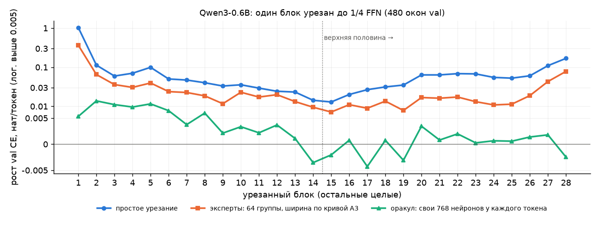

| блок | простое урезание | эксперты (64 группы, ширина по кривой) | оракул |
|---|---|---|---|
| 1 | +1.0275 ± 0.1104 | +0.3637 ± 0.0718 | +0.0055 |
| 2 | +0.1131 ± 0.0058 | +0.0650 ± 0.0098 | +0.0138 |
| 3 | +0.0594 ± 0.0041 | +0.0359 ± 0.0020 | +0.0111 |
| 4 | +0.0701 ± 0.0042 | +0.0305 ± 0.0019 | +0.0096 |
| 5 | +0.0992 ± 0.0042 | +0.0395 ± 0.0022 | +0.0116 |
| 6 | +0.0500 ± 0.0026 | +0.0238 ± 0.0017 | +0.0077 |
| 7 | +0.0470 ± 0.0026 | +0.0226 ± 0.0015 | +0.0038 |
| 8 | +0.0401 ± 0.0023 | +0.0185 ± 0.0015 | +0.0067 |
| 9 | +0.0330 ± 0.0020 | +0.0117 ± 0.0014 | +0.0021 |
| 10 | +0.0355 ± 0.0021 | +0.0229 ± 0.0015 | +0.0033 |
| 11 | +0.0292 ± 0.0024 | +0.0173 ± 0.0019 | +0.0022 |
| 12 | +0.0243 ± 0.0015 | +0.0198 ± 0.0012 | +0.0037 |
| 13 | +0.0232 ± 0.0015 | +0.0132 ± 0.0011 | +0.0011 |
| 14 | +0.0143 ± 0.0014 | +0.0095 ± 0.0011 | -0.0035 |
| 15 | +0.0129 ± 0.0014 | +0.0071 ± 0.0010 | -0.0021 |
| 16 | +0.0201 ± 0.0013 | +0.0110 ± 0.0009 | +0.0008 |
| 17 | +0.0266 ± 0.0016 | +0.0089 ± 0.0011 | -0.0043 |
| 18 | +0.0313 ± 0.0017 | +0.0136 ± 0.0009 | +0.0007 |
| 19 | +0.0349 ± 0.0019 | +0.0078 ± 0.0010 | -0.0031 |
| 20 | +0.0635 ± 0.0025 | +0.0168 ± 0.0012 | +0.0034 |
| 21 | +0.0635 ± 0.0025 | +0.0161 ± 0.0011 | +0.0008 |
| 22 | +0.0684 ± 0.0037 | +0.0173 ± 0.0016 | +0.0020 |
| 23 | +0.0675 ± 0.0044 | +0.0131 ± 0.0013 | +0.0003 |
| 24 | +0.0548 ± 0.0044 | +0.0109 ± 0.0013 | +0.0007 |
| 25 | +0.0525 ± 0.0039 | +0.0113 ± 0.0010 | +0.0006 |
| 26 | +0.0603 ± 0.0038 | +0.0188 ± 0.0011 | +0.0014 |
| 27 | +0.1095 ± 0.0051 | +0.0430 ± 0.0022 | +0.0018 |
| 28 | +0.1682 ± 0.0051 | +0.0781 ± 0.0026 | -0.0025 |

- **Эксперты дешевле простого урезания в каждом блоке.** Сумма по 28 блокам: +0.97 против +2.50 (у оракула
  +0.08). Нижняя половина дороже верхней: +0.69 против +0.27 у экспертов.
- **Самый дорогой — блок 1:** +0.364 у экспертов, +1.028 у урезания, хотя оракулу хватает своих 768 нейронов
  (+0.0055). Дальше по цене блоки 2–5 (+0.030…+0.065) и 27–28 (+0.043, +0.078).

**Что такое «1/4 во всех 28 блоках — +1.16 нат» (п. 2).** Это вариант all_fang из 17.14: 64 эксперта в каждом блоке,
ширина групп внутри блока одинаковая, доли блоков по мере FANG по всем 28 блокам. Блоки 1–14 идут по месту, 15–28 —
наперёд от блока 14, общих нейронов нет. Отдельного условия «1/4 в каждой половине» там нет: нижняя половина в
среднем получила 0.268, верхняя 0.232. Блок 1 из-за выброса FC получил 10/16. Итог 3.5559 против 2.3965 у исходной.

**Раздача по половинам (п. 3).** Средний расход 1/4 по всем блокам, где не сказано иное. Δ ± 2 SE по окнам val.

| вариант | доли по блокам (×1/16) | расход | val CE | Википедия / код / сказки | Δ к исходной | Δ к all_fang |
|---|---|---|---|---|---|---|
| а) все 28 блоков по FANG = all_fang | 10 4 4 4 4 4 4 4 4 4 4 4 3 3 4 4 4 4 4 4 4 4 4 3 3 3 3 4 | 0.250 | 3.5559 | 4.4014 / 2.5037 / 3.2584 | +1.1594 ± 0.0108 | — |
| б) нижняя 1/2, FFN верхней выключены | 8 8 8 8 8 8 8 8 8 8 8 8 8 8 0 0 0 0 0 0 0 0 0 0 0 0 0 0 | 0.250 | 16.2902 | 16.3302 / 17.0355 / 15.8201 | +13.8937 ± 0.0610 | +12.7343 ± 0.0636 |
| б′) нижняя 3/8, верхняя 1/8 | 6 6 6 6 6 6 6 6 6 6 6 6 6 6 2 2 2 2 2 2 2 2 2 2 2 2 2 2 | 0.250 | 3.7585 | 4.6531 / 2.6679 / 3.4309 | +1.3621 ± 0.0147 | +0.2027 ± 0.0072 |
| в) нижняя целая, верхняя как в all_fang | 16×14, 4 4 4 4 4 4 4 4 4 3 3 3 3 4 | 0.616 | 2.8434 | 3.6129 / 1.9913 / 2.5123 | +0.4470 ± 0.0057 | -0.7124 ± 0.0077 |
| в′) нижняя целая, верхняя E64 с шириной групп по A3 (лучший из A2) | 16×14 + группы | 0.625 | 2.7708 | 3.4016 / 1.9267 / 2.5827 | +0.3743 ± 0.0026 | -0.7851 ± 0.0094 |

- **а)** FANG по всем 28 блокам без условия на половины — это и есть all_fang, отдельно не пересчитывал.
- **б)** Если нижней половине дать 1/2, при общем 1/4 верхней остаётся ровно ноль. Без FFN в верхней половине модель
  разваливается (CE 16.3). Выполнимый перекос 3/8 + 1/8 тоже хуже all_fang, на 0.20.
- **в)** Расход здесь больше 1/4: 0.616 и 0.625. Урезание нижней половины в all_fang стоит 0.71 нат (в против а).

**Блок 1 отдельно.** Набор по номеру токена: у каждого токена словаря свои 768 нейронов (1/4) — те, что важнее всего в
среднем по его появлениям на калибровке. Свой набор есть у 8866 токенов, встречавшихся там не меньше 50 раз: это 89%
калибровки и 88% val. Остальным достаётся набор их кластера эмбеддингов (64 кластера). В блоке 1 эти кластеры
совпадают с 64 группами по месту: вход блока — сам эмбеддинг.

Только блок 1 урезан до 1/4 (480 окон val):

| набор нейронов блока 1 | рост CE ± 2 SE |
|---|---|
| свой у каждого номера токена | +0.0604 ± 0.0161 |
| 64 группы, ширина поровну | +0.2382 ± 0.0530 |
| 64 группы, ширина по кривой (как выше) | +0.3637 ± 0.0718 |
| простое урезание | +1.0275 ± 0.1104 |
| оракул: свои 768 у каждого токена в каждой позиции | +0.0055 ± 0.0009 |

Вся модель, средний расход 1/4, остальное как в all_fang:

| вариант | доли по блокам (×1/16) | расход | val CE | Википедия / код / сказки | Δ к исходной | Δ к all_fang |
|---|---|---|---|---|---|---|
| all_fang | 10 4 4 4 4 4 4 4 4 4 4 4 3 3 4 4 4 4 4 4 4 4 4 3 3 3 3 4 | 0.250 | 3.5559 | 4.4014 / 2.5037 / 3.2584 | +1.1594 ± 0.0108 | — |
| а) блок 1 целый, блоки 2–28 по FANG | 16 6 5 5 5 4 4 4 4 4 4 3 2 2 2 3 4 4 3 4 4 4 3 2 2 2 2 5 | 0.250 | 3.4970 | 4.3413 / 2.4653 / 3.1890 | +1.1005 ± 0.0096 | -0.0589 ± 0.0034 |
| б) блок 1 по номеру токена, блоки 2–28 по FANG | 4 6 5 6 6 5 5 5 4 4 4 4 3 3 3 3 4 4 4 4 4 4 3 3 2 2 2 6 | 0.250 | 3.4981 | 4.3649 / 2.4764 / 3.1606 | +1.1017 ± 0.0124 | -0.0577 ± 0.0075 |
| в) как а), блоки 27–28 по 1/2 (по кривой), блоки 2–26 по FANG | 16 5 4 5 5 4 4 4 3 4 3 3 2 2 2 3 3 3 3 3 3 3 3 2 2 2 8 8 | 0.250 | 3.5762 | 4.4215 / 2.4752 / 3.3070 | +1.1797 ± 0.0106 | +0.0203 ± 0.0034 |

- **Набор по номеру токена в одиночном урезании в 4 раза дешевле 64 групп** (+0.060 против
  +0.238), но до оракула ещё в 10 раз. Ширина групп по кривой в блоке 1 вредит: +0.364
  против +0.238 при ровной ширине.
- **Во всей модели а) и б) лучше all_fang на 0.06.** Между собой эффект не обнаружен: б − а = +0.0012 ± 0.0073.
  Набор по номеру токена почти заменяет целый блок 1 за четверть его ширины. Освободившиеся 3/4 блока 1 получили
  блоки 2–28, и выигрыш вышел примерно таким же.
- **в) хуже all_fang:** ширину блокам 27–28 пришлось отнять у блоков 2–26, и это обошлось дороже, чем дало.
- **Лучшее при 1/4 по всей модели без обучения** — 3.497 (а) и 3.498 (б). До исходной модели остаётся 1.10 нат.


### 17.17 Поправки к урезанным группам (без обучения)

Основа — E64 наперёд с шириной групп по A3 (E64_a3need, val CE 2.7708). Оракул верхней половины при 1/4 — 2.4246,
разрыв до него 0.346. Поправка добавляет к выходу урезанного FFN оценку недостающей части (полный выход минус
урезанный) по входу FFN z. Она подбирается гребневой регрессией на калибровке: 1600 окон, состояния целой модели,
каждое 5-е окно отложено для подбора λ. Ранг понижается до r. Своя поправка — у групп, где на калибровке не меньше
3000 токенов; остальным достаётся поправка блока того же ранга. Код — `dd/r25_corr.py`, таблицы —
[`report/r25_corr.md`](report/r25_corr.md).

Верхняя половина (блоки 15–28 урезаны все сразу), полный val. FFN верхней половины — 132.1M параметров.

| поправка | val CE | Δ ± 2 SE | закрыто разрыва до оракула | параметров | доля FFN верхней половины |
|---|---|---|---|---|---|
| без поправки | 2.7708 | — | 0 | 0 | 0 |
| сдвиг на группу | 2.7224 | −0.0483 ± 0.0011 | 14% | 0.92M | 0.7% |
| одна линейная на блок, ранг 8 | 2.7217 | −0.0491 ± 0.0011 | 14% | 0.24M | 0.2% |
| одна линейная на блок, ранг 32 | 2.7054 | −0.0654 ± 0.0012 | 19% | 0.93M | 0.7% |
| одна линейная на блок, ранг 64 | 2.6942 | −0.0766 ± 0.0013 | 22% | 1.85M | 1.4% |
| одна линейная на блок, ранг 128 | 2.6845 | −0.0863 ± 0.0014 | 25% | 3.68M | 2.8% |
| на блок ранга 32 + сдвиг на группу | 2.6963 | −0.0745 ± 0.0013 | 22% | 1.84M | 1.4% |
| на блок ранга 128 + сдвиг на группу | 2.6784 | −0.0924 ± 0.0014 | 27% | 4.59M | 3.5% |
| на блок ранга 32 + на группу ранга 4 | 2.6820 | −0.0888 ± 0.0015 | 26% | 8.98M | 6.8% |
| на блок ранга 32 + на группу ранга 8 | 2.6702 | −0.1006 ± 0.0017 | 29% | 16.13M | 12.2% |
| линейная на группу, ранг 4 | 2.6952 | −0.0756 ± 0.0015 | 22% | 8.17M | 6.2% |
| линейная на группу, ранг 8 | 2.6790 | −0.0918 ± 0.0017 | 27% | 15.44M | 11.7% |
| линейная на группу, ранг 16 | 2.6573 | −0.1135 ± 0.0018 | 33% | 29.97M | 22.7% |
| линейная на группу, ранг 32 | 2.6321 | −0.1387 ± 0.0020 | 40% | 59.04M | 44.7% |

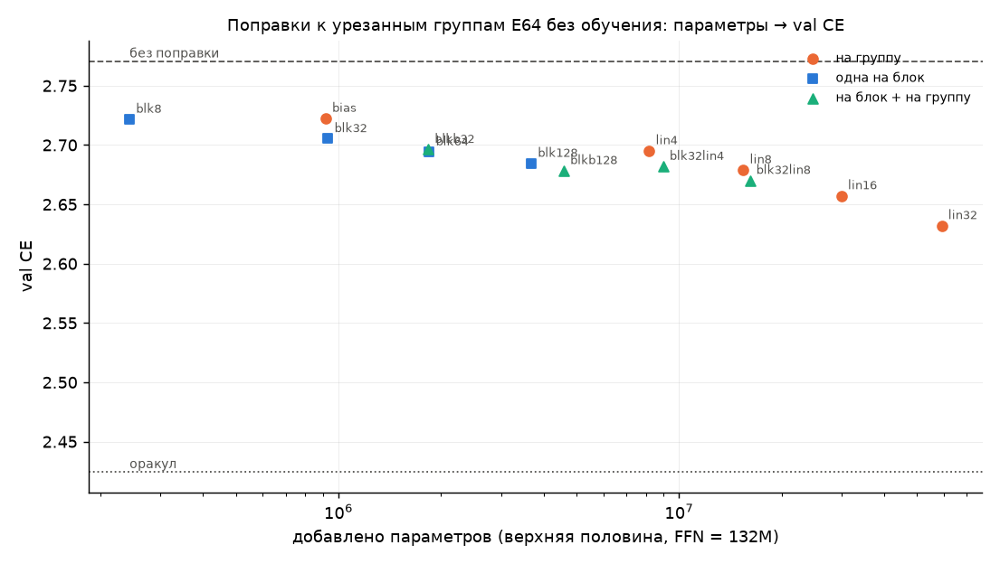

- **Помогает каждая поправка**, все разности больше 2 SE.
- **Дешевле всего по параметрам — одна карта на блок.** Ранг 8 (0.24M, 0.2% FFN) даёт столько же, сколько сдвиг
  на группу (0.92M): −0.049. Ранг 128 + сдвиг на группу — −0.092 при 4.6M (3.5%).
- **Больше всего даёт линейная на группу ранга 32:** −0.139, закрыто 40% разрыва. Но параметров у неё 59M — 45% FFN
  верхней половины. По вычислениям она дёшева: ранг 32 — это 64 скалярных произведения длины d на токен, 2.8% от
  бюджета 1/4 (2304). Дорога она памятью.

**Один блок урезан, остальные целые** (480 окон val, сумма роста CE по 14 блокам):

| поправка | сумма по 14 блокам | закрыто разрыва до оракула |
|---|---|---|
| без поправки | +0.274 | — |
| сдвиг на группу | +0.268 | 2% |
| линейная на группу, ранг 8 / 16 / 32 | +0.239 / +0.224 / +0.207 | 13% / 18% / 25% |
| одна линейная на блок, ранг 8 / 32 | +0.277 / +0.268 | −1% / 2% |

- **В одиночном урезании поправки почти не помогают.** Сдвиг на группу в блоке 15 даже вредит: +0.0102 против
  +0.0071 без поправки. Когда урезаны все 14 блоков, тот же сдвиг даёт −0.048, а в сумме одиночных — −0.006.
  Почти весь выигрыш поправок появляется только при урезании всех блоков сразу.
- **Позиция 0 ни при чём.** Проверял, не вредит ли поправка на первой позиции окна: калибровка её не видит. Если её
  там выключить, ничего не меняется (96 окон): блок 15, сдвиг — +0.0096 и +0.0095; блок 28, сдвиг — +0.0812 и
  +0.0812; блок 28, ранг 32 на группу — +0.0709 и +0.0705.

**Вся модель.** Лучшая конфигурация при среднем расходе 1/4 (блок 1 целый, блоки 2–28 по FANG, 17.16а) плюс
линейная на группу ранга 32 во всех урезанных блоках: val CE 2.9683 против 3.4970 без поправки
(−0.529 ± 0.006). Добавлено 114M параметров — 43% FFN всей модели. Другие поправки на всей модели не считал:
правило было «только лучшая на группу, если Δ ≤ −0.01 и больше 2 SE».

### 17.18 Число групп: 8 / 64 / 128 / 256

Верхняя половина при 1/4, ширина групп одинаковая, без поправок. Два способа деления:
- кластеры состояний (E) — k-means входа блока;
- кластеры по нужным нейронам (nb) — области A2.

Нейроны группы — её 768 самых важных по средней |a| × норме столбца на всей калибровке при том же назначении
групп. Группа определяется двумя способами:
- **наперёд** — от блока 14, как в A2;
- **точно (по месту)**: для E — ближайший центр к настоящему входу блока, для nb — ближайший центр важности к
  настоящей активации.

Код — `dd/r25_ngroups.py`, таблицы — [`report/r25_ngroups.md`](report/r25_ngroups.md).

| способ | групп | val CE наперёд | val CE точно | точно − наперёд | точность маршрута наперёд: среднее / блок 28 | однородность, медиана |
|---|---|---|---|---|---|---|
| кластеры состояний | 8 | 3.0214 | 3.0239 | +0.0025 ± 0.0005 | 0.965 / 0.946 | 2.09 |
| кластеры состояний | 64 | 2.8057 | 2.7974 | −0.0083 ± 0.0005 | 0.896 / 0.794 | 2.03 |
| кластеры состояний | 128 | 2.7632 | 2.7526 | −0.0106 ± 0.0006 | 0.873 / 0.734 | 1.98 |
| кластеры состояний | 256 | 2.7306 | **2.7106** | −0.0200 ± 0.0007 | 0.846 / 0.666 | 1.93 |
| по нужным нейронам | 8 | 2.9814 | 2.9930 | +0.0117 ± 0.0009 | 0.913 / 0.746 | 2.13 |
| по нужным нейронам | 64 | 2.8106 | 2.8187 | +0.0081 ± 0.0008 | 0.740 / 0.487 | 2.09 |
| по нужным нейронам | 128 | 2.7665 | 2.7716 | +0.0051 ± 0.0008 | 0.701 / 0.444 | 2.06 |
| по нужным нейронам | 256 | 2.7300 | 2.7317 | +0.0017 ± 0.0008 | 0.667 / 0.397 | 2.02 |

Однородность — покрытие группы, делённое на среднюю потребность токена (как в 17.13).

- **Чем больше групп, тем лучше.** Без насыщения до 256: у кластеров состояний по месту 3.0239 → 2.7974 → 2.7526 →
  2.7106. От 64 к 256 групп — −0.087 ± 0.001.
- **Лучшее — 256 кластеров состояний по месту (2.7106).** Точная группа здесь лучше угаданной наперёд на 0.020 и
  лучше 256 областей по нужным нейронам на 0.019 ± 0.001.
- **Наперёд два способа равны.** При 256 группах 2.7300 против 2.7306, эффект не обнаружен (−0.0006 ± 0.0007).
- **Угадывание наперёд с ростом числа групп ошибается чаще.** Для E — от 0.965 до 0.846 в среднем, в блоке 28 —
  0.67. Но CE всё равно падает. Для E при 64 группах и больше точная группа лучше угаданной. Для nb точная группа
  чуть хуже угаданной: от +0.012 при 8 группах до +0.002 при 256.
- **Однородность почти не меняется:** 2.09 → 1.93. Даже в группе из 256 общий набор, нужный 90% её токенов, вдвое
  шире потребности одного токена.

**Куда уходит разрыв до оракула** (nb256 по центру области, 2.7300; разрыв 0.305):
- точная группа вместо угаданной — −0.002 ± 0.001 (−1%);
- если токен берёт свои 768 из 1536 самых важных нейронов своей группы (пул), а не общие 768 группы, — 0.232
  (76%);
- остаток — нужные нейроны вне пула, 0.075 (25%).

Три четверти потери — выбор внутри группы, а не выбор группы. Из этого — двухуровневый выбор (17.21).

### 17.19 Сжимаемость групп по итоговой потере (E64)

Урезается одна группа в одном блоке: её токены получают top-w нейронов группы, w = 1/32 … 1/2 FFN; всё остальное
целое. Измеряется рост CE на токенах группы, 480 окон val. Минимальная ширина группы — самая узкая, при которой рост
не выше порога и при ней, и при всех более широких. Учитываются группы с ≥ 50 токенами (892 из 14 × 64). Код —
`dd/r25_more.py compress`, таблицы — [`report/r25_more.md`](report/r25_more.md).

| порог, нат/токен | 1/32 | 1/16 | 1/8 | 1/4 | 1/2 | >1/2 | средняя минимальная ширина на токен |
|---|---|---|---|---|---|---|---|
| 0.01 | 95 (7%) | 70 (6%) | 108 (12%) | 234 (27%) | 277 (35%) | 108 (13%) | 0.394 FFN |
| 0.05 | 521 (54%) | 115 (14%) | 108 (13%) | 87 (11%) | 36 (4%) | 25 (3%) | 0.121 FFN |

Число групп; в скобках доля токенов. Средние ширины — по одиночным урезаниям: при урезании всех групп сразу потери
складываются не так.

- **Группы очень разные по сжимаемости.** При пороге 0.01 четверть токенов сидит в группах, которым хватает 1/8 и
  меньше. 13% — в группах, которым мало и 1/2.
- **Блоки тоже разные.** В блоках 27–28 почти половине групп мало 1/2 (29 и 28 из 64). В блоке 15 треть групп
  (23 из 64) обходится 1/32.
- **Местная ошибка — плохой ориентир для ширины.** Покрытие (90% токенов группы с ошибкой выхода FFN ≤ 10%, 17.13)
  почти у всех групп больше 1/2 FFN: медиана 2688 нейронов. По итоговой потере медиана — 768 (порог 0.01) и 96
  (порог 0.05). Спирмен между ними −0.22 и −0.50: знак обратный.

По этим кривым раздаётся ширина групп в 17.20 и в итоговой сборке (17.24).


### 17.20 Ширина групп жадно по кривым сжимаемости (E64)

Верхняя половина, 64 группы наперёд (как в A2), общий расход 1/4. Ширины групп раздаются жадно по кривым из 17.19,
кривые сделаны невозрастающими. На каждом шаге одна группа переходит на любую более широкую ширину сетки 96 / 192 /
384 / 768 / 1536 / 3072 — та, у которой выигрыш на добавленный нейрон больше всех. Шаги идут, пока общий расход
(доля токенов группы на калибровке × ширина, по 14 блокам) не достигнет 1/4. Два правила выигрыша:
- **c (основное)** — снижение роста CE на добавленный нейрон, то есть на единицу расхода на токен;
- **n (для сравнения)** — снижение роста × число токенов группы на нейрон.

Группам с < 50 токенами на окнах кривых — 768. Код — `dd/r25_greedy.py`, таблицы —
[`report/r25_greedy.md`](report/r25_greedy.md).

| вариант | val CE | расход на val | Δ к ровной ± 2 SE | Δ к A3 ± 2 SE | Δ к A3 вне окон кривых |
|---|---|---|---|---|---|
| ровная ширина (768 у каждой группы) | 2.8057 | 0.250 | — | +0.035 ± 0.004 | +0.035 ± 0.004 |
| по кривой A3 (E64_a3need) | 2.7708 | 0.251 | −0.035 ± 0.004 | — | — |
| **жадно, правило c** | **2.7420** | 0.249 | −0.064 ± 0.004 | −0.029 ± 0.002 | −0.029 ± 0.002 |
| жадно, правило n | 2.7503 | 0.262 | −0.055 ± 0.005 | −0.021 ± 0.003 | −0.020 ± 0.003 |

«Вне окон кривых» — 3283 окна val, на которых кривые не снимались. Там выигрыш тот же, то есть кривые не подогнаны
под свои окна. Правило n ещё и перерасходует бюджет: 0.262 вместо 0.25 на val.

- **Жадная раздача по правилу c — лучшая ровная по расходу схема при 1/4:** −0.064 к ровной ширине и −0.029 к
  ширине по A3.
- **Куда уходит ширина.** По правилу c 94 группы получили 96 нейронов, 37 групп — все 3072. Доля расхода по блокам
  15..28: 0.08 0.10 0.18 0.16 0.20 0.30 0.26 0.25 0.23 0.21 0.21 0.26 0.48 0.60. Блоки 15–16 сжаты до 0.08–0.10,
  блоки 27–28 получили 0.48 и 0.60.
- **По одному блоку** сумма роста по 14 блокам — +0.173 против +0.274 у A3 и +0.311 у ровной. Блоки 27–28 подешевели
  в 4–11 раз (+0.011 и +0.007 против +0.043 и +0.078 у A3). Блоки 15–16 подорожали вдвое: их ширину отдали
  блокам 27–28.

**Кривая «расход → val CE».** Средняя доля FFN верхней половины, фактическая на val. Δ — к ровной ширине того же
расхода, ± 2 SE.

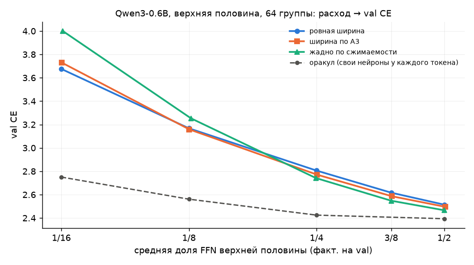

| расход | ровная | по A3 | жадно (c) | жадно − ровная | жадно − A3 |
|---|---|---|---|---|---|
| 1/16 | 3.6757 | 3.7291 | 3.9998 | +0.324 ± 0.008 | +0.271 ± 0.007 |
| 1/8 | 3.1675 | 3.1580 | 3.2530 | +0.086 ± 0.006 | +0.095 ± 0.005 |
| 1/4 | 2.8057 | 2.7708 | 2.7420 | −0.064 ± 0.004 | −0.029 ± 0.002 |
| 3/8 | 2.6168 | 2.5859 | 2.5479 | −0.069 ± 0.003 | −0.038 ± 0.001 |
| 1/2 | 2.5144 | 2.4955 | 2.4661 | −0.048 ± 0.002 | −0.029 ± 0.001 |

- **От 1/4 до 1/2 жадная раздача лучше всех,** выигрыш у ровной ширины — 0.05–0.07.
- **При 1/8 и 1/16 жадная раздача хуже ровной:** +0.09 и +0.32. Вероятная причина: кривые сняты, когда урезана одна
  группа, а всё остальное целое. При малом бюджете урезано почти всё, и потери групп уже не складываются. Жадная раздача сжимает
  до 96 нейронов много групп, которые поодиночке это переносят, а вместе — нет. Ширина по A3 при 1/16 тоже хуже
  ровной (+0.053).


### 17.21 Двухуровневый выбор нейронов

Из 17.18: три четверти потери 256 групп — выбор внутри группы. Проверяю двухуровневую схему.
- **Уровень 1** — группа токена по месту: 256 кластеров состояний, ближайший центр к настоящему входу блока. Пул
  группы — её P самых важных нейронов, P = 768 … 2048.
- **Уровень 2** — внутри пула токен оставляет часть нейронов. Правила выбора:
  - **оракул** — свои top-k по |a| × норма столбца. Для этого нужна вся активация пула, так что это потолок
    выбора, а не реальный расход;
  - **гейт по пулу (как CATS)** — top-k по |silu(gate)|, гейт считается по всему пулу, up и down — только для k;
  - **предсказатель ранга r** (32 / 128) — линейная гребневая оценка важности нейронов пула по входу FFN z, ранг
    понижен до r. R² на отложенных окнах — 0.19–0.55 при r = 32 и 0.28–0.62 при r = 128;
  - **TEAL в пуле** — пороги по модулю, как в TEAL: элементы входа |z| < t_z выбрасываются (для gate и up), потом
    выбрасываются активации пула |a| < t_a (для down). Одна оставленная доля s на оба порога, пороги — квантили на
    калибровке.

**Расход** — скалярные произведения длины d на токен в блоке. Полный FFN — 9216, бюджет 1/4 — 2304, 1/3 — 3072.
По правилам:
- одноуровневая схема ширины w — 3w;
- гейт — P + 2k;
- предсказатель — r + rP/d + 3k;
- TEAL — 3Ps;
- поправка — 64 (одна карта ранга 32 на блок и сдвиг на группу).

Код — `dd/r25_twolevel.py`, таблицы — [`report/r25_twolevel.md`](report/r25_twolevel.md).

**Сначала без учёта маршрута** (он одинаков у всех схем). Δ — к одноуровневой схеме того же расхода, ± 2 SE.

| схема (1/4) | пул | k или s | val CE | Δ к одноуровневой |
|---|---|---|---|---|
| одноуровневая, w = 768 | — | — | 2.7106 | — |
| оракул в пуле | 1024 / 1536 | 640 / 384 | 2.6078 / 2.6045 | −0.103 / −0.106 |
| **TEAL в пуле** | 1024 / 1536 | 0.75 / 0.50 | **2.6112** / 2.6233 | **−0.100** / −0.087 |
| предсказатель ранга 128 | 1024 / 1536 / 2048 | 682 / 661 / 640 | 2.6685 / 2.6567 / 2.6670 | −0.042 / −0.054 / −0.044 |
| предсказатель ранга 32 | 1024 / 1536 / 2048 | 746 / 741 / 736 | 2.7027 / 2.7207 / 2.7356 | −0.008 / +0.010 / +0.025 |
| гейт по пулу (CATS) | 1024 / 1536 / 2048 | 640 / 384 / 128 | 2.6807 / 2.7955 / 4.4107 | −0.030 / +0.085 / +1.70 |

При 1/3 (одноуровневая w = 1024: 2.5988) картина та же:
- оракул в пуле 1536 — −0.105;
- TEAL в пуле 1536 — −0.090;
- предсказатель ранга 128 — −0.044;
- гейт по пулу — +0.011 и +0.108.

Все разности больше 2 SE (ошибки 0.001–0.009).

- **TEAL в пуле почти равен оракулу в пуле.** При 1/4 и пуле 1024 разница +0.0033 ± 0.0003, при 1/3 и пуле 1536 —
  +0.015.
- **Предсказатель важности слаб.** Ранг 128 даёт половину выигрыша оракула, ранг 32 почти ничего: R² 0.2–0.3 мало.
- **Гейт по пулу (CATS) при таком бюджете плох:** счёт гейта по всему пулу съедает бюджет, на up и down остаётся
  мало нейронов.

**С поправкой.** Поправка — одна карта ранга 32 на блок и сдвиг на группу, подобраны на калибровке. Её 64 единицы
взяты из бюджета схемы; маршрут, как и выше, не учитывается.

| бюджет | схема | без поправки | с поправкой | Δ ± 2 SE |
|---|---|---|---|---|
| 1/4 | одноуровневая (w 768 → 746) | 2.7106 | 2.6596 | −0.051 ± 0.001 |
| 1/4 | TEAL в пуле 1024 (s 0.750 → 0.729) | 2.6112 | 2.5823 | −0.029 ± 0.001 |
| 1/3 | одноуровневая (w 1024 → 1002) | 2.5988 | 2.5750 | −0.024 ± 0.001 |
| 1/3 | TEAL в пуле 1536 (s 0.667 → 0.653) | 2.5091 | 2.5055 | −0.004 ± 0.001 |

- **Поправка и выбор внутри пула частично делают одно и то же.** С TEAL в пуле поправка даёт меньше, чем с
  одноуровневой схемой: −0.029 против −0.051 при 1/4, при 1/3 — почти ничего (−0.004).
- **Вместе они всё равно лучше всего.** TEAL в пуле с поправкой лучше одноуровневой с поправкой на 0.077 ± 0.001
  (1/4) и 0.070 ± 0.002 (1/3).
- На отложенных окнах калибровки поправка объясняет 12–18% недостающего вклада.

**Итоговое сравнение: маршрут входит в расход.** Маршрут к группе бывает двух видов:
- полный — 256 центров, 256 единиц;
- двухступенчатый — 16 крупных центров, потом 16 мелких внутри выбранного, 32 единицы.

Двухступенчатый выбирает ту же группу, что полный, у 81–84% токенов. Ориентир — TEAL по всему слою (без групп и
маршрута) того же расхода.

| бюджет | схема | маршрут | расход: FFN + маршрут | val CE |
|---|---|---|---|---|
| 1/4 | TEAL по всему слою, s = 0.25 | — | 2304 | 3.3870 |
| 1/4 | одноуровневая, w = 682 / 757 | полный / двухступенчатый | 2046 + 256 / 2271 + 32 | 2.7628 / 2.7522 |
| 1/4 | предсказатель ранга 128, пул 1536 | полный / двухступенчатый | 2048 + 256 / 2270 + 32 | 2.7054 / 2.6743 |
| 1/4 | **TEAL в пуле 1024** | полный / **двухступенчатый** | 2048 + 256 / 2272 + 32 | 2.6321 / **2.6386** |
| 1/3 | TEAL по всему слою, s = 0.333 | — | 3072 | 2.8898 |
| 1/3 | одноуровневая, w = 938 / 1013 | полный / двухступенчатый | 2814 + 256 / 3039 + 32 | 2.6302 / 2.6278 |
| 1/3 | предсказатель ранга 128, пул 1536 | полный / двухступенчатый | 2816 + 256 / 3038 + 32 | 2.5825 / 2.5708 |
| 1/3 | **TEAL в пуле 1536** | полный / **двухступенчатый** | 2816 + 256 / 3040 + 32 | 2.5319 / **2.5256** |

- **TEAL по всему слою при таком бюджете разваливается:** 3.387 при 1/4 и 2.890 при 1/3. Все схемы с группами
  лучше него на 0.21–0.76.
- **Лучшая реальная схема — TEAL в пуле группы.** При двухступенчатом маршруте она лучше одноуровневой на
  0.114 ± 0.001 (1/4) и 0.102 ± 0.002 (1/3), и лучше предсказателя ранга 128 на 0.036 и 0.045.
- **Двухступенчатый маршрут против полного.** У одноуровневой схемы при 1/4 двухступенчатый лучше на
  0.011 ± 0.001. Освободившиеся 224 единицы стоят больше, чем ошибки маршрута на 16–19% токенов. У TEAL в пуле 1024
  при 1/4 лучше полный (+0.0065 ± 0.0005 у двухступенчатого), у TEAL в пуле 1536 при 1/3 — двухступенчатый
  (−0.0064 ± 0.0005). Разница в обе стороны меньше 0.01.
- **Против прежних схем.** TEAL в пуле 1024 с двухступенчатым маршрутом (всё учтено, 2.6386) лучше E64 наперёд
  с жадными ширинами (2.7420) на 0.103 ± 0.003. При этом у E64 маршрут наперёд от блока 14 вообще не учитывался в
  расходе, а это карта d × d и поиск среди 64 центров — 1088 единиц на блок, 47% бюджета 1/4. До оракула верхней половины (2.4246)
  остаётся 0.214 ± 0.003.


### 17.22 Потолок непересекающихся групп нейронов

Вопрос: что даёт деление самих нейронов на непересекающиеся группы (как в MoEfication), если выбирать группы для
токена идеально. Нейроны каждого верхнего блока делятся на E равных групп по совместной важности. Каждый нейрон
задаётся вектором своей важности |a| × норма столбца на 16384 токенах калибровки, вектор нормируется. Дальше
k-means на E кластеров и точное равное назначение: в каждой группе ровно 3072 / E нейронов. Токен оракульно
берёт k групп с наибольшей суммарной важностью, всего 768 нейронов (1/4). Маршрутизатора нет. Код —
`dd/r25_disjoint.py`, таблица — [`report/r25_disjoint.md`](report/r25_disjoint.md).

| вариант | val CE | Δ к оракулу по отдельным нейронам ± 2 SE |
|---|---|---|
| оракул по отдельным нейронам (свои 768 у каждого токена) | 2.4246 | — |
| 32 группы по 96 нейронов, оракул берёт 8 | 2.9749 | +0.550 ± 0.004 |
| 64 группы по 48 нейронов, оракул берёт 16 | 2.8398 | +0.415 ± 0.004 |
| для сравнения: 256 кластеров состояний по месту, ровная ширина (17.18) | 2.7106 | +0.286 ± 0.004 |
| E64 наперёд, жадные ширины (17.20) | 2.7420 | +0.317 ± 0.002 |
| E64 наперёд, ширина по A3 + поправка ранга 32 на группу (17.17) | 2.6321 | +0.208 ± 0.003 |

- **Непересекающиеся группы нейронов хуже наших схем даже с оракулом.** Оракул по 64 группам из 48 нейронов
  (2.840) хуже 256 кластеров состояний по месту без всякого оракула (2.711): +0.129 ± 0.003. Нейроны, которые нужны вместе
  одному токену, не складываются в постоянные блоки: деление теряет больше, чем выбор группы.
- **Мельче группы — лучше:** 64 по 48 лучше 32 по 96 на 0.135 ± 0.001. В пределе группа из одного нейрона — это оракул по
  нейронам.
- Значит, в нашем режиме (1/4, без обучения) группировать надо токены, а не нейроны: у группы токенов свой набор
  нейронов, и наборы разных групп пересекаются.


### 17.23 Проверка на разных размерах: Qwen3-0.6B / 1.7B / 4B / 8B

Вопрос: меняется ли картина с размером модели. Рецепт без обучения для верхней половины (1.7B — блоки 15–28,
4B — 19–36), бюджет 1/4 FFN, данные те же (токенизатор общий):
- **эксперты** — 256 кластеров состояний по месту (k-means входа блока, 400 окон калибровки). Группа токена —
  ближайший центр настоящего входа блока. Нейроны группы — её самые важные по средней |a| × норма столбца;
- **ширина** — равная (1/4 в каждом блоке) или по долям FANG со средним 1/4;
- **оракул** — свои 1/4 нейронов у каждого токена в каждом верхнем блоке.

480 окон val, как A3. Код — `dd/r25_scale.py`, таблица — [`report/r25_scale.md`](report/r25_scale.md).

| модель | блоков / ширина FFN | исходная CE | потеря оракула | потеря экспертов | эксперты − оракул | доли FANG − равные | сумма одиночных урезаний |
|---|---|---|---|---|---|---|---|
| Qwen3-0.6B | 28 / 3072 | 2.3948 | +0.028 ± 0.002 | +0.320 ± 0.012 | +0.292 ± 0.012 | +0.003 ± 0.003 | +0.241 |
| Qwen3-1.7B | 28 / 6144 | 2.2611 | **−0.050 ± 0.003** | +0.204 ± 0.017 | +0.254 ± 0.016 | +0.024 ± 0.003 | +0.125 |
| Qwen3-4B | 36 / 9728 | 2.1116 | −0.002 ± 0.003 | +0.284 ± 0.016 | +0.286 ± 0.014 | −0.004 ± 0.003 | +0.231 |
| Qwen3-8B | 36 / 12288 | 1.8657 | +0.011 ± 0.003 | +0.382 ± 0.024 | +0.371 ± 0.022 | не считалось | не считалось |

- **Оракулу 1/4 FFN хватает на всех размерах.** У 0.6B потеря +0.028, у 8B +0.011. У 4B эффект не обнаружен. У 1.7B оракул
  даже лучше исходной модели на 0.050: в 96% окон и на всех трёх источниках (Википедия −0.046, код −0.022,
  сказки −0.070).
- **Это не ошибка счёта.** Независимая проверка — HF transformers, fp32, процессор, 3 окна (`dd/r25_hfcheck.py`). Для 1.7B она даёт для
  оракула −0.054 / −0.056 / −0.052 к исходной; мой проход в bf16 — −0.049 / −0.060 / −0.049. Исходная CE совпадает
  в пределах 0.001–0.006. На 0.6B та же проверка даёт +0.034 / +0.009 / +0.016, мой проход — +0.032 / +0.011 /
  +0.016.
- **Разрыв экспертов до оракула с размером не уменьшается:** 0.29 / 0.25 / 0.29 / 0.37. У 8B он самый большой. Групповой выбор нейронов без
  обучения теряет примерно одинаково на всех трёх размерах. Потеря экспертов к исходной у 1.7B меньше (+0.20)
  в основном потому, что там сам оракул лучше исходной.
- **Доли FANG не помогают ни на одном размере.** У 0.6B и 4B эффект не обнаружен, у 1.7B они хуже равных на
  0.024.
- **Урезание одного блока.** Дороже всех последние два блока на всех размерах: +0.042 / +0.057 (0.6B), +0.039 /
  +0.044 (1.7B), +0.033 / +0.037 (4B). У 1.7B урезание экспертов в одном из блоков 16–20 снижает CE на
  0.010–0.014, у 4B — в блоке 21 (−0.014). Вместе потери больше суммы одиночных: +0.32 против +0.24,
  +0.20 против +0.13, +0.28 против +0.23.

**Qwen3-8B** — добавлена позже тем же протоколом: только исходная, оракул и эксперты, без FANG и одиночных урезаний.
Дома, состояния калибровки при построении книг лежали в оперативной памяти; на результат это не влияет. Оракул
теряет +0.011 ± 0.003, эксперты +0.382 ± 0.024. Сверка с HF transformers (bf16, GPU, 3 окна):
- исходная CE 2.7166 / 2.5469 / 1.8784 против моих 2.7418 / 2.5452 / 1.8790;
- разность «оракул − исходная» +0.010 / +0.082 / −0.009 против моих −0.002 / +0.080 / −0.013.

Значит, на 1.7B и 4B полный FFN верхней половины на этих данных избыточен даже по CE: оракул не теряет ничего или
выигрывает. Но кластеры состояний без обучения подбирают нейроны группы так же плохо, как на 0.6B. Почему у 1.7B
выбрасывание 3/4 нейронов снижает CE, я не исследовал. Предположение для проверки: в этих блоках много мелких
вкладов, которые на нашей смеси данных вредят. Проверка — та же мера на другой выборке (например, на калибровке)
и при 1/2 FFN.


### 17.24 Итоговая сборка без обучения

Код — `dd/r25_assembly.py`, таблицы — [`report/r25_assembly.md`](report/r25_assembly.md).

**Верхняя половина.** Блоки 15–28, бюджет 1/4 (2304) и 1/3 (3072) единиц на токен в блоке. Учтено всё:
- маршрут к одной из 256 групп (кластеры состояний по месту, двухступенчатый, 32 единицы);
- FFN: 3 × ширина, у двухуровневой — 3 × пул × доля;
- поправка — одна карта ранга 32 на блок и сдвиг на группу, 64 единицы. С ней ширины пересчитаны на бюджет без
  этих 64 единиц.

Ширина групп раздаётся четырьмя способами:
- поровну;
- жадно по всей половине — по кривым сжимаемости 256 групп (`dd/r25_compress2.py e256`, 240 окон, правило c);
- по долям блоков FANG и поровну внутри блока;
- по долям FANG и жадно внутри блока.

Двухуровневая схема — лучшая из 17.21: TEAL в пуле группы, пул 1024 при 1/4 и 1536 при 1/3. Оракул верхней
половины при 1/4 — 2.4246, исходная модель — 2.3965.

| схема (1/4) | без поправки | с поправкой | Δ к ровной без поправки (с поправкой) | Δ к оракулу (с поправкой) |
|---|---|---|---|---|
| ровная ширина | 2.7557 | 2.6963 | — (−0.059 ± 0.001) | +0.331 (+0.272) |
| жадная по всей половине | 2.7130 | 2.6369 | −0.043 ± 0.004 (−0.119 ± 0.004) | +0.288 (+0.212) |
| доли FANG, ровно внутри блока | 2.7427 | 2.6942 | −0.013 ± 0.001 (−0.062 ± 0.001) | +0.318 (+0.270) |
| доли FANG + жадная внутри блока | 2.6818 | 2.6408 | −0.074 ± 0.003 (−0.115 ± 0.003) | +0.257 (+0.216) |
| **двухуровневая (TEAL в пуле 1024)** | 2.6386 | **2.6064** | −0.117 ± 0.001 (**−0.149 ± 0.002**) | +0.214 (**+0.182**) |
| двухуровневая + доли FANG | 2.6701 | 2.6364 | −0.086 ± 0.001 (−0.119 ± 0.002) | +0.246 (+0.212) |

| схема (1/3) | без поправки | с поправкой | Δ к ровной без поправки (с поправкой) |
|---|---|---|---|
| ровная ширина | 2.6299 | 2.6008 | — (−0.029 ± 0.001) |
| жадная по всей половине | 2.5816 | 2.5461 | −0.048 ± 0.003 (−0.084 ± 0.003) |
| доли FANG, ровно внутри блока | 2.6278 | 2.6085 | −0.002 ± 0.001 (−0.022 ± 0.001) |
| доли FANG + жадная внутри блока | 2.5745 | 2.5566 | −0.055 ± 0.003 (−0.073 ± 0.003) |
| **двухуровневая (TEAL в пуле 1536)** | 2.5256 | **2.5209** | −0.104 ± 0.002 (**−0.109 ± 0.002**) |
| двухуровневая + доли FANG | 2.5579 | 2.5491 | −0.072 ± 0.002 (−0.081 ± 0.002) |

Расход всех схем — в пределах ±16 единиц от бюджета: ширины кратны 16. Исключение — двухуровневая с долями
FANG: 2244 и 3028–3032. Её блоку 28 FANG даёт больше, чем стоит весь пул, и остаток бюджета не тратится.

- **Лучшее при 1/4 — двухуровневая с поправкой: 2.6064.** Это −0.149 к ровной ширине. До оракула верхней
  половины остаётся 0.182, до исходной модели — 0.210. При 1/3 лучшая — тоже двухуровневая (2.5209 с поправкой),
  но там поправка почти ничего не добавляет (−0.005).
- **Вклад частей при 1/4** (к ровной ширине без поправки):
  - двухуровневый выбор — −0.117;
  - жадная раздача — −0.043;
  - доли FANG — −0.013;
  - поправка — −0.059.

  Двухуровневый выбор сильнее жадной раздачи почти втрое. С поправкой двухуровневая лучше жадной на
  0.031 ± 0.003.
- **Части складываются не одинаково.** Жадная раздача и поправка складываются даже чуть лучше суммы: −0.119 против
  −0.043 − 0.059. А поправка поверх двухуровневой даёт только −0.032 (при 1/3 — −0.005). Доли FANG вредят
  двухуровневой схеме: +0.03 при обоих бюджетах. Недорасход бюджета объясняет из этого около 0.01.
- **Доли FANG + жадная внутри блока лучше жадной по всей половине** без поправки: −0.031 ± 0.001. С
  поправкой наоборот: жадная по всей половине лучше на 0.004 ± 0.001. Кривые e256 сняты на 240 окнах, жадная по всей половине переносит
  ширину между блоками. Ограничение по блокам по FANG, похоже, страхует от ошибок кривых.

- **Против прежних схем.** E64 наперёд с жадными ширинами (17.20) — 2.7420, но его маршрут (1088 единиц на блок)
  в расход не входил. Ровная ширина здесь с учтённым маршрутом — 2.7557, разница +0.014 ± 0.004. Лучшая схема
  здесь лучше прежней на 0.136.

**Вся модель, средний расход 1/4.** Блок 1 целый, блоки 2–28 по долям FANG — то же, что b1full_fang в 17.16.
Внутри каждого блока ширины 64 групп раздаются жадно по кривым сжимаемости: блоки 2–14 — `r25_compress2 low64`,
240 окон; блоки 15–28 — `r25_more compress`, E64. Поправка — линейная ранга 32 на группу, как в 17.17 (114M
параметров). Маршрут наперёд верхних блоков в расход не входит, как во всех прежних вариантах всей модели.

| вариант | val CE | Википедия / код / сказки | Δ к b1full_fang ± 2 SE |
|---|---|---|---|
| ровная ширина групп в блоке (b1full_fang) | 3.4970 | 4.341 / 2.465 / 3.189 | — |
| жадная ширина групп в блоке | 3.4160 | 4.063 / 2.447 / 3.283 | −0.081 ± 0.007 |
| ровная + поправка ранга 32 на группу (17.17) | 2.9683 | 3.815 / 2.164 / 2.528 | −0.529 ± 0.006 |
| **жадная + поправка ранга 32 на группу** | **2.8756** | 3.589 / 2.109 / 2.555 | **−0.621 ± 0.007** |

- **Жадная ширина внутри блока даёт −0.081 и без поправки, и поверх неё** (−0.093 ± 0.005). Лучшее при 1/4 по всей
  модели без обучения — 2.8756, до исходной 0.48.
- **Источники выигрывают по-разному.** Википедия выигрывает 0.28, а сказки теряют 0.09. Кривые сняты на общей смеси,
  и жадная раздача отдаёт ширину группам, важным для Википедии.


### 17.25 FLOPs на токен: урезанная большая модель против целой меньшей

Вопрос: если урезать большую модель до расхода целой меньшей, что лучше по val CE? Расчёт по результатам 17.23 (с 8B) и 17.24;
новый прогон — только 8B.

**FLOPs на токен** — 2 × умножений-сложений по config.json каждой модели:
- внимание — проекции q, k, v, o и ядро QK и AV при средней длине контекста наших окон, 512.5 ключа;
- FFN;
- маршрут — ближайший из 256 центров (256·d) или двухступенчатый (32·d);
- поправка — 64·d;
- выходной слой d·V — отдельной строкой, он у целой и урезанной модели одного размера одинаковый.

Нормы, RoPE, softmax и пороги TEAL не считаются: меньше 1%. val CE — на тех же 480 окнах, что в 17.23. Числа 0.6B
из 17.24 взяты на этих же окнах. Урезанная модель — 256 групп по месту, 1/4 FFN в верхней половине (протокол 17.23).
У 0.6B есть ещё лучшая схема из 17.24. Код — `dd/r25_flops.py`, таблица — [`report/r25_flops.md`](report/r25_flops.md).

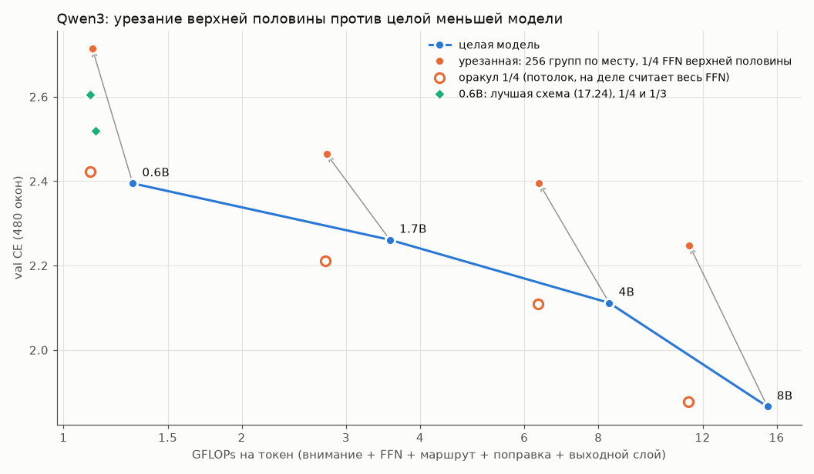

| модель | вариант | GFLOPs на токен | доля от целой | val CE | целая того же расхода (интерполяция) | против целой меньшей: Δ CE ± 2 SE |
|---|---|---|---|---|---|---|
| 0.6B | целая | 1.310 | 1.00 | 2.3948 | — | — |
| 0.6B | урезанная, 256 групп | 1.119 | 0.85 | 2.7146 | — | — |
| 0.6B | урезанная, лучшая схема при 1/4 (17.24) | 1.111 | 0.85 | 2.6054 | — | — |
| 0.6B | урезанная, лучшая схема при 1/3 (17.24) | 1.133 | 0.87 | 2.5198 | — | — |
| 0.6B | оракул 1/4* | 1.111 | 0.85 | 2.4230 | — | — |
| 1.7B | целая | 3.558 | 1.00 | 2.2611 | — | — |
| 1.7B | урезанная, 256 групп | 2.780 | 0.78 | 2.4649 | 2.294 | против 0.6B (1.31 GFLOPs): **+0.070 ± 0.013** |
| 1.7B | оракул 1/4* | 2.766 | 0.78 | 2.2113 | 2.295 | против 0.6B: −0.184 ± 0.008 |
| 4B | целая | 8.347 | 1.00 | 2.1116 | — | — |
| 4B | урезанная, 256 групп | 6.353 | 0.76 | 2.3956 | 2.159 | против 1.7B (3.56 GFLOPs): **+0.135 ± 0.016** |
| 4B | оракул 1/4* | 6.330 | 0.76 | 2.1098 | 2.160 | против 1.7B: −0.151 ± 0.007 |
| 8B | целая | 15.438 | 1.00 | 1.8657 | — | — |
| 8B | урезанная, 256 групп | 11.399 | 0.74 | 2.2481 | 1.987 | против 4B (8.35 GFLOPs): **+0.137 ± 0.024** |
| 8B | оракул 1/4* | 11.362 | 0.74 | 1.8770 | 1.988 | против 4B: −0.235 ± 0.009 |

\* Оракулу для выбора нужен весь FFN. Его расход в таблице номинальный, это потолок выбора, а не реальная схема.

«Целая того же расхода» — кусочно-линейная интерполяция по log FLOPs между целыми моделями. Это допущение:
промежуточных целых моделей нет. Прямое сравнение — с ближайшей целой меньшей на тех же 480 окнах.

Из чего состоит расход целой модели (0.6B / 1.7B / 4B / 8B):
- внимание — 36% / 23% / 26% / 22%;
- FFN — 40% / 59% / 64% / 70%;
- выходной слой — 24% / 17% / 9% / 8%.

FFN верхней половины — 20% / 30% / 32% / 35% всего расхода. Урезание его до 1/4 экономит 15% / 22% / 24% / 26%.

- **При равном расходе урезанная большая модель хуже целой меньшей во всех трёх парах.** Целая меньшая к тому же
  дешевле:
  - урезанная 1.7B хуже целой 0.6B на 0.070 ± 0.013 при расходе в 2.1 раза больше;
  - урезанная 4B хуже целой 1.7B на 0.135 ± 0.016 при расходе в 1.8 раза больше;
  - урезанная 8B хуже целой 4B на 0.137 ± 0.024 при расходе в 1.37 раза больше.

  Против линии целых моделей при том же расходе: +0.17 / +0.24 / +0.26.
- **Почему так.** Урезание FFN верхней половины до 1/4 экономит 15–26% расхода, а стоит +0.20…+0.38 CE. Переход
  на целую модель меньше экономит 46–63% расхода и стоит +0.13…+0.25 CE: 8B → 4B — −46% и +0.246; 4B → 1.7B —
  −57% и +0.150; 1.7B → 0.6B — −63% и +0.134. Внимание и выходной слой урезание не трогает: у 0.6B это 60% расхода,
  у 8B — 30%.
- **Выигрыш возможен только при выборе нейронов, близком к оракулу.** Бесплатный идеальный выбор дал бы урезанной
  модели выигрыш у линии целых при том же расходе: −0.08 (1.7B), −0.05 (4B), −0.11 (8B). Наши схемы без обучения
  отстают от оракула на 0.25–0.37.
- **Лучшая схема 0.6B** (двухуровневая с поправкой) — 2.605 при 0.85 расхода целой 0.6B. Целой Qwen3 меньше
  0.6B нет, сравнить не с чем. Оценка, не мерено: если бы её выигрыш у 256 групп (−0.109 на 0.6B) перенёсся на
  1.7B, урезанная 1.7B дала бы около 2.356. Это лучше целой 0.6B примерно на 0.04, но при расходе в 2.1 раза
  больше. Против линии целых при том же расходе — всё равно хуже, примерно на 0.06.

**Вывод: при равном расходе наша урезанная большая модель хуже целой меньшей. Так на всех трёх парах размеров,
от 0.6B до 8B.** Пока выбор нейронов без обучения так далёк от оракула, выгоднее взять целую модель меньше.


## 18. Блок r26: маршрут наперёд и кэш экспертов на OLMoE-1B-7B (без обучения)

### 18.1 Постановка

- **Модель** — allenai/OLMoE-1B-7B-0924: 16 слоёв, в каждом 64 эксперта (SwiGLU 1024), top-8 без перенормировки.
  Свой проход (`dd/r26_olmoe.py`) сверен с transformers на двух окнах: самый вероятный токен совпадает в 98.4% позиций,
  CE 1.4685 против 1.4721.
- **Данные** — val смеси r21 в токенах OLMoE: 4.02M токенов (Википедия 1.52M, код 1.00M, сказки 1.51M), окна 1024.
  Плотная val CE 1.6578. Токенизатор другой, поэтому с CE Qwen её не сравнивать. Карты калиброваны на 2.0M токенов
  train, поровну по источникам; λ выбрана по каждому пятому окну.
- **Угадывание маршрута слоя j по состоянию после слоя N** (N = 2, 4, 8, 12, каждый следующий слой j):
  - a) гребневая карта из нормированного состояния после слоя N во вход маршрутизатора слоя j, затем гейт слоя j;
  - b) гейт слоя j прямо на состоянии после слоя N, нормированном RMSNorm слоя j. Так угадывают следующий слой
    существующие системы подкачки.

  Мера — доля настоящих 8 экспертов среди угаданных 8, 12 или 16.
- **Блоками по K слоёв** (K = 2, 4, 8): точки решения после слоёв 0 (эмбеддинги), K, 2K, …; каждый слой угадывается из
  своей точки.
- **Кэш.** Все 1024 эксперта лежат в обычной памяти, на видеокарте помещается 1/8, 1/4 или 1/2 из них. Генерация идёт
  по одному токену, эксперты слоя подгружаются по одному. Правила вытеснения:
  - LRU;
  - по предсказанию a): начиная со слоя N известны угаданные эксперты оставшихся слоёв текущего токена. Вытесняется
    эксперт из кэша, которого нет в этом будущем (из таких — давнее всех использованный), иначе тот, что нужен позже
    всех;
  - блоками: то же правило, но известно только будущее текущего блока;
  - оракул (Belady): известно точное будущее всех следующих токенов;
  - добавил сам: то же правило, что a), но с настоящими маршрутами всех слоёв текущего токена. Это потолок любого
    угадывания в пределах токена.

  **Размер эксперта.** Эксперт OLMoE — 3 матрицы 2048 × 1024, то есть 12.58 МБ в bf16 (так модель хранится). В
  первой версии таблицы я молча взял 3.15 МБ — вес эксперта, квантованного до 4 бит. Это допущение: квантованную
  модель здесь не запускали, её качество не мерено. Теперь в таблице оба размера. Шина 25 ГБ/с. Считаются только
  байты подкачки: перекрытие подкачки со счётом здесь не моделировалось, поэтому «токенов/с» — верхняя граница. На
  каждый источник 30720 токенов подряд, первые 1024 — прогрев. Число промахов от размера эксперта не зависит, от него
  зависят только байты и время.
- **Цена по качеству:** эксперты слоёв выше N берутся по предсказанию a). Их веса — вероятности настоящего
  маршрутизатора: он всё равно считается, когда слой работает.

Счёт шёл после ночного снятия очереди: перезапуск в 08:52, проверка 0.5 мин, карты 8.7, маршруты 7.5, цена 36.8,
кэш 3.7 мин. Потом я пересчитал кэш с потолком и с промахами по отрезкам для ± 2 SE (5 мин на процессоре).

### 18.2 Угадывание маршрута

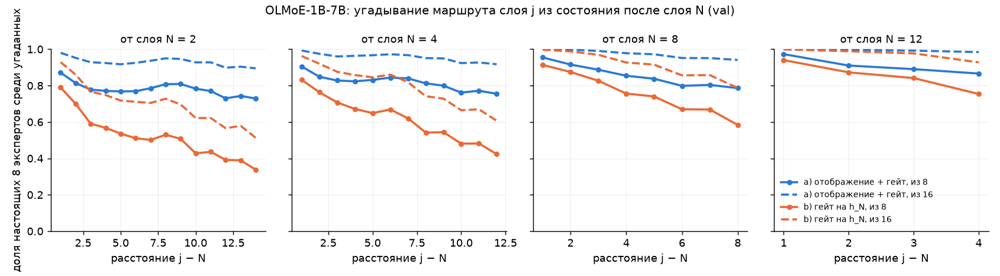

| от слоя N | на слой j | R² карты | a) из 8 | a) из 12 | a) из 16 | b) из 8 | b) из 16 |
|---|---|---|---|---|---|---|---|
| 2 | 3 | 0.86 | 0.871 | 0.958 | 0.980 | 0.790 | 0.928 |
| 2 | 4 | 0.63 | 0.814 | 0.914 | 0.952 | 0.699 | 0.860 |
| 2 | 6 | 0.40 | 0.771 | 0.877 | 0.924 | 0.567 | 0.748 |
| 2 | 10 | 0.33 | 0.808 | 0.911 | 0.950 | 0.530 | 0.728 |
| 2 | 16 | 0.28 | 0.729 | 0.842 | 0.895 | 0.338 | 0.513 |
| 4 | 5 | 0.89 | 0.905 | 0.980 | 0.993 | 0.832 | 0.962 |
| 4 | 8 | 0.47 | 0.824 | 0.928 | 0.963 | 0.672 | 0.858 |
| 4 | 16 | 0.32 | 0.755 | 0.868 | 0.917 | 0.423 | 0.607 |
| 8 | 9 | 0.92 | 0.955 | 0.998 | 1.000 | 0.914 | 0.997 |
| 8 | 12 | 0.55 | 0.854 | 0.950 | 0.978 | 0.756 | 0.927 |
| 8 | 16 | 0.37 | 0.786 | 0.896 | 0.941 | 0.584 | 0.787 |
| 12 | 13 | 0.94 | 0.973 | 1.000 | 1.000 | 0.940 | 0.999 |
| 12 | 16 | 0.57 | 0.866 | 0.960 | 0.984 | 0.754 | 0.928 |

Все пары слоёв и разбивка по источникам — в [`report/r26_tables.md`](report/r26_tables.md).

- **Карта лучше гейта на текущем состоянии** на любом расстоянии, и разрыв растёт с расстоянием: на соседний слой
  +0.03…+0.08, на последний слой +0.11…+0.39.
- **После первых 2–3 слоёв доля угаданных почти не падает,** хотя R² карты падает до 0.28–0.37. От слоя 2 на слои 6–16
  угадывается 0.73–0.81. Видимо, маршрутизатор смотрит на ту часть состояния, которая предсказуема издалека; это
  догадка, отдельно не проверял.
- **Из 12 угаданных** настоящие 8 почти все: 0.84–1.00 в зависимости от расстояния.
- **По источникам** легче всего сказки: от слоя 2 на слой 16 — 0.771 против 0.694 у Википедии и 0.719 у кода.

**Блоками по K** (доля настоящих 8 среди угаданных, среднее по 16 слоям):

| K | a) из 8 | a) из 12 | a) из 16 | b) из 8 | a) из 8 по слоям 1..16 |
|---|---|---|---|---|---|
| 2 | 0.859 | 0.928 | 0.947 | 0.780 | 0.42 0.55 0.87 0.81 0.91 0.85 0.93 0.88 0.95 0.92 0.96 0.90 0.97 0.91 0.98 0.93 |
| 4 | 0.803 | 0.887 | 0.917 | 0.698 | 0.42 0.55 0.61 0.62 0.91 0.85 0.83 0.82 0.95 0.92 0.89 0.85 0.97 0.91 0.89 0.87 |
| 8 | 0.715 | 0.811 | 0.857 | 0.550 | 0.42 0.55 0.61 0.62 0.59 0.59 0.61 0.61 0.95 0.92 0.89 0.85 0.84 0.80 0.80 0.79 |

Слабое место всех схем блоками — первый блок: его угадывают по эмбеддингам, без контекста. Слой 1 так угадывается на
0.42, слой 2 на 0.55.

### 18.3 Кэш экспертов

Промахов на токен (подгрузок эксперта). Δ к LRU — парная разность ± 2 SE по отрезкам из 1024 токенов; кэш между
отрезками не сбрасывается, так что SE приблизительная.

| на видеокарте | правило | промахов на токен | Δ к LRU ± 2 SE | Википедия / код / сказки | МБ на токен (4 бита / bf16) | токенов/с (4 бита / bf16) |
|---|---|---|---|---|---|---|
| 128 (1/8) | LRU | 78.34 | — | 83.50 / 67.98 / 83.54 | 246.4 / 985.7 | 101 / 25 |
| 128 (1/8) | любое правило, знающее только текущий токен (a), блоками, точное знание) | 78.34 | 0.00 | 83.50 / 67.98 / 83.54 | 246.4 / 985.7 | 101 / 25 |
| 128 (1/8) | оракул | 53.76 | −24.58 ± 0.42 | 57.88 / 44.78 / 58.62 | 169.1 / 676.5 | 148 / 37 |
| 256 (1/4) | LRU | 60.55 | — | 67.25 / 45.79 / 68.61 | 190.5 / 761.9 | 131 / 33 |
| 256 (1/4) | a), N = 2 | 57.82 | −2.73 ± 0.14 | 64.05 / 43.85 / 65.55 | 181.9 / 727.5 | 137 / 34 |
| 256 (1/4) | a), N = 4 | 58.57 | −1.98 ± 0.10 | 64.95 / 44.33 / 66.41 | 184.2 / 737.0 | 136 / 34 |
| 256 (1/4) | a), N = 8 | 59.62 | −0.93 ± 0.04 | 66.25 / 45.03 / 67.58 | 187.5 / 750.2 | 133 / 33 |
| 256 (1/4) | a), N = 12 | 60.35 | −0.20 ± 0.01 | 67.09 / 45.55 / 68.40 | 189.8 / 759.4 | 132 / 33 |
| 256 (1/4) | блоками, K = 2 | 60.35 | −0.19 ± 0.01 | 67.09 / 45.52 / 68.45 | 189.8 / 759.4 | 132 / 33 |
| 256 (1/4) | блоками, K = 4 | 59.94 | −0.61 ± 0.03 | 66.72 / 45.04 / 68.06 | 188.6 / 754.2 | 133 / 33 |
| 256 (1/4) | блоками, K = 8 | 59.06 | −1.49 ± 0.05 | 65.72 / 44.36 / 67.09 | 185.8 / 743.1 | 135 / 34 |
| 256 (1/4) | точное знание слоёв текущего токена | 55.54 | −5.00 ± 0.22 | 61.20 / 41.93 / 63.49 | 174.7 / 698.9 | 143 / 36 |
| 256 (1/4) | оракул | 30.20 | −30.34 ± 1.08 | 33.54 / 22.26 / 34.81 | 95.0 / 380.0 | 263 / 66 |
| 512 (1/2) | LRU | 25.77 | — | 29.94 / 15.60 / 31.76 | 81.1 / 324.3 | 308 / 77 |
| 512 (1/2) | a), N = 2 | 24.67 | −1.10 ± 0.13 | 28.76 / 15.24 / 30.00 | 77.6 / 310.4 | 322 / 81 |
| 512 (1/2) | a), N = 4 | 24.93 | −0.84 ± 0.10 | 29.05 / 15.33 / 30.41 | 78.4 / 313.7 | 319 / 80 |
| 512 (1/2) | a), N = 8 | 25.35 | −0.42 ± 0.05 | 29.51 / 15.47 / 31.06 | 79.7 / 319.0 | 314 / 78 |
| 512 (1/2) | a), N = 12 | 25.67 | −0.09 ± 0.01 | 29.85 / 15.57 / 31.61 | 80.8 / 323.0 | 310 / 77 |
| 512 (1/2) | блоками, K = 2 | 25.64 | −0.13 ± 0.01 | 29.80 / 15.55 / 31.57 | 80.7 / 322.6 | 310 / 77 |
| 512 (1/2) | блоками, K = 4 | 25.42 | −0.35 ± 0.04 | 29.56 / 15.47 / 31.23 | 80.0 / 319.9 | 313 / 78 |
| 512 (1/2) | блоками, K = 8 | 25.07 | −0.69 ± 0.08 | 29.22 / 15.36 / 30.65 | 78.9 / 315.5 | 317 / 79 |
| 512 (1/2) | точное знание слоёв текущего токена | 23.97 | −1.79 ± 0.18 | 27.97 / 14.83 / 29.12 | 75.4 / 301.6 | 332 / 83 |
| 512 (1/2) | оракул | 9.46 | −16.31 ± 1.07 | 11.36 / 5.68 / 11.33 | 29.8 / 119.0 | 840 / 210 |

- **Подкачку определяет повторное использование экспертов между токенами, а не внутри токена.** Даже точное знание
  всех слоёв текущего токена снимает 8.3% промахов при 1/4 и 6.9% при 1/2. Лучшее угадывание (от слоя 2) берёт около
  половины этого: 4.5% и 4.3%. Оракул, знающий следующие токены, снимает 50% и 63%.
- **При 1/8 выигрыш ровно ноль у всех правил, знающих только текущий токен,** во всех отрезках. 128 = 16 × 8, то есть
  в кэш помещается ровно один токен. Объяснение: на слое l LRU выбрасывает эксперта слоя l предыдущего токена. Эксперт привязан к
  своему слою, поэтому ни один дальнейший слой текущего токена его не использует, и любое такое правило выбирает ту же
  жертву.
- **Для вытеснения дальность важнее точности.** От слоя 2 угадывается хуже, чем от слоя 12, но знает 14 слоёв вперёд и
  снимает больше промахов. Блоками по 8 лучше, чем блоками по 2.
- **Код подкачивает меньше всех** (45.8 промаха против 67–69 при 1/4 под LRU): видимо, эксперты между токенами кода
  повторяются чаще.

### 18.4 Цена по качеству: эксперты по угаданному маршруту

Эксперты слоёв выше N выбраны по a) (8 угаданных), веса — вероятности настоящего маршрутизатора. Разности ± 2 SE по
окнам val.

| маршрут по угаданному | val CE | Δ к плотной | Википедия Δ | код Δ | сказки Δ |
|---|---|---|---|---|---|
| — (плотная) | 1.6578 | — | — | — | — |
| слои выше 12 | 1.6604 | +0.0026 ± 0.0001 | +0.0048 ± 0.0002 | +0.0017 ± 0.0002 | +0.0010 ± 0.0001 |
| слои выше 8 | 1.6756 | +0.0178 ± 0.0007 | +0.0353 ± 0.0013 | +0.0098 ± 0.0006 | +0.0054 ± 0.0003 |
| слои выше 4 | 1.6944 | +0.0366 ± 0.0015 | +0.0726 ± 0.0028 | +0.0245 ± 0.0019 | +0.0082 ± 0.0004 |
| слои выше 2 | 1.7210 | +0.0632 ± 0.0023 | +0.1246 ± 0.0039 | +0.0408 ± 0.0028 | +0.0161 ± 0.0005 |
| блоками по 2, все 16 слоёв | 1.7846 | +0.1268 ± 0.0033 | +0.2060 ± 0.0053 | +0.1257 ± 0.0055 | +0.0478 ± 0.0011 |
| блоками по 4, все 16 слоёв | 1.8335 | +0.1757 ± 0.0043 | +0.2831 ± 0.0064 | +0.1800 ± 0.0070 | +0.0646 ± 0.0012 |
| блоками по 8, все 16 слоёв | 1.9190 | +0.2612 ± 0.0059 | +0.4276 ± 0.0079 | +0.2558 ± 0.0086 | +0.0971 ± 0.0015 |

- Все разности больше 2 SE. Сильнее всех теряет Википедия (в 1.6–2 раза больше среднего), меньше всех — сказки.
- Блоками по 2 стоит вдвое дороже, чем «слои выше 2» (+0.127 против +0.063), хотя слои 5–16 угадывает из более
  близких точек. Видимо, всё дело в слоях 1–2, угаданных по эмбеддингам на 0.42 и 0.55; по слоям отдельно не мерил.

### 18.5 Что дальше

Предложения на момент первого прогона (потом посчитаны: следующий токен и время — 18.6, 12 кандидатов — 18.7):
- **Угадывать экспертов следующих токенов, а не следующих слоёв.** Между LRU и оракулом при 1/4 лежит 30 промахов на
  токен, из них угадывание в пределах токена может закрыть не больше 5. Следующий шаг — угадывать по состоянию токена
  маршруты одного-двух следующих токенов и мерить, какую часть разрыва до оракула это закрывает.
- **Брать 12 угаданных, а выбирать 8 настоящим маршрутизатором среди них.** Из 12 угаданных настоящие 8 почти все
  (0.84–1.00), так что цена по качеству должна быть заметно ниже, чем в 18.4, но это не мерено.
- **Подгрузку заранее** (перекрытие подкачки со счётом) симуляция не учитывает. Для неё угадывание полезно и без
  снижения байтов; оценить это можно только моделью времени.

Код — `dd/r26_olmoe.py` (prep / check / calib / route / cost / sim) и `dd/r26_report.py`; тесты — `tests/test_r26.py`.

### 18.6 Дополнения: следующий токен, время ожидания, другие правила вытеснения

Код — `dd/r26_more.py` (карты и угадывание следующего токена, 12 кандидатов) и `dd/r26_sim.py` (кэш с известным
будущим и подгрузкой заранее, модель времени, LFU / LRU-2 / ARC; на процессоре, без torch). Тесты —
`tests/test_r26_more.py`: без подгрузки новый симулятор совпадает с прежними LRU и «pred» во всех отрезках.
Таблицы — [`report/r26_more.md`](report/r26_more.md).

**Угадывание экспертов следующего токена (п. 6).** Гребневая карта ведёт из состояния текущего токена после слоя M во
вход маршрутизатора слоя j следующего токена, дальше — гейт слоя j. Карта восстанавливает этот вход слабо: R² 0.19–0.38.
Доля настоящих 8 экспертов следующего токена среди угаданных:

| способ | из 8, среднее по 16 слоям | по слоям | Википедия / код / сказки | из 12 |
|---|---|---|---|---|
| карта от слоя 12 + гейт | 0.624 | 0.56–0.69 | 0.586 / 0.680 / 0.625 | 0.735 |
| карта от слоя 8 + гейт | 0.587 | 0.52–0.67 | 0.547 / 0.649 / 0.587 | 0.697 |
| карта от слоя 16 + гейт | 0.599 | 0.54–0.67 | 0.552 / 0.655 / 0.611 | 0.709 |
| «как у текущего токена» (его top-k на том же слое) | 0.388 | 0.27–0.48 | 0.378 / 0.467 / 0.346 | 0.479 |

Следующий токен угадывается намного хуже следующих слоёв того же токена (там 0.73–0.97), но лучше, чем если просто
взять экспертов текущего токена.

**Промахи без подгрузки, если известно будущее (пп. 5–6), и классические правила.** Промахов на токен; в скобках Δ к
LRU ± 2 SE по отрезкам.

| правило | K = 128 | K = 256 | K = 384 | K = 512 |
|---|---|---|---|---|
| LRU | 78.34 | 60.55 | 41.46 | 25.77 |
| LFU (счёт с загрузки) | — | 87.15 (+26.60 ± 2.73) | 58.41 (+16.95 ± 1.93) | 38.64 (+12.87 ± 1.71) |
| LFU (счёт за всю историю) | — | 59.80 (-0.74 ± 1.82) | 41.74 (+0.28 ± 2.05) | 27.33 (+1.57 ± 1.76) |
| LRU-2 | — | 59.41 (-1.14 ± 0.36) | 39.56 (-1.91 ± 0.41) | 24.11 (-1.66 ± 0.27) |
| ARC | — | 59.78 (-0.76 ± 0.19) | 40.72 (-0.74 ± 0.13) | 25.77 (-0.00 ± 0.00) |
| текущий токен от слоя 2 (лучшее из 18.3) | 78.34 (+0.00 ± 0.00) | 57.82 (-2.73 ± 0.14) | 39.62 (-1.84 ± 0.17) | 24.67 (-1.10 ± 0.13) |
| текущий токен точно | 78.34 (+0.00 ± 0.00) | 55.54 (-5.00 ± 0.22) | 38.33 (-3.13 ± 0.23) | 23.97 (-1.79 ± 0.18) |
| следующий токен угадан (от слоя 12) | 82.74 (+4.40 ± 0.27) | 56.67 (-3.87 ± 0.17) | 39.28 (-2.19 ± 0.20) | 24.54 (-1.23 ± 0.15) |
| следующий токен угадан (от слоя 8) | 83.07 (+4.73 ± 0.46) | 56.01 (-4.53 ± 0.20) | 38.92 (-2.54 ± 0.23) | 24.35 (-1.41 ± 0.17) |
| текущий и следующий токен точно | 66.00 (-12.34 ± 0.35) | 48.70 (-11.85 ± 0.54) | 34.07 (-7.39 ± 0.53) | 21.66 (-4.11 ± 0.38) |
| оракул (Belady) | 53.76 (-24.58 ± 0.42) | 30.20 (-30.34 ± 1.08) | 17.36 (-24.11 ± 1.24) | 9.46 (-16.31 ± 1.07) |

- **При K = 128 знание слоёв текущего токена даёт ровно LRU.** Это свойство постановки, объяснение в 18.3. При таком
  кэше выиграть можно только знанием следующих токенов: точное знание следующего токена снимает 12.3 промаха (−16%),
  оракул — 24.6.
- **Угаданный следующий токен почти не помогает.** При K = 128 он даже хуже LRU (+4.4); при 256–512 даёт −1.2…−4.5,
  примерно как угадывание текущего токена. Даже точное знание следующего токена закрывает от четверти до половины
  разрыва до оракула (при 256: −11.9 из −30.3). Остальное — повторы экспертов через много токенов.
- **Из классических правил лучше всех LRU-2:** −1.1…−1.9 промаха, примерно как угадывание текущего токена от слоя 2.
  ARC даёт −0.7…−0.8 при 256–384, а при 512 почти совпадает с LRU (в третьем знаке). У LFU со счётом за всю историю
  эффект не обнаружен; LFU со счётом с момента загрузки сильно хуже LRU (+13…+27).

**Время ожидания (п. 4).** Модель простая. Первая половина времени слоя уходит на внимание и маршрутизатор; потом
слой ждёт свои 8 экспертов; потом идёт вторая половина. Шина одна: подгрузка по требованию идёт раньше очереди
заранее заказанных экспертов, а уже начатую подгрузку не прерывает. Подгрузка заранее: как только в точке решения
стали известны угаданные эксперты, все отсутствующие в кэше ставятся в очередь в порядке надобности. Подгружаемый
эксперт может вытеснить только того, кто не нужен в известном будущем или нужен позже. Оракул — нижняя граница:
промахи Белади, подкачка целиком перекрыта счётом, время = max(счёт, подкачка). Параметры — шина 25 ГБ/с, слой
0.3 мс (счёт токена 4.8 мс), эксперт 3.15 МБ (4 бита) или 12.58 МБ (bf16). Ожидание экспертов, мс на токен,
4 бита / bf16:

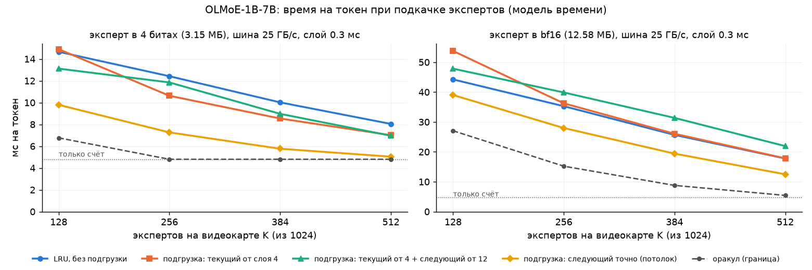

| правило | K = 128 | K = 256 | K = 384 | K = 512 |
|---|---|---|---|---|
| LRU, без подгрузки | 9.86 / 39.43 | 7.62 / 30.47 | 5.22 / 20.87 | 3.24 / 12.97 |
| LRU-2, без подгрузки | — | 7.48 / 29.90 | 4.98 / 19.91 | 3.03 / 12.13 |
| подгрузка угаданных от слоя 4 | 10.10 / 48.97 | 5.82 / 31.44 | 3.74 / 21.26 | 2.21 / 13.02 |
| подгрузка угаданных от слоя 8 | 11.47 / 51.95 | 6.27 / 30.29 | 4.17 / 20.59 | 2.52 / 12.61 |
| подгрузка угаданных от слоя 12 | 10.89 / 46.56 | 6.89 / 30.04 | 4.67 / 20.50 | 2.87 / 12.64 |
| подгрузка угаданного следующего токена (от слоя 12) | 8.73 / 41.45 | 6.29 / 33.71 | 4.08 / 24.20 | 2.51 / 14.71 |
| подгрузка: текущий от слоя 4 + следующий от слоя 12 | 8.32 / 43.04 | 7.05 / 35.07 | 4.17 / 26.56 | 2.16 / 17.12 |
| подгрузка: следующий токен точно, от слоя 12 (потолок) | 4.99 / 34.21 | 2.46 / 23.18 | 0.97 / 14.60 | 0.24 / 7.69 |
| оракул (граница) | 1.96 / 22.26 | 0.00 / 10.40 | 0.00 / 3.98 | 0.00 / 0.62 |

- **Подгрузка заранее помогает только при лёгком эксперте.** В 4 битах подгрузка угаданных от слоя 4 снимает 1.8 мс при
  K = 256 (−24%) и 1.0 мс при 512. При K = 128 она хуже LRU: подгружённое вытесняет нужное.
- **Сколько промахов успевает подгрузиться.** При K = 256, подгрузке от слоя 4 и эксперте в 4 битах заранее подгружено и
  использовано 33.9 эксперта на токен. Из них вовремя пришли 15.6, опоздали 18.3. В bf16 вовремя — 2.4:
  шина и так почти всё время занята. Поэтому в bf16 подгрузка угаданных почти ничего не даёт или вредит: от слоя 4
  +1.0 мс, от слоя 12 −0.4 мс.
- **Угаданный следующий токен с подгрузкой** в 4 битах даёт −0.7…−1.3 мс, в bf16 хуже LRU на 1.7–3.3 мс: на каждый
  токен 6–29 подгрузок уходят зря.
- **Точное знание следующего токена с подгрузкой от слоя 12** — потолок этой схемы. При K = 256 ожидание 2.46 мс в
  4 битах (−68%) и 23.2 мс в bf16 (−24%); у оракула-границы 0 и 10.4 мс.
- **От параметров зависит сильно.** При медленном слое (1 мс) подгрузке есть куда спрятаться: в 4 битах при 256 лучшая
  схема даёт 2.58 мс против 7.62 у LRU, в bf16 — 24.5 против 30.5. При быстром слое (0.1 мс) выигрыш почти
  исчезает: 7.35 против 7.62.

**Итог по кэшу.** Без подгрузки маршрут наперёд почти бесполезен: байты определяет повторное использование экспертов
между токенами, и выиграть можно только знанием следующих токенов. Польза маршрута наперёд — в подгрузке заранее. Но
нынешней точности хватает только при лёгком (4-битном) эксперте и не слишком быстром слое. Для bf16 нужна точность,
близкая к точной: иначе ошибочные подгрузки занимают шину.


### 18.7 12 угаданных кандидатов, 8 выбирает настоящий маршрутизатор

На слоях выше N кандидаты — 12 экспертов, угаданных по карте и гейту (как «а» в 18.2). Настоящий маршрутизатор
берёт свои лучшие 8 среди них, веса — его вероятности. Плотная модель — 1.6578. Разности ± 2 SE по окнам val. Код —
`dd/r26_more.py cost12`, таблицы — [`report/r26_more.md`](report/r26_more.md).

| от слоя N | val CE | Δ к плотной | Википедия / код / сказки, Δ | Δ к 8 угаданным (18.4) | настоящие top-8 среди 12, по слоям | экспертов на токен без кэша |
|---|---|---|---|---|---|---|
| 2 | 1.6880 | +0.0302 ± 0.0013 | +0.062 / +0.018 / +0.007 | −0.0330 ± 0.0011 | 0.844–0.958 | 184 |
| 4 | 1.6732 | +0.0154 ± 0.0007 | +0.032 / +0.010 / +0.003 | −0.0212 ± 0.0008 | 0.871–0.980 | 176 |
| 8 | 1.6641 | +0.0063 ± 0.0003 | +0.013 / +0.003 / +0.002 | −0.0115 ± 0.0004 | 0.899–0.998 | 160 |
| 12 | 1.6587 | +0.0009 ± 0.0001 | +0.001 / +0.000 / +0.001 | −0.0017 ± 0.0001 | 0.961–1.000 | 144 |

Без кэша плотная модель грузит 128 экспертов на токен, 12 кандидатов — 144–184.

- **По качеству 12 кандидатов вдвое-втрое лучше 8 угаданных.** От слоя 4 потеря +0.015 против +0.037, от слоя 8 —
  +0.006 против +0.018. Дороже всего Википедия, как и в 18.4.
- **По времени ожидания они не выигрывают** (модель времени из 18.6, 4 бита, подгрузка кандидатов заранее). При
  K = 256 кандидаты от слоя 12 дают 7.48 мс против 7.62 у LRU (−0.14 ± 0.02), от слоя 8 — −0.05 ± 0.04, от слоёв
  2 и 4 эффект не обнаружен. Подгрузка 8 угаданных от слоя 4 — 5.82 мс. При K = 384 и 512 то же: лучшие кандидаты
  дают −0.4 и −0.6 мс, подгрузка 8 от слоя 4 — −1.5 и −1.0 мс. При K = 128 кандидаты хуже LRU на 2.4–4.9 мс. На
  токен 7–29 подгрузок уходят зря, и шина занята ими.
- **В bf16 12 кандидатов хуже LRU при всех K:** +1.1…+6.7 мс при 256–512, +10…+21 мс при 128.

12 кандидатов — хороший способ снизить цену угадывания по качеству. Но на подгрузке он не экономит: лишние 4
эксперта на слой стоят шине дороже, чем экономят промахи.


## 19. Раунд 27: проверка на задачах, а не только по CE (Qwen3, без обучения)

### 19.1 Постановка

Вопрос: сохраняется ли вывод 17.25 «урезанная большая модель хуже целой меньшей при равном расходе», если мерить
задачами. В литературе урезание часто держит перплексию, но проседает на задачах на знания (LLM-KICK) и меняет
ответы при той же точности (Dutta et al., 2024).

**Модели** — чат-версии Qwen3-0.6B, 1.7B и 4B. Урезается верхняя половина блоков при 1/4 FFN. 8B снята по вашему
слову: частичные результаты целой 8B в отчёт не входят.

**Варианты:**
- **лучшая двухуровневая** — схема 17.24, обобщённая на любой размер:
  - 256 кластеров состояний по месту (книги 17.23, 400 окон калибровки) и двухступенчатый маршрут;
  - пул группы — F/3 самых важных нейронов;
  - TEAL внутри пула;
  - поправка: карта ранга 32 на блок и сдвиг на группу.

  Всё входит в расход 1/4. Пул F/3 подобран на 0.6B и под другие размеры не перенастраивался.
- **ориентиры только для 0.6B**: простое урезание (одни и те же 768 нейронов у всех токенов) и TEAL по всему слою
  при s = 1/4.

**Меры:**
- CE, KL(целая ‖ урезанная) и совпадение топ-1 с целой моделью — на 480 окнах нашего val;
- перплексия WikiText-2 (test) — окна по 2048 токенов, как в SparseGPT и Wanda;
- задачи — lm-evaluation-harness 0.4.13:
  - zero-shot: ARC-e, ARC-c, HellaSwag, PIQA, WinoGrande, TriviaQA — по 1000 случайных вопросов, одних и тех же
    для всех моделей;
  - MMLU 5-shot — 2000 случайных вопросов по всем 57 предметам;
  - метрика: acc_norm для ARC, HellaSwag и PIQA, acc для WinoGrande и MMLU;
- TriviaQA:
  - чат-модели отвечают целой фразой («The last US state … was California»), поэтому точное совпадение почти
    нулевое: 0.02 у 0.6B, 0.24 у 4B;
  - основная мера здесь — «ответ содержится в генерации»: один из правильных вариантов встречается целиком, без
    учёта регистра и пунктуации, не больше 32 новых токенов;
- «средняя точность» — среднее пяти задач без MMLU и TriviaQA; «знания» — среднее MMLU и TriviaQA («содержит»);
- **перевороты** — доля вопросов, на которые урезанная модель отвечает верно, а целая того же размера неверно, или
  наоборот.

**Как считались** ± 2 SE — парный бутстрэп по вопросам, у всех моделей одни и те же выборки, или по окнам для CE.
«Линия целых моделей» — их точность, интерполированная по log FLOPs. FLOPs — как в 17.25.

Урезанные модели прогнаны через свой класс модели для lm-eval поверх нашего прохода: правдоподобие и жадная
генерация с остановкой как у HF. Код — `dd/r27_tasks.py` и `dd/r27_report.py`. Таблицы —
[`report/r27_tables.md`](report/r27_tables.md).

### 19.2 Наш класс модели против HF в lm-eval (целая 0.6B)

| задача | HF | наш | одинаковые решения |
|---|---|---|---|
| ARC-e | 0.555 | 0.556 | 99.1% |
| ARC-c | 0.342 | 0.339 | 99.7% |
| HellaSwag | 0.440 | 0.440 | 99.4% |
| PIQA | 0.683 | 0.682 | 99.1% |
| WinoGrande | 0.568 | 0.563 | 96.9% |
| TriviaQA (точное) | 0.021 | 0.022 | 99.5%; дословно та же генерация — 83.9% |

Различия — шум bf16. Оба считают логиты в bf16, и один шаг округления при логитах около 20 — это 0.125. Медиана
расхождения log p варианта — 0.08–0.17. Тот же шум задаёт порог для переворотов: 0.3–3% ответов меняются и без
урезания. Для MMLU эталон HF не досчитан: при пакете 4 у него не хватило памяти (log-softmax в fp32 по 152 тыс.
токенов). Пакет 1 исправлен в коде, но шаг не перезапускался.

### 19.3 Итог

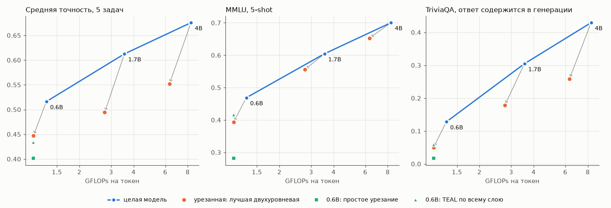

| модель | вариант | GFLOPs | CE (val) | WikiText-2 ppl | KL | топ-1 | средняя точность (5) | MMLU | TriviaQA (содержит) |
|---|---|---|---|---|---|---|---|---|---|
| 0.6B | целая | 1.31 | 2.395 | 21.0 | — | — | 0.516 | 0.469 | 0.128 |
| 0.6B | лучшая двухуровневая | 1.11 | 2.616 | 29.6 | 0.25 | 0.79 | 0.447 | 0.393 | 0.050 |
| 0.6B | TEAL по всему слою | 1.11 | 3.390 | 78.3 | 0.99 | 0.61 | 0.434 | 0.416 | 0.058 |
| 0.6B | простое урезание | 1.11 | 3.448 | 70.6 | 1.20 | 0.53 | 0.401 | 0.282 | 0.017 |
| 1.7B | целая | 3.56 | 2.261 | 16.7 | — | — | 0.613 | 0.604 | 0.305 |
| 1.7B | лучшая двухуровневая | 2.77 | 2.479 | 23.5 | 0.29 | 0.81 | 0.494 | 0.555 | 0.178 |
| 4B | целая | 8.35 | 2.112 | 13.7 | — | — | 0.676 | 0.700 | 0.429 |
| 4B | лучшая двухуровневая | 6.33 | 2.322 | 18.4 | 0.34 | 0.79 | 0.552 | 0.653 | 0.259 |

У 0.6B лучшая двухуровневая здесь 2.616 против 2.605 в 17.24: другие книги, 400 окон калибровки против 800. У 1.7B
она по CE на 0.014 хуже простых 256 групп с равной шириной из 17.23 (2.465). Пул F/3, подобранный на 0.6B, на 1.7B
не лучший. У 4B она лучше 256 групп на 0.074.

**Против целой модели того же размера**, ± 2 SE:

| модель | вариант | Δ средней точности | Δ MMLU | Δ TriviaQA | перевороты: 5 задач (верно→неверно / неверно→верно) | MMLU | TriviaQA |
|---|---|---|---|---|---|---|---|
| 0.6B | лучшая двухуровневая | −0.069 ± 0.012 | −0.076 ± 0.022 | −0.078 ± 0.020 | 18.4% (12.7 / 5.8) | 25.9% | 10.4% |
| 0.6B | TEAL по всему слою | −0.082 ± 0.013 | −0.053 ± 0.020 | −0.070 ± 0.019 | 24.1% (16.1 / 7.9) | 20.8% | 9.8% |
| 0.6B | простое урезание | −0.115 ± 0.015 | −0.187 ± 0.027 | −0.111 ± 0.020 | 27.3% (19.4 / 7.9) | 42.8% | 11.3% |
| 1.7B | лучшая двухуровневая | −0.118 ± 0.013 | −0.049 ± 0.017 | −0.126 ± 0.027 | 23.4% (17.6 / 5.8) | 15.3% | 20.0% |
| 4B | лучшая двухуровневая | −0.124 ± 0.013 | −0.048 ± 0.017 | −0.171 ± 0.031 | 23.3% (17.9 / 5.5) | 14.7% | 26.5% |

**Против линии целых моделей при том же расходе** и прямо против целой меньшей (она дешевле):

| модель | CE | средняя точность (5) | MMLU | TriviaQA | знания | против целой меньшей: средняя точность / знания |
|---|---|---|---|---|---|---|
| 1.7B, лучшая двухуровневая (2.77 GFLOPs) | +0.184 ± 0.013 | −0.094 ± 0.012 | −0.015 ± 0.016 | −0.082 ± 0.023 | −0.048 ± 0.014 | 0.6B (1.31): −0.022 ± 0.014 / **+0.069 ± 0.017** |
| 4B, лучшая двухуровневая (6.33 GFLOPs) | +0.162 ± 0.012 | −0.103 ± 0.012 | −0.017 ± 0.016 | −0.130 ± 0.027 | −0.073 ± 0.016 | 1.7B (3.56): −0.061 ± 0.014 / +0.001 ± 0.018 |

### 19.4 Оракул на Base-моделях (выброс 1.7B, 17.23)

Оракул — у каждого токена свои 1/4 нейронов верхней половины. 480 окон val.

| модель | исходная CE | оракул − исходная ± 2 SE | у чат-версии (17.23): исходная CE / оракул − исходная |
|---|---|---|---|
| Qwen3-0.6B-Base | 2.023 | +0.054 ± 0.002 | 2.395 / +0.028 ± 0.002 |
| Qwen3-1.7B-Base | 1.802 | +0.027 ± 0.001 | 2.261 / −0.050 ± 0.003 |

У Base-моделей оракул хуже исходной. Выигрыш оракула у чат-1.7B связан с дообучением в чат.

### 19.5 Выводы

- **Потолок, посчитанный по чат-версиям, был завышен.** У Base-моделей оракул теряет +0.027…+0.054. «Оракулу 1/4
  хватает без потерь» (17.23) верно только для чат-моделей.
- **Вся линия Qwen (r25–r27) мерилась на чат-моделях.** На сыром тексте нашего val они на 0.37–0.46 нат хуже
  Base: 2.395 против 2.023 у 0.6B, 2.261 против 1.802 у 1.7B. Абсолютные CE, потолки и «бесплатный» оракул в
  разделах 17 и 19 — свойства чат-моделей. На Base картина может быть другой.
- **По CE и по пяти задачам на здравый смысл вывод 17.25 держится.**
  - Урезанные модели лежат ниже линии целых: CE на +0.16…+0.18 хуже, средняя точность на 0.09–0.10 ниже.
  - Они хуже даже целой меньшей, которая дешевле: 1.7B против 0.6B — −0.022 ± 0.014, 4B против 1.7B —
    −0.061 ± 0.014.
- **Со знаниями сложнее, и подтверждается это лишь наполовину.**
  - Вспоминание фактов (TriviaQA) проседает сильнее всего: на 40–61% от уровня своей целой модели; у пяти задач
    на здравый смысл — 13–19%. Против линии целых: −0.08 и −0.13.
  - Знания с выбором ответа (MMLU) держатся лучше всего: −7…−16% от своей целой. У 1.7B и 4B MMLU лежит на линии
    целых, эффект не обнаружен (−0.015 ± 0.016, −0.017 ± 0.016).
  - Против целой меньшей по знаниям: урезанная 1.7B лучше 0.6B на 0.069 ± 0.017, урезанная 4B равна 1.7B.
  - Предсказание LLM-KICK здесь верно для вспоминания и неверно для MMLU.
- **CE и перплексия плохо упорядочивают схемы по задачам.** У TEAL по всему слою (0.6B) CE на 0.77 хуже лучшей
  двухуровневой, перплексия WikiText-2 — 78 против 30. При этом:
  - MMLU у него выше на 0.023 ± 0.021;
  - на TriviaQA эффект не обнаружен;
  - средняя точность ниже на 0.013 ± 0.013 — на границе 2 SE.
- **Перевороты на порядок выше шума.**
  - Урезанные модели меняют 18–27% ответов в пяти задачах; верно → неверно в 2–3.3 раза чаще, чем наоборот.
  - На MMLU у 1.7B и 4B точность падает на 0.05, а ответ меняется на 15% вопросов.
  - Шум bf16 меняет 0.3–3% ответов. Значит, «та же точность при других ответах» (Dutta et al.) здесь есть: потеря
    точности — лишь часть изменений.
- **Оговорки:**
  - схема не перенастраивалась под 1.7B и 4B; у 1.7B она по CE слабее 256 групп;
  - TriviaQA оценивалась мягкой мерой;
  - эталон HF для MMLU не досчитан;
  - 8B снята.


## 20. Раунд 28: что мешает экспертам различаться (r21 и OLMoE-1B-7B; этапы 0–2 дома, обучение этапов 3–4 на vast)

### 20.1 Постановка

Вопрос: почему эксперты смеси r21 (perlayer, hash) так мало отличаются друг от друга и от общего FFN. Гипотеза
блока: эксперт получает градиент не только от своих токенов, но и от всех позиций, которые читают его записи через
K / V внимания следующих блоков, а эти позиции принадлежат любым темам. Так «чужой» градиент тянет каждого эксперта
обслуживать всех.

- **Этап 0** (без обучения): готовые r21 perlayer s0 и hash s0. Подмена экспертов, подмена с подбором выхода,
  расхождение весов, чужой градиент по весам и его разбивка по темам.
- **Этап 0б** (без обучения): то же на OLMoE-1B-7B (обвязка и val r26). Дополнительно: кривая по рангу
  маршрутизатора, подбор выхода, меньше экспертов на токен, доля токенов с заметным изменением потери.
- **Этап 1** (обучение, дома, ночная очередь): 7 вариантов perlayer r21. Все стартуют с A-mix, 10k шагов, тот же
  маршрут. В б–д меняется только градиент, который доходит до записей экспертов в K / V верхних блоков от чужих
  позиций, прямой проход тот же. е — общий down на блок, ж — общий FFN + добавки. Замеры на сохранениях 2k / 5k / 10k.
- **Этап 2**: полные матрицы подмены и подбора на 10k (1024 окна), парные разности качества, второй сид лучшего
  варианта.

Код: `dd/r28_stage0.py`, `dd/r28_olmoe.py`, `dd/r28_train.py`, `dd/r28_measure.py`, отчёты `dd/r28_report.py` и
`dd/r28_report1.py`. Тесты весов градиента — `tests/test_r28.py` (17 шт., прошли перед обучением). Таблицы:
[`report/r28_tables.md`](report/r28_tables.md) (этапы 0, 0б), [`report/r28_stage12.md`](report/r28_stage12.md)
(этапы 1, 2). Этапы 0–2 считались дома. В этапах 3–4 обучение шло на vast.ai (по вашему слову, 6 машин,
~$2.6), замеры — дома.

**Мера специализации.** Токены эксперта i пропускаются через другого эксперта k того же блока, считается рост CE на
этих токенах. Специализация = (чужой − свой) / (ноль − свой) = чужой / ноль: свой — сама модель, её рост 0, «ноль» —
нулевой выход FFN на этих токенах. 0 — эксперты взаимозаменяемы, 1 — чужой эксперт не лучше пустого FFN. Та же мера с
FFN dense-cont (плотная модель, дообученная те же 10k шагов) вместо чужого эксперта — ориентир «общий FFN».

### 20.2 Этап 0: готовые r21 (без обучения)

Сводка по блокам (1024 окна val; среднее по экспертам с весом доли токенов; ± 2 SE):

| модель | блок | чужой эксперт | FFN A-mix | FFN dense-cont | ноль | чужой / ноль | dense-cont / ноль | снято подбором down |
|---|---|---|---|---|---|---|---|---|
| perlayer | 5 | +0.0204 | +0.0145 | +0.0078 | +0.0710 | 0.288 ± 0.011 | 0.110 ± 0.006 | 56% |
| perlayer | 6 | +0.0302 | +0.0216 | +0.0110 | +0.1057 | 0.286 ± 0.009 | 0.104 ± 0.005 | 55% |
| perlayer | 7 | +0.0495 | +0.0347 | +0.0188 | +0.1628 | 0.304 ± 0.007 | 0.116 ± 0.004 | 59% |
| perlayer | 8 | +0.2059 | +0.7024 | +0.0305 | +0.6668 | 0.309 ± 0.009 | 0.046 ± 0.001 | 86% |
| hash | 5 | +0.0169 | +0.0148 | +0.0083 | +0.0603 | 0.280 ± 0.011 | 0.138 ± 0.007 | 50% |
| hash | 6 | +0.0283 | +0.0228 | +0.0127 | +0.1008 | 0.281 ± 0.008 | 0.126 ± 0.005 | 48% |
| hash | 7 | +0.0344 | +0.0313 | +0.0151 | +0.1539 | 0.224 ± 0.006 | 0.098 ± 0.004 | 51% |
| hash | 8 | +0.0528 | +0.5306 | +0.0882 | +0.6667 | 0.079 ± 0.002 | 0.132 ± 0.004 | 63% |

- **Эксперты различаются, но умеренно.** Чужой эксперт стоит около 0.3 от пустого FFN (у hash в блоке 8 — 0.08).
  Общий FFN dense-cont заменяет эксперта в 2–3 раза лучше любого чужого: 0.10–0.14 от нуля. Даже стартовый FFN
  A-mix в блоках 5–7 лучше чужого эксперта. Каждый эксперт ушёл от общей точки в свою сторону, и чужой ушёл
  в другую.
- **Блок 8 особый.** У perlayer FFN A-mix там хуже нуля (+0.70 против +0.67), а dense-cont стоит лишь +0.03: последний
  блок сильно переучивается после старта, и эксперты делают это вместе. У hash в блоке 8 эксперты почти
  взаимозаменяемы (0.08).
- **Половину разницы даёт выход.** Если у чужого эксперта заморозить gate / up и подобрать down под выход своего,
  снимается 48–59% разницы в блоках 5–7 и 63–86% в блоке 8. Входные признаки чужого объясняют 0.84–0.96 выхода своего
  (случайные — 0.35–0.65). Входная часть у экспертов во многом общая.
- **Веса.** Косинус весов экспертов между собой 0.90–0.93, сдвиг от A-mix ≈ 0.3 нормы. Сдвиги разных экспертов почти
  независимы (косинус 0.18–0.22), со сдвигом dense-cont косинус 0.35.
- **Чужой градиент велик и не сосредоточен в темах.** Доля чужого в градиенте весов эксперта (perlayer / hash):
  0.62 / 0.66 в блоке 5, 0.53 / 0.45 в блоке 6, 0.36 / 0.33 в блоке 7, 0 в блоке 8 (дальше внимания нет). Косинус
  своего и чужого ≈ 0: чужой — отдельное направление, а не усиление своего. Разбивка по темам читающих широкая:
  эффективное число тем 6.2 из 8 у perlayer и 7.9 у hash, доля своей темы 0.14–0.15 (случайно — 0.125).

Вывод этапа 0: условие гипотезы выполнено. В блоках 5–7 больше половины градиента эксперта приходит от позиций
любых тем. Будет ли эксперт без этой части отличаться сильнее — проверяет этап 1.

### 20.3 Этап 0б: OLMoE-1B-7B (без обучения)

Условия другие: в OLMoE у токена 8 экспертов из 64 и выход слоя — их сумма с весами маршрутизатора. Подмена меняет
около 1/8 выхода, «ноль» убирает одного из восьми. Мера подмена / ноль та же по смыслу, но масштаб другой.

**Подмена одного из 8** (слот случайный, 256 окон): подмена / ноль = 1.1–1.5 для случайного невыбранного,
1.1–1.3 для 9-го по маршрутизатору, 1.2–1.7 для самого далёкого (слой 15: 1.8 / 1.4 / 2.8; далёкий в слое 0 —
2.2). Чужой эксперт хуже,
чем просто убрать слот. «Оставшиеся 7 с перенормировкой» ≈ «ноль». В абсолютных числах всё мало: 0.003–0.035 нат
на токен.

**Главный эксперт токена** (наибольший вес; 96 окон; нат на токен ± 2 SE):

| слой | ноль главного эксперта | подмена на ранг 9 | доля с изменением > 0.1, ноль: всего (рост / падение) | доля с изменением > 0.1, ранг 9 | среднее изменение по модулю: ноль / ранг 9 |
|---|---|---|---|---|---|
| 0 | +0.0197 ± 0.0044 | +0.0243 ± 0.0049 | 0.34 (0.19 / 0.15) | 0.36 (0.20 / 0.16) | 0.133 / 0.146 |
| 1 | +0.0317 ± 0.0051 | +0.0397 ± 0.0061 | 0.36 (0.21 / 0.15) | 0.38 (0.23 / 0.16) | 0.145 / 0.161 |
| 2 | +0.0359 ± 0.0035 | +0.0415 ± 0.0043 | 0.39 (0.22 / 0.17) | 0.41 (0.24 / 0.18) | 0.168 / 0.183 |
| 3 | +0.0274 ± 0.0031 | +0.0319 ± 0.0035 | 0.35 (0.20 / 0.15) | 0.38 (0.22 / 0.16) | 0.136 / 0.151 |
| 4 | +0.0261 ± 0.0036 | +0.0292 ± 0.0039 | 0.34 (0.19 / 0.15) | 0.36 (0.21 / 0.15) | 0.131 / 0.144 |
| 5 | +0.0162 ± 0.0027 | +0.0203 ± 0.0035 | 0.33 (0.18 / 0.15) | 0.35 (0.20 / 0.15) | 0.116 / 0.130 |
| 6 | +0.0126 ± 0.0019 | +0.0157 ± 0.0025 | 0.30 (0.17 / 0.14) | 0.34 (0.19 / 0.15) | 0.104 / 0.118 |
| 7 | +0.0131 ± 0.0018 | +0.0159 ± 0.0023 | 0.29 (0.16 / 0.13) | 0.32 (0.18 / 0.14) | 0.100 / 0.114 |
| 8 | +0.0183 ± 0.0027 | +0.0194 ± 0.0034 | 0.29 (0.16 / 0.13) | 0.32 (0.18 / 0.14) | 0.101 / 0.114 |
| 9 | +0.0329 ± 0.0026 | +0.0382 ± 0.0036 | 0.33 (0.20 / 0.14) | 0.36 (0.21 / 0.15) | 0.128 / 0.143 |
| 10 | +0.0478 ± 0.0030 | +0.0525 ± 0.0038 | 0.36 (0.21 / 0.14) | 0.38 (0.23 / 0.15) | 0.150 / 0.163 |
| 11 | +0.0440 ± 0.0036 | +0.0526 ± 0.0052 | 0.35 (0.21 / 0.14) | 0.38 (0.23 / 0.15) | 0.143 / 0.161 |
| 12 | +0.0496 ± 0.0051 | +0.0601 ± 0.0072 | 0.35 (0.21 / 0.14) | 0.38 (0.23 / 0.15) | 0.152 / 0.174 |
| 13 | +0.0601 ± 0.0054 | +0.0727 ± 0.0080 | 0.33 (0.20 / 0.13) | 0.36 (0.21 / 0.14) | 0.158 / 0.181 |
| 14 | +0.0458 ± 0.0045 | +0.0597 ± 0.0074 | 0.33 (0.19 / 0.14) | 0.34 (0.20 / 0.14) | 0.142 / 0.164 |
| 15 | +0.0415 ± 0.0075 | +0.0623 ± 0.0094 | 0.39 (0.21 / 0.18) | 0.39 (0.23 / 0.16) | 0.173 / 0.189 |

- **Средний рост мал, но на отдельных токенах изменения большие и в обе стороны.** Убрать главного эксперта в
  одном слое — у 29–39% токенов потеря меняется больше чем на 0.1 нат: растёт у 16–22%, падает у 13–18%. Среднее
  изменение по модулю 0.10–0.17 нат на токен против среднего роста 0.013–0.060: изменения почти гасят друг друга. Подмена на 9-го
  по маршрутизатору — так же или чуть больше (32–41%).
- **Это не шум пересчёта.** Проверка без подмены тем же путём (кэш состояния слоя, bf16) даёт ровно 0.
- Средний рост от нуля главного эксперта больше в верхних слоях (0.04–0.06 в слоях 10–15 против 0.013–0.036 в
  слоях 0–9), а доля затронутых токенов по слоям почти постоянна (0.29–0.39).

**Ранг заменителя** (главный эксперт заменяется экспертом с рангом r, вес тот же; отношение к нулю): ранг 9 —
1.06–1.25, ранг 64 — 1.2–2.0, случайный из 56 — 1.2–1.5. Кривая растёт, но слабо: маршрутизатор ранжирует
экспертов по пригодности лишь грубо, и уже 9-й хуже пустого слота. Подгонка нормы выхода под заменённого делает
хуже (1.6–3, в слоях 1–2 до 6–15 раз; там у части экспертов крошечная норма выхода, растяжение ломает). Слот с
наименьшим весом — на уровне шума.

**Подмена с подбором выхода** (слои 0 / 4 / 8 / 12 / 15, по 16 экспертов; рост CE на токенах, где эксперт выбран;
партнёр «ближайший» — чаще всех выбирается вместе с экспертом):

| слой | ближайший: как есть → с подбором | случайный: как есть → с подбором | случайные gate / up + подбор | ноль | объяснено выхода: ближайший / случайный / случайные gate / up |
|---|---|---|---|---|---|
| 0 | +0.0041 → +0.0008 | +0.0014 → +0.0009 | +0.0009 | +0.0011 | 0.27 / 0.24 / 0.19 |
| 4 | +0.0051 → +0.0021 | +0.0033 → +0.0021 | +0.0022 | +0.0029 | 0.15 / 0.13 / 0.10 |
| 8 | +0.0055 → +0.0025 | +0.0048 → +0.0028 | +0.0027 | +0.0032 | 0.17 / 0.15 / 0.13 |
| 12 | +0.0190 → +0.0101 | +0.0141 → +0.0105 | +0.0105 | +0.0114 | 0.16 / 0.13 / 0.12 |
| 15 | +0.0316 → +0.0114 | +0.0290 → +0.0118 | +0.0122 | +0.0097 | 0.37 / 0.34 / 0.26 |

- **Входная часть экспертов OLMoE своя.** Признаки чужого эксперта объясняют 0.13–0.37 выхода, случайные — 0.10–0.26.
  В маленькой модели было 0.84–0.96 против 0.35–0.65 у случайных.
- **Подбор сводит подмену к уровню пустого слота**, и с любым партнёром выходит столько же, сколько со случайными
  gate / up. Доля «снято» (26–79%) здесь значит только это. Сравнивать её с 48–86% маленькой модели нельзя: там
  подбор давал много больше нуля.
- **Частый совместный партнёр как есть хуже случайного** (слой 0: +0.0041 против +0.0014, слой 12: +0.019 против
  +0.014). Маршрутизатор выбирает вместе разных экспертов, а не похожих.

**Меньше экспертов на токен** (все слои сразу, полный val r26; «как есть» — веса оставшихся не меняются,
«перенорм.» — растянуты до суммы исходных 8; парно к 8 экспертам, ± 2 SE):

| вариант | экспертов на токен (мин–макс по слоям) | val CE | Δ к 8 |
|---|---|---|---|
| 8 экспертов | 8 | 1.6578 | — |
| топ-7: как есть / перенорм. | 7 | 1.6638 / 1.6687 | +0.0060 / +0.0109 (± 0.0002) |
| топ-6 | 6 | 1.6797 / 1.6953 | +0.0219 / +0.0375 (± 0.0006) |
| топ-5 | 5 | 1.7161 / 1.7546 | +0.058 / +0.097 (± 0.0013) |
| топ-4 | 4 | 1.7899 / 1.8849 | +0.132 / +0.227 (± 0.0025) |
| вес ≥ 0.02, как есть | 7.86 (7.47–7.97) | 1.6580 | +0.0002 ± 0.0001 |
| вес ≥ 0.05, как есть | 2.97 (1.76–4.64) | 1.9162 | +0.258 ± 0.003 |
| вес ≥ 0.1, как есть | 1.07 (1.00–1.28) | 4.2432 | +2.59 ± 0.04 |

- **Каждый отброшенный эксперт нужен:** цена растёт быстрее линейной (0.006 → 0.022 → 0.058 → 0.132).
  Порог 0.02 бесплатен, но убирает лишь 1.7% вызовов. Почти все 8 весов выше 0.02, а уже порог 0.05 оставляет
  около трёх.
- **Перенормировка хуже везде, примерно вдвое** (с порогами 0.05 и 0.1 — катастрофически, +2.0 и +6.1). OLMoE
  обучен без нормировки топ-8, так что веса несут и масштаб выхода, а не только долю.

**Чужой градиент по выходу эксперта** (окна 256): доля чужого 0.89 в слое 0 и монотонно падает до 0.18 в слое 14,
в слое 15 — 0. Косинус своего и чужого 0.00–0.03. Зависит от числа слоёв внимания после эксперта.

**Рядом с маленькой моделью** (по числу слоёв после эксперта; подробно — `report/r28_tables.md`):

| слоёв после эксперта | маленькая модель: доля чужого градиента (по выходу) | OLMoE |
|---|---|---|
| 3 | 0.57 (блок 5) | 0.31 (слой 12) |
| 2 | 0.43 (блок 6) | 0.24 (слой 13) |
| 1 | 0.36 (блок 7) | 0.18 (слой 14) |
| 0 | 0 (блок 8) | 0 (слой 15) |
| 15 | — | 0.89 (слой 0) |

- **Чужой градиент есть везде** и не совпадает по направлению со своим. В OLMoE на том же числе слоёв после эксперта
  его доля примерно вдвое меньше, при тех же окнах 256. Нижние слои OLMoE получают почти весь градиент выхода от
  чужих позиций.
- **Эксперты OLMoE специализированы сильнее наших.** Чужой эксперт хуже пустого слота (1.1–1.9 от нуля), у нас
  чужой — 0.3 от нуля. Условия разные: один из 8 против всего FFN. Убрать 1/8 выхода дёшево, остальные 7
  компенсируют. Прямое сравнение чисел некорректно, сравнимо лишь направление: в OLMoE чужой эксперт не служит
  заменой.

### 20.4 Этап 1: обучение с ослабленным чужим градиентом

Все варианты — как perlayer r21: старт с A-mix, 10k шагов, те же окна, план lr и маршрут по книгам слоёв.
Темы — эксперты блока 5. Вес пары (читающая позиция, читаемая позиция) умножает только градиент, который идёт к
записям экспертов в K / V внимания блоков 6–8; прямой проход и остальной градиент не меняются.

| вариант | что меняется | доля чужого градиента, блоки 5 / 6 / 7: естественная → как учится (начало) |
|---|---|---|
| а) обычный perlayer | ничего (повтор r21) | 0.63 / 0.51 / 0.35 |
| б) только своя тема | вес 1 для своей темы, 0 для чужих | → 0.31 / 0.31 / 0.18 |
| в) иерархия | своя 1, широкая тема (пара ближайших по центрам: {1,2}, {0,5}, {4,7}, {3,6}) 0.5, остальные 0.1 | → 0.34 / 0.32 / 0.20 |
| г) ровное ослабление | 0.3 для всех чужих тем | → 0.38 / 0.34 / 0.21 |
| д) контроль | как в, но принадлежность к темам перемешана | → 0.40 / 0.35 / 0.18 |
| е) общий down | down один на блок, gate / up у каждого эксперта свои | 0.62 / 0.51 / 0.33 |
| ж) общий + добавки | общий FFN A-mix 1056 нейронов (lr ×0.1) + у каждого эксперта добавка 352 (down = 0 на старте) | 0.64 / 0.55 / 0.42 |

Проверка на шаге 0: а–е совпадают с A-mix (разница ≤ 5·10⁻⁵ на 256 окнах). У ж на шаге 0 +0.104: общая часть —
1056 самых важных нейронов из 1408, без остальных. Скорость: 0.26–0.27 с/шаг у а, е, ж, 0.33 с/шаг у б–д
(взвешивание градиента по парам).

### 20.5 Этап 2: качество и различие экспертов на 10k

Качество — полный val, парные разности по окнам ± 2 SE. Различие — 1024 окна val, все пары. ± 2 SE отношения —
дельта-метод без учёта корреляции, с запасом. Подробно, с 2k / 5k и подбором по блокам — `report/r28_stage12.md`.

| вариант | val CE | Δ к а ± 2 SE | Δ к dense-cont ± 2 SE | чужой / ноль, блоки 5 / 6 / 7 / 8 | dense-cont / ноль, блок 5 | снято подбором down, блоки 5–7 | косинус сдвигов |
|---|---|---|---|---|---|---|---|
| а) обычный | 2.2685 | — | −0.0314 ± 0.0004 | 0.287 / 0.285 / 0.304 / 0.309 | 0.110 ± 0.006 | 0.61–0.64 | 0.17–0.22 |
| б) своя тема | 2.2764 | +0.0079 ± 0.0002 | −0.0235 ± 0.0004 | 0.308 / 0.291 / 0.306 / 0.312 | 0.208 ± 0.009 | 0.61–0.66 | 0.17–0.22 |
| в) иерархия | 2.2734 | +0.0049 ± 0.0001 | −0.0265 ± 0.0004 | 0.299 / 0.289 / 0.304 / 0.312 | 0.174 ± 0.008 | 0.61–0.69 | 0.17–0.22 |
| г) ровно 0.3 | 2.2717 | +0.0033 ± 0.0001 | −0.0282 ± 0.0004 | 0.294 / 0.287 / 0.303 / 0.311 | 0.145 ± 0.007 | 0.60–0.70 | 0.17–0.22 |
| д) контроль | 2.2740 | +0.0055 ± 0.0002 | −0.0259 ± 0.0004 | 0.272 / 0.286 / 0.303 / 0.314 | 0.157 ± 0.007 | 0.61–0.67 | 0.17–0.22 |
| е) общий down | 2.2783 | +0.0098 ± 0.0002 | −0.0216 ± 0.0003 | 0.186 / 0.183 / 0.188 / 0.126 | 0.076 ± 0.005 | 0.39–0.43 | 0.17–0.20 |
| ж) общий + добавки | 2.3014 | +0.0329 ± 0.0004 | +0.0015 ± 0.0003 | 0.095 / 0.107 / 0.113 / 0.128 | 0.051 ± 0.005 | 0.71–0.75 | 0.10–0.11 |
| г) ровно 0.3, сид 1 | 2.2725 | +0.0040 ± 0.0004 | −0.0274 ± 0.0005 | 0.296 / 0.287 / 0.305 / 0.315 | 0.151 ± 0.007 | 0.60–0.71 | 0.17–0.22 |

Второй сид — лучший вариант по CE (г), другой порядок данных при том же старте. Сид 1 против сида 0: +0.0008 ± 0.0004 по CE, специализация совпадает в пределах 0.004. Шум между сидами по CE около 0.001, различия вариантов 0.003–0.010 больше него.

± 2 SE у «чужой / ноль»: 0.010–0.011 в блоке 5, 0.009 в блоке 6, 0.007 в блоке 7, 0.009 в блоке 8 (у е и ж
0.003–0.008). Разница двух вариантов значима, если больше ≈ 0.015 в блоке 5 и ≈ 0.01 в блоках 6–8.

ж отдельно: подмена добавки на чужую стоит 0.70 / 0.98 / 0.93 / 0.70 от отключения добавок (блоки 5–8). Само
отключение добавок стоит +0.010 / +0.013 / +0.021 / +0.145 нат на токенах эксперта.

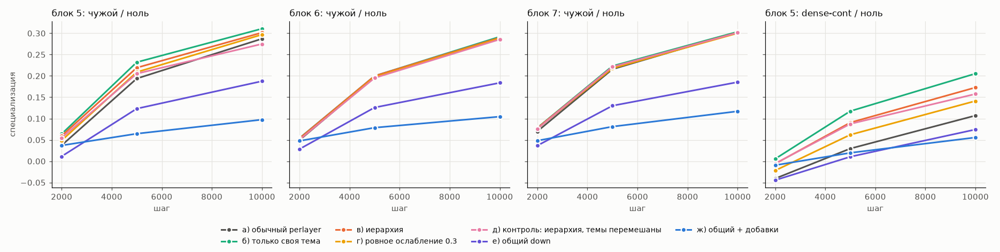

**Ход обучения** (блок 5, чужой / ноль, 256 окон, ± 2 SE ≈ 0.02): а 0.04 → 0.19 → 0.29 (2k / 5k / 10k),
б 0.06 → 0.23 → 0.31, в 0.06 → 0.22 → 0.30, г 0.05 → 0.21 → 0.30, д 0.06 → 0.21 → 0.28, е 0.01 → 0.12 → 0.19,
ж 0.04 → 0.07 → 0.10. В блоках 6–7 рост такой же, а–д совпадают в пределах 0.01.

### 20.6 Выводы

**Растёт ли различие экспертов, если ослабить чужой градиент? Нет.**
- У б–д «чужой / ноль» в блоках 6–8 тот же, что у а: разница ≤ 0.006, эффект не обнаружен. Во всех блоках сразу —
  0.313–0.316 у всех. Косинус сдвигов между экспертами (0.17–0.22) и доля, которую снимает подбор down, тоже не
  меняются.
- В блоке 5 у б +0.021 (на пределе 2 SE), у в и г эффект не обнаружен, у д −0.015 (на пределе). Ход обучения тот же:
  на 2k б–д чуть впереди а (0.05–0.06 против 0.04), к 10k разница в пределах шума.
- Чужой градиент режется сильно (в блоке 5 его доля 0.63 → 0.31–0.40), а различие экспертов от этого не растёт.
  Значит, не он держит экспертов похожими друг на друга.

**Что меняется на самом деле: эксперты вместе уходят от общего FFN.**
- dense-cont / ноль в блоке 5 растёт с 0.11 до 0.15–0.21. Порядок примерно совпадает с силой среза (в скобках —
  оставшаяся доля чужого градиента в блоке 5): б 0.208 (0.31), в 0.174 (0.34), д 0.157 (0.40), г 0.145 (0.38). Растёт
  и цена нуля в блоке 5 (0.071 → 0.075–0.086).
- Чужой градиент учит эксперта писать то, что читают следующие блоки. Без него все эксперты одинаково теряют эту
  общую часть: они отходят от «общего FFN», но не друг от друга.
- Темы роли почти не играют. Контроль с перемешанными темами (д) по различию лежит между в и г. По качеству он
  хуже в на 0.0006, это меньше шума сидов.

**Что с качеством: хуже, и тем сильнее, чем сильнее срез.** б (0.31) +0.0079, в (0.34) +0.0049, д (0.40) +0.0055,
г (0.38) +0.0033; все ± ≤ 0.0002, шум сидов около 0.001. Чужой градиент полезен. Правильная разметка тем его срез
заметно не удешевляет: в и д различаются меньше шума сидов.

**Структурные варианты.**
- **е, общий down:** различие падает (0.19 против 0.29, в блоке 8 0.13 против 0.31), подбор down снимает меньше
  (0.39–0.43). Качество +0.0098. Примерно треть различия экспертов — в их выходной части, и она полезна.
- **ж, общий + добавки:** добавки сильно свои — подмена на чужую стоит 0.70–0.98 от отключения. Но весят они мало:
  отключение стоит 0.010–0.021 нат в блоках 5–7. Модель теряет весь выигрыш смеси: +0.0015 ± 0.0003 к dense-cont,
  +0.033 к а. Часть проигрыша — старт: общая часть из 1056 нейронов на шаге 0 стоит +0.104.

**Различие растёт со временем.** Во всех вариантах «чужой / ноль» в блоке 5 растёт 0.04 → 0.19 → 0.29 (2k / 5k /
10k) и к 10k не насыщается. OLMoE это согласуется (этап 0б): после долгого обучения чужой эксперт там хуже пустого
слота, хотя доля чужого градиента в нижних слоях 0.8–0.9. Условия разные (8 из 64 против одного эксперта), так что
это согласие, а не проверка.

**Итог:** в r21 экспертов похожими держит не чужой градиент. Его срез различие не увеличивает, а качество ухудшает
на 0.003–0.008. Различие определяется временем обучения и тем, есть ли у эксперта своя выходная часть.

### 20.7 Этап 3: растёт ли выигрыш смеси вместе со специализацией (до 40k шагов)

Постановка:
- **Модели.** а (perlayer) и dense-cont продолжены с 10k до 40k шагов, так же hash.
- **lr.** Постоянный, на уровне конца этапа 1 (0.1 от пика: 3·10⁻⁵, блоки 1–4 ×0.1), после 200 шагов разогрева.
  AdamW свежий: состояние оптимизатора на 10k не сохранялось. Всё одинаково для трёх моделей. Новый косинус не
  выбран: он дал бы скачок lr на 10k, и сохранения 20k / 30k / 40k стояли бы на разных lr.
- **Данные.** В `data_mix` хватало только на 30 336 шагов, а A-mix и этап 1 съели 30 000. Продолжение идёт по
  `data_mix_ext` (`dd/mix_data_ext.py`): 498M токенов из тех же трёх источников, в том же порядке, с документа
  сразу после последнего использованного, каждые сотые документы выброшены. Стык проверен по всем источникам:
  последний обрезанный документ `data_mix` совпал с перекодированным заново. Окна одни и те же, в одном порядке
  для всех моделей.
- **Сохранения 2k и 5k.** У dense-cont и hash r21 сохранена только 10k, поэтому обе модели обучены заново
  0 → 10k по рецепту этапа 1. Повтор dense-cont на 10k даёт полный val 2.2999, как исходный.
- **Замеры** на каждом сохранении (2k, 5k, 10k, 20k, 30k, 40k):
  - полный val по окнам и выигрыш смеси = CE dense-cont − CE смеси, парно, ± 2 SE;
  - специализация на 1024 окнах; «dense-cont / ноль» — с dense-cont того же шага;
  - доля, которую снимает подбор down;
  - косинус сдвигов экспертов от шага 0.
- **Где считалось.** dense-cont и hash обучались на vast, а 10k → 40k и все замеры — дома.

Код: `dd/r28_long.py`, тесты `tests/test_r28_long.py`. Таблица — [`report/r28_long.md`](report/r28_long.md).

**а (perlayer)**:

| шаг | CE а | CE dense-cont | выигрыш смеси ± 2 SE | чужой / ноль: блоки 5 / 6 / 7 / 8 | dense-cont / ноль, блок 5 | снято подбором, блоки 5–7 | косинус сдвигов | ‖сдвиг‖ / ‖A-mix‖ |
|---|---|---|---|---|---|---|---|---|
| 2k | 2.3932 | 2.3905 | −0.0027 ± 0.0003 | 0.04 / 0.04 / 0.07 / 0.19 | 0.00 | — | 0.06–0.08 | 0.19 |
| 5k | 2.3362 | 2.3514 | +0.0152 ± 0.0003 | 0.20 / 0.19 / 0.22 / 0.15 | 0.07 | 0.51–0.58 | 0.12–0.15 | 0.28 |
| 10k | 2.2685 | 2.2999 | +0.0314 ± 0.0004 | 0.29 / 0.29 / 0.30 / 0.31 | 0.11 | 0.59–0.61 | 0.17–0.22 | 0.31 |
| 20k | 2.2623 | 2.3001 | +0.0379 ± 0.0004 | 0.32 / 0.32 / 0.34 / 0.27 | 0.13 | 0.59–0.64 | 0.22–0.27 | 0.33 |
| 30k | 2.2554 | 2.2977 | +0.0422 ± 0.0004 | 0.35 / 0.35 / 0.37 / 0.26 | 0.14 | 0.60–0.70 | 0.27–0.32 | 0.35 |
| 40k | 2.2481 | 2.2953 | +0.0472 ± 0.0005 | 0.38 / 0.38 / 0.40 / 0.43 | 0.15 | 0.60–0.73 | 0.31–0.36 | 0.37 |

± 2 SE у «чужой / ноль» в блоке 5 — 0.009–0.012. На 2k «снято подбором» не определено: разница «свой против
чужого» там около нуля.

**hash** (повтор hash r21; на 10k совпадает с ним по каждому окну, разница 0.0000):

| шаг | CE hash | CE dense-cont | выигрыш смеси ± 2 SE | чужой / ноль: блоки 5 / 6 / 7 / 8 | dense-cont / ноль, блок 5 | снято подбором, блоки 5–7 | косинус сдвигов | perlayer − hash ± 2 SE |
|---|---|---|---|---|---|---|---|---|
| 2k | 2.3989 | 2.3905 | −0.0084 ± 0.0004 | 0.03 / 0.05 / 0.04 / 0.04 | −0.01 | — | 0.05–0.12 | −0.0057 ± 0.0004 |
| 5k | 2.3403 | 2.3514 | +0.0111 ± 0.0005 | 0.20 / 0.20 / 0.16 / 0.06 | 0.08 | 0.42–0.46 | 0.12–0.20 | −0.0040 ± 0.0004 |
| 10k | 2.2708 | 2.2999 | +0.0291 ± 0.0005 | 0.28 / 0.28 / 0.22 / 0.08 | 0.14 | 0.46–0.49 | 0.17–0.27 | −0.0023 ± 0.0004 |
| 20k | 2.2627 | 2.3001 | +0.0374 ± 0.0006 | 0.31 / 0.31 / 0.24 / 0.10 | 0.16 | 0.45–0.48 | 0.23–0.34 | −0.0004 ± 0.0005 |
| 30k | 2.2555 | 2.2977 | +0.0422 ± 0.0006 | 0.33 / 0.33 / 0.26 / 0.09 | 0.18 | 0.45–0.49 | 0.28–0.39 | −0.0000 ± 0.0005 |
| 40k | 2.2486 | 2.2953 | +0.0467 ± 0.0006 | 0.35 / 0.35 / 0.28 / 0.09 | 0.19 | 0.46–0.49 | 0.32–0.44 | −0.0005 ± 0.0005 |

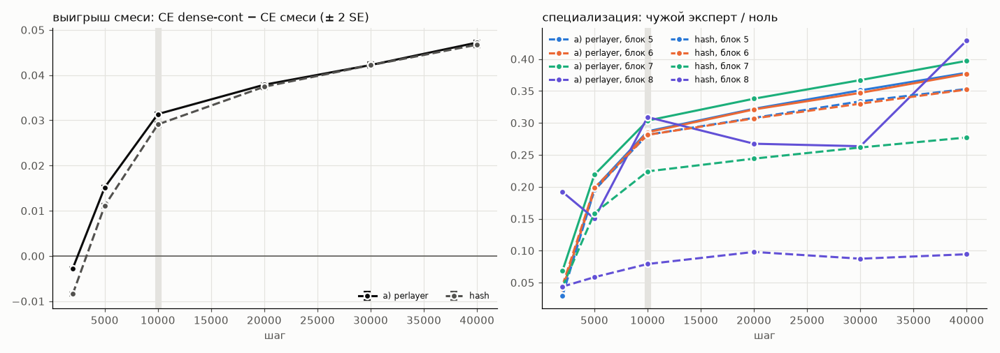

**Ответ: выигрыш растёт вместе со специализацией, и к 40k ни то ни другое на плато не вышло.**

- **Выигрыш.** Выигрыш смеси над dense-cont: −0.003 / −0.008 на 2k (смесь ещё хуже), +0.031 / +0.029 на 10k,
  +0.047 на 40k у обеих смесей. После 10k он растёт на ~0.005 за 10k шагов и замедляется слабо: у perlayer
  +0.0065, +0.0043, +0.0050.
- **Специализация.** В блоках 5–6 у обеих смесей растёт на ~0.025–0.03 за 10k: 0.29 → 0.38 у perlayer,
  0.28 → 0.35 у hash. Плато тоже нет.
- **Почему выигрыш растёт после 10k.** На постоянном низком lr dense-cont почти стоит: 2.2999 → 2.2953, −0.005 за
  30k шагов. Смеси продолжают учиться: −0.020 и −0.022. Рост выигрыша после 10k почти целиком даёт обучение смеси.

**Но больше специализации — не больше выигрыша.**
- **Уровень специализации.** В блоке 8 у hash эксперты всю дорогу почти взаимозаменяемы (0.08–0.10), у perlayer к
  40k 0.43. Блок 7: 0.28 против 0.40. При этом качество двух смесей с 20k не различается: perlayer − hash
  −0.0004 / −0.0000 / −0.0005 ± 0.0005 на 20k / 30k / 40k, эффект не обнаружен.
- **Ранний перевес perlayer** (−0.006 на 2k, −0.002 на 10k) к 20k исчезает.
- **Вывод.** Похоже, выигрыш и специализация растут вместе потому, что оба растут со временем обучения.
  Сравнение маршрутов не показывает, что большая специализация даёт больший выигрыш.

**Эксперты расходятся друг с другом и одновременно все вместе уходят от общего FFN.**
- **Косинус сдвигов** между экспертами растёт: 0.19 → 0.32 у perlayer, 0.17–0.27 → 0.32–0.44 у hash.
- **dense-cont / ноль** растёт: 0.11 → 0.15 у perlayer, 0.14 → 0.19 у hash; в блоке 8 у hash 0.13 → 0.48.
- **Подбор down** снимает постоянную долю: 0.60 у perlayer, 0.48 у hash. Доля различия, которая сидит в выходе
  эксперта, со временем не меняется.

Оговорка: продолжение шло на постоянном lr 0.1 от пика. Плато при новом косинусе или на большем lr здесь не
проверялось.

### 20.8 Этап 4: маршрут по выходу

Все варианты устроены как perlayer r21: старт с A-mix, 10k шагов, 8 экспертов в блоках 5–8. Меняется только маршрут.
- **а) по выходу.** Вход блока переводится в логиты замороженным выходным слоем A-mix (финальная норма и общий
  эмбеддинг). Берётся самый вероятный токен, затем его группа, затем эксперт по таблице блока.
- **б) вход × выход.** Эксперт выбирается по паре (группа текущего токена, группа предсказанного).
- **в) смешанный.** Блоки 5–6 идут по хешу текущего токена (таблицы hash r21), блоки 7–8 — как а).
- **г) подсмотренный ответ.** Эксперт выбирается по группе настоящего следующего токена. Это только граница размера
  эффекта, в выводы о качестве не идёт.

Группы токенов — сферический k-means на 64 группы по центрированным выходным эмбеддингам A-mix, с весом частоты
токена в train. Первый вариант, без центрирования и весов, сложил ~52% нагрузки в одну группу: у эмбеддингов A-mix
большая общая компонента. Таблицы «группа → эксперт» и «пара групп → эксперт» свои у каждого блока. Нагрузка
выравнивается жадно по нагрузке A-mix на калибровке: максимальная доля эксперта 0.13–0.14 у а), 0.125 у б) и г).

Код: `dd/r28_route.py`, варианты в `dd/r28_train.py`, тесты `tests/test_r28_route.py`. Обучение и этап 2 шли на vast,
по варианту на машину. Таблица — [`report/r28_route.md`](report/r28_route.md).

На 10k: полный val, парные разности по окнам ± 2 SE; perlayer, hash и dense-cont — модели r21.

| маршрут | val CE | Δ к perlayer | Δ к hash | Δ к dense-cont | чужой / ноль: блоки 5 / 6 / 7 / 8 | снято подбором down | сменили эксперта за обучение | макс. доля эксперта на 10k |
|---|---|---|---|---|---|---|---|---|
| perlayer (наш а этапа 1) | 2.2685 | — | −0.0023 ± 0.0004 | −0.0314 ± 0.0004 | 0.29 / 0.29 / 0.30 / 0.31 | 0.61–0.64 (блок 8 0.90) | 0.7–2.3% | 0.26–0.44 |
| а) по выходу | 2.2811 | +0.0125 ± 0.0003 | +0.0103 ± 0.0004 | −0.0189 ± 0.0004 | 0.24 / 0.23 / 0.19 / 0.08 | 0.47–0.49 (0.65) | 8.7–13.3% | 0.13–0.14 |
| б) вход × выход | 2.2848 | +0.0162 ± 0.0004 | +0.0140 ± 0.0004 | −0.0151 ± 0.0004 | 0.24 / 0.22 / 0.17 / 0.05 | 0.45–0.49 (0.51) | 8.3–12.5% | 0.13 |
| в) хеш + выход | 2.2748 | +0.0062 ± 0.0004 | +0.0040 ± 0.0003 | −0.0251 ± 0.0004 | 0.29 / 0.31 / 0.20 / 0.08 | 0.49–0.51 (0.66) | 0 / 0 / 12.9 / 13.5% | 0.13 |
| г) подсмотренный ответ | 1.4461 | −0.822 ± 0.007 | −0.825 ± 0.007 | −0.854 ± 0.007 | 0.66 / 0.61 / 0.75 / 7.1 | 0.70–0.77 (0.99) | 0 | 0.13 |

± 2 SE у «чужой / ноль» ≈ 0.011 в блоке 5 (у г 0.023). Шаг 0 у всех совпадает с A-mix (≤ 3·10⁻⁵ на 256 окнах).

- **Маршрут по выходу хуже маршрута по книгам и хуже hash, но лучше dense-cont.** Чем больше блоков идут по выходу,
  тем хуже: в) +0.006 (два блока), а) +0.013 (четыре), б) +0.016 (четыре, с парой). Добавить к выходу текущий
  токен (б) — хуже, чем выход один.
- **Специализация ниже, особенно в верхних блоках.** В блоках 7–8 по выходу «чужой / ноль» 0.17–0.20 и 0.05–0.08,
  у perlayer 0.30 и 0.31. Блоки 5–6 в в) идут по хешу и держат уровень perlayer (0.29 / 0.31). Подбор down снимает
  меньше разницы (0.45–0.51 против 0.61–0.64): эксперты отличаются не только выходом.
- **Маршрут по выходу нестабилен.** За обучение 9–13% токенов меняют эксперта, у perlayer 1–2%. Почти всё меняется
  к 2k и дальше не растёт (а: 0.086 → 0.090 → 0.087 в блоке 5). Выходной слой A-mix заморожен, а состояния в
  первые тысячи шагов сдвигаются.
- **Ровная нагрузка сама по себе не помогает.** У маршрутов по выходу максимальная доля эксперта 0.13–0.14, у
  perlayer 0.26–0.44, но perlayer лучше всех.
- **Подсмотренный ответ: −0.82 нат.** Выбор эксперта по группе следующего токена — это три бита ответа, и модель
  использует их почти полностью. В блоке 8 чужой эксперт в 7 раз хуже пустого FFN, потому что эксперт несёт ответ.
  Это граница, к которой маршрут «по выходу» мог бы стремиться, если бы угадывал группу ответа точно. Как часто
  выходной слой A-mix на входе блоков 5–8 угадывает группу ответа, здесь не мерилось. Известно только, что в 12–13%
  случаев он предсказывает сам текущий токен.

### 20.9 Проба: донор с линейной поправкой (OLMoE, слой 4, без обучения)

Постановка:
- **Жертвы и доноры.** 5 экспертов со средней нагрузкой (их выбирают 11–12.5% токенов). Для каждой два донора:
  ближайший по косинусу строк маршрутизатора и случайный.
- **Подмена.** На токенах, где выбрана жертва, её место занимает донор с весом жертвы плюс поправка Δy = W·z + b
  (z — вход эксперта, цель — выход жертвы минус выход донора).
- **Подбор поправки.** Гребневая регрессия, λ по отложенным окнам. Ранг r — проекция на r главных направлений
  подогнанных значений (регрессия пониженного ранга).
- **Объём.** Калибровка — 50k токенов r26, оценка — 96 окон val.
- **Счёт** — ~15 минут дома, вместе с повтором, который совпал до последнего знака.

Код: `dd/r28_olmoe.py lowrank`, `dd/r28_lowrank_report.py`. Таблица — [`report/r28_lowrank.md`](report/r28_lowrank.md).

Рост CE на токенах жертв, нат на токен, по 5 жертвам; ± 2 SE по окнам. Доля снятой разницы считается парно на тех же
токенах:

| донор | как есть | ранг 8 | ранг 32 | ранг 128 | полный | ноль жертвы | снято: ранг 8 / 32 / 128 / полный | R² разности выходов (отложенные): 8 / 32 / 128 / полный |
|---|---|---|---|---|---|---|---|---|
| ближайший по маршрутизатору (косинус 0.45) | +0.0040 ± 0.0013 | +0.0041 | +0.0037 | +0.0033 | +0.0032 | +0.0024 ± 0.0008 | −0.04 ± 0.12 / 0.06 ± 0.12 / 0.18 ± 0.11 / 0.20 ± 0.12 | 0.04 / 0.08 / 0.14 / 0.22 |
| случайный (косинус 0.08) | +0.0030 ± 0.0010 | +0.0025 | +0.0019 | +0.0017 | +0.0016 | +0.0024 ± 0.0008 | 0.15 ± 0.10 / 0.37 ± 0.15 / 0.42 ± 0.16 / 0.45 ± 0.17 | 0.03 / 0.07 / 0.13 / 0.20 |

Параметры поправки в долях эксперта: ранг 8 — 0.5%, 32 — 2.1%, 128 — 8.3%, полный — 67%. Проверка: жертва на своём
месте даёт рост ровно 0.

**Ответ: ранг 32 больше половины разницы не снимает.**
- **Ближайший донор:** 0.06 ± 0.12, эффект не обнаружен.
- **Случайный донор:** 0.37 ± 0.15. Это больше нуля, но 0.5 входит в 2 SE, так что «больше половины» не показано.
- **Даже полная линейная поправка** (67% параметров эксперта) снимает лишь 0.20 и 0.45. Линейное отображение
  объясняет только 8% (ранг 32) и 20–22% (полный) разброса разности выходов жертвы и донора: выходы экспертов OLMoE
  различаются нелинейно.
- **Ближайший по маршрутизатору донор хуже случайного** (+0.0040 против +0.0030), и поправка его почти не спасает.
  Это сходится с этапом 0б: похожие для маршрутизатора эксперты не взаимозаменяемы. Оба донора как есть хуже, чем
  просто убрать жертву (+0.0024).

## 21. Раунд 29: новый источник для perlayer 40k (быстрая версия, дома)

### 21.1 Постановка

- **База.** perlayer 40k (этап 3 r28, `runs_home/r28s3/pl`). Эксперты стоят в блоках 5–8, маршрут идёт по
  per-layer книгам r21: 64 кода → 8 экспертов.
- **Новые источники** (`dd/r29_data.py`, ~30 с на оба). По 16.5M токенов train и 0.5M val, каждый 30-й документ
  уходит в val. Токенизатор тот же: GPT-2 BPE, ids + 2, без добавленных токенов внутри документов.
  - **Близкий** — PubMed-аннотации (MedRAG/pubmed, заголовок + аннотация). Английский, узкая область,
    225 токенов на 1000 символов.
  - **Далёкий** — русская Википедия (wikimedia/wikipedia 20231101.ru). GPT-2 BPE режет её почти посимвольно:
    1034 токена на 1000 символов.
- **Этап 0** (без обучения): 256 окон val на источник, входы блоков 5–8.
- **Обучение.**
  - 1000 шагов × 32 окна по 513 токенов, только окна нового источника. Окна одни и те же, в одном порядке.
  - lr 3·10⁻⁴ у всех вариантов, разогрев 50 шагов, косинус до 3·10⁻⁵. AdamW, wd 0.1 на матрицах,
    обрезка градиента 1.0.
  - 3.2–5.1 минуты на прогон.
- **Оценка.** 512 окон каждого источника: новый val и три старых val из `data_mix`. Разность к базе считается
  парно по окнам, ± 2 SE.

Варианты:
- **а) все веса.**
- **в) новые эксперты по кодам.**
  - Код выбирается по train-окнам. Доля нового в коде = p_new / (p_new + p_old), где p_old — смесь трёх старых
    источников поровну.
  - Коды берутся по убыванию доли, пока доля ≥ 0.5 и покрытие нового меньше 80%.
  - Каждый выбранный код переписывается в таблице на копию своего владельца, по одной копии на владельца.
  - Учатся только копии.
- **ж) новые эксперты по метке документа.**
  - Те же копии, что в в). Токен нового источника в блоках 5–8 идёт к копии своего эксперта.
  - Если у его эксперта копии нет (2–8% токенов по блокам), токен идёт к копии с наибольшей массой нового. Поэтому на
    шаге 0 ж) не точно равен базе на новом источнике.
  - Учатся только копии. Старые источники к копиям не попадают.
- **д) LoRA** на всех линейных слоях: qkv и o всех блоков, FFN блоков 1–4, каждый эксперт (своя пара матриц на
  эксперта). Ранг подобран под число параметров в).

Код: `dd/r29.py` (stage0 / train / report), таблицы — [`report/r29_stage0.md`](report/r29_stage0.md) и
[`report/r29_tables.md`](report/r29_tables.md).

### 21.2 Этап 0: где новый источник в модели (без обучения)

Полные таблицы — [`report/r29_stage0.md`](report/r29_stage0.md).

| | блок 5 | блок 6 | блок 7 | блок 8 |
|---|---|---|---|---|
| экспертов на 80% токенов, **perlayer**: PubMed / ру / wiki / code / ts | 2 / 1 / 3 / 3 / 4 | 2 / 1 / 2 / 2 / 4 | 3 / 1 / 3 / 4 / 3 | 2 / 1 / 2 / 3 / 3 |
| то же, **hash 40k** | 6 / 6 / 6 / 6 / 6 | 6 / 5 / 6 / 6 / 6 | 6 / 5 / 6 / 6 / 6 | 6 / 5 / 6 / 6 / 6 |
| кодов на 80% (из 64): PubMed / ру / wiki | 14 / 4 / 17 | 15 / 2 / 20 | 12 / 1 / 17 | 9 / 1 / 17 |
| медиана расстояния до ближайшего центра: PubMed / ру / wiki | 18.3 / 21.0 / 18.2 | 19.8 / 22.2 / 19.7 | 19.7 / 22.2 / 19.8 | 20.4 / 22.3 / 20.2 |
| линейный классификатор «новый / старый», отложенные окна: PubMed / ру | 0.978 / 0.999 | 0.981 / 0.999 | 0.981 / 0.999 | 0.982 / 0.999 |

Тот же классификатор на одних эмбеддингах токенов: PubMed 0.748, ру 0.958.

- **Русский модель складывает в отдельный угол.** В каждом блоке 93–98% его токенов у одного эксперта, на 1–4
  кодах. Все его состояния дальше от центров, чем у старых источников: даже 10-й процентиль выше их медиан.
- **PubMed книга кодов не выделяет.** 2–3 эксперта и 9–15 кодов, как у старых источников, расстояния как у
  wiki. При этом по состоянию он отделяется линейно на 98% (по одним токенам — на 75%). Различие в состоянии есть,
  книга его не видит.
- **hash не выделяет ни один источник.** Каждый размазан на 5–6 экспертов из 8.
- **Коды для в).**
  - ру: 4 / 2 / 1 / 1 кода в блоках 5–8, по одному владельцу на блок → 4 новых эксперта. Они покрывают 80–88%
    нового, на них приходится 4–11% старых токенов.
  - PubMed: 10–16 кодов на блок, 4–5 владельцев → 17 новых экспертов. Покрытие нового 82–85%, но на эти коды
    приходится 20–30% старых токенов.

### 21.3 Итог: выигрыш на новом и потеря на старых

1000 шагов, 512 окон на источник. Δ — разность CE к базе, нат на токен, ± 2 SE парно по окнам. «Итог» =
выигрыш на новом − средняя потеря на трёх старых. База: ру 2.5623, PubMed 5.0254, wiki 3.8534, code 1.3883,
ts 1.5046.

| источник | вариант | обучаемых параметров | новый, Δ | wiki | code | ts | старые в среднем | итог |
|---|---|---|---|---|---|---|---|---|
| ру (далёкий) | а) все веса | 112M | −1.788 ± 0.048 | +2.478 | +1.703 | +2.764 | +2.315 ± 0.020 | **−0.526 ± 0.052** |
| | в) новые эксперты по кодам | 8.65M (4 эксперта) | −1.527 ± 0.054 | +0.013 | +0.013 | +0.002 | +0.009 ± 0.001 | **+1.517 ± 0.054** |
| | ж) новые эксперты по метке | 8.65M (4) | −1.612 ± 0.054 | 0 | 0 | 0 | 0 (побитово) | **+1.612 ± 0.054** |
| | д) LoRA, ранг 37 | 8.58M | −1.474 ± 0.058 | +0.196 | +0.120 | +0.089 | +0.135 ± 0.003 | **+1.339 ± 0.058** |
| PubMed (близкий) | а) все веса | 112M | −1.964 ± 0.028 | +1.879 | +2.671 | +2.750 | +2.433 ± 0.031 | **−0.469 ± 0.042** |
| | в) новые эксперты по кодам | 36.8M (17) | −0.836 ± 0.015 | +0.282 | +0.058 | +0.014 | +0.118 ± 0.003 | **+0.718 ± 0.015** |
| | ж) новые эксперты по метке | 36.8M (17) | −0.914 ± 0.016 | 0 | 0 | 0 | 0 (побитово) | **+0.914 ± 0.016** |
| | д) LoRA, ранг 159 | 36.9M | −0.913 ± 0.016 | +0.564 | +0.343 | +0.435 | +0.447 ± 0.007 | **+0.466 ± 0.017** |

Проверки и парные разности на новом источнике:
- **ж) на старых источниках побитово совпадает с базой.** Суммы CE по каждому окну wiki, code и ts равны точно.
- **ж) стартует хуже базы**, потому что токены без копии своего эксперта уходят к чужой копии: +0.017 на ру,
  +0.039 на PubMed. в) на шаге 0 равен базе.
- **Парные разности на новом:**
  - ж − в: ру −0.085 ± 0.004, PubMed −0.078 ± 0.002;
  - ж − д: ру −0.139 ± 0.006, PubMed −0.001 ± 0.002 (эффект не обнаружен);
  - а − ж: ру −0.176 ± 0.010, PubMed −1.050 ± 0.017.

**Ответ: лучший итог в обоих случаях у новых экспертов по метке документа (ж).** Старое у ж) не меняется вовсе,
а новый источник он учит лучше в) и не хуже LoRA.

- **Далёкий источник: маршрут по кодам почти равен маршруту по метке.** в) уступает ж) 0.085 на новом и теряет
  на старых всего +0.009, итог +1.52 против +1.61. Это прямое следствие этапа 0: русский сидит на 1–4 своих
  кодах, и таблица отделяет его почти без утечки.
- **Близкий источник: коды не разделяют.** Чтобы покрыть 82–85% PubMed, коды забирают 20–30% старых токенов.
  Больше всего страдает wiki (+0.28) — ближайший к PubMed старый источник. Нового в) выучивает на 0.078 меньше
  ж), итог +0.72 против +0.91. Линейный классификатор по состоянию отделяет PubMed на 98%, значит, маршрут по
  такому признаку, а не по книге кодов, мог бы приблизиться к ж). Здесь это не проверялось.
- **LoRA с тем же числом параметров.**
  - На PubMed учит новое так же, как ж) (разница −0.001 ± 0.002, эффект не обнаружен), но портит старое на
    +0.45. Итог +0.47 — худший из трёх частичных вариантов.
  - На ру учит хуже (−1.47) и портит старое на +0.13.
- **Все веса дают наибольший выигрыш на новом** (ру −1.79, PubMed −1.96: на PubMed на 1.05 больше ж). Но за
  1000 шагов на одном источнике старое разрушается: +2.3…+2.4. Итог отрицательный.

Оговорки:
- один сид, 1000 шагов, один lr 3·10⁻⁴ для всех вариантов (LoRA обычно учат на большем lr, все веса — на
  меньшем);
- правило отбора кодов одно: доля ≥ 0.5, покрытие до 80%. Строже — меньше утечки, но меньше покрытие;
- число новых экспертов у источников разное (4 и 17), сравнивать итоги между источниками нельзя;
- ж) получает метку документа даром. В реальном применении её нужно угадать: по этапу 0 линейный классификатор
  по состоянию делает это на 98–99.9%.

Время: данные ~30 с, этап 0 ~25 с, прогоны по 3.2–5.1 мин, всё вместе ~43 минуты (18:15–18:58).

### 21.4 Дополнение: маршрут по классификатору и LoRA с маской

Постановка (те же 1000 шагов, окна и оценка, что в 21.1):
- **Классификатор «новый / старый».**
  - Логистическая регрессия на нормированном входе блока: по одной на каждый блок 5–8, источник и базовую
    модель. Для perlayer 40k классификатор свой, для dense-cont 40k — обученный на состояниях dense-cont.
  - Обучен на train-окнах: 120k токенов нового и по 40k каждого старого, классы поровну, порог 0.
  - Во время обучения заморожен. Точность на train: ру 0.9986–0.9988, PubMed 0.977–0.980.
- **з)** как ж), но метку ставит классификатор своего блока. Отмеченный токен идёт к копии своего эксперта;
  копии и запасная копия те же, что в ж).
- **и)** LoRA на qkv, o и FFN блоков 5–8 perlayer 40k. Добавка включена только у отмеченных токенов, добавка
  FFN общая для экспертов блока.
  - Ранг подобран под параметры з): 245 для ру (8.66M) и 1041 для PubMed (36.8M).
  - 1041 больше полного ранга 512. Лишние параметры не добавляют выразительности, равенство параметров здесь
    формальное.
- **к)** то же на dense-cont 40k со своим классификатором. Δ считается к своей базе: ру 2.5716, PubMed 5.0638,
  wiki 3.9033, code 1.4269, ts 1.5552.
- **л)** как и), но маска — метка документа.
- **lr.** LoRA обучалась с 3·10⁻⁴ и 1·10⁻³, лучший по новому во всех случаях 1·10⁻³; в таблице оба. з) —
  3·10⁻⁴, как ж).
- **Проверки.**
  - Прямой проход новой обёртки совпадает с базой r29 по каждому окну.
  - dense-cont совпадает с исходной моделью: разница логитов 0.
  - л) на старых источниках побитово равен базе при обоих lr.
- **Время:** 4–5.5 мин на прогон, 14 прогонов, 19:11–20:14.

Код: `dd/r29b.py` (clf / train / report). Таблица — [`report/r29b_tables.md`](report/r29b_tables.md).

Отметки «старые → новые» и «новые пропущены» — доля токенов по блокам 5 / 6 / 7 / 8 после обучения (для в) — на
состояниях базы; модели в) не сохранялись). На состояниях базы (шаг 0):
- **классификатор:** ру 0.2% / 0.3–0.4%, PubMed 3.0–3.3% / 1.6–1.8%;
- **коды в):** ру 4–10% / 12–20%, PubMed 21–30% / 16–18%.

| источник | вариант | lr | новый, Δ | старые в среднем | итог | старые → новые | новые пропущены |
|---|---|---|---|---|---|---|---|
| ру | в) новые эксперты по кодам | 3e-4 | −1.527 ± 0.054 | +0.009 | +1.517 ± 0.054 | 0.10 / 0.06 / 0.04 / 0.04 | 0.20 / 0.14 / 0.15 / 0.12 |
| | ж) новые эксперты по метке | 3e-4 | −1.612 ± 0.054 | 0 | +1.612 ± 0.054 | 0 | 0 |
| | з) новые эксперты по классификатору | 3e-4 | −1.434 ± 0.056 | +0.001 | +1.433 ± 0.056 | 0.002 / 0.001 / 0.001 / 0.001 | 0.003 / 0.42 / 0.60 / 0.57 |
| | и) LoRA по классификатору, perlayer | 3e-4 / **1e-3** | −1.459 / −1.619 ± 0.052 | +0.001 / +0.002 | +1.458 / **+1.617 ± 0.052** | 0.002 / 0.001 / 0.001 / 0.002 | 0.003 / 0.67 / 0.70 / 0.54 |
| | к) LoRA по классификатору, dense-cont | 3e-4 / **1e-3** | −1.465 / −1.628 ± 0.052 | +0.001 / +0.002 | +1.463 / **+1.626 ± 0.052** | 0.002 / 0.001 / 0.001 / 0.002 | 0.003 / 0.71 / 0.69 / 0.54 |
| | л) LoRA по метке, perlayer | 3e-4 / **1e-3** | −1.612 / −1.745 ± 0.050 | 0 | +1.612 / **+1.745 ± 0.050** | 0 | 0 |
| PubMed | в) новые эксперты по кодам | 3e-4 | −0.836 ± 0.015 | +0.118 | +0.718 ± 0.015 | 0.30 / 0.28 / 0.22 / 0.21 | 0.16 / 0.18 / 0.18 / 0.16 |
| | ж) новые эксперты по метке | 3e-4 | −0.914 ± 0.016 | 0 | +0.914 ± 0.016 | 0 | 0 |
| | з) новые эксперты по классификатору | 3e-4 | −0.856 ± 0.016 | +0.028 | +0.828 ± 0.016 | 0.033 / 0.022 / 0.024 / 0.029 | 0.018 / 0.13 / 0.21 / 0.16 |
| | и) LoRA по классификатору, perlayer | 3e-4 / **1e-3** | −0.945 / −1.059 ± 0.019 | +0.038 / +0.048 | +0.907 / **+1.011 ± 0.019** | 0.033 / 0.027 / 0.034 / 0.039 | 0.018 / 0.15 / 0.15 / 0.13 |
| | к) LoRA по классификатору, dense-cont | 3e-4 / **1e-3** | −0.970 / −1.087 ± 0.019 | +0.037 / +0.046 | +0.933 / **+1.040 ± 0.019** | 0.034 / 0.027 / 0.035 / 0.040 | 0.018 / 0.17 / 0.16 / 0.14 |
| | л) LoRA по метке, perlayer | 3e-4 / **1e-3** | −1.004 / −1.123 ± 0.020 | 0 | +1.004 / **+1.123 ± 0.020** | 0 | 0 |

Парные разности на новом источнике, ру / PubMed:

| пара | ру | PubMed |
|---|---|---|
| л − ж, тот же lr 3·10⁻⁴ | +0.0003 ± 0.0019 (эффект не обнаружен) | −0.090 ± 0.003 |
| л (1·10⁻³) − ж | −0.133 ± 0.007 | −0.209 ± 0.005 |
| з − ж | +0.178 ± 0.005 | +0.058 ± 0.002 |
| з − в | +0.093 ± 0.005 | −0.020 ± 0.003 |
| и − з, тот же lr 3·10⁻⁴ | −0.026 ± 0.003 | −0.089 ± 0.003 |
| и − л, тот же lr | +0.153 ± 0.005 (3·10⁻⁴), +0.126 ± 0.005 (1·10⁻³) | +0.059 ± 0.002 (3·10⁻⁴), +0.064 ± 0.003 (1·10⁻³) |
| к − и, абсолютная CE, оба 1·10⁻³ | +0.0005 ± 0.0021 (эффект не обнаружен) | +0.011 ± 0.003 |

На старых источниках к хуже и на 0.04–0.05, ровно на разницу баз (wiki +0.050, code +0.039, ts +0.051).

**Ответы:**
- **Лучший вариант — л), LoRA по метке документа с lr 1·10⁻³:** итог ру +1.75, PubMed +1.12, старое побитово
  как у базы.
  - При одинаковом lr 3·10⁻⁴ л) на ру равен ж) (эффект не обнаружен), на PubMed лучше на 0.09. При честной
    метке LoRA того же размера не хуже новых экспертов.
  - С lr 1·10⁻³ LoRA выигрывает ещё 0.12–0.13. ж) при 1·10⁻³ не считался, так что сравнение «ж против л при
    лучших lr» остаётся открытым.
- **Замороженный классификатор теряет новый источник по ходу обучения.**
  - На шаге 0 он почти безошибочен: ру 0.3%, PubMed 1.8% пропусков.
  - Новые параметры в блоке 5 и дальше сдвигают состояния новых токенов, и классификаторы блоков 6–8 перестают
    их узнавать. После обучения пропущено 42–70% русских и 12–21% PubMed-токенов.
  - Блок 5 не страдает: 0.3% / 1.8%, его вход идёт из нетронутых блоков 1–4.
  - Ложные отметки на старых не растут: ру 0.1–0.2%, PubMed 2–4%.
  - Отсюда з) хуже ж) (ру −0.18, PubMed −0.06 на новом), а на ру хуже даже кодов в). и) уступает л) 0.06–0.15.
- **Потеря на старых у классификатора маленькая.**
  - ру: +0.001–0.002 против +0.009 у кодов и +0.135 у д).
  - PubMed: +0.03–0.05 против +0.118 у кодов и +0.447 у д). Это цена 3% ложно отмеченных старых токенов, в
    основном wiki и ts.
  - Классификатор по состоянию отделяет близкий источник гораздо лучше книги кодов.
- **База под LoRA для нового источника почти не важна (к против и).**
  - На новом абсолютная CE одинакова на ру (эффект не обнаружен), на PubMed dense-cont хуже на 0.011.
  - На старых dense-cont сохраняет свою отставку от perlayer на 0.04–0.05. Выигрыш смеси на старом остаётся,
    но новое она не впитывает лучше dense.
- **lr 1·10⁻³ лучше 3·10⁻⁴ у всех вариантов LoRA:** +0.12–0.16 на новом. Потеря на старых через ложные отметки
  чуть больше.

Одна отметка от классификатора блока 5 посчитана в 21.5. ж) и з) с lr 1·10⁻³ по вашему решению не считались.

### 21.5 Одна отметка от блока 5 и итог r29

Постановка:
- Отметку «новый» ставит только классификатор блока 5, один раз на токен, и та же отметка действует в блоках 6–8.
  Вход блока 5 идёт из блоков 1–4, которые не обучаются, поэтому отметка не сдвигается по ходу обучения.
- Варианты з5) (новые эксперты) и и5) (LoRA), оба с lr 1·10⁻³, на обоих источниках, perlayer 40k.
- Остальное как в 21.4. Четыре прогона, 20:47–21:04.

Отметки после обучения те же, что на базе, во всех блоках: старые → новые ру 0.002, PubMed 0.033; новые пропущены
ру 0.003, PubMed 0.018. Для сравнения: при своём классификаторе на каждом блоке пропущено 42–70% (ру) и 12–21%
(PubMed).

| источник | вариант | lr | новый, Δ | старые в среднем | итог |
|---|---|---|---|---|---|
| ру | з) новые эксперты, классификатор каждого блока | 3e-4 | −1.434 ± 0.056 | +0.001 | +1.433 ± 0.056 |
| | и) LoRA, классификатор каждого блока | 1e-3 | −1.619 ± 0.052 | +0.002 | +1.617 ± 0.052 |
| | **з5) новые эксперты, отметка блока 5** | 1e-3 | −1.723 ± 0.050 | +0.002 | **+1.721 ± 0.050** |
| | **и5) LoRA, отметка блока 5** | 1e-3 | −1.733 ± 0.049 | +0.001 | **+1.732 ± 0.049** |
| | л) LoRA по метке документа | 1e-3 | −1.745 ± 0.050 | 0 | +1.745 ± 0.050 |
| PubMed | з) новые эксперты, классификатор каждого блока | 3e-4 | −0.856 ± 0.016 | +0.028 | +0.828 ± 0.016 |
| | и) LoRA, классификатор каждого блока | 1e-3 | −1.059 ± 0.019 | +0.048 | +1.011 ± 0.019 |
| | **з5) новые эксперты, отметка блока 5** | 1e-3 | −1.063 ± 0.019 | +0.035 | **+1.028 ± 0.019** |
| | **и5) LoRA, отметка блока 5** | 1e-3 | −1.111 ± 0.020 | +0.045 | **+1.066 ± 0.020** |
| | л) LoRA по метке документа | 1e-3 | −1.123 ± 0.020 | 0 | +1.123 ± 0.020 |

Парные разности на новом, ру / PubMed:
- **и5 − и** (оба 1·10⁻³): −0.114 ± 0.005 / −0.052 ± 0.003. Одна отметка от блока 5 снимает почти весь
  разрыв с меткой документа.
- **и5 − л** (оба 1·10⁻³): +0.012 ± 0.001 / +0.013 ± 0.002. Вентиль по состоянию уступает честной метке
  около 0.01.
- **и5 − з5** (одна отметка, один lr): −0.010 ± 0.002 / −0.048 ± 0.003. LoRA того же размера немного лучше
  новых экспертов.
- **з5 − з:** −0.289 ± 0.011 / −0.207 ± 0.005. Здесь вместе меняются отметка и lr (1·10⁻³ против 3·10⁻⁴),
  разделить их нельзя.

Потеря на старых при отметке блока 5 — та же цена ложных отметок, что и раньше: ру +0.001–0.002, PubMed
+0.035–0.045 (3.3% старых токенов отмечены как новые, больше всего страдает wiki: +0.056 / +0.078).

**Итог r29: для прицельной правки эксперты преимущества не дают, вентиль по состоянию работает на плотной модели
так же.**
- **Эксперты не лучше LoRA того же размера при одной и той же отметке и одном lr:**
  - по метке документа при 3·10⁻⁴: на ру разница не обнаружена, на PubMed LoRA лучше на 0.090;
  - по отметке блока 5 при 1·10⁻³: LoRA лучше на 0.010 (ру) и 0.048 (PubMed).
- **Собственный маршрут смеси как вентиль хуже классификатора по состоянию.** На близком источнике коды
  perlayer отправляют к новым экспертам 21–30% старых токенов, классификатор — 3%. Итог в) +0.72 против
  +1.03–1.07 у вентилей по состоянию. На далёком источнике коды почти не уступают, но и там отстают.
- **Вентиль по состоянию на плотной модели:**
  - классификатор на состояниях dense-cont так же точен: на шаге 0 3.4% / 1.8% ошибок против 3.3% / 1.8% у
    perlayer на PubMed, 0.2% / 0.3–0.4% на ру;
  - LoRA с ним учит новое так же (абсолютная CE на ру — разница не обнаружена, на PubMed +0.011);
  - старое теряет так же (+0.002 / +0.046 против +0.002 / +0.048);
  - смесь сохраняет лишь своё исходное преимущество на старых источниках (0.04–0.05), к правке оно не
    добавляет.
  - Это проверено с классификатором на каждом блоке (к). Вариант с одной отметкой от блока 5 на dense-cont не
    считался. Там вход блока 5 тоже не меняется при обучении, так что ждать стоит того же, но это не проверено.
- **Практическое правило:** отметку нужно ставить один раз, до первого обучаемого слоя. Классификаторы на входах
  обучаемых блоков по ходу обучения слепнут: 42–70% пропусков.
- **Лучший рабочий вариант** — и5), LoRA с отметкой блока 5: ру +1.73, PubMed +1.07. Это 0.012–0.013 от LoRA по
  метке документа (+1.75 / +1.12), при потере на старых +0.001 / +0.045.

Оговорки: один сид, 1000 шагов; ж) и з) при lr 1·10⁻³ не считались (по решению); для PubMed ранг LoRA (1041)
формально выше полного, так что равенство параметров с экспертами там номинальное.

## 22. Раунд 30: сворачивание глубины A и A-mat (TinyStories d512/8, без обучения)

Постановка:
- **Модели.** A (`runs_ts/A_s0`) и A-mat (`runs_vast/Amat_s0`, потеря выхода после каждого блока с весом 0.2,
  раздел 10.23). Для оценки «заметно» взяты ориентиры: второй сид A (`runs_vast/A_s1`) и A-mat с весом 0.1.
- **Val** — полный TinyStories, 9004 окна по 512 токенов, как в ts_eval. Исходные CE совпали с прежними:
  1.3994 / 1.3975.
- **Сворачивание.** Заменяются все веса блока: нормы, qkv, o, FFN.
  - (а) блоки 2–8 заменены средним их весов;
  - (б) на место блоков 2–8 поставлен один из них, каждый по очереди;
  - (в) два соседних блока заменены своим средним: каждая пара по очереди, плюс все пары 2–3, 4–5, 6–7 сразу.
  - Δ — разность к исходной модели, ± 2 SE по окнам. «A-mat − A» — разность потерь, парно по окнам.
- **Похожесть слоёв.** Считается на исходных моделях, 256 окон val (131k токенов).
  - Косинус правок (выход блока минус вход) соседних блоков на одних и тех же токенах.
  - Гребневая карта «правка l → правка l+1»: подгонка на 256 окнах train, λ — по отложенной части, R² на val.
  - k-means по нормированным состояниям после блоков 1–8: своя книга на каждую глубину (k 64) против общей книги
    (k 64 и k 512 = 8 × 64). Мера — доля объяснённой дисперсии на val.
- **Счёт** — ~13 минут дома. Код: `dd/r30_fold.py` (fold / sim / report). Полные таблицы:
  [`report/r30_fold.md`](report/r30_fold.md).

| мера | A, сид 0 / сид 1 | A-mat, 0.2 / 0.1 | A-mat (0.2) − A (сид 0) |
|---|---|---|---|
| исходная val CE | 1.3994 / 1.3969 | 1.3975 / 1.3944 | |
| (а) блоки 2–8 = среднее | +3.84 / +3.55 | **+1.34 / +1.75** | **−2.50 ± 0.005** |
| (б) лучший одиночный блок на всех местах | +3.62 (блок 3) / +3.24 (блок 3) | +1.38 (блок 2) / +1.53 (блок 2) | −2.24 |
| (б) блок 8 на всех местах | +5.51 / +5.49 | +7.82 / +7.93 | +2.31 ± 0.006 |
| (в) пара соседних, среднее по 6 парам | +0.52 / +0.48 | +0.30 / +0.34 | −0.22 |
| (в) пара 2–3 | +0.46 / +0.39 | +0.88 / +0.90 | +0.42 ± 0.003 |
| (в) пары 5–6, 6–7, 7–8 | +0.43…+0.79 / +0.34…+0.68 | +0.10…+0.15 / +0.15…+0.18 | −0.28…−0.69 |
| (в) все пары сразу (2–3, 4–5, 6–7) | +1.99 / +2.16 | +1.58 / +2.09 | −0.41 ± 0.004 |
| косинус правок соседних блоков, среднее | 0.27 / 0.29 | 0.24 / 0.24 | |
| R² карты «правка l → правка l+1», среднее | 0.42 / 0.40 | 0.34 / 0.35 | |
| k-means: своя книга − общая (64), доля дисперсии | 0.074 / 0.072 | 0.039 / 0.049 | |
| длина правки, блок 1 → блок 8 | 24 → 92 / 25 → 93 | 32 → 43 / 32 → 53 | |

**Ответ: да, при сворачивании A-mat теряет заметно меньше, чем A, но свёрнутыми без обучения не годятся обе.**
- **Среднее блоков 2–8:** A-mat +1.34 (с весом 0.1 — +1.75), A +3.84 / +3.55. Это на 2.5 нат меньше, тогда как
  два сида A расходятся на 0.29. Но +1.34 — это CE 2.74 против 1.40: свёрнутая A-mat тоже сломана.
- **Один блок на всех местах:** у A-mat блоки 2–7 подходят лучше, чем у A, на 0.9–2.4. Лучший — блок 2 (+1.38).
  Блок 8 у A-mat особенный: на всех местах он хуже, чем у A (+7.8 против +5.5).
- **Пары соседних блоков.**
  - Верхние пары у A-mat почти взаимозаменяемы: 5–6 / 6–7 / 7–8 стоят +0.10…+0.15 против +0.43…+0.79 у A.
  - Нижняя пара 2–3 у A-mat, наоборот, вдвое дороже: +0.88 против +0.46.
  - Все три пары сразу: A-mat 0.2 лучше A на 0.41 при разбросе сидов A 0.17. A-mat 0.1 (+2.09) от A сида 1
    (+2.16) почти не отличается.
- **Меры похожести правок разницу не объясняют.** Правки соседних блоков у A-mat не более похожи, а чуть менее:
  косинус 0.24 против 0.27–0.29, R² линейной карты 0.34 против 0.40–0.42. Повторять правку предыдущего блока
  хуже, чем ничего, у обеих: R² тождества отрицателен везде.
- **Чем A-mat отличается:**
  - длина правок по глубине почти ровная (32 → 43 против 24 → 92 у A);
  - состояния разных глубин ближе по раскладке: общая книга теряет к своим вдвое меньше (0.04–0.05 против
    0.07). В верхних блоках A общая книга заметно хуже своей (блок 7: 0.14 против 0.23), у A-mat почти так же
    (0.25 против 0.28).
- **Гипотеза, не проверялась.** Потеря выхода после каждого блока заставляет все глубины держать состояние в
  формате, читаемом одной головой. Поэтому подставленный «средний» верхний блок меньше портит формат, хотя сами
  правки блоков не похожи.

## 23. Раунд 31: петля из A-mat, из A и с нуля против плотной модели того же размера (TinyStories, дома)

### 23.1 Без обучения: средним заменены только верхние блоки

Модели A (сид 0) и A-mat (вес 0.2), полный val, Δ к исходной ± 2 SE по окнам:

| замена средним | A | A-mat | цена на один убранный блок, A-mat |
|---|---|---|---|
| блоки 5–8 | +2.026 ± 0.004 | +0.337 ± 0.001 | 0.112 |
| блоки 4–8 | +2.554 ± 0.005 | +0.500 ± 0.002 | 0.125 |
| блоки 3–8 | +3.155 ± 0.006 | +0.821 ± 0.003 | 0.164 |
| блоки 2–8 (раздел 22) | +3.845 | +1.343 | 0.224 |

- **A-mat теряет в 4–6 раз меньше A.** Верхние блоки 5–8 одним средним стоят ей всего +0.34.
- **Число своих блоков внизу — 2, как в задании.**
  - Правило задал до обучения: n = 2, если его цена на убранный блок у A-mat не больше 1.5× лучшей.
  - Вышло 1.46×, на грани. Добавка блока 3 в свёртку стоит +0.32, вдвое дороже добавки блока 4 (+0.16).
  - С тремя своими блоками петля, возможно, была бы лучше, но это не проверялось.

### 23.2 Обучение петли, 20k шагов

Постановка:
- **Петля.** Блоки 1–2 свои. Блоки 3–8 заменены одним общим блоком, который применяется 6 раз. Перед каждым
  применением к потоку прибавляется эмбеддинг номера шага, на старте нулевой.
- **Варианты.**
  - а) веса из A-mat, общий блок на старте — среднее весов её блоков 3–8;
  - б) то же из A;
  - в) с нуля: инициализация A, общий блок — инициализация её блока 3;
  - г) плотная модель из 3 блоков с нуля. Параметров как у петли без эмбеддинга шага: 13.8M против 29.9M у A.
- **План как у A.** Те же случайные окна (генератор сида 0), bs 32, контекст 512, lr 1·10⁻³, разогрев 500,
  косинус до 0.1, AdamW, wd 0.1, обрезка 1.0. Потеря — обычная CE у всех, без выходов A-mat.
- **Оценка.** Val на тех же 256 окнах, что в логах A и A-mat, каждые 1000 шагов. В конце — полный val.
- **Проверки.**
  - Плотная обёртка с весами A даёт ровно A по каждому окну.
  - Петли из A-mat и A на шаге 0 дают val свёртки 3–8: 2.2182 / 4.5539. Разница — только округление среднего,
    до 0.001 на токен.
- **Время.** Петля ~30 мин (0.09 с/шаг: 8 применений блока, как у A), плотная из 3 блоков — 13 мин. Всё вместе
  21:15–23:00.

Код: `dd/r31_loop.py` (fold / check / train / report). Таблица — [`report/r31_loop.md`](report/r31_loop.md).

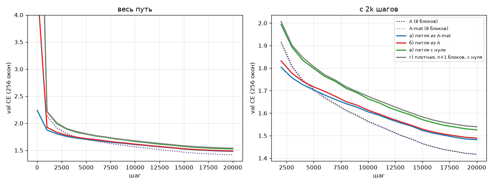

| модель | параметров | val 0 | 1k | 2k | 5k | 10k | 15k | 20k | полный val |
|---|---|---|---|---|---|---|---|---|---|
| A, 8 блоков (справка) | 29.9M | — | 2.138 | 1.917 | 1.707 | 1.564 | 1.465 | 1.417 | 1.3994 |
| A-mat, 8 блоков (справка) | 29.9M | — | 2.135 | 1.910 | 1.698 | 1.561 | 1.465 | 1.416 | 1.3975 |
| **а) петля из A-mat** | 13.8M | 2.237 | **1.874** | **1.804** | 1.703 | 1.606 | 1.523 | 1.482 | **1.4647** |
| б) петля из A | 13.8M | 4.567 | 1.926 | 1.832 | 1.717 | 1.613 | 1.529 | 1.489 | 1.4705 |
| в) петля с нуля | 13.8M | 9.156 | 2.215 | 1.993 | 1.798 | 1.664 | 1.571 | 1.526 | 1.5074 |
| г) плотная, 3 блока, с нуля | 13.8M | 9.114 | 2.220 | 2.007 | 1.806 | 1.675 | 1.583 | 1.540 | 1.5185 |

Парные разности полного val (± 2 SE по окнам):

| пара | разность |
|---|---|
| а − б (из A-mat против из A) | −0.0059 ± 0.0006 |
| а − в (из A-mat против с нуля) | −0.0427 ± 0.0007 |
| б − в | −0.0368 ± 0.0006 |
| а − г (из A-mat против плотной того же размера) | −0.0539 ± 0.0007 |
| в − г (петля с нуля против плотной) | −0.0112 ± 0.0006 |

Отставание б от а на 256 окнах по шагам: +2.33 (шаг 0), +0.051 (1k), +0.028 (2k), +0.013 (5k), +0.007 (10k),
+0.006–0.007 (15–20k).

**Ответы:**
- **Из A-mat петля учится быстрее и чуть лучше, чем из A.**
  - Стартовый перевес огромен (2.24 против 4.57). Через 1000 шагов от него остаётся 0.05, к 5k — 0.013.
  - Дальше держится постоянный остаток около 0.006, в конце −0.0059 ± 0.0006, эффект обнаружен.
  - Конечную точку б а) проходит на ~1000 шагов раньше. Выгода A-mat почти вся в первых тысячах шагов.
- **Из готовой модели петля учится намного быстрее и лучше, чем с нуля:** в конце −0.043 (из A-mat) и −0.037
  (из A). Конечное значение петли с нуля а) проходит к 15k шагам из 20k.
  - Оговорка: а) и б) унаследовали 20k шагов обучения исходной модели на тех же данных. Это сравнение «дообучение
    против обучения с нуля», а не равных затрат.
- **Петля обходит плотную модель того же числа параметров.**
  - Из A-mat — на 0.054, с нуля — на 0.011. Плотную из 3 блоков петля с нуля проходит к 18k шагам, петля из
    A-mat — к 15k.
  - Но петля считает 8 блоков на токен против 3, её шаг в 2.3 раза дольше. По вычислениям сравнение в её пользу
    не говорит.
- **До исходных моделей петля не дотягивает.** Петля из A-mat после 20k дообучения хуже самой A-mat на 0.067
  (1.4647 против 1.3975): общий блок вместо шести своих стоит заметно.

## 24. Воспроизведение

```
uv sync                                                    # torch 2.14 cu130, triton-windows
python -m dd.data --version 4 --k 3,4 --max_sent 127 --out data4
python -m pytest tests -q
python run_all.py --lam_weak 0.003 --lam_mid 0.01 --lam_strong 0.03     # сетка → runs4/
python -m dd.extra runs4/*                                 # Жаккар и «сырые» обновления
python -m dd.report runs4 report                           # таблицы и рисунки
```
Этап 1 (исходная схема, флаг `norm_state=False`): `python -m dd.data --out data` (v2), затем
`python -m dd.train --variant B_legacy --data data --d 256 --n_layers 8 --ffn_hidden 688 --lam 0.1 --steps 10000`
и `python -m dd.evaluate <run> data`. Результаты этапа 1 лежат в `pilot/`, пилоты по трудности языка — в
`pilot2/` – `pilot4/`.

Раунд 3:
```
python -m dd.data --version 5 --k 3,4 --out data5
python run_all5.py --lam 0.01 --lam_I 0.03                 # сетка → runs5/ (обучение + dd.evaluate5)
python -m dd.tails runs5/I_s0 runs5/I_s1 runs5/J_s0 runs5/J_s1 runs5/A_s0 runs5/H_s0 ...   # хвосты
python -m dd.g_slopes runs5/G_s0 runs5/G_s1 runs5/G_s2    # наклоны G и их обнуление
python -m dd.report5 runs5 report                          # report/r3_tables.md и рисунки r3_*
python run_k.py                                            # вариант K → runs5/K*_s* (+ dd.evaluate_k)
python -m dd.report_k runs5 report                         # report/k_tables.md, k_curves.png, k_shifts.png
python -m dd.k_extra runs5/K25_s0 runs5/K25_s1 ...         # градиент головы гейта, пропуск FFN целиком → report/k_extra.json
```

Раунд 4:
```
python run_r4.py --lam_Ip 0.01 --workers 3                 # 20 прогонов → runs6/ (обучение + dd.evaluate5 + dd.evaluate_r4, для I′ ещё dd.tails)
python -m dd.r4_extra runs5/A_s* runs5/I_s* runs5/H_s* ... runs6/*   # ‖x‖, max|x_i|/RMS, разреженные координаты
python -m dd.report_r4 runs6 runs5 report                  # report/r4_tables.md и рисунки r4_*
```
Пилоты λ для I′ (16k шагов, `--stop_at 16000`) и smoke-прогоны новых вариантов лежат в `pilot6/`.

Раунд 5:
```
python run_r5.py --prio 1 --workers 3                      # Q-L0-start ×2, Q0 s2–s4, A s3–s4 → runs7/ (обучение + dd.evaluate5 + dd.evaluate_r4)
python run_r5.py --prio 2 --p2_sched start --workers 3     # QG25, QG50, QG-split25, QG-nogate25 ×2 → runs7/
python -m dd.qg_timing runs7/QG25_s0 data5 40              # время шага генерации с пропуском и без → <прогон>/qg_timing.json
python -m dd.ffn_bench report/r5_ffn_bench.json            # синтетический замер FFN при d = 128…2048
python run_r5x.py                                          # продление QG50_s1 и QG-split25_s0 80k → 120k → runs7x/
python -m dd.report_r5 runs7 runs6 runs5 report runs7x     # report/r5_tables.md и рисунки r5_* (+ r5_ext.png)
```
Smoke-прогоны QG (1000 шагов) лежат в `pilot7/`.

Раунд 6:
```
python run_r6.py --workers 6                               # часть 1: QG25, QG-split25, QG-splitFFN25, QG-splitHead25 ×2, 120k → runs8/
python -m dd.report_r6 runs8 report                        # report/r6_tables.md, r6_curves.png, r6_depth_by_m.png
# часть 2: TinyStories-{train,valid}.txt из roneneldan/TinyStories в data_ts/raw/
python -m dd.ts_data data_ts 8192                          # свой BPE 8192 + потоки токенов
python -m dd.ts_train --variant A --name A_s0 --out runs_ts  # A; затем пробы сетки (2000 шагов, --stop_at 2000) → pilot_ts/
python -m dd.ts_grid_check pilot_ts report                 # report/r6_grid_pilots.md: качество и края сетки по слоям
python run_r6ts.py --best QGsplit --grid profile --levels 40 --emb_scale 22.627417   # калибровка, Q0, QG25, QG-split25, QG25 s1, ts_eval, ts_speed
python -m dd.report_r6ts runs_ts report                    # report/r6ts_tables.md, r6ts_generations.md, r6ts_*.png
python run_r6n.py --deadline 10:00                         # ночной блок: QG50, QG-split50, QG35, QG-split35 (20k), A-40k, QG25-40k (+ QG-split25-40k, если успевает) → runs_ts/
python -m dd.report_r6n runs_ts report                     # report/r6n_tables.md, r6n_generations.md, r6n_frontier.png, r6n_long.png
python -m dd.ts_adapt run runs_ts/QG25_s0 runs_ts/QG25_s1 runs_ts/QG35_s0 runs_ts/QG50_s0 runs_ts/QGsplit25_s0 runs_ts/QGsplit35_s0 runs_ts/QGsplit50_s0
python -m dd.ts_adapt report runs_ts report                # адаптивность: report/r6_adapt_tables.md, r6_adapt.png (сводка — report/r6_adaptivity.md)
```
Каждый прогон d = 512 занимает 4–6 ГБ памяти хоста: запускать по одному (физической памяти 32 ГБ).

Раунд 7 на vast.ai (ключ — в `$VAST_API_KEY`, CLI: `uv tool install vastai`):
```
python -m dd.vast_run vast_plans/check_A.json --dry-run    # найденные машины и оценка стоимости
python -m dd.vast_run vast_plans/check_A.json              # 300 шагов + A 20k на 1×3090 → runs_vast/
python -m dd.vast_compare A_s0 QG25_s0 QG25_s1             # A на vast против домашнего
python -m dd.vast_run vast_plans/r7_controls_s12.json --gpus 4 --max-usd 1.5
python -m dd.vast_run vast_plans/r7_m1.json --gpus 2 --max-usd 0.75     # static s0, s1
python -m dd.vast_run vast_plans/r7_m2.json --gpus 2 --max-usd 0.75     # static s2, tokengate s0
python -m dd.vast_run --cleanup                            # удалить инстансы, оставшиеся после сбоя скрипта
python -m dd.report_r7 runs_ts report                      # report/r7_tables.md (сиды из runs_ts и runs_vast)
```

Раунд 8, проверки r7 на vast.ai (10.12, 10.13):
```
python -m dd.vast_run vast_plans/r8_staticinit_hybrid.json --gpus 2 --max-usd 1.0     # staticinit ×2, hybrid
python -m dd.vast_run vast_plans/r8_noramp.json --gpus 1 --max-usd 0.4
python -m dd.vast_run vast_plans/r8_ctrl.json --gpus 1 --max-usd 0.4
python -m dd.r8_map deviation QG25staticinit_s0            # отход маски от static → runs_vast/<run>/deviation.json
python -m dd.vast_run vast_plans/wiki_A.json --gpus 1 --max-usd 0.6   # Википедия: данные (dd.wiki_data), A, калибровка
python -m dd.wiki_plan                                     # сетка от A_wiki → vast_plans/wiki_main.json (+ wiki_pair, wiki_q0)
python -m dd.vast_run vast_plans/wiki_pair.json --gpus 2 --max-usd 1.3   # static + QG25
python -m dd.vast_run vast_plans/wiki_q0.json --gpus 1 --max-usd 0.7     # Q0
python -m dd.r8_map wiki                                   # report/wiki_tables.md
```

Раунд 9 (готовые чекпойнты, домашняя карта, fp32):
```
python -m dd.r9_diag gate      # градиент гейта против реального переключения → runs_ts/QG25_s0/gate_diag.npz
python -m dd.r9_diag ablate    # выкидывание записи блока на позиции, A и static → ablate.npz
python -m dd.r9_diag report    # report/r9_tables.md
python -m dd.vast_run vast_plans/r9_A_s1.json --gpus 1 --max-usd 0.3          # A s1 (потолок согласия)
python -m dd.r9_diag lens      # KL(финальное ‖ logit lens) по состояниям → <run>/lens_kl.npz
python -m dd.r9_diag ablate_s1 # причинная карта A s1
python -m dd.r9_diag agree     # report/r9_agree.md
python -m dd.vast_run vast_plans/r9_upd_pair.json --gpus 2 --max-usd 0.7      # static и QG25 с округлением правки
python -m dd.vast_run vast_plans/r9_upd_q0.json --gpus 1 --max-usd 0.35       # Q0 с округлением правки
python -m dd.vast_run vast_plans/r9_mulimit.json --gpus 1 --max-usd 0.32       # 10.14: QG25-mulimit
python -m dd.vast_run vast_plans/r9_fix_main.json --gpus 2 --max-usd 0.75      # 10.14: пробы + hnet/dimmer (основные — "manual": разрешаются вручную)
python -m dd.vast_run vast_plans/r9_fix_main.json --gpus 2 --attach <id> --max-usd 0.75   # переподключение к идущему инстансу
python -m dd.r9_diag gate_variants   # 10.14: диагностика градиента на тех же 200 позициях + распределение p
python -m dd.r9_diag g14             # report/r9_gate_variants.md
python -m dd.r8_map viz        # + вкладка «Причинная карта A» (страница собирается из report/r8_viz_template.html)
```

Раунд 10 (10.15: без сетки и гейт «по очереди»):
```
python -m dd.vast_run vast_plans/r10_nogrid_ordered.json --gpus 2 --max-usd 1.0   # пробы 300 шагов + QG25-nogrid, static-nogrid, QG25-ordered
# чекпойнты 10k и 15k (для дрейфа) докачиваются вручную по scp до удаления инстанса: драйвер их не забирает
python -m dd.ts_adapt run runs_vast/QG25nogrid_s0 runs_vast/QG25ordered_s0   # адаптивность → <run>/adapt.json
python -c "from dd.r9_diag import pdist; pdist('QG25ordered_s0', 'runs_vast')"   # уверенность p (и для QG25nogrid_s0)
python -m dd.r10_diag kdist runs_vast/QG25ordered_s0      # k по блокам, проверка «начало очереди»
python -m dd.r10_diag drift runs_vast/QG25ordered_s0      # дрейф раскладки 10k / 15k / 20k (и для QG25nogrid_s0)
python -m dd.r10_diag state runs_vast/QG25nogrid_s0       # масштаб состояния без сетки, доля за ±40δ
python -m dd.r10_diag report                              # report/r10_tables.md
```

Раунд 11 (10.16: бюджет по блокам и переменное k):
```
python -m dd.vast_run vast_plans/r11_perblock_randk_unequal.json --gpus 2 --max-usd 1.0   # пробы 300 + perblock, randk, unequal
# "fetch_ckpts": [10000, 15000] в плане — драйвер сам забирает чекпойнты для дрейфа
python -m dd.r10_diag kdist runs_vast/QG25orderedperblock_s0   # k по блокам (и для QG25randk_s0, QG25staticunequal_s0)
python -m dd.ts_adapt run runs_vast/QG25orderedperblock_s0
python -c "from dd.r9_diag import pdist; pdist('QG25orderedperblock_s0', 'runs_vast')"
python -m dd.r10_diag drift runs_vast/QG25orderedperblock_s0
python -m dd.r11_swap runs_vast/QG25static_s0 runs_vast/QG25staticunequal_s0 runs_vast/QG25randk_s0 runs_vast/QG25ordered_s0 runs_vast/QG25orderedperblock_s0   # подмена маски → report/r11_swap.json
python -m dd.r11_diag report                              # report/r11_tables.md
```

Раунды 12–14 (10.17 лестница, 10.18 k13 и второй сид perblock, 10.19 VQ):
```
python -m dd.vast_run vast_plans/r12_ladder_m1.json --gpus 1 --max-usd 0.9    # пробы 2k и лестница: m1 / m2 / m3
python -m dd.vast_run vast_plans/r12_ladder_m2.json --gpus 1 --max-usd 0.77   # основные — "manual": разрешаются вручную
python -m dd.vast_run vast_plans/r12_ladder_m3.json --gpus 1 --max-usd 0.48   # (ssh: touch /workspace/dd/vast/allow/<job>)
python -m dd.ts_adapt run runs_vast/QG25nogrid_d256L8_s0 runs_vast/QG25nogrid_d512L16_s0 runs_vast/QG25nogrid_d768L12_s0
python -m dd.r10_diag drift runs_vast/QG25nogrid_d768L12_s0                # и для двух других размеров
python -m dd.r12_diag report                                                # report/r12_tables.md, report/r12_ladder.png
python -m dd.vast_run vast_plans/r13_k13_perblock.json --gpus 2 --max-usd 0.9   # k13 без сетки + perblock сид 1
python -m dd.r10_diag kdist runs_vast/QG25orderedperblockk13nogrid_s0      # + ts_adapt, pdist, drift как в раунде 11
python -m dd.vast_run vast_plans/r14_vq.json --gpus 2 --max-usd 0.7            # books-shared, books-delta
python -m dd.r14_vq stats runs_vast/Avqshared_s0 runs_vast/Avqdelta_s0     # символы, книги, связь с трудностью
python -m dd.r14_vq report                                                  # report/r14_tables.md
```

10.20 (нормированный VQ, дообучение A, аттрактор):
```
python -m dd.vast_run vast_plans/r15_vqnorm.json --gpus 1 --max-usd 0.8   # shared-norm, delta-norm с нуля (дообучения оттуда сняты)
python -m dd.r17_insert                                                    # CE сразу после вставки книги в A s0 → report/r17_insert.json
python -m dd.vast_run vast_plans/r17_ft_kmeans.json --gpus 1 --max-usd 0.3 # дообучение: k-means книга, плавный ввод, контроль A
python -m dd.vast_run vast_plans/r16_attract.json --gpus 1 --max-usd 0.25  # аттрактор, дообучение A s0
python -m dd.r14_vq stats runs_vast/Avqsharednorm_s0 runs_vast/Avqdeltanorm_s0 runs_vast/Avqsharednorm_ftAkm_s0 runs_vast/Avqdeltanorm_ftAkm_s0
python -m dd.r14_vq report
python -m dd.r16_attract stats runs_vast/Aattract_ftA_s0                  # мягкий / жёсткий CE, символы
python -m dd.r16_attract report                                           # report/r16_tables.md
```

10.21 (биты на направление, только A s0) и 10.22 (воронка):
```
python -m dd.r19_codebook                                                  # report/r19_codebook.json, .md
python -m dd.vast_run vast_plans/r18_funnel.json --gpus 2 --max-usd 0.8    # funnel-narrow/-wide, static-36, -mat
python -m dd.r18_funnel heads  runs_vast/funnelnarrow_s0                   # головы по префиксу на замороженной сети
python -m dd.r18_funnel depth  runs_vast/funnelnarrow_s0 runs_vast/funnelnarrowmat_s0
python -m dd.r18_funnel groups runs_ts/A_s0 runs_vast/static36_s0 runs_vast/funnelnarrow_s0 runs_vast/funnelwide_s0 runs_vast/funnelnarrowmat_s0
python -m dd.r18_funnel report                                             # report/r18_tables.md
```

10.23 (строгая голова, сиды, Википедия, A-mat):
```
python -m dd.vast_run vast_plans/r20_ts.json --gpus 2 --max-usd 1.0     # mat-strict s0, s1, λ0.1
python -m dd.vast_run vast_plans/r20_wiki.json --gpus 1 --max-usd 0.7   # mat-strict на Википедии
python -m dd.vast_run vast_plans/r20_amat_a.json --gpus 1 --max-usd 0.3 # A-mat λ0.2 (r20_amat_b.json — λ0.1)
python -m dd.r20_depth depth  runs_ts/A_s0 runs_vast/Amat_s0 runs_vast/Amat01_s0 runs_vast/funnelnarrow_s0 runs_vast/funnelnarrowmat_s0 runs_vast/funnelmatstrict_s0 runs_vast/funnelmatstrict_s1 runs_vast/funnelmatstrict01_s0 runs_vast/funnelmatstrict_wiki_s0
python -m dd.r20_depth groups runs_vast/Amat_s0 runs_vast/Amat01_s0 runs_vast/funnelmatstrict_s0 runs_vast/funnelmatstrict_s1 runs_vast/funnelmatstrict01_s0
python -m dd.r20_report                                                 # report/r20_tables.md
python -m dd.r20_viz mat=runs_vast/funnelnarrowmat_s0 strict=runs_vast/funnelmatstrict_s0 amat=runs_vast/Amat_s0   # report/r20_viz.html
# Википедия: data_wiki/{val.bin,tokenizer.json,freq.npy} забраны с машины (sha256 val совпадает с runs_vast/_data_wiki/hashes.json)
```

Раунд 8 (готовые чекпойнты, GPU, без обучения):
```
python -m dd.r8_map lens        # A: ‖Δx‖/‖x‖ по блокам и logit lens → runs_ts/A_s0/lens.npz
python -m dd.r8_map causal      # QG50: закрытие половины открытых групп → runs_ts/QG50_s0/causal.json
python -m dd.r8_map honesty     # корреляции карты QG с A → runs_ts/A_s0/honesty.json
python -m dd.r8_map viz         # 30 историй → report/r8_viz_data.json; страница report/r8_viz.html
python -m dd.r8_map report      # report/r8_map_tables.md
```

Раунд 22 (Qwen3-1.7B, дома, без обучения; веса из HF-кэша, transformers только для сверки):
```
python -m dd.r22_farkv docs        # data_long/docs.json: документы 2–8k токенов из data_wiki/val.bin и data_mix/val.bin
python -m dd.r22_farkv check       # свой послойный проход против transformers; гибрид с настоящим состоянием
python -m dd.r22_farkv calib       # runs_home/r22/calib.pt, calib.json: μ_j и гребневые A_j, b_j для l ∈ {7,10,14,18,21,24}
python -m dd.r22_farkv ppl         # runs_home/r22/ppl.json (сетка l × a/b/c × W ∈ {0,256,1024} + точная + сток точный)
python -m dd.r22_farkv niah        # runs_home/r22/niah.json: спрятанный факт
python -m dd.r22_farkv direction   # runs_home/r22/direction.json: косинусы приближённых K/V с настоящими
python -m dd.r22_report            # report/r22_tables.md, r22_by_l.png, r22_positions.png
```

Блок r20 (код r21; данные строятся на машине, обучение на vast; `vast_plans/r21_moe.json` собирает `dd/r21_plan.py`):
```
python -m dd.mix_data                                      # data_mix: Википедия + codeparrot-clean + TinyStories, GPT-2 BPE
python -m dd.r21_plan                                      # vast_plans/r21_moe.json: A-mix, книги, пробы 300 шагов, гейт, 8 основных + необязательные
python -m dd.vast_run vast_plans/r21_moe.json --max-usd 2.65 --max-hours 13.5
python -m dd.r21_moe train --variant rvq_sem --beta auto ... # один вариант этапа 2 вручную (аргументы — как в плане)
python -m dd.r21_report                                    # report/r21_tables.md, r21_drift.png, r21_loads.png
python -m dd.r21_resid endpoints                           # остатки и запас выбора RVQ на шаге 0 и 10k (дома)
python -m dd.r21_resid plbooks                             # то же для книг per-layer
python -m dd.r21_resid report                              # report/r21_resid.md, r21_resid.png (+ повторы *_rl с логом остатков)
python -m dd.r21_viz data                                  # страница «эксперты perlayer»: данные по всему val -> report/r21_perlayer_data.json
python -m dd.r21_viz page                                  # report/r21_perlayer.html (шаблон report/r21_perlayer_template.html; + карточка из report/r21_ws.json)
python -m dd.r21_ws annot                                  # «пробелы в коде»: разметка строк Python val (tokenize) -> runs_home/r21_ws/annot.npz, sets.json
python -m dd.r21_ws ablate                                 # 1: выключение экспертов только на пробелах -> ablate.json
python -m dd.r21_ws attn                                   # 2: внимание к пробелам по блокам и головам -> attn.json
python -m dd.r21_ws probe                                  # 3: линейные пробы на входе / выходе эксперта -> probe.json (~13 мин)
python -m dd.r21_ws report                                 # report/r21_ws.md, report/r21_ws.json (затем r21_viz page)
```

Раунд 23 (дома, без обучения; `data_mix/calib_train.bin` — 3906 окон train, вырезанных на машине r21):
```
python -m dd.r23_ahead calib                               # runs_home/r23/maps.pt, calib.json
python -m dd.r23_ahead agree                               # замер 1 -> agree.json
python -m dd.r23_ahead ce                                  # замер 2 -> ce.json
python -m dd.r23_ahead report                              # report/r23_tables.md
```

Блок r24 (A-mix-big и замер — 1×4090, этап 2 — 2×4090 на vast; смесь собирается на машине, sha256 = r21; из дома
уходят A-mix, книги, калибровочные окна, затем ширины / P_l / важность / области):
```
python -m dd.vast_run vast_plans/r24_phase1.json --gpu RTX_4090 --gpus 1 --max-dph 0.45 --max-usd 1.15 --max-hours 2.9 --disk 40 --setup-min 20
    # Amixbig_s0 (dd.ts_train --d 768 --n_layers 12 --n_heads 12 --ffn_hidden 2048, 20k шагов) и
    # r24_prep = python -m dd.r24_width prep --big runs_vast/Amixbig_s0  (P_l на A-mix + меры + ширины) -> runs_vast/r24_prep
python -m dd.vast_run vast_plans/r24_phase2_tr.json --gpu RTX_4090 --gpus 2 --max-usd 1.3
    # 6 прогонов: python -m dd.r24_width train --variant uniform|excess|shuffled --seed 0|1 --work runs_vast/r24_prep,
    # после каждого evalrun (весь val) -> runs_vast/w_<вариант>_s<сид>/eval.json
python -m dd.r24_width report                              # report/r24_tables.md (dd/r24_report.py)
```
Дома то же самое без vast: `python -m dd.mix_data data_mix_build` (затем train.bin в data_mix, сверка sha256 с
data_mix/hashes.json), `python -m dd.ts_train ... --out runs_home`, `python -m dd.r24_width calib / measure / train /
eval` с `--work runs_home/r24`.

Раунд 25, этап A (дома, без обучения; веса Qwen/Qwen3-0.6B и Qwen/Qwen3-1.7B из кэша HF):
```
python -m dd.r25_qwen prep                                 # data_qwen: смесь r21 в токенах Qwen (val 3.85M, калибровка 5.0M train)
python -m dd.r25_qwen check                                # наш проход против transformers; маски FFN
python -m dd.r25_qwen books                                # k-means 64 по входу блоков 15..28, 8 сверхкластеров -> runs_home/r25/books.pt (~8 мин)
python -m dd.r25_qwen calib                                # P_l (гребневая), важности нейронов по областям, совпадение на отложенных окнах (~12 мин)
python -m dd.r25_qwen teal                                 # пороги teal блок за блоком
python -m dd.r25_qwen val                                  # CE 0.6B и 1.7B, коды наперёд / по месту на всём val (~8 мин)
python -m dd.r25_qwen compare                              # A4: experts, experts_place, prune, teal (~11 мин); --variants oracle — диагностика
python -m dd.r25_qwen curves                               # A3: кривые ширины, 480 окон val (~25 мин)
python -m dd.r25_qwen report                               # report/r25_tables.md, report/r25_summary.json (dd/r25_report.py)
```

Раунд 25, этап A2 (дома, без обучения; всё после этапа A):
```
python -m dd.r25_a2 codes                                  # важности и счётчики по 64 кодам -> runs_home/r25/a2_codes.pt
python -m dd.r25_qwen curves --fracs 16 --merge            # точка 1/16 кривых A3
python -m dd.r25_a2 eval --step 1                          # E16 / E32 / E64 (п. 1)
python -m dd.r25_a2 eval --step 2                          # ширина по блокам по кривой A3 (п. 2)
python -m dd.r25_a2 eval --step 3                          # по разнице ошибок + 3 перестановки (п. 3); --step 31 — ровная ширина того же расхода
python -m dd.r25_a2 eval --step 4                          # E8 + общие нейроны (п. 4)
python -m dd.r25_regions build                             # области по нужным нейронам, 8 и 64 (п. 8)
python -m dd.r25_regions eval                              # маршруты: ближайший центр, линейный
# дальше — ночная очередь (шаги по одному, готовые пропускаются, ошибки -> runs_home/queue/queue.log):
<базовый python> dd/jobrun.py .venv/Scripts/python.exe -m dd.r25_queue
#   r25_regions bigce                                      # Qwen3-1.7B один раз: CE по токенам калибровки -> calib_big_ce.npy
#   r25_regions extra / eval_extra                         # ячейки (512 кодов) и APC 64 / 512
#   r25_best decide                                        # лучшая ровная конфигурация (E64)
#   r25_oracle curves / single / need / best_curve         # оракул: все блоки, по одному блоку, нужные нейроны, кривая E64
#   r25_oracle coverage / fc / widths                      # покрытие и однородность групп, мера FANG, раздача бюджета + общие
#   r25_a2 eval --step 5                                   # CMoE
#   r25_all books / curves / eval                          # п. 6–7: книги и кривые блоков 1–14, ширина по всей модели
#   r25_a2 report, r25_all report                          # report/r25_a2.md, r25_groups.md, r25_all.md
runs_home/queue/stop.ps1                                   # снять очередь вместе со всем деревом процессов
```

Блок r26 (дома, без обучения; OLMoE-1B-7B, в очереди — шаги r26_check … r26_report). transformers, accelerate (сверка
прохода), pyarrow (сборка смеси) и typer записаны в pyproject с точными версиями, `uv sync` их ставит.
```
python -m dd.r26_olmoe prep                                # data_olmoe/: val смеси r21 в токенах OLMoE, калибровка 2M токенов train
python -m dd.r26_olmoe check                               # наш проход против transformers (модель грузится сразу в видеокарту)
python -m dd.r26_olmoe calib                               # гребневые карты -> runs_home/r26/maps_N*.pt (~9 мин)
python -m dd.r26_olmoe route                               # доли угаданных, плотная CE, маршруты для симуляции (~8 мин)
python -m dd.r26_olmoe cost                                # val CE с угаданными экспертами (~37 мин)
python -m dd.r26_olmoe sim                                 # симуляция кэша, на процессоре (~5 мин)
python -m dd.r26_olmoe report                              # report/r26_tables.md, report/r26_recall.png
```

Дополнения r25 и r26 (дома, без обучения; в очереди `dd/r25_queue.py` — шаги после r26_report; очередь перечитывает
список шагов перед каждым шагом):
```
python -m dd.r25_more single                               # один блок до 1/4: эксперты / урезание, все 28 блоков (~12 мин)
python -m dd.r25_more whole                                # вся модель: нижняя 1/2 + верхняя 0, 3/8 + 1/8, нижняя целая (~13 мин)
python -m dd.r25_more tokcalib                             # блок 1: набор по номеру токена -> runs_home/r25/tok1.pt
python -m dd.r25_more single1                              # блок 1 отдельно: номер токена / 64 группы
python -m dd.r25_more whole2                               # вся модель: блок 1 целый / по номеру токена / + блоки 27–28 (~12 мин)
python -m dd.r25_more compress                             # сжимаемость каждой группы E64 по итоговой потере (~3 ч)
python -m dd.r25_more report                               # report/r25_more.md, report/r25_single.png
python -m dd.r26_olmoe sim                                 # кэш K = 128 / 256 / 384 / 512
python -m dd.r26_more nextcalib                            # карты: состояние токена после слоя 8 / 12 / 16 -> маршрут следующего токена
python -m dd.r26_more nextroute                            # доли угаданных у следующего токена, маршруты для симуляции
python -m dd.r26_sim run                                   # кэш с подгрузкой и время (12 процессов, ~8 мин) -> runs_home/r26/time.json
python -m dd.r26_sim classic                               # LFU / LRU-2 / ARC, K = 256 / 384 / 512
python -m dd.r26_more cost12                               # 12 кандидатов, 8 выбирает маршрутизатор: val CE и маршруты
python -m dd.r26_more report                               # report/r26_more.md, report/r26_time.png
```

Второй набор дополнений r25 (без обучения; дома — в очереди `dd/r25_queue.py`, остальное — на vast.ai по планам
`vast_plans/r25_*.json`; результаты с машин копируются из `runs_vast/<задание>/` в `runs_home/r25/`):

```
python -m dd.r25_corr fit / eval / single / whole / report  # поправки (17.17) -> corr.json, ce_corr_*.npy, report/r25_corr.md
python -m dd.r25_corr fit2 / eval2                          # второй набор поправок: на блок, блок + группа
python -m dd.r25_ngroups build / imp / eval / stats / decomp / report   # число групп 8 / 64 / 128 / 256 (17.18)
python -m dd.r25_greedy alloc / eval / single / curve / report         # жадные ширины по кривым (17.20)
python -m dd.r25_twolevel slim                             # ngroups_e256.pt — только нужное (для vast.ai)
python -m dd.r25_twolevel prep                             # предсказатели, пороги TEAL, двухступенчатый маршрут -> twolevel.pt
python -m dd.r25_twolevel eval --part i/2                  # сетка без учёта маршрута (vast: r25_twolevel0/1)
python -m dd.r25_twolevel eval2 --part i/3                 # маршрут в расходе, TEAL по всему слою (vast: r25_twolevel2_{0,1,2})
python -m dd.r25_twolevel corr                             # с поправкой: одноуровневая и лучшая двухуровневая
python -m dd.r25_twolevel report                           # report/r25_twolevel.md (17.21)
python -m dd.r25_disjoint build / eval / report            # непересекающиеся группы нейронов (17.22; vast: r25_scale_a)
python -m dd.r25_scale run --model Qwen/Qwen3-1.7B         # и 0.6B, 4B (17.23; vast: r25_scale_a / r25_scale_b)
python -m dd.r25_scale run --model Qwen/Qwen3-8B --skip_fang --skip_single --s_cpu   # 8B дома (только исходная, оракул, эксперты)
python -m dd.r25_hfcheck Qwen/Qwen3-8B 0,160,320 gpu       # сверка 8B с HF transformers (bf16, GPU)
python -m dd.r25_scale report                              # report/r25_scale.md
python -m dd.r25_flops                                     # FLOPs на токен -> val CE (17.25): report/r25_flops.md, r25_flops.png
python -m dd.r25_compress2 run --kind e256 --blocks 15-16  # кривые сжимаемости 256 групп, части по машинам (vast: r25_c2_e256_*)
python -m dd.r25_compress2 run --kind low64 --blocks 2-4   # кривые 64 кодов нижних блоков (vast: r25_c2_low64_*)
python -m dd.r25_compress2 merge --kind e256 --src runs_vast/c2_e256_*/compress_e256.json   # и low64
python -m dd.r25_assembly alloc                            # ширины сборки -> runs_home/r25/assembly.json
python -m dd.r25_assembly up --kind tl                     # двухуровневые варианты сборки (дома)
python -m dd.r25_assembly up --kind width --part i/5       # ширины: части 0–3 на vast (r25_as_w*), часть 4 дома
python -m dd.r25_assembly whole                            # вся модель (vast: r25_as_whole)
python -m dd.r25_assembly report                           # report/r25_assembly.md (17.24)
python -m dd.r26_more cost12                               # OLMoE: 12 кандидатов (18.7; vast: r26_cost12)
python -m dd.r25_hfcheck Qwen/Qwen3-1.7B 0,160,320        # проверка через HF transformers (fp32, процессор), числа — в 17.23
```

Раунд 27 (дома, без обучения; в очереди `dd/r25_queue.py`, шаги r27_*; lm-eval==0.4.13, datasets==5.2.0,
evaluate==0.4.6 в pyproject):

```
python -m dd.r27_tasks samples                             # одни и те же случайные вопросы: 1000 на задачу, MMLU 2000 -> runs_home/r27/samples.json
python -m dd.r27_tasks smoke                               # всё в малом виде на 0.6B, построчная сверка с HF
python -m dd.r27_tasks prep --size 1.7B                    # лучшая двухуровневая для размера: пороги TEAL, маршрут, поправка -> prep_<модель>.pt
python -m dd.r27_tasks val --size 1.7B --variant best      # CE / KL / топ-1 (480 окон) и перплексия WikiText-2 -> val.json
python -m dd.r27_tasks lm --size 1.7B --variant best       # lm-eval через наш класс модели -> lm_<модель>_<вариант>_<задача>.json
python -m dd.r27_tasks hf --size 0.6B                      # эталон: lm-eval со своей моделью HF (MMLU не досчитан)
python -m dd.r27_tasks base                                # оракул на Qwen3-0.6B-Base / 1.7B-Base -> base.json
python -m dd.r27_tasks report                              # report/r27_tables.md, report/r27_tasks.png
```

Раунд 28 (дома; в очереди `dd/r25_queue.py`, шаги r28_*; чекпойнты r21 perlayer s0 / hash s0, веса
allenai/OLMoE-1B-7B-0924 из кэша HF; на vast ничего):

```
python -m dd.r28_stage0 div --ckpt perlayer                # расхождение весов (то же с --ckpt hash для всех команд этапа 0)
python -m dd.r28_stage0 grad --ckpt perlayer               # чужой градиент по весам, разбивка по темам читающих
python -m dd.r28_stage0 swap --ckpt perlayer               # матрица подмены 8×8 по блокам и во всех блоках сразу
python -m dd.r28_stage0 fit --ckpt perlayer                # подмена с подбором down (гребневая регрессия)
python -m dd.r28_stage0 ograd --ckpt perlayer --win 256    # чужой градиент по выходу эксперта (для сравнения с OLMoE)
python -m dd.r28_olmoe swap                                # OLMoE: подмена одного из 8 (случайный / 9-й / далёкий)
python -m dd.r28_olmoe ograd                               # OLMoE: чужой градиент по выходу эксперта
python -m dd.r28_olmoe rank                                # OLMoE: подмена по рангу, с выравниванием нормы и без
python -m dd.r28_olmoe fit --min_free_gb 10                # OLMoE: подбор выхода, слои 0 / 4 / 8 / 12 / 15
python -m dd.r28_olmoe topk                                # OLMoE: 7…4 эксперта на токен и пороги веса
python -m dd.r28_olmoe tokshare --min_free_gb 10           # OLMoE: доля токенов с |ΔCE| > 0.1
pytest -q tests/test_r28.py                                # веса градиента (17 тестов); обучение только после них
python -m dd.r28_train ref --out runs_home/r28s1           # CE по окнам dense-cont и perlayer r21 (для парных разностей)
python -m dd.r28_train train --variant hier --out runs_home/r28s1    # варианты base add hier own shuf flat sdown; замеры на 2k / 5k / 10k
python -m dd.r28_train stage2 --variant hier --out runs_home/r28s1   # этап 2: CE по окнам, полные матрицы на 10k
python -m dd.r28_train seed2 --out runs_home/r28s1         # второй сид лучшего варианта (г) + его этап 2
python -m dd.r28_stage0 report                             # report/r28_tables.md, r28_olmoe_rank.png (этапы 0, 0б)
python -m dd.r28_report1                                   # report/r28_stage12.md, r28_spec.png (этапы 1, 2)
```

Раунд 28, этапы 3 и 4 (обучение — на vast по планам `vast_plans/r28_s3_*.json`, `r28_s4_*.json`, остальное — дома, в
очереди `dd/r25_queue.py`, шаги r28_s3b_* / r28_s4b_*):

```
python -m dd.mix_data_ext data_mix_ext                     # 498M токенов после документов data_mix (стык проверяется) -> data_mix_ext/
python -m dd.r28_long train --model dense --phase first    # dense-cont заново 0 -> 10k (сохранения 2k / 5k / 10k); так же --model hash
python -m dd.r28_long train --model pl --phase cont        # 10k -> 40k на data_mix_ext, постоянный lr 0.1 от пика (pl, dense, hash)
python -m dd.r28_long vast --model dense                   # на машине vast: data_mix_ext + сверка sha256 + обе фазы
python -m dd.r28_long measure --model pl                   # все сохранения: полный val по окнам, специализация с dense-cont того же шага
python -m dd.r28_long report                               # report/r28_long.md, r28_long.png
python -m dd.r28_route prep                                # группы токенов (k-means 64, центр., вес частоты), таблицы -> runs_home/r28s4/route_tables.pt
python -m dd.r28_route vast --variant out                  # обучение 10k + этап 2 (out, inout, mixed, oracle)
python -m dd.r28_route changed                             # доля токенов, сменивших эксперта к 2k / 5k / 10k
python -m dd.r28_route report                              # report/r28_route.md
```

Раунд 28, проба поправки низкого ранга (OLMoE, слой 4, дома, ~15 минут):

```
python -m dd.r28_olmoe lowrank          # 5 жертв x 2 донора, поправка ранга 8 / 32 / 128 / полная -> runs_home/r28/olmoe_lowrank.json + суммы по окнам
python -m dd.r28_lowrank_report         # report/r28_lowrank.md (парные доли снятой разницы)
```

Раунд 29 (дома, ~43 мин):
```
python -m dd.r29_data ru; python -m dd.r29_data med          # data_r29/<src>/ (~30 с)
python -m dd.r29 stage0                                      # report/r29_stage0.md, runs_home/r29/stage0.json
python -m dd.r29 train --src ru --variant codes              # и label / lora / all; то же для --src med
python -m dd.r29 report                                      # report/r29_tables.md
```

Раунд 29, дополнение (дома, ~65 мин):
```
python -m dd.r29b clf                                         # классификаторы «новый / старый», блоки 5–8, perlayer и dense-cont
python -m dd.r29b train --src ru --variant zclf               # з); iclf / kclf / llabel с --lr 3e-4 и 1e-3; то же для --src med
python -m dd.r29b train --src ru --variant zclf5 --lr 1e-3   # 21.5: отметка блока 5 на все блоки; и iclf5; то же для med
python -m dd.r29b report                                      # report/r29b_tables.md
```

Раунд 30 (дома, ~13 мин):
```
python -m dd.r30_fold fold        # сворачивание: среднее / один блок / пары -> runs_home/r30/val_<модель>_<замена>.npy
python -m dd.r30_fold sim         # косинус правок, гребневая карта, k-means своя / общая -> runs_home/r30/sim.json
python -m dd.r30_fold report      # report/r30_fold.md
```

Раунд 31 (дома, ~1 ч 50 мин):
```
python -m dd.r31_loop fold                      # средним верхние блоки 5–8 / 4–8 / 3–8, выбор числа своих блоков -> runs_home/r31/fold.json
python -m dd.r31_loop check --n_own 2           # петля на шаге 0 == свёртка, плотная обёртка == A
python -m dd.r31_loop train --run amat          # и a / scratch / dense, по 20k шагов -> runs_home/r31/<run>/
python -m dd.r31_loop report                    # report/r31_loop.md, report/r31_loop.png
```
