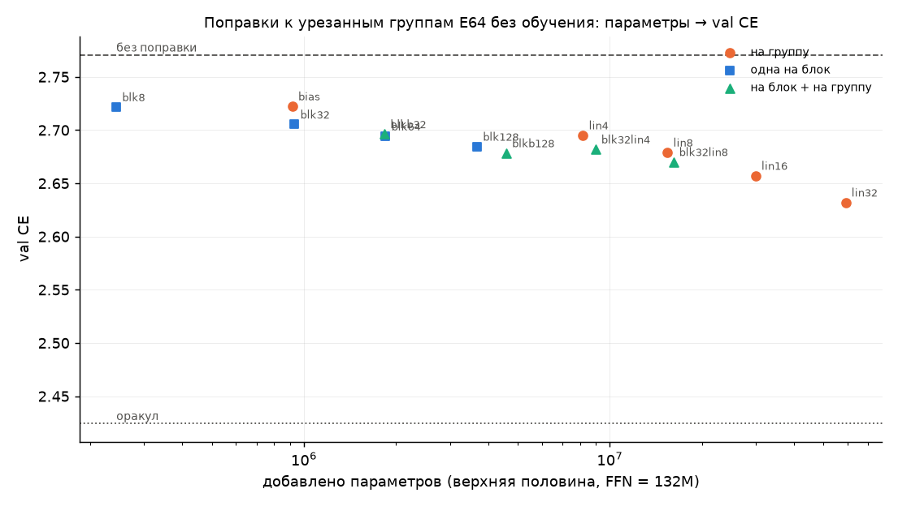

# Раунд 25: поправки к урезанным группам без обучения (Qwen3-0.6B, верхняя половина, E64 с шириной по A3)

Без поправки (E64_a3need) val CE 2.7708; оракул верхней половины при 1/4 2.4246; разрыв 0.3461. Калибровка 1600 окон, каждое 5-е отложено для регуляризации; своя линейная поправка у групп с ≥ 3000 токенами калибровки, у остальных — поправка блока того же ранга. FFN верхней половины — 132.1M параметров.

| поправка | val CE | Википедия / код / сказки | Δ к без поправки ± 2 SE | закрыто разрыва до оракула | добавлено параметров | доля от FFN верхней половины | объяснено недостающего вклада (отложенные окна) |
|---|---|---|---|---|---|---|---|
| без поправки | 2.7708 | 3.4016 / 1.9267 / 2.5827 | — | 0 | 0 | 0 | 0 |
| сдвиг на группу (ранг 0) | 2.7224 | 3.3524 / 1.9230 / 2.5097 | -0.0483 ± 0.0011 | 14.0% | 0.92M | 0.7% | 12.0% |
| линейная на группу, ранг 4 | 2.6952 | 3.3310 / 1.9115 / 2.4671 | -0.0756 ± 0.0015 | 21.8% | 8.17M | 6.2% | 17.9% |
| линейная на группу, ранг 8 | 2.6790 | 3.3181 / 1.9010 / 2.4443 | -0.0918 ± 0.0017 | 26.5% | 15.44M | 11.7% | 21.2% |
| линейная на группу, ранг 16 | 2.6573 | 3.3010 / 1.8825 / 2.4158 | -0.1135 ± 0.0018 | 32.8% | 29.97M | 22.7% | 25.5% |
| линейная на группу, ранг 32 | 2.6321 | 3.2809 / 1.8603 / 2.3835 | -0.1387 ± 0.0020 | 40.1% | 59.04M | 44.7% | 30.6% |
| одна линейная на блок, ранг 8 | 2.7217 | 3.3489 / 1.9207 / 2.5128 | -0.0491 ± 0.0011 | 14.2% | 0.24M | 0.2% | 10.3% |
| одна линейная на блок, ранг 32 | 2.7054 | 3.3330 / 1.9073 / 2.4943 | -0.0654 ± 0.0012 | 18.9% | 0.93M | 0.7% | 13.5% |
| одна линейная на блок, ранг 64 | 2.6942 | 3.3233 / 1.8987 / 2.4800 | -0.0766 ± 0.0013 | 22.1% | 1.85M | 1.4% | 15.6% |
| одна линейная на блок, ранг 128 | 2.6845 | 3.3138 / 1.8921 / 2.4685 | -0.0863 ± 0.0014 | 24.9% | 3.68M | 2.8% | 18.0% |
| линейная на блок ранга 32 + сдвиг на группу | 2.6963 | 3.3235 / 1.9060 / 2.4812 | -0.0745 ± 0.0013 | 21.5% | 1.84M | 1.4% | 15.9% |
| линейная на блок ранга 128 + сдвиг на группу | 2.6784 | 3.3078 / 1.8916 / 2.4591 | -0.0924 ± 0.0014 | 26.7% | 4.59M | 3.5% | 19.6% |
| линейная на блок ранга 32 + на группу ранга 4 | 2.6820 | 3.3160 / 1.8973 / 2.4565 | -0.0888 ± 0.0015 | 25.7% | 8.98M | 6.8% | 19.5% |
| линейная на блок ранга 32 + на группу ранга 8 | 2.6702 | 3.3076 / 1.8917 / 2.4375 | -0.1006 ± 0.0017 | 29.1% | 16.13M | 12.2% | 22.2% |

## Один блок урезан (480 окон val), рост CE

| блок | без поправки | сдвиг на группу (ранг 0) | линейная на группу, ранг 4 | линейная на группу, ранг 8 | линейная на группу, ранг 16 | линейная на группу, ранг 32 | одна линейная на блок, ранг 8 | одна линейная на блок, ранг 32 | оракул |
|---|---|---|---|---|---|---|---|---|---|
| 15 | +0.0071 | +0.0102 | +0.0088 | +0.0081 | +0.0073 | +0.0062 | +0.0098 | +0.0103 | -0.0021 |
| 16 | +0.0110 | +0.0109 | +0.0089 | +0.0082 | +0.0073 | +0.0065 | +0.0106 | +0.0100 | +0.0008 |
| 17 | +0.0089 | +0.0123 | +0.0113 | +0.0101 | +0.0091 | +0.0077 | +0.0139 | +0.0123 | -0.0043 |
| 18 | +0.0136 | +0.0086 | +0.0082 | +0.0079 | +0.0064 | +0.0059 | +0.0108 | +0.0099 | +0.0007 |
| 19 | +0.0078 | +0.0110 | +0.0083 | +0.0077 | +0.0068 | +0.0062 | +0.0112 | +0.0109 | -0.0031 |
| 20 | +0.0168 | +0.0119 | +0.0090 | +0.0079 | +0.0072 | +0.0067 | +0.0121 | +0.0121 | +0.0034 |
| 21 | +0.0161 | +0.0128 | +0.0120 | +0.0110 | +0.0096 | +0.0085 | +0.0147 | +0.0135 | +0.0008 |
| 22 | +0.0173 | +0.0155 | +0.0133 | +0.0121 | +0.0112 | +0.0098 | +0.0159 | +0.0139 | +0.0020 |
| 23 | +0.0131 | +0.0131 | +0.0122 | +0.0116 | +0.0105 | +0.0093 | +0.0139 | +0.0134 | +0.0003 |
| 24 | +0.0109 | +0.0104 | +0.0108 | +0.0104 | +0.0100 | +0.0094 | +0.0106 | +0.0108 | +0.0007 |
| 25 | +0.0113 | +0.0106 | +0.0101 | +0.0099 | +0.0097 | +0.0091 | +0.0112 | +0.0109 | +0.0006 |
| 26 | +0.0188 | +0.0181 | +0.0171 | +0.0169 | +0.0163 | +0.0154 | +0.0184 | +0.0183 | +0.0014 |
| 27 | +0.0430 | +0.0419 | +0.0402 | +0.0389 | +0.0374 | +0.0348 | +0.0418 | +0.0411 | +0.0018 |
| 28 | +0.0781 | +0.0811 | +0.0797 | +0.0781 | +0.0752 | +0.0712 | +0.0818 | +0.0809 | -0.0025 |
| сумма | +0.274 | +0.268 | +0.250 | +0.239 | +0.224 | +0.207 | +0.277 | +0.268 | +0.000 |
| закрыто разрыва до оракула (по сумме) | — | 2% | 9% | 13% | 18% | 25% | -1% | 2% | — |

## Вся модель

Лучшая поправка по группам — линейная на группу, ранг 32: -0.1387 ± 0.0020 к без поправки; правило «заметно помогает»: Δ ≤ −0.01 и больше 2 SE по модулю — выполнено.

b1full_fang (блок 1 целый, блоки 2–28 по FANG, средний расход 1/4) + линейная на группу, ранг 32 во всех урезанных блоках: val CE 2.9683 против 3.4970 без поправки (-0.5287 ± 0.0056) и 3.5559 у all_fang (-0.5876 ± 0.0066); добавлено 114.15M параметров (43.2% FFN всей модели).
