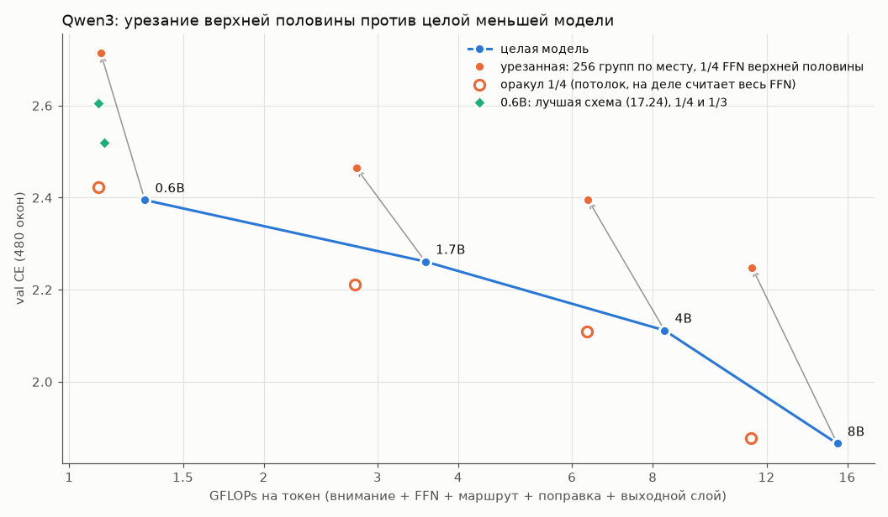

# Раунд 25: FLOPs на токен → val CE, целые и урезанные Qwen3 (без обучения)

FLOPs на токен = 2 × умножений-сложений по config.json: внимание (проекции q, k, v, o + ядро QK и AV при средней длине контекста наших окон 512.5 ключа), FFN, маршрут (ближайший из 256 центров — 256·d; двухступенчатый — 32·d), поправка (64·d), выходной слой d·V. Нормы, RoPE, softmax, пороги не считаются (< 1%). val CE — 480 окон A3 (как r25_scale). Урезание — только FFN верхней половины блоков.

| модель | вариант | GFLOPs на токен | доля от целой | из них: внимание / FFN / маршрут + поправка / выход | val CE | целая модель того же расхода (интерполяция) | против целой меньшей: Δ CE ± 2 SE (её GFLOPs) |
|---|---|---|---|---|---|---|---|
| Qwen3-0.6B | целая | 1.310 | 1.00 | 0.470 / 0.528 / 0.000 / 0.311 | 2.3948 | — | — |
| Qwen3-0.6B | урезанная: 256 групп по месту, 1/4 FFN в верхней половине | 1.119 | 0.85 | 0.470 / 0.330 / 0.007 / 0.311 | 2.7146 | — | — |
| Qwen3-0.6B | оракул 1/4 в верхней половине (потолок; на деле считает весь FFN) | 1.111 | 0.85 | 0.470 / 0.330 / 0.000 / 0.311 | 2.4230 | — | — |
| Qwen3-0.6B | урезанная: лучшая схема при 1/4 (двухуровневая TEAL в пуле + поправка, 17.24) | 1.111 | 0.85 | 0.470 / 0.328 / 0.003 / 0.311 | 2.6054 | — | — |
| Qwen3-0.6B | урезанная: лучшая схема при 1/3 (то же, 17.24) | 1.133 | 0.87 | 0.470 / 0.350 / 0.003 / 0.311 | 2.5198 | — | — |
| Qwen3-1.7B | целая | 3.558 | 1.00 | 0.822 / 2.114 / 0.000 / 0.622 | 2.2611 | — | — |
| Qwen3-1.7B | урезанная: 256 групп по месту, 1/4 FFN в верхней половине | 2.780 | 0.78 | 0.822 / 1.321 / 0.015 / 0.622 | 2.4649 | 2.2941 | Qwen3-0.6B: +0.0701 ± 0.0126 (1.310) |
| Qwen3-1.7B | оракул 1/4 в верхней половине (потолок; на деле считает весь FFN) | 2.766 | 0.78 | 0.822 / 1.321 / 0.000 / 0.622 | 2.2113 | 2.2948 | Qwen3-0.6B: -0.1835 ± 0.0080 (1.310) |
| Qwen3-4B | целая | 8.347 | 1.00 | 2.190 / 5.379 / 0.000 / 0.778 | 2.1116 | — | — |
| Qwen3-4B | урезанная: 256 групп по месту, 1/4 FFN в верхней половине | 6.353 | 0.76 | 2.190 / 3.362 / 0.024 / 0.778 | 2.3956 | 2.1594 | Qwen3-1.7B: +0.1345 ± 0.0161 (3.558) |
| Qwen3-4B | оракул 1/4 в верхней половине (потолок; на деле считает весь FFN) | 6.330 | 0.76 | 2.190 / 3.362 / 0.000 / 0.778 | 2.1098 | 2.1601 | Qwen3-1.7B: -0.1513 ± 0.0067 (3.558) |
| Qwen3-8B | целая | 15.438 | 1.00 | 3.322 / 10.872 / 0.000 / 1.245 | 1.8657 | — | — |
| Qwen3-8B | урезанная: 256 групп по месту, 1/4 FFN в верхней половине | 11.399 | 0.74 | 3.322 / 6.795 / 0.038 / 1.245 | 2.2481 | 1.9870 | Qwen3-4B: +0.1366 ± 0.0240 (8.347) |
| Qwen3-8B | оракул 1/4 в верхней половине (потолок; на деле считает весь FFN) | 11.362 | 0.74 | 3.322 / 6.795 / 0.000 / 1.245 | 1.8770 | 1.9883 | Qwen3-4B: -0.2346 ± 0.0087 (8.347) |

Интерполяция — кусочно-линейная по log FLOPs между целыми моделями (допущение: промежуточных целых моделей мы не мерили). Прямое сравнение — с ближайшей целой моделью меньшего размера на тех же окнах; она дешевле.

