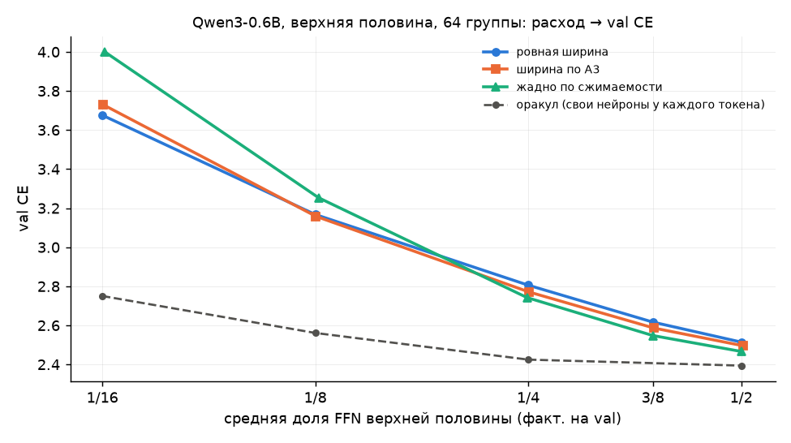

# Раунд 25: ширина групп жадно по кривым сжимаемости (E64, верхняя половина, общий расход 1/4)

Кривые — рост CE на токенах группы при урезании только её (480 окон val A3), сделаны невозрастающими. Жадный шаг — переход группы на любую более широкую ширину сетки [96, 192, 384, 768, 1536, 3072] с наибольшим выигрышем на добавленный нейрон, пока общий расход (сумма доля токенов группы на калибровке × ширина по 14 блокам) не превысит 1/4. Группы с < 50 токенами на этих окнах — 768. Разности ± 2 SE по окнам val; «вне окон кривых» — по 3283 окнам val, не входящим в 480 окон кривых (на них кривые не смотрели).

Правило c: ширины групп 96 — 94, 192 — 133, 384 — 220, 768 — 298, 1536 — 110, 3072 — 37; доля расхода по блокам 15..28: 0.08 0.10 0.18 0.16 0.20 0.30 0.26 0.25 0.23 0.21 0.21 0.26 0.48 0.60.
Правило n: ширины групп 96 — 180, 192 — 151, 384 — 203, 768 — 225, 1536 — 110, 3072 — 23; доля расхода по блокам 15..28: 0.08 0.10 0.16 0.19 0.21 0.29 0.28 0.25 0.23 0.24 0.21 0.31 0.42 0.55.

| вариант | val CE | факт. расход (val) | Δ к ровной ± 2 SE | Δ к A3 ± 2 SE | Δ к ровной вне окон кривых | Δ к A3 вне окон кривых |
|---|---|---|---|---|---|---|
| ровная ширина (768 у каждой группы) | 2.8057 | 0.2500 | — | +0.0349 ± 0.0040 | — | +0.0349 ± 0.0043 |
| по кривой A3 | 2.7708 | 0.2507 | -0.0349 ± 0.0040 | — | -0.0349 ± 0.0043 | — |
| **жадно по сжимаемости (основной): снижение роста на нейрон = на единицу расхода на токен** | 2.7420 | 0.2491 | -0.0637 ± 0.0043 | -0.0287 ± 0.0018 | -0.0636 ± 0.0046 | -0.0286 ± 0.0020 |
| жадно по сжимаемости (для сравнения): снижение роста × токены группы на нейрон | 2.7503 | 0.2622 | -0.0554 ± 0.0053 | -0.0205 ± 0.0028 | -0.0553 ± 0.0056 | -0.0204 ± 0.0030 |

## Один блок урезан (480 окон val), рост CE ± 2 SE; в скобках доля FFN блока на этих окнах

| блок | E64 | E64_greedy_c | E64_greedy_n | E64_a3need |
|---|---|---|---|---|
| 15 | +0.0076 ± 0.0009 (0.25) | +0.0156 ± 0.0014 (0.07) | +0.0141 ± 0.0016 (0.08) | +0.0071 (0.23) |
| 16 | +0.0109 ± 0.0009 (0.25) | +0.0223 ± 0.0013 (0.10) | +0.0223 ± 0.0013 (0.11) | +0.0110 (0.24) |
| 17 | +0.0082 ± 0.0011 (0.25) | +0.0108 ± 0.0012 (0.18) | +0.0133 ± 0.0014 (0.16) | +0.0089 (0.24) |
| 18 | +0.0125 ± 0.0009 (0.25) | +0.0163 ± 0.0011 (0.17) | +0.0149 ± 0.0011 (0.20) | +0.0136 (0.25) |
| 19 | +0.0081 ± 0.0009 (0.25) | +0.0094 ± 0.0010 (0.20) | +0.0097 ± 0.0013 (0.22) | +0.0078 (0.25) |
| 20 | +0.0178 ± 0.0012 (0.25) | +0.0118 ± 0.0009 (0.30) | +0.0135 ± 0.0009 (0.29) | +0.0168 (0.26) |
| 21 | +0.0169 ± 0.0012 (0.25) | +0.0120 ± 0.0009 (0.27) | +0.0123 ± 0.0009 (0.29) | +0.0161 (0.26) |
| 22 | +0.0176 ± 0.0015 (0.25) | +0.0133 ± 0.0010 (0.25) | +0.0139 ± 0.0011 (0.26) | +0.0173 (0.27) |
| 23 | +0.0158 ± 0.0018 (0.25) | +0.0098 ± 0.0012 (0.22) | +0.0103 ± 0.0015 (0.24) | +0.0131 (0.25) |
| 24 | +0.0192 ± 0.0022 (0.25) | +0.0107 ± 0.0013 (0.21) | +0.0095 ± 0.0016 (0.26) | +0.0109 (0.25) |
| 25 | +0.0221 ± 0.0024 (0.25) | +0.0101 ± 0.0010 (0.21) | +0.0104 ± 0.0013 (0.23) | +0.0113 (0.26) |
| 26 | +0.0295 ± 0.0026 (0.25) | +0.0129 ± 0.0010 (0.26) | +0.0110 ± 0.0011 (0.32) | +0.0188 (0.25) |
| 27 | +0.0524 ± 0.0036 (0.25) | +0.0108 ± 0.0008 (0.48) | +0.0156 ± 0.0017 (0.46) | +0.0430 (0.26) |
| 28 | +0.0729 ± 0.0047 (0.25) | +0.0070 ± 0.0007 (0.57) | +0.0107 ± 0.0010 (0.54) | +0.0781 (0.23) |
| сумма | +0.311 | +0.173 | +0.182 | +0.274 |

## Кривая «расход → val CE» (верхняя половина)

Расход — фактическая средняя доля FFN верхней половины на val. Δ — к ровной ширине того же номинального расхода, ± 2 SE по окнам val.

| номинальный расход | ровная: CE (расход) | по A3: CE (расход) | жадно: CE (расход) | A3 − ровная | жадно − ровная | жадно − A3 |
|---|---|---|---|---|---|---|
| 0.0625 | 3.6757 (0.062) | 3.7291 (0.063) | 3.9998 (0.063) | +0.0534 ± 0.0051 | +0.3241 ± 0.0084 | +0.2708 ± 0.0071 |
| 0.1250 | 3.1675 (0.125) | 3.1580 (0.125) | 3.2530 (0.126) | -0.0095 ± 0.0044 | +0.0856 ± 0.0055 | +0.0950 ± 0.0049 |
| 0.2500 | 2.8057 (0.250) | 2.7708 (0.251) | 2.7420 (0.249) | -0.0349 ± 0.0040 | -0.0637 ± 0.0043 | -0.0287 ± 0.0018 |
| 0.3750 | 2.6168 (0.375) | 2.5859 (0.377) | 2.5479 (0.375) | -0.0309 ± 0.0033 | -0.0689 ± 0.0031 | -0.0381 ± 0.0014 |
| 0.5000 | 2.5144 (0.500) | 2.4955 (0.503) | 2.4661 (0.500) | -0.0188 ± 0.0024 | -0.0482 ± 0.0022 | -0.0294 ± 0.0010 |

