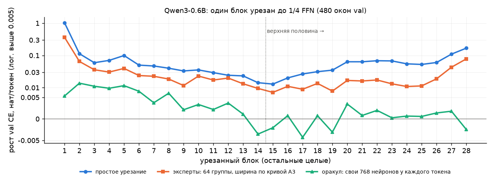

# Раунд 25, дополнения: урезание по одному блоку, вся модель, сжимаемость групп (Qwen3-0.6B, без обучения)

## 1. Один блок урезан до 1/4, остальные целые

480 окон val (как A3), опорная CE 2.3948; рост CE по всем позициям ± 2 SE по окнам.

| блок | простое урезание | эксперты (64 группы, ширина по A3) | факт. ширина экспертов | оракул | 8 областей по одной (кривые A3 / п. 6) |
|---|---|---|---|---|---|
| 1 | +1.0275 ± 0.1104 | +0.3637 ± 0.0718 | 0.247 | +0.0055 | +0.3821 |
| 2 | +0.1131 ± 0.0058 | +0.0650 ± 0.0098 | 0.248 | +0.0138 | +0.0392 |
| 3 | +0.0594 ± 0.0041 | +0.0359 ± 0.0020 | 0.254 | +0.0111 | +0.0373 |
| 4 | +0.0701 ± 0.0042 | +0.0305 ± 0.0019 | 0.259 | +0.0096 | +0.0336 |
| 5 | +0.0992 ± 0.0042 | +0.0395 ± 0.0022 | 0.255 | +0.0116 | +0.0361 |
| 6 | +0.0500 ± 0.0026 | +0.0238 ± 0.0017 | 0.252 | +0.0077 | +0.0201 |
| 7 | +0.0470 ± 0.0026 | +0.0226 ± 0.0015 | 0.261 | +0.0038 | +0.0187 |
| 8 | +0.0401 ± 0.0023 | +0.0185 ± 0.0015 | 0.245 | +0.0067 | +0.0154 |
| 9 | +0.0330 ± 0.0020 | +0.0117 ± 0.0014 | 0.248 | +0.0021 | +0.0183 |
| 10 | +0.0355 ± 0.0021 | +0.0229 ± 0.0015 | 0.242 | +0.0033 | +0.0155 |
| 11 | +0.0292 ± 0.0024 | +0.0173 ± 0.0019 | 0.225 | +0.0022 | +0.0087 |
| 12 | +0.0243 ± 0.0015 | +0.0198 ± 0.0012 | 0.239 | +0.0037 | +0.0152 |
| 13 | +0.0232 ± 0.0015 | +0.0132 ± 0.0011 | 0.254 | +0.0011 | +0.0089 |
| 14 | +0.0143 ± 0.0014 | +0.0095 ± 0.0011 | 0.229 | -0.0035 | +0.0071 |
| 15 | +0.0129 ± 0.0014 | +0.0071 ± 0.0010 | 0.230 | -0.0021 | +0.0080 |
| 16 | +0.0201 ± 0.0013 | +0.0110 ± 0.0009 | 0.244 | +0.0008 | +0.0099 |
| 17 | +0.0266 ± 0.0016 | +0.0089 ± 0.0011 | 0.243 | -0.0043 | +0.0129 |
| 18 | +0.0313 ± 0.0017 | +0.0136 ± 0.0009 | 0.251 | +0.0007 | +0.0180 |
| 19 | +0.0349 ± 0.0019 | +0.0078 ± 0.0010 | 0.253 | -0.0031 | +0.0175 |
| 20 | +0.0635 ± 0.0025 | +0.0168 ± 0.0012 | 0.259 | +0.0034 | +0.0327 |
| 21 | +0.0635 ± 0.0025 | +0.0161 ± 0.0011 | 0.261 | +0.0008 | +0.0359 |
| 22 | +0.0684 ± 0.0037 | +0.0173 ± 0.0016 | 0.266 | +0.0020 | +0.0354 |
| 23 | +0.0675 ± 0.0044 | +0.0131 ± 0.0013 | 0.252 | +0.0003 | +0.0266 |
| 24 | +0.0548 ± 0.0044 | +0.0109 ± 0.0013 | 0.251 | +0.0007 | +0.0292 |
| 25 | +0.0525 ± 0.0039 | +0.0113 ± 0.0010 | 0.257 | +0.0006 | +0.0308 |
| 26 | +0.0603 ± 0.0038 | +0.0188 ± 0.0011 | 0.249 | +0.0014 | +0.0379 |
| 27 | +0.1095 ± 0.0051 | +0.0430 ± 0.0022 | 0.261 | +0.0018 | +0.0725 |
| 28 | +0.1682 ± 0.0051 | +0.0781 ± 0.0026 | 0.234 | -0.0025 | +0.1025 |

Сумма по 28 блокам: простое урезание +2.500, эксперты +0.968, оракул +0.079. Нижняя половина: +1.666 / +0.694; верхняя: +0.834 / +0.274.

## 3. Вся модель при разной раздаче по половинам

64 эксперта в каждом блоке (нижние — по месту, верхние — наперёд от блока 14), ширина групп в блоке одинаковая. Расход — средняя доля FFN по 28 блокам. Разности ± 2 SE по окнам val.

| вариант | доли по блокам (×1/16) | расход | val CE | Википедия | код | сказки | Δ к исходной | Δ к all_fang |
|---|---|---|---|---|---|---|---|---|
| исходная модель | — | 1.000 | 2.3965 | 3.0104 | 1.5770 | 2.2123 | +0.0000 ± 0.0000 | -1.1594 ± 0.0108 |
| все 28 блоков, доли FANG (all_fang) | 10 4 4 4 4 4 4 4 4 4 4 4 3 3 4 4 4 4 4 4 4 4 4 3 3 3 3 4 | 0.250 | 3.5559 | 4.4014 | 2.5037 | 3.2584 | +1.1594 ± 0.0108 | +0.0000 ± 0.0000 |
| все 28 блоков, доли по кривым | 16 4 4 3 5 3 2 2 2 2 2 1 1 1 1 2 3 3 4 5 6 6 4 5 4 5 8 8 | 0.250 | 3.6775 | 4.5030 | 2.5753 | 3.4303 | +1.2811 ± 0.0113 | +0.1217 ± 0.0038 |
| все 28 блоков, 1/4 везде | 4 4 4 4 4 4 4 4 4 4 4 4 4 4 4 4 4 4 4 4 4 4 4 4 4 4 4 4 | 0.250 | 3.7511 | 4.6085 | 2.6625 | 3.4620 | +1.3547 ± 0.0181 | +0.1953 ± 0.0116 |
| нижняя половина 1/2, FFN верхней выключены | 8 8 8 8 8 8 8 8 8 8 8 8 8 8 0 0 0 0 0 0 0 0 0 0 0 0 0 0 | 0.250 | 16.2902 | 16.3302 | 17.0355 | 15.8201 | +13.8937 ± 0.0610 | +12.7343 ± 0.0636 |
| нижняя половина 3/8, верхняя 1/8 | 6 6 6 6 6 6 6 6 6 6 6 6 6 6 2 2 2 2 2 2 2 2 2 2 2 2 2 2 | 0.250 | 3.7585 | 4.6531 | 2.6679 | 3.4309 | +1.3621 ± 0.0147 | +0.2027 ± 0.0072 |
| нижняя половина целая, верхняя — доли FANG из all_fang | 16 16 16 16 16 16 16 16 16 16 16 16 16 16 4 4 4 4 4 4 4 4 4 3 3 3 3 4 | 0.616 | 2.8434 | 3.6129 | 1.9913 | 2.5123 | +0.4470 ± 0.0057 | -0.7124 ± 0.0077 |
| нижняя целая, верхняя E64 с шириной групп по A3 (лучший из A2) | 16×14 + верхняя | 0.625 | 2.7708 | 3.4016 | 1.9267 | 2.5827 | +0.3743 ± 0.0026 | -0.7851 ± 0.0094 |
| нижняя целая, верхняя E64 1/4 | 16×14 + верхняя | 0.625 | 2.8057 | 3.5621 | 1.9562 | 2.4871 | +0.4093 ± 0.0052 | -0.7501 ± 0.0079 |

У all_fang средняя доля нижней половины 0.268, верхней 0.232: отдельного условия «1/4 в каждой половине» там нет.

## Блок 1 отдельно

Только блок 1 урезан до 1/4 (480 окон val). Свой набор есть у 8866 токенов словаря (≥ 50 появлений на калибровке; 89.0% калибровки, 88.2% этих окон val), у остальных — набор их кластера эмбеддингов.

| набор нейронов блока 1 | рост CE ± 2 SE |
|---|---|
| свой у каждого номера токена | +0.0604 ± 0.0161 |
| 64 группы (= 64 кластера эмбеддингов), ширина поровну | +0.2382 ± 0.0530 |
| 64 группы по месту, ширина по кривой (п. 1) | +0.3637 ± 0.0718 |
| простое урезание | +1.0275 ± 0.1104 |
| оракул: свои 768 у каждого токена в каждой позиции | +0.0055 ± 0.0009 |

Вся модель, средний расход 1/4 (64 эксперта, остальное как в all_fang). Δ ± 2 SE по окнам val.

| вариант | доли по блокам (×1/16) | val CE | Википедия | код | сказки | Δ к all_fang | Δ к исходной |
|---|---|---|---|---|---|---|---|
| all_fang | 10 4 4 4 4 4 4 4 4 4 4 4 3 3 4 4 4 4 4 4 4 4 4 3 3 3 3 4 | 3.5559 | 4.4014 | 2.5037 | 3.2584 | — | +1.1594 ± 0.0108 |
| блок 1 целый, блоки 2–28 по FANG | 16 6 5 5 5 4 4 4 4 4 4 3 2 2 2 3 4 4 3 4 4 4 3 2 2 2 2 5 | 3.4970 | 4.3413 | 2.4653 | 3.1890 | -0.0589 ± 0.0034 | +1.1005 ± 0.0096 |
| блок 1 по номеру токена (1/4), блоки 2–28 по FANG | 4 6 5 6 6 5 5 5 4 4 4 4 3 3 3 3 4 4 4 4 4 4 3 3 2 2 2 6 | 3.4981 | 4.3649 | 2.4764 | 3.1606 | -0.0577 ± 0.0075 | +1.1017 ± 0.0124 |
| блок 1 целый, блоки 27–28 по кривым (1/2), блоки 2–26 по FANG | 16 5 4 5 5 4 4 4 3 4 3 3 2 2 2 3 3 3 3 3 3 3 3 2 2 2 8 8 | 3.5762 | 4.4215 | 2.4752 | 3.3070 | +0.0203 ± 0.0034 | +1.1797 ± 0.0106 |

## Сжимаемость групп по итоговой потере (E64, верхняя половина)

Урезается только одна группа в одном блоке (её токены получают top-w нейронов группы), остальное целое; рост CE на токенах группы, 480 окон val. Минимальная ширина — самая узкая, при которой рост ≤ порога и при ней, и при всех более широких. Группы с ≥ 50 токенами.

**Порог 0.01 нат/токен** — групп по минимальной ширине (всего 892); в скобках доля токенов:

| 1/32 | 1/16 | 1/8 | 1/4 | 1/2 | >1/2 |
|---|---|---|---|---|---|
| 95 (7%) | 70 (6%) | 108 (12%) | 234 (27%) | 277 (35%) | 108 (13%) |

Если дать каждой группе её минимальную ширину, средняя ширина на токен 1210 нейронов (0.394 FFN) — по одиночным урезаниям, вместе они не складываются.

**Порог 0.05 нат/токен** — групп по минимальной ширине (всего 892); в скобках доля токенов:

| 1/32 | 1/16 | 1/8 | 1/4 | 1/2 | >1/2 |
|---|---|---|---|---|---|
| 521 (54%) | 115 (14%) | 108 (13%) | 87 (11%) | 36 (4%) | 25 (3%) |

Если дать каждой группе её минимальную ширину, средняя ширина на токен 373 нейронов (0.121 FFN) — по одиночным урезаниям, вместе они не складываются.

**По блокам** (порог 0.01; число групп с минимальной шириной 1/32 … >1/2; медиана покрытия из r25_groups):

| блок | 1/32 | 1/16 | 1/8 | 1/4 | 1/2 | >1/2 | медиана ширины по местной ошибке (покрытие) |
|---|---|---|---|---|---|---|---|
| 15 | 23 | 9 | 8 | 17 | 5 | 2 | 2976 |
| 16 | 11 | 10 | 12 | 25 | 5 | 1 | 2976 |
| 17 | 3 | 9 | 7 | 25 | 18 | 2 | 2784 |
| 18 | 7 | 4 | 12 | 19 | 22 | 0 | 2832 |
| 19 | 6 | 3 | 12 | 18 | 23 | 2 | 2784 |
| 20 | 2 | 3 | 1 | 15 | 39 | 4 | 2688 |
| 21 | 5 | 1 | 5 | 21 | 27 | 5 | 2592 |
| 22 | 3 | 6 | 7 | 13 | 28 | 7 | 2496 |
| 23 | 4 | 7 | 9 | 20 | 19 | 5 | 2496 |
| 24 | 9 | 9 | 12 | 14 | 12 | 8 | 2496 |
| 25 | 10 | 4 | 9 | 24 | 9 | 8 | 2496 |
| 26 | 7 | 3 | 10 | 15 | 21 | 7 | 2400 |
| 27 | 3 | 0 | 2 | 5 | 23 | 29 | 2400 |
| 28 | 2 | 2 | 2 | 3 | 26 | 28 | 1056 |

**Сравнение с шириной по местной ошибке** (покрытие: 90% токенов группы с ошибкой выхода FFN ≤ 10%, калибровка): Спирмен с минимальной шириной по итоговой потере -0.22 (порог 0.01), -0.50 (порог 0.05). Медиана покрытия 2688, медиана минимальной ширины 768 (0.01) и 96 (0.05).

Перекрёстная таблица (строки — минимальная ширина при пороге 0.01, столбцы — покрытие):

| по итоговой потере \ покрытие | ≤96 | 97–192 | 193–384 | 385–768 | 769–1536 | 1537–3071 | не достигнуто (3072) |
|---|---|---|---|---|---|---|---|
| 1/32 | 0 | 0 | 0 | 2 | 1 | 92 | 0 |
| 1/16 | 0 | 0 | 0 | 0 | 2 | 68 | 0 |
| 1/8 | 0 | 0 | 1 | 0 | 1 | 106 | 0 |
| 1/4 | 0 | 0 | 0 | 2 | 1 | 230 | 1 |
| 1/2 | 0 | 0 | 1 | 14 | 11 | 251 | 0 |
| >1/2 | 0 | 0 | 0 | 3 | 14 | 91 | 0 |
