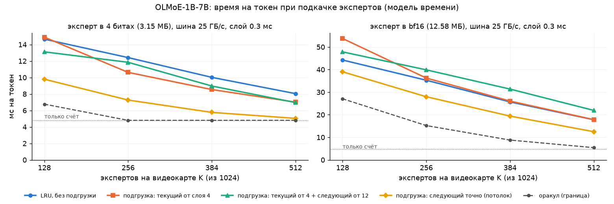

# Блок r26, дополнения: следующий токен, время ожидания, 12 кандидатов (OLMoE-1B-7B, без обучения)

## 6. Угадывание экспертов следующего токена по текущему

Доля настоящих 8 экспертов следующего токена среди угаданных 8 (в скобках — из 12 / из 16). a) карта из состояния текущего токена после слоя M + гейт слоя j; «как у текущего» — top-k маршрутизатора текущего токена на том же слое. R² карт — на отложенных окнах калибровки.

| слой j | a) от слоя 8 (R²) | a) от слоя 12 (R²) | a) от слоя 16 (R²) | как у текущего |
|---|---|---|---|---|
| 1 | 0.607 (0.71 / 0.78) [0.20] | 0.629 (0.74 / 0.80) [0.23] | 0.573 (0.68 / 0.75) [0.22] | 0.278 (0.35 / 0.40) |
| 2 | 0.535 (0.64 / 0.71) [0.19] | 0.564 (0.67 / 0.74) [0.21] | 0.536 (0.64 / 0.71) [0.20] | 0.273 (0.35 / 0.41) |
| 3 | 0.547 (0.65 / 0.73) [0.22] | 0.582 (0.69 / 0.76) [0.24] | 0.566 (0.67 / 0.75) [0.22] | 0.357 (0.44 / 0.50) |
| 4 | 0.590 (0.70 / 0.76) [0.23] | 0.623 (0.73 / 0.80) [0.26] | 0.600 (0.71 / 0.77) [0.22] | 0.366 (0.45 / 0.51) |
| 5 | 0.635 (0.75 / 0.81) [0.27] | 0.662 (0.77 / 0.84) [0.28] | 0.637 (0.75 / 0.81) [0.24] | 0.452 (0.55 / 0.61) |
| 6 | 0.650 (0.76 / 0.83) [0.28] | 0.679 (0.79 / 0.85) [0.29] | 0.655 (0.77 / 0.83) [0.24] | 0.479 (0.58 / 0.64) |
| 7 | 0.665 (0.78 / 0.84) [0.30] | 0.690 (0.80 / 0.86) [0.30] | 0.665 (0.78 / 0.84) [0.24] | 0.482 (0.58 / 0.64) |
| 8 | 0.650 (0.76 / 0.83) [0.32] | 0.675 (0.79 / 0.85) [0.30] | 0.646 (0.76 / 0.83) [0.24] | 0.466 (0.57 / 0.63) |
| 9 | 0.635 (0.74 / 0.81) [0.35] | 0.665 (0.77 / 0.83) [0.33] | 0.635 (0.74 / 0.80) [0.25] | 0.418 (0.51 / 0.57) |
| 10 | 0.596 (0.70 / 0.77) [0.32] | 0.638 (0.75 / 0.81) [0.33] | 0.612 (0.72 / 0.78) [0.26] | 0.396 (0.48 / 0.54) |
| 11 | 0.559 (0.67 / 0.73) [0.31] | 0.606 (0.71 / 0.78) [0.36] | 0.583 (0.69 / 0.75) [0.29] | 0.350 (0.44 / 0.50) |
| 12 | 0.576 (0.68 / 0.74) [0.29] | 0.621 (0.73 / 0.79) [0.38] | 0.600 (0.70 / 0.77) [0.30] | 0.407 (0.50 / 0.56) |
| 13 | 0.562 (0.68 / 0.75) [0.27] | 0.608 (0.73 / 0.79) [0.36] | 0.589 (0.71 / 0.78) [0.30] | 0.379 (0.47 / 0.54) |
| 14 | 0.540 (0.65 / 0.72) [0.25] | 0.589 (0.70 / 0.77) [0.33] | 0.572 (0.68 / 0.76) [0.30] | 0.379 (0.48 / 0.54) |
| 15 | 0.531 (0.64 / 0.72) [0.23] | 0.581 (0.70 / 0.77) [0.30] | 0.566 (0.68 / 0.75) [0.30] | 0.360 (0.46 / 0.52) |
| 16 | 0.518 (0.63 / 0.70) [0.23] | 0.567 (0.68 / 0.75) [0.30] | 0.555 (0.67 / 0.74) [0.32] | 0.366 (0.46 / 0.52) |

Среднее по 16 слоям (из 8): a) от слоя 8 0.587 (0.547 / 0.649 / 0.587); a) от слоя 12 0.624 (0.586 / 0.680 / 0.625); a) от слоя 16 0.599 (0.552 / 0.655 / 0.611); как у текущего 0.388 (0.378 / 0.467 / 0.346) — в скобках Википедия / код / сказки.

## Промахи кэша, если известно будущее (без подгрузки заранее)

Промахов на токен; Δ к LRU — парная разность ± 2 SE по отрезкам из 1024 токенов. Строки «текущий от N» и «точно текущий» — из прежней таблицы r26_sim; LRU здесь совпал с ней во всех отрезках.

| правило | K = 128 | K = 256 | K = 384 | K = 512 |
|---|---|---|---|---|
| LRU | 78.34 | 60.55 | 41.46 | 25.77 |
| LFU (счёт с загрузки) | — | 87.15 (+26.60 ± 2.73) | 58.41 (+16.95 ± 1.93) | 38.64 (+12.87 ± 1.71) |
| LFU (счёт за всю историю) | — | 59.80 (-0.74 ± 1.82) | 41.74 (+0.28 ± 2.05) | 27.33 (+1.57 ± 1.76) |
| LRU-2 | — | 59.41 (-1.14 ± 0.36) | 39.56 (-1.91 ± 0.41) | 24.11 (-1.66 ± 0.27) |
| ARC | — | 59.78 (-0.76 ± 0.19) | 40.72 (-0.74 ± 0.13) | 25.77 (-0.00 ± 0.00) |
| текущий токен от слоя 2 (лучшее из r26) | 78.34 (+0.00 ± 0.00) | 57.82 (-2.73 ± 0.14) | 39.62 (-1.84 ± 0.17) | 24.67 (-1.10 ± 0.13) |
| текущий токен точно | 78.34 (+0.00 ± 0.00) | 55.54 (-5.00 ± 0.22) | 38.33 (-3.13 ± 0.23) | 23.97 (-1.79 ± 0.18) |
| знание следующего токена (от слоя 8) | 83.07 (+4.73 ± 0.46) | 56.01 (-4.53 ± 0.20) | 38.92 (-2.54 ± 0.23) | 24.35 (-1.41 ± 0.17) |
| знание следующего токена (от слоя 12) | 82.74 (+4.40 ± 0.27) | 56.67 (-3.87 ± 0.17) | 39.28 (-2.19 ± 0.20) | 24.54 (-1.23 ± 0.15) |
| знание следующего токена (от слоя 16) | 78.34 (+0.00 ± 0.00) | 58.00 (-2.55 ± 0.10) | 39.97 (-1.50 ± 0.14) | 24.92 (-0.85 ± 0.11) |
| текущий от слоя 4 + следующий от слоя 12 | 80.45 (+2.11 ± 0.17) | 56.63 (-3.91 ± 0.17) | 38.97 (-2.49 ± 0.23) | 24.33 (-1.44 ± 0.17) |
| точно известны текущий и следующий токен | 66.00 (-12.34 ± 0.35) | 48.70 (-11.85 ± 0.54) | 34.07 (-7.39 ± 0.53) | 21.66 (-4.11 ± 0.38) |
| оракул (Belady) | 53.76 (-24.58 ± 0.42) | 30.20 (-30.34 ± 1.08) | 17.36 (-24.11 ± 1.24) | 9.46 (-16.31 ± 1.07) |

## 4. Время ожидания экспертов (шина 25 ГБ/с, слой 0.3 мс)

**Размер эксперта.** Эксперт OLMoE-1B-7B — 3 матрицы 2048 × 1024: 12.58 МБ в bf16 (так модель хранится) и 3.15 МБ, если веса квантовать до 4 бит (допущение: квантованную модель здесь никто не запускал, её качество не мерено). Считаю оба: подгрузка одного эксперта 0.126 мс (4 бита) и 0.503 мс (bf16).

Слой: половина времени — внимание и маршрутизатор, потом ждём своих 8 экспертов, потом вторая половина. Одна шина; подгрузка по требованию идёт раньше очереди заранее заказанных. Оракул: промахи Белади, подгрузка целиком перекрыта счётом (нижняя граница: время = max(счёт, подкачка)). «Вовремя» — заранее подгруженный эксперт пришёл до того, как понадобился; «опоздал» — ещё в пути или в очереди. Δ ожидания к LRU ± 2 SE по отрезкам.

**K = 128**

| правило | по требованию / токен | заранее зря / токен | подгрузок / токен | 4 бита: вовремя / опоздал | 4 бита: ожидание, мс (Δ к LRU) | 4 бита: токенов/с | bf16: вовремя / опоздал | bf16: ожидание, мс (Δ к LRU) | bf16: токенов/с |
|---|---|---|---|---|---|---|---|---|---|
| LRU, без подгрузки | 78.34 | 0.00 | 78.34 | 0.00 / 0.00 | 9.858 | 68 | 0.00 / 0.00 | 39.430 | 23 |
| подгрузка угаданных 8 от слоя 4 | 49.88 | 14.34 | 108.45 | 13.00 / 31.24 | 10.096 (+0.239 ± 0.109) | 67 | 0.02 / 44.22 | 48.967 (+9.537 ± 0.283) | 19 |
| подгрузка угаданных 8 от слоя 8 | 69.50 | 7.73 | 109.69 | 9.68 / 22.78 | 11.473 (+1.616 ± 0.118) | 61 | 0.02 / 32.44 | 51.954 (+12.524 ± 0.413) | 18 |
| подгрузка угаданных 8 от слоя 12 | 75.11 | 2.38 | 95.26 | 5.52 / 12.25 | 10.887 (+1.029 ± 0.108) | 64 | 0.01 / 17.76 | 46.560 (+7.130 ± 0.415) | 19 |
| подгрузка следующего токена (от слоя 12) | 51.27 | 29.24 | 106.71 | 23.38 / 12.84 | 8.734 (-1.124 ± 0.095) | 74 | 1.86 / 34.36 | 41.449 (+2.019 ± 0.255) | 22 |
| подгрузка следующего токена (от слоя 16) | 53.07 | 39.97 | 110.89 | 19.75 / 18.37 | 9.390 (-0.467 ± 0.176) | 70 | 0.02 / 38.10 | 43.744 (+4.314 ± 0.470) | 21 |
| подгрузка: текущий от 4 + следующий от 12 | 31.16 | 39.79 | 104.18 | 28.03 / 32.69 | 8.315 (-1.542 ± 0.120) | 76 | 1.61 / 59.11 | 43.036 (+3.606 ± 0.338) | 21 |
| подгрузка: следующий токен точно, от слоя 12 (потолок) | 9.37 | 0.42 | 77.50 | 34.96 / 33.18 | 4.992 (-4.866 ± 0.010) | 102 | 1.95 / 66.18 | 34.209 (-5.221 ± 0.013) | 26 |
| 12 кандидатов от слоя 2, 8 выбирает маршрутизатор | 41.36 | 33.96 | 127.07 | 1.11 / 50.63 | 12.344 (+2.487 ± 0.069) | 58 | 0.00 / 51.74 | 49.764 (+10.334 ± 0.270) | 18 |
| 12 кандидатов от слоя 4, 8 выбирает маршрутизатор | 41.39 | 33.70 | 126.14 | 1.12 / 49.93 | 12.243 (+2.385 ± 0.039) | 59 | 0.00 / 51.05 | 49.430 (+10.000 ± 0.152) | 18 |
| 12 кандидатов от слоя 8, 8 выбирает маршрутизатор | 64.00 | 26.28 | 130.08 | 1.10 / 38.70 | 13.491 (+3.633 ± 0.052) | 55 | 0.00 / 39.80 | 55.144 (+15.714 ± 0.228) | 17 |
| 12 кандидатов от слоя 12, 8 выбирает маршрутизатор | 95.97 | 13.11 | 129.14 | 1.05 / 19.01 | 14.723 (+4.866 ± 0.137) | 51 | 0.00 / 20.06 | 60.899 (+21.469 ± 0.551) | 15 |
| оракул (граница) | — | — | 53.76 | — | 1.964 (-7.893) | 148 | — | 22.258 (-17.172) | 37 |

**K = 256**

| правило | по требованию / токен | заранее зря / токен | подгрузок / токен | 4 бита: вовремя / опоздал | 4 бита: ожидание, мс (Δ к LRU) | 4 бита: токенов/с | bf16: вовремя / опоздал | bf16: ожидание, мс (Δ к LRU) | bf16: токенов/с |
|---|---|---|---|---|---|---|---|---|---|
| LRU, без подгрузки | 60.55 | 0.00 | 60.55 | 0.00 / 0.00 | 7.618 | 81 | 0.00 / 0.00 | 30.474 | 28 |
| лучшее из LFU / LRU-2 / ARC: LRU-2, без подгрузки | 59.41 | 0.00 | 59.41 | 0.00 / 0.00 | 7.475 (-0.143 ± 0.046) | 81 | 0.00 / 0.00 | 29.902 (-0.572 ± 0.182) | 29 |
| подгрузка угаданных 8 от слоя 4 | 28.41 | 8.29 | 70.60 | 15.58 / 18.32 | 5.824 (-1.795 ± 0.096) | 94 | 2.35 / 31.55 | 31.437 (+0.964 ± 0.256) | 28 |
| подгрузка угаданных 8 от слоя 8 | 36.54 | 4.27 | 65.61 | 10.69 / 14.11 | 6.274 (-1.345 ± 0.064) | 90 | 1.51 / 23.29 | 30.291 (-0.183 ± 0.120) | 28 |
| подгрузка угаданных 8 от слоя 12 | 47.61 | 1.29 | 62.10 | 5.47 / 7.73 | 6.888 (-0.731 ± 0.030) | 86 | 0.54 / 12.66 | 30.039 (-0.435 ± 0.039) | 29 |
| подгрузка следующего токена (от слоя 12) | 33.75 | 18.24 | 82.85 | 19.92 / 11.04 | 6.288 (-1.330 ± 0.090) | 90 | 3.25 / 27.71 | 33.710 (+3.236 ± 0.216) | 26 |
| подгрузка следующего токена (от слоя 16) | 37.16 | 21.95 | 88.43 | 14.46 / 15.15 | 7.132 (-0.487 ± 0.173) | 84 | 2.09 / 27.53 | 35.473 (+4.999 ± 0.316) | 25 |
| подгрузка: текущий от 4 + следующий от 12 | 18.27 | 27.05 | 92.83 | 16.73 / 32.07 | 7.048 (-0.570 ± 0.158) | 84 | 2.98 / 45.82 | 35.072 (+4.598 ± 0.195) | 25 |
| подгрузка: следующий токен точно, от слоя 12 (потолок) | 0.00 | 0.00 | 55.54 | 32.51 / 23.03 | 2.464 (-5.154 ± 0.078) | 138 | 0.83 / 54.71 | 23.177 (-7.297 ± 0.118) | 36 |
| 12 кандидатов от слоя 2, 8 выбирает маршрутизатор | 11.14 | 28.71 | 95.40 | 8.99 / 46.66 | 7.683 (+0.064 ± 0.083) | 80 | 2.86 / 52.79 | 35.214 (+4.740 ± 0.237) | 25 |
| 12 кандидатов от слоя 4, 8 выбирает маршрутизатор | 20.30 | 23.60 | 90.20 | 8.34 / 37.96 | 7.637 (+0.019 ± 0.050) | 80 | 1.91 / 44.39 | 35.647 (+5.173 ± 0.160) | 25 |
| 12 кандидатов от слоя 8, 8 выбирает маршрутизатор | 33.73 | 14.60 | 79.79 | 6.33 / 25.13 | 7.570 (-0.048 ± 0.038) | 81 | 2.02 / 29.45 | 34.832 (+4.358 ± 0.141) | 25 |
| 12 кандидатов от слоя 12, 8 выбирает маршрутизатор | 47.35 | 6.79 | 69.43 | 3.64 / 11.64 | 7.480 (-0.139 ± 0.021) | 81 | 2.05 / 13.23 | 32.096 (+1.623 ± 0.073) | 27 |
| оракул (граница) | — | — | 30.20 | — | 0.000 (-7.618) | 208 | — | 10.402 (-20.072) | 66 |

**K = 384**

| правило | по требованию / токен | заранее зря / токен | подгрузок / токен | 4 бита: вовремя / опоздал | 4 бита: ожидание, мс (Δ к LRU) | 4 бита: токенов/с | bf16: вовремя / опоздал | bf16: ожидание, мс (Δ к LRU) | bf16: токенов/с |
|---|---|---|---|---|---|---|---|---|---|
| LRU, без подгрузки | 41.46 | 0.00 | 41.46 | 0.00 / 0.00 | 5.217 | 100 | 0.00 / 0.00 | 20.870 | 39 |
| лучшее из LFU / LRU-2 / ARC: LRU-2, без подгрузки | 39.56 | 0.00 | 39.56 | 0.00 / 0.00 | 4.977 (-0.240 ± 0.051) | 102 | 0.00 / 0.00 | 19.909 (-0.960 ± 0.205) | 40 |
| подгрузка угаданных 8 от слоя 4 | 20.16 | 5.39 | 49.44 | 14.29 / 9.61 | 3.738 (-1.479 ± 0.107) | 117 | 2.83 / 21.07 | 21.256 (+0.386 ± 0.211) | 38 |
| подгрузка угаданных 8 от слоя 8 | 26.00 | 2.63 | 45.56 | 9.38 / 7.54 | 4.168 (-1.049 ± 0.069) | 112 | 1.72 / 15.21 | 20.594 (-0.275 ± 0.098) | 39 |
| подгрузка угаданных 8 от слоя 12 | 33.38 | 0.78 | 42.78 | 4.55 / 4.08 | 4.670 (-0.548 ± 0.032) | 106 | 0.60 / 8.03 | 20.504 (-0.366 ± 0.031) | 40 |
| подгрузка следующего токена (от слоя 12) | 24.31 | 10.72 | 58.05 | 19.29 / 3.73 | 4.075 (-1.142 ± 0.092) | 113 | 4.21 / 18.80 | 24.200 (+3.330 ± 0.416) | 34 |
| подгрузка следующего токена (от слоя 16) | 26.79 | 13.19 | 62.17 | 15.33 / 6.85 | 4.656 (-0.561 ± 0.144) | 106 | 3.29 / 18.90 | 25.606 (+4.737 ± 0.549) | 33 |
| подгрузка: текущий от 4 + следующий от 12 | 13.00 | 16.37 | 66.23 | 20.97 / 15.89 | 4.167 (-1.051 ± 0.120) | 112 | 2.70 / 34.16 | 26.564 (+5.695 ± 0.362) | 32 |
| подгрузка: следующий токен точно, от слоя 12 (потолок) | 0.00 | 0.00 | 38.33 | 29.00 / 9.33 | 0.967 (-4.251 ± 0.150) | 173 | 2.00 / 36.33 | 14.602 (-6.267 ± 0.141) | 52 |
| 12 кандидатов от слоя 2, 8 выбирает маршрутизатор | 8.36 | 19.24 | 70.08 | 12.75 / 29.72 | 4.841 (-0.377 ± 0.095) | 104 | 1.91 / 40.56 | 27.617 (+6.748 ± 0.291) | 31 |
| 12 кандидатов от слоя 4, 8 выбирает маршрутизатор | 15.00 | 15.69 | 65.37 | 11.20 / 23.48 | 4.860 (-0.357 ± 0.055) | 104 | 1.93 / 32.75 | 26.991 (+6.122 ± 0.211) | 31 |
| 12 кандидатов от слоя 8, 8 выбирает маршрутизатор | 24.38 | 9.37 | 56.47 | 7.71 / 15.01 | 4.951 (-0.266 ± 0.026) | 103 | 3.72 / 19.00 | 24.213 (+3.344 ± 0.154) | 34 |
| 12 кандидатов от слоя 12, 8 выбирает маршрутизатор | 34.22 | 4.15 | 48.76 | 3.92 / 6.46 | 5.105 (-0.112 ± 0.012) | 101 | 2.00 / 8.39 | 22.422 (+1.553 ± 0.085) | 37 |
| оракул (граница) | — | — | 17.36 | — | 0.000 (-5.217) | 208 | — | 3.976 (-16.894) | 114 |

**K = 512**

| правило | по требованию / токен | заранее зря / токен | подгрузок / токен | 4 бита: вовремя / опоздал | 4 бита: ожидание, мс (Δ к LRU) | 4 бита: токенов/с | bf16: вовремя / опоздал | bf16: ожидание, мс (Δ к LRU) | bf16: токенов/с |
|---|---|---|---|---|---|---|---|---|---|
| LRU, без подгрузки | 25.77 | 0.00 | 25.77 | 0.00 / 0.00 | 3.242 | 124 | 0.00 / 0.00 | 12.969 | 56 |
| лучшее из LFU / LRU-2 / ARC: LRU-2, без подгрузки | 24.11 | 0.00 | 24.11 | 0.00 / 0.00 | 3.033 (-0.209 ± 0.034) | 128 | 0.00 / 0.00 | 12.134 (-0.835 ± 0.137) | 59 |
| подгрузка угаданных 8 от слоя 4 | 13.29 | 3.34 | 31.96 | 11.20 / 4.13 | 2.210 (-1.032 ± 0.094) | 143 | 2.88 / 12.45 | 13.023 (+0.054 ± 0.145) | 56 |
| подгрузка угаданных 8 от слоя 8 | 16.81 | 1.55 | 28.82 | 7.04 / 3.42 | 2.522 (-0.721 ± 0.061) | 137 | 1.67 / 8.79 | 12.610 (-0.359 ± 0.069) | 57 |
| подгрузка угаданных 8 от слоя 12 | 21.05 | 0.45 | 26.73 | 3.32 / 1.91 | 2.867 (-0.375 ± 0.028) | 130 | 0.57 / 4.66 | 12.639 (-0.330 ± 0.025) | 57 |
| подгрузка следующего токена (от слоя 12) | 16.05 | 6.03 | 37.37 | 14.14 / 1.16 | 2.509 (-0.733 ± 0.070) | 137 | 5.65 / 9.66 | 14.706 (+1.737 ± 0.304) | 51 |
| подгрузка следующего токена (от слоя 16) | 17.73 | 7.60 | 40.24 | 12.49 / 2.42 | 2.832 (-0.410 ± 0.088) | 131 | 4.38 / 10.53 | 16.097 (+3.128 ± 0.502) | 48 |
| подгрузка: текущий от 4 + следующий от 12 | 8.70 | 9.58 | 43.48 | 19.34 / 5.86 | 2.159 (-1.084 ± 0.085) | 144 | 4.33 / 20.87 | 17.117 (+4.148 ± 0.467) | 46 |
| подгрузка: следующий токен точно, от слоя 12 (потолок) | 0.00 | 0.00 | 23.97 | 21.60 / 2.38 | 0.239 (-3.003 ± 0.178) | 198 | 3.53 / 20.44 | 7.689 (-5.280 ± 0.173) | 80 |
| 12 кандидатов от слоя 2, 8 выбирает маршрутизатор | 5.96 | 12.40 | 48.31 | 14.06 / 15.89 | 2.663 (-0.579 ± 0.055) | 134 | 2.81 / 27.14 | 19.239 (+6.270 ± 0.436) | 42 |
| 12 кандидатов от слоя 4, 8 выбирает маршрутизатор | 10.58 | 10.08 | 44.53 | 11.78 / 12.08 | 2.779 (-0.463 ± 0.034) | 132 | 3.76 / 20.11 | 17.816 (+4.847 ± 0.301) | 44 |
| 12 кандидатов от слоя 8, 8 выбирает маршрутизатор | 16.54 | 5.70 | 37.05 | 7.47 / 7.33 | 2.952 (-0.290 ± 0.022) | 129 | 3.44 / 11.37 | 15.370 (+2.401 ± 0.165) | 50 |
| 12 кандидатов от слоя 12, 8 выбирает маршрутизатор | 22.08 | 2.43 | 30.99 | 3.44 / 3.04 | 3.134 (-0.109 ± 0.012) | 126 | 1.64 / 4.84 | 14.031 (+1.062 ± 0.089) | 53 |
| оракул (граница) | — | — | 9.46 | — | 0.000 (-3.242) | 208 | — | 0.617 (-12.352) | 185 |

**Другие параметры** (ожидание, мс / токен: LRU / лучшая подгрузка заранее / оракул-граница):

| эксперт, шина, слой | K = 128 | K = 256 | K = 384 | K = 512 |
|---|---|---|---|---|
| 4 бита, 25 ГБ/с, 0.3 мс | 9.86 / 8.32 (pf_cur4_next12) / 1.96 | 7.62 / 5.82 (pf_cur4) / 0.00 | 5.22 / 3.74 (pf_cur4) / 0.00 | 3.24 / 2.16 (pf_cur4_next12) / 0.00 |
| 4 бита, 25 ГБ/с, 0.1 мс | 9.86 / 9.96 (pf_next12) / 5.16 | 7.62 / 7.35 (pf_cur8) / 2.20 | 5.22 / 4.97 (pf_cur8) / 0.64 | 3.24 / 3.03 (pf_cur8) / 0.00 |
| 4 бита, 25 ГБ/с, 1.0 мс | 9.86 / 4.05 (pf_cur4_next12) / 0.00 | 7.62 / 2.58 (pf_cur4_next12) / 0.00 | 5.22 / 1.75 (pf_cur4_next12) / 0.00 | 3.24 / 1.14 (pf_cur4_next12) / 0.00 |
| 4 бита, 12.5 ГБ/с, 0.3 мс | 19.72 / 20.04 (pf_next12) / 8.73 | 15.24 / 14.24 (pf_cur8) / 2.82 | 10.43 / 9.40 (pf_cur4) / 0.21 | 6.48 / 5.60 (pf_cur4) / 0.00 |
| 4 бита, 50 ГБ/с, 0.3 мс | 4.93 / 2.70 (pf_cur4_next12) / 0.00 | 3.81 / 1.97 (pf_cur4_next12) / 0.00 | 2.61 / 1.14 (pf_cur4_next12) / 0.00 | 1.62 / 0.67 (pf_cur4_next12) / 0.00 |
| bf16, 25 ГБ/с, 0.3 мс | 39.43 / 41.45 (pf_next12) / 22.26 | 30.47 / 30.04 (pf_cur12) / 10.40 | 20.87 / 20.50 (pf_cur12) / 3.98 | 12.97 / 12.61 (pf_cur8) / 0.62 |
| bf16, 25 ГБ/с, 0.1 мс | 39.43 / 44.64 (pf_next12) / 25.46 | 30.47 / 30.84 (pf_cur12) / 13.60 | 20.87 / 21.17 (pf_cur12) / 7.14 | 12.97 / 13.15 (pf_cur12) / 3.17 |
| bf16, 25 ГБ/с, 1.0 мс | 39.43 / 33.73 (pf_next12) / 11.06 | 30.47 / 24.45 (pf_cur4) / 0.83 | 20.87 / 15.65 (pf_cur4) / 0.00 | 12.97 / 9.16 (pf_cur4) / 0.00 |
| bf16, 12.5 ГБ/с, 0.3 мс | 78.86 / 87.69 (pf_next12) / 49.32 | 60.95 / 61.28 (pf_cur12) / 25.60 | 41.74 / 41.99 (pf_cur12) / 12.67 | 25.94 / 26.01 (pf_cur12) / 4.81 |
| bf16, 50 ГБ/с, 0.3 мс | 19.72 / 20.04 (pf_next12) / 8.73 | 15.24 / 14.24 (pf_cur8) / 2.82 | 10.43 / 9.40 (pf_cur4) / 0.21 | 6.48 / 5.60 (pf_cur4) / 0.00 |

## 1′. 12 угаданных кандидатов, 8 выбирает настоящий маршрутизатор

Слои выше N: кандидаты — 12 экспертов по a) (карта + гейт); маршрутизатор берёт свои лучшие 8 среди них, веса — его вероятности. Разности ± 2 SE по окнам val. «Без кэша» — экспертов на токен, если каждый раз грузить всех нужных.

| от слоя N | val CE | Δ к плотной | Википедия Δ | код Δ | сказки Δ | Δ к 8 угаданным | свои top-8 маршрутизатора среди 12 (слои N+1 … 16) | экспертов / токен без кэша (МБ: 4 бита / bf16) |
|---|---|---|---|---|---|---|---|---|
| 2 | 1.6880 | +0.0302 ± 0.0013 | +0.0617 ± 0.0025 | +0.0179 ± 0.0013 | +0.0065 ± 0.0003 | -0.0330 ± 0.0011 | 0.844–0.958 | 184 (579 / 2315) |
| 4 | 1.6732 | +0.0154 ± 0.0007 | +0.0315 ± 0.0015 | +0.0102 ± 0.0008 | +0.0026 ± 0.0002 | -0.0212 ± 0.0008 | 0.871–0.980 | 176 (554 / 2215) |
| 8 | 1.6641 | +0.0063 ± 0.0003 | +0.0126 ± 0.0006 | +0.0029 ± 0.0003 | +0.0021 ± 0.0002 | -0.0115 ± 0.0004 | 0.899–0.998 | 160 (503 / 2013) |
| 12 | 1.6587 | +0.0009 ± 0.0001 | +0.0013 ± 0.0001 | +0.0002 ± 0.0001 | +0.0008 ± 0.0001 | -0.0017 ± 0.0001 | 0.961–1.000 | 144 (453 / 1812) |

Плотная модель без кэша: 128 экспертов на токен (403 МБ в 4 битах, 1611 МБ в bf16). С кэшем — строки «12 кандидатов» в таблицах времени выше.

