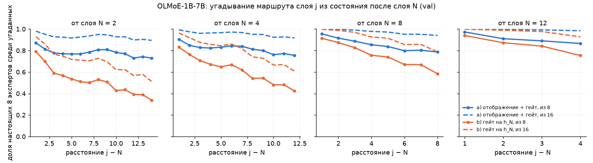

# Блок r26: маршрут наперёд и кэш экспертов на OLMoE-1B-7B (без обучения)

val 4020896 токенов OLMoE (Википедия 1517623, код 995868, сказки 1507405); калибровка отображений 2001825 токенов train. Проверка прохода против transformers: top-1 0.9844, CE 1.4685 против 1.4721. Плотный val CE 1.6578.

## 1. Доля настоящих 8 экспертов среди угаданных 8 / 12 / 16 (весь val)

**От слоя N = 2** (R² гребневого отображения на отложенных окнах — в скобках)

| слой j | j − N | a) из 8 | a) из 12 | a) из 16 | b) из 8 | b) из 12 | b) из 16 | a) из 8: Википедия / код / сказки |
|---|---|---|---|---|---|---|---|---|
| 3 (0.86) | 1 | 0.871 | 0.958 | 0.980 | 0.790 | 0.887 | 0.928 | 0.866 / 0.869 / 0.877 |
| 4 (0.63) | 2 | 0.814 | 0.914 | 0.952 | 0.699 | 0.802 | 0.860 | 0.803 / 0.804 / 0.831 |
| 5 (0.49) | 3 | 0.778 | 0.881 | 0.928 | 0.591 | 0.696 | 0.766 | 0.763 / 0.774 / 0.796 |
| 6 (0.40) | 4 | 0.771 | 0.877 | 0.924 | 0.567 | 0.675 | 0.748 | 0.737 / 0.787 / 0.795 |
| 7 (0.35) | 5 | 0.768 | 0.872 | 0.917 | 0.536 | 0.645 | 0.718 | 0.741 / 0.762 / 0.798 |
| 8 (0.33) | 6 | 0.769 | 0.877 | 0.925 | 0.510 | 0.627 | 0.711 | 0.738 / 0.787 / 0.789 |
| 9 (0.33) | 7 | 0.786 | 0.892 | 0.936 | 0.501 | 0.616 | 0.705 | 0.759 / 0.767 / 0.825 |
| 10 (0.33) | 8 | 0.808 | 0.911 | 0.950 | 0.530 | 0.644 | 0.728 | 0.786 / 0.772 / 0.853 |
| 11 (0.34) | 9 | 0.809 | 0.909 | 0.946 | 0.507 | 0.613 | 0.696 | 0.791 / 0.763 / 0.857 |
| 12 (0.34) | 10 | 0.783 | 0.884 | 0.928 | 0.428 | 0.536 | 0.622 | 0.746 / 0.758 / 0.837 |
| 13 (0.33) | 11 | 0.770 | 0.880 | 0.928 | 0.436 | 0.540 | 0.622 | 0.738 / 0.718 / 0.836 |
| 14 (0.31) | 12 | 0.730 | 0.844 | 0.899 | 0.392 | 0.489 | 0.566 | 0.683 / 0.702 / 0.795 |
| 15 (0.29) | 13 | 0.743 | 0.853 | 0.904 | 0.389 | 0.494 | 0.579 | 0.710 / 0.687 / 0.814 |
| 16 (0.28) | 14 | 0.729 | 0.842 | 0.895 | 0.338 | 0.433 | 0.513 | 0.694 / 0.719 / 0.771 |

**От слоя N = 4** (R² гребневого отображения на отложенных окнах — в скобках)

| слой j | j − N | a) из 8 | a) из 12 | a) из 16 | b) из 8 | b) из 12 | b) из 16 | a) из 8: Википедия / код / сказки |
|---|---|---|---|---|---|---|---|---|
| 5 (0.89) | 1 | 0.905 | 0.980 | 0.993 | 0.832 | 0.929 | 0.962 | 0.906 / 0.898 / 0.909 |
| 6 (0.65) | 2 | 0.848 | 0.946 | 0.975 | 0.763 | 0.871 | 0.920 | 0.835 / 0.854 / 0.858 |
| 7 (0.53) | 3 | 0.828 | 0.927 | 0.960 | 0.708 | 0.818 | 0.876 | 0.817 / 0.818 / 0.846 |
| 8 (0.47) | 4 | 0.824 | 0.928 | 0.963 | 0.672 | 0.790 | 0.858 | 0.808 / 0.835 / 0.832 |
| 9 (0.44) | 5 | 0.831 | 0.933 | 0.967 | 0.649 | 0.772 | 0.845 | 0.816 / 0.815 / 0.857 |
| 10 (0.42) | 6 | 0.844 | 0.942 | 0.972 | 0.669 | 0.793 | 0.860 | 0.831 / 0.813 / 0.877 |
| 11 (0.42) | 7 | 0.839 | 0.936 | 0.967 | 0.620 | 0.743 | 0.818 | 0.829 / 0.796 / 0.878 |
| 12 (0.40) | 8 | 0.813 | 0.913 | 0.951 | 0.542 | 0.661 | 0.742 | 0.784 / 0.789 / 0.857 |
| 13 (0.38) | 9 | 0.799 | 0.908 | 0.949 | 0.544 | 0.653 | 0.728 | 0.777 / 0.750 / 0.854 |
| 14 (0.35) | 10 | 0.761 | 0.873 | 0.924 | 0.481 | 0.586 | 0.665 | 0.727 / 0.733 / 0.815 |
| 15 (0.33) | 11 | 0.772 | 0.881 | 0.927 | 0.482 | 0.593 | 0.669 | 0.747 / 0.719 / 0.831 |
| 16 (0.32) | 12 | 0.755 | 0.868 | 0.917 | 0.423 | 0.528 | 0.607 | 0.729 / 0.749 / 0.785 |

**От слоя N = 8** (R² гребневого отображения на отложенных окнах — в скобках)

| слой j | j − N | a) из 8 | a) из 12 | a) из 16 | b) из 8 | b) из 12 | b) из 16 | a) из 8: Википедия / код / сказки |
|---|---|---|---|---|---|---|---|---|
| 9 (0.92) | 1 | 0.955 | 0.998 | 1.000 | 0.914 | 0.988 | 0.997 | 0.955 / 0.947 / 0.959 |
| 10 (0.75) | 2 | 0.916 | 0.988 | 0.997 | 0.875 | 0.967 | 0.988 | 0.912 / 0.896 / 0.931 |
| 11 (0.63) | 3 | 0.887 | 0.972 | 0.990 | 0.826 | 0.933 | 0.969 | 0.884 / 0.854 / 0.912 |
| 12 (0.55) | 4 | 0.854 | 0.950 | 0.978 | 0.756 | 0.875 | 0.927 | 0.838 / 0.834 / 0.884 |
| 13 (0.48) | 5 | 0.838 | 0.940 | 0.972 | 0.740 | 0.859 | 0.915 | 0.825 / 0.797 / 0.877 |
| 14 (0.42) | 6 | 0.799 | 0.909 | 0.952 | 0.670 | 0.788 | 0.856 | 0.779 / 0.773 / 0.835 |
| 15 (0.39) | 7 | 0.804 | 0.911 | 0.951 | 0.668 | 0.791 | 0.858 | 0.790 / 0.758 / 0.847 |
| 16 (0.37) | 8 | 0.786 | 0.896 | 0.941 | 0.584 | 0.711 | 0.787 | 0.774 / 0.783 / 0.801 |

**От слоя N = 12** (R² гребневого отображения на отложенных окнах — в скобках)

| слой j | j − N | a) из 8 | a) из 12 | a) из 16 | b) из 8 | b) из 12 | b) из 16 | a) из 8: Википедия / код / сказки |
|---|---|---|---|---|---|---|---|---|
| 13 (0.94) | 1 | 0.973 | 1.000 | 1.000 | 0.940 | 0.994 | 0.999 | 0.974 / 0.960 / 0.980 |
| 14 (0.77) | 2 | 0.910 | 0.986 | 0.997 | 0.873 | 0.967 | 0.989 | 0.906 / 0.890 / 0.927 |
| 15 (0.65) | 3 | 0.890 | 0.975 | 0.992 | 0.841 | 0.947 | 0.977 | 0.888 / 0.857 / 0.915 |
| 16 (0.57) | 4 | 0.866 | 0.960 | 0.984 | 0.754 | 0.875 | 0.928 | 0.865 / 0.855 / 0.875 |

## 1′. Предсказание блоками по K слоёв (точки решения после слоёв 0, K, 2K, …)

Средняя по всем 16 слоям доля настоящих 8 среди угаданных (каждый слой — из своей точки решения):

| K | a) из 8 | a) из 12 | a) из 16 | b) из 8 | b) из 12 | b) из 16 | a) из 8 по слоям 1..16 |
|---|---|---|---|---|---|---|---|
| 2 | 0.859 | 0.928 | 0.947 | 0.780 | 0.867 | 0.898 | 0.42 0.55 0.87 0.81 0.91 0.85 0.93 0.88 0.95 0.92 0.96 0.90 0.97 0.91 0.98 0.93 |
| 4 | 0.803 | 0.887 | 0.917 | 0.698 | 0.792 | 0.835 | 0.42 0.55 0.61 0.62 0.91 0.85 0.83 0.82 0.95 0.92 0.89 0.85 0.97 0.91 0.89 0.87 |
| 8 | 0.715 | 0.811 | 0.857 | 0.550 | 0.644 | 0.702 | 0.42 0.55 0.61 0.62 0.59 0.59 0.61 0.61 0.95 0.92 0.89 0.85 0.84 0.80 0.80 0.79 |

## 2. Кэш экспертов при генерации по одному токену

Все 1024 эксперта (16 слоёв × 64) в обычной памяти, на видеокарте K. Эксперт — 3 матрицы 2048 × 1024: 12.58 МБ в bf16 (как модель хранится) и 3.15 МБ, если квантовать до 4 бит (допущение, квантованную модель здесь не запускали); шина 25 ГБ/с (оценка учитывает только подкачку экспертов). По 30720 токенов подряд из каждого источника, первые 1024 — прогрев. Δ к LRU — парная разность промахов на токен ± 2 SE по отрезкам из 1024 токенов (кэш между отрезками не сбрасывается, так что SE приблизительная).

| K | правило | промахов на токен | Δ к LRU ± 2 SE | Википедия / код / сказки | МБ на токен (4 бита / bf16) | токенов/с (4 бита / bf16) |
|---|---|---|---|---|---|---|
| 128 (1/8) | LRU | 78.34 | — | 83.50 / 67.98 / 83.54 | 246.4 / 985.8 | 101.4 / 25.4 |
| 128 (1/8) | по предсказанию a), N = 2 | 78.34 | +0.00 ± 0.00 | 83.50 / 67.98 / 83.54 | 246.4 / 985.8 | 101.4 / 25.4 |
| 128 (1/8) | по предсказанию a), N = 4 | 78.34 | +0.00 ± 0.00 | 83.50 / 67.98 / 83.54 | 246.4 / 985.8 | 101.4 / 25.4 |
| 128 (1/8) | по предсказанию a), N = 8 | 78.34 | +0.00 ± 0.00 | 83.50 / 67.98 / 83.54 | 246.4 / 985.8 | 101.4 / 25.4 |
| 128 (1/8) | по предсказанию a), N = 12 | 78.34 | +0.00 ± 0.00 | 83.50 / 67.98 / 83.54 | 246.4 / 985.8 | 101.4 / 25.4 |
| 128 (1/8) | по предсказанию блоками, K = 2 | 78.34 | +0.00 ± 0.00 | 83.50 / 67.98 / 83.54 | 246.4 / 985.8 | 101.4 / 25.4 |
| 128 (1/8) | по предсказанию блоками, K = 4 | 78.34 | +0.00 ± 0.00 | 83.50 / 67.98 / 83.54 | 246.4 / 985.8 | 101.4 / 25.4 |
| 128 (1/8) | по предсказанию блоками, K = 8 | 78.34 | +0.00 ± 0.00 | 83.50 / 67.98 / 83.54 | 246.4 / 985.8 | 101.4 / 25.4 |
| 128 (1/8) | точно известны все слои текущего токена (потолок правил a) и блоками) | 78.34 | +0.00 ± 0.00 | 83.50 / 67.98 / 83.54 | 246.4 / 985.8 | 101.4 / 25.4 |
| 128 (1/8) | оракул (Belady) | 53.76 | -24.58 ± 0.42 | 57.88 / 44.78 / 58.62 | 169.1 / 676.4 | 147.8 / 37.0 |
| 256 (1/4) | LRU | 60.55 | — | 67.25 / 45.79 / 68.61 | 190.5 / 761.8 | 131.3 / 32.8 |
| 256 (1/4) | по предсказанию a), N = 2 | 57.82 | -2.73 ± 0.14 | 64.05 / 43.85 / 65.55 | 181.9 / 727.5 | 137.5 / 34.4 |
| 256 (1/4) | по предсказанию a), N = 4 | 58.57 | -1.98 ± 0.10 | 64.95 / 44.33 / 66.41 | 184.2 / 736.9 | 135.7 / 33.9 |
| 256 (1/4) | по предсказанию a), N = 8 | 59.62 | -0.93 ± 0.04 | 66.25 / 45.03 / 67.58 | 187.5 / 750.2 | 133.3 / 33.3 |
| 256 (1/4) | по предсказанию a), N = 12 | 60.35 | -0.20 ± 0.01 | 67.09 / 45.55 / 68.40 | 189.8 / 759.4 | 131.7 / 32.9 |
| 256 (1/4) | по предсказанию блоками, K = 2 | 60.35 | -0.19 ± 0.01 | 67.09 / 45.52 / 68.45 | 189.9 / 759.4 | 131.7 / 32.9 |
| 256 (1/4) | по предсказанию блоками, K = 4 | 59.94 | -0.61 ± 0.03 | 66.72 / 45.04 / 68.06 | 188.6 / 754.2 | 132.6 / 33.1 |
| 256 (1/4) | по предсказанию блоками, K = 8 | 59.06 | -1.49 ± 0.05 | 65.72 / 44.36 / 67.09 | 185.8 / 743.1 | 134.6 / 33.6 |
| 256 (1/4) | точно известны все слои текущего токена (потолок правил a) и блоками) | 55.54 | -5.00 ± 0.22 | 61.20 / 41.93 / 63.49 | 174.7 / 698.9 | 143.1 / 35.8 |
| 256 (1/4) | оракул (Belady) | 30.20 | -30.34 ± 1.08 | 33.54 / 22.26 / 34.81 | 95.0 / 380.0 | 263.1 / 65.8 |
| 384 (3/8) | LRU | 41.46 | — | 45.98 / 28.31 / 50.10 | 130.4 / 521.7 | 191.7 / 47.9 |
| 384 (3/8) | по предсказанию a), N = 2 | 39.62 | -1.84 ± 0.17 | 44.01 / 27.48 / 47.38 | 124.6 / 498.6 | 200.6 / 50.1 |
| 384 (3/8) | по предсказанию a), N = 4 | 40.07 | -1.40 ± 0.14 | 44.48 / 27.71 / 48.01 | 126.0 / 504.1 | 198.4 / 49.6 |
| 384 (3/8) | по предсказанию a), N = 8 | 40.75 | -0.71 ± 0.08 | 45.22 / 28.04 / 49.00 | 128.2 / 512.8 | 195.0 / 48.8 |
| 384 (3/8) | по предсказанию a), N = 12 | 41.30 | -0.17 ± 0.02 | 45.80 / 28.25 / 49.84 | 129.9 / 519.6 | 192.4 / 48.1 |
| 384 (3/8) | по предсказанию блоками, K = 2 | 41.26 | -0.21 ± 0.02 | 45.74 / 28.21 / 49.81 | 129.8 / 519.1 | 192.6 / 48.2 |
| 384 (3/8) | по предсказанию блоками, K = 4 | 40.88 | -0.59 ± 0.05 | 45.33 / 28.02 / 49.28 | 128.6 / 514.3 | 194.4 / 48.6 |
| 384 (3/8) | по предсказанию блоками, K = 8 | 40.29 | -1.18 ± 0.11 | 44.74 / 27.75 / 48.37 | 126.7 / 506.9 | 197.3 / 49.3 |
| 384 (3/8) | точно известны все слои текущего токена (потолок правил a) и блоками) | 38.33 | -3.13 ± 0.23 | 42.53 / 26.54 / 45.92 | 120.6 / 482.3 | 207.3 / 51.8 |
| 384 (3/8) | оракул (Belady) | 17.36 | -24.11 ± 1.24 | 19.94 / 11.68 / 20.45 | 54.6 / 218.4 | 457.9 / 114.5 |
| 512 (1/2) | LRU | 25.77 | — | 29.94 / 15.60 / 31.76 | 81.1 / 324.2 | 308.4 / 77.1 |
| 512 (1/2) | по предсказанию a), N = 2 | 24.67 | -1.10 ± 0.13 | 28.76 / 15.24 / 30.00 | 77.6 / 310.4 | 322.2 / 80.5 |
| 512 (1/2) | по предсказанию a), N = 4 | 24.93 | -0.84 ± 0.10 | 29.05 / 15.33 / 30.41 | 78.4 / 313.7 | 318.8 / 79.7 |
| 512 (1/2) | по предсказанию a), N = 8 | 25.35 | -0.42 ± 0.05 | 29.51 / 15.47 / 31.06 | 79.7 / 318.9 | 313.6 / 78.4 |
| 512 (1/2) | по предсказанию a), N = 12 | 25.67 | -0.09 ± 0.01 | 29.85 / 15.57 / 31.61 | 80.8 / 323.0 | 309.6 / 77.4 |
| 512 (1/2) | по предсказанию блоками, K = 2 | 25.64 | -0.13 ± 0.01 | 29.80 / 15.55 / 31.57 | 80.7 / 322.6 | 310.0 / 77.5 |
| 512 (1/2) | по предсказанию блоками, K = 4 | 25.42 | -0.35 ± 0.04 | 29.56 / 15.47 / 31.23 | 80.0 / 319.8 | 312.7 / 78.2 |
| 512 (1/2) | по предсказанию блоками, K = 8 | 25.07 | -0.69 ± 0.08 | 29.22 / 15.36 / 30.65 | 78.9 / 315.5 | 317.0 / 79.2 |
| 512 (1/2) | точно известны все слои текущего токена (потолок правил a) и блоками) | 23.97 | -1.79 ± 0.18 | 27.97 / 14.83 / 29.12 | 75.4 / 301.6 | 331.5 / 82.9 |
| 512 (1/2) | оракул (Belady) | 9.46 | -16.31 ± 1.07 | 11.36 / 5.68 / 11.33 | 29.8 / 119.0 | 840.1 / 210.0 |

## 3. Цена по качеству: эксперты слоёв выше N по предсказанию a)

Веса выбранных экспертов — вероятности настоящего маршрутизатора слоя. Разности ± 2 SE по окнам val.

| маршрут по предсказанию | val CE | Δ к плотной | Википедия Δ | код Δ | сказки Δ |
|---|---|---|---|---|---|
| — (плотная) | 1.6578 | — | — | — | — |
| слои выше 2 | 1.7210 | +0.0632 ± 0.0023 | +0.1246 ± 0.0039 | +0.0408 ± 0.0028 | +0.0161 ± 0.0005 |
| слои выше 4 | 1.6944 | +0.0366 ± 0.0015 | +0.0726 ± 0.0028 | +0.0245 ± 0.0019 | +0.0082 ± 0.0004 |
| слои выше 8 | 1.6756 | +0.0178 ± 0.0007 | +0.0353 ± 0.0013 | +0.0098 ± 0.0006 | +0.0054 ± 0.0003 |
| слои выше 12 | 1.6604 | +0.0026 ± 0.0001 | +0.0048 ± 0.0002 | +0.0017 ± 0.0002 | +0.0010 ± 0.0001 |
| блоками по 2, все 16 слоёв | 1.7846 | +0.1268 ± 0.0033 | +0.2060 ± 0.0053 | +0.1257 ± 0.0055 | +0.0478 ± 0.0011 |
| блоками по 4, все 16 слоёв | 1.8335 | +0.1757 ± 0.0043 | +0.2831 ± 0.0064 | +0.1800 ± 0.0070 | +0.0646 ± 0.0012 |
| блоками по 8, все 16 слоёв | 1.9190 | +0.2612 ± 0.0059 | +0.4276 ± 0.0079 | +0.2558 ± 0.0086 | +0.0971 ± 0.0015 |
