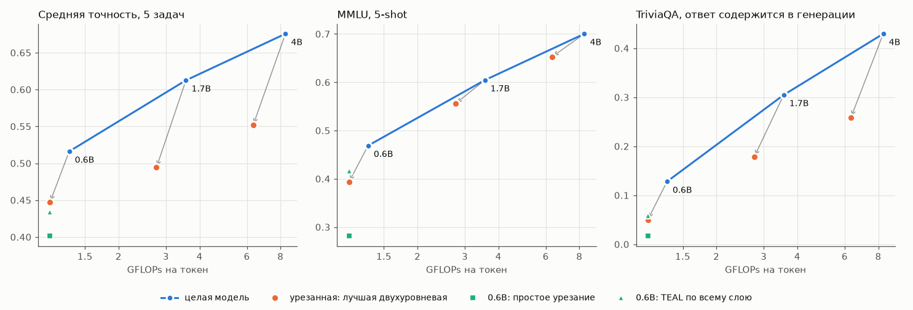

# Раунд 27: проверка на задачах (Qwen3, верхняя половина при 1/4, без обучения)

Задачи — lm-evaluation-harness 0.4.13, одни и те же случайные вопросы для всех моделей: ARC-e, ARC-c, HellaSwag, PIQA, WinoGrande, TriviaQA — zero-shot, по 1000 (ARC-c и WinoGrande — все, что есть в подвыборке); MMLU — 5-shot, 2000 вопросов. Мера: acc_norm (ARC, HellaSwag, PIQA), acc (WinoGrande, MMLU), exact match (TriviaQA, не больше 32 новых токенов); TriviaQA «содержит» — один из правильных ответов целиком встречается в генерации (без учёта регистра и пунктуации): чат-модели отвечают фразой, и точное совпадение почти нулевое. Средняя точность — среднее пяти задач без MMLU и TriviaQA; «знания» — среднее MMLU и TriviaQA «содержит». CE, KL(целая ‖ урезанная) и совпадение топ-1 — 480 окон нашего val; перплексия WikiText-2 (test) — окна по 2048 токенов. GFLOPs на токен — как в 17.25 (r25_flops). ± 2 SE — бутстрэп по вопросам (по окнам для CE), парный.

## Итог

| модель | вариант | GFLOPs | CE (val) | WikiText-2 ppl | KL | топ-1 | средняя точность (5) | MMLU | TriviaQA: точное / содержит |
|---|---|---|---|---|---|---|---|---|---|
| 0.6B | целая | 1.31 | 2.3948 | 20.96 | — | — | 0.5161 | 0.4687 | 0.022 / 0.128 |
| 0.6B | лучшая двухуровневая (TEAL в пуле + поправка) | 1.11 | 2.6161 | 29.63 | 0.2512 | 0.788 | 0.4472 | 0.3929 | 0.007 / 0.050 |
| 0.6B | простое урезание | 1.11 | 3.4477 | 70.64 | 1.1994 | 0.528 | 0.4014 | 0.2815 | 0.000 / 0.017 |
| 0.6B | TEAL по всему слою | 1.11 | 3.3900 | 78.25 | 0.9853 | 0.608 | 0.4341 | 0.4160 | 0.004 / 0.058 |
| 1.7B | целая | 3.56 | 2.2611 | 16.72 | — | — | 0.6125 | 0.6043 | 0.133 / 0.305 |
| 1.7B | лучшая двухуровневая (TEAL в пуле + поправка) | 2.77 | 2.4793 | 23.49 | 0.2937 | 0.814 | 0.4943 | 0.5554 | 0.039 / 0.178 |
| 4B | целая | 8.35 | 2.1116 | 13.66 | — | — | 0.6756 | 0.7004 | 0.239 / 0.429 |
| 4B | лучшая двухуровневая (TEAL в пуле + поправка) | 6.33 | 2.3217 | 18.37 | 0.3375 | 0.792 | 0.5516 | 0.6526 | 0.072 / 0.259 |

## По задачам

| модель | вариант | ARC-e | ARC-c | HellaSwag | PIQA | WinoGrande | TriviaQA (точное) | MMLU | TriviaQA (содержит) |
|---|---|---|---|---|---|---|---|---|---|
| 0.6B | целая | 0.556 | 0.339 | 0.440 | 0.682 | 0.563 | 0.022 | 0.469 | 0.128 |
| 0.6B | лучшая двухуровневая (TEAL в пуле + поправка) | 0.436 | 0.252 | 0.365 | 0.621 | 0.562 | 0.007 | 0.393 | 0.050 |
| 0.6B | простое урезание | 0.351 | 0.225 | 0.317 | 0.574 | 0.540 | 0.000 | 0.282 | 0.017 |
| 0.6B | TEAL по всему слою | 0.415 | 0.254 | 0.357 | 0.624 | 0.520 | 0.004 | 0.416 | 0.058 |
| 1.7B | целая | 0.694 | 0.424 | 0.586 | 0.731 | 0.627 | 0.133 | 0.604 | 0.305 |
| 1.7B | лучшая двухуровневая (TEAL в пуле + поправка) | 0.489 | 0.310 | 0.441 | 0.651 | 0.580 | 0.039 | 0.555 | 0.179 |
| 4B | целая | 0.779 | 0.531 | 0.656 | 0.744 | 0.667 | 0.239 | 0.701 | 0.430 |
| 4B | лучшая двухуровневая (TEAL в пуле + поправка) | 0.562 | 0.362 | 0.528 | 0.671 | 0.634 | 0.072 | 0.652 | 0.259 |

## Против целой модели того же размера: изменение и перевороты

Переворот — вопрос, на который урезанная модель отвечает верно, а целая неверно, или наоборот. Доля от всех вопросов; в скобках — верно → неверно / неверно → верно.

| модель | вариант | Δ средней точности | Δ MMLU | Δ TriviaQA (содержит) | перевороты (5 задач) | перевороты MMLU | перевороты TriviaQA (содержит) |
|---|---|---|---|---|---|---|---|
| 0.6B | лучшая двухуровневая (TEAL в пуле + поправка) | -0.069 ± 0.012 | -0.076 ± 0.022 | -0.078 ± 0.020 | 0.184 (0.127 / 0.058) | 0.259 (0.168 / 0.091) | 0.104 (0.091 / 0.013) |
| 0.6B | простое урезание | -0.115 ± 0.015 | -0.187 ± 0.027 | -0.111 ± 0.020 | 0.273 (0.194 / 0.079) | 0.428 (0.307 / 0.120) | 0.113 (0.112 / 0.001) |
| 0.6B | TEAL по всему слою | -0.082 ± 0.013 | -0.053 ± 0.020 | -0.070 ± 0.019 | 0.241 (0.161 / 0.079) | 0.208 (0.131 / 0.077) | 0.098 (0.084 / 0.014) |
| 1.7B | лучшая двухуровневая (TEAL в пуле + поправка) | -0.118 ± 0.013 | -0.049 ± 0.017 | -0.126 ± 0.027 | 0.234 (0.176 / 0.058) | 0.153 (0.101 / 0.052) | 0.200 (0.163 / 0.037) |
| 4B | лучшая двухуровневая (TEAL в пуле + поправка) | -0.124 ± 0.013 | -0.048 ± 0.017 | -0.171 ± 0.031 | 0.233 (0.179 / 0.055) | 0.147 (0.098 / 0.050) | 0.265 (0.218 / 0.047) |

## Выше или ниже линии целых моделей при том же расходе

Δ = урезанная − линия целых моделей при её GFLOPs (лог-линейная интерполяция между соседними размерами). Для CE «хуже» = больше, для точности «хуже» = меньше. Знания — MMLU и TriviaQA; остальное — пять задач. Справа — прямое сравнение с целой моделью меньшего размера (она дешевле).

| модель | вариант | GFLOPs | CE | средняя точность (5) | MMLU | TriviaQA (содержит) | знания (MMLU + TriviaQA) | против целой меньшей: средняя точность / знания |
|---|---|---|---|---|---|---|---|---|
| 0.6B | лучшая двухуровневая (TEAL в пуле + поправка) | 1.11 | — | — | — | — | — | — |
| 0.6B | простое урезание | 1.11 | — | — | — | — | — | — |
| 0.6B | TEAL по всему слою | 1.11 | — | — | — | — | — | — |
| 1.7B | лучшая двухуровневая (TEAL в пуле + поправка) | 2.77 | +0.184 ± 0.013 | -0.094 ± 0.012 | -0.015 ± 0.016 | -0.082 ± 0.023 | -0.048 ± 0.014 | 0.6B: -0.022 ± 0.014 / +0.069 ± 0.017 |
| 4B | лучшая двухуровневая (TEAL в пуле + поправка) | 6.33 | +0.162 ± 0.012 | -0.103 ± 0.012 | -0.017 ± 0.016 | -0.130 ± 0.027 | -0.073 ± 0.016 | 1.7B: -0.061 ± 0.014 / +0.001 ± 0.018 |

## Проверка класса модели: наш проход против HF в lm-eval (целая 0.6B)

| задача | точность HF | точность наша | одинаковые решения | медиана / максимум |Δ log p| варианта |
|---|---|---|---|---|
| ARC-e | 0.5550 | 0.5560 | 0.991 | 0.1128 / 0.9566 |
| ARC-c | 0.3420 | 0.3390 | 0.997 | 0.1204 / 1.6201 |
| HellaSwag | 0.4400 | 0.4400 | 0.994 | 0.1744 / 1.3904 |
| PIQA | 0.6830 | 0.6820 | 0.991 | 0.1725 / 1.5558 |
| WinoGrande | 0.5680 | 0.5630 | 0.969 | 0.0840 / 0.5957 |
| TriviaQA (точное) | 0.0210 | 0.0220 | 0.995 | одинаковый ответ у 0.839 |

## Оракул 1/4 на Base-моделях (480 окон val)

| модель | исходная CE | оракул − исходная ± 2 SE | то же у чат-версии (17.23) |
|---|---|---|---|
| Qwen3-0.6B-Base | 2.0232 | +0.0544 ± 0.0019 | +0.0282 ± 0.0020 |
| Qwen3-1.7B-Base | 1.8018 | +0.0268 ± 0.0013 | -0.0498 ± 0.0026 |

