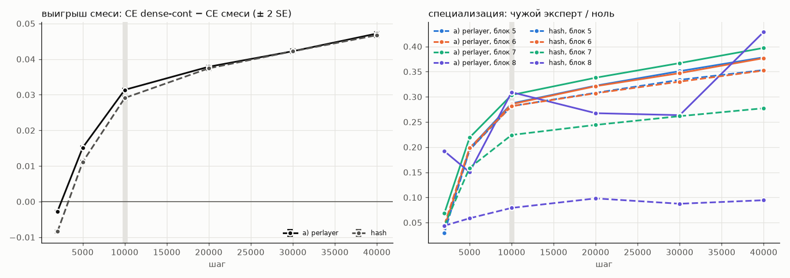

# Раунд 28, этап 3: растёт ли выигрыш смеси вместе со специализацией (дома)

а (perlayer) и dense-cont — 0 → 10k как этап 1 (dense-cont обучен заново: в r21 сохранена только 10k), 10k → 40k: свежий AdamW, 200 шагов разогрева до lr конца этапа 1 (0.1 от пика), дальше постоянный; окна `data_mix_ext` (документы после `data_mix`, без повторов), одни и те же для всех моделей. Выигрыш смеси = CE dense-cont − CE смеси на полном val, парно по окнам, ± 2 SE. Специализация — 1024 окна val; dense-cont / ноль — с dense-cont того же шага.

Проверки воспроизведения: dense-cont заново против dense-cont r21 на 10k: -0.0000 ± 0.0000; hash заново против hash r21 на 10k: -0.0000 ± 0.0000.

## а) perlayer

| шаг | val CE смеси | val CE dense-cont | выигрыш смеси ± 2 SE | чужой / ноль: блоки 5 / 6 / 7 / 8 (± 2 SE блока 5) | dense-cont / ноль: блоки 5 / 6 / 7 / 8 | снято подбором: 5 / 6 / 7 / 8 | косинус сдвигов | ‖сдвиг‖ / ‖A-mix‖ |
|---|---|---|---|---|---|---|---|---|
| 2000 | 2.3932 | 2.3905 | -0.0027 ± 0.0003 | 0.038 / 0.040 / 0.068 / 0.192 (± 0.009) | 0.002 / 0.010 / 0.022 / 0.006 | 49.80 / -0.27 / 0.53 / 0.96 | 0.07 / 0.08 / 0.06 / 0.08 | 0.191 |
| 5000 | 2.3362 | 2.3514 | +0.0152 ± 0.0003 | 0.197 / 0.194 / 0.219 / 0.150 (± 0.011) | 0.070 / 0.067 / 0.082 / 0.024 | 0.51 / 0.51 / 0.58 / 0.82 | 0.13 / 0.15 / 0.12 / 0.15 | 0.278 |
| 10000 | 2.2685 | 2.2999 | +0.0314 ± 0.0004 | 0.287 / 0.285 / 0.304 / 0.309 (± 0.011) | 0.109 / 0.104 / 0.116 / 0.046 | 0.59 / 0.61 / 0.61 / 0.91 | 0.19 / 0.22 / 0.17 / 0.21 | 0.307 |
| 20000 | 2.2623 | 2.3001 | +0.0379 ± 0.0004 | 0.322 / 0.321 / 0.338 / 0.267 (± 0.011) | 0.127 / 0.122 / 0.130 / 0.050 | 0.59 / 0.64 / 0.60 / 0.85 | 0.23 / 0.27 / 0.22 / 0.26 | 0.325 |
| 30000 | 2.2554 | 2.2977 | +0.0422 ± 0.0004 | 0.351 / 0.347 / 0.367 / 0.263 (± 0.012) | 0.141 / 0.134 / 0.141 / 0.061 | 0.60 / 0.70 / 0.60 / 0.85 | 0.28 / 0.32 / 0.27 / 0.30 | 0.345 |
| 40000 | 2.2481 | 2.2953 | +0.0472 ± 0.0005 | 0.379 / 0.377 / 0.397 / 0.429 (± 0.012) | 0.152 / 0.150 / 0.153 / 0.098 | 0.60 / 0.73 / 0.60 / 0.93 | 0.32 / 0.36 / 0.31 / 0.35 | 0.365 |

## hash

| шаг | val CE смеси | val CE dense-cont | выигрыш смеси ± 2 SE | чужой / ноль: блоки 5 / 6 / 7 / 8 (± 2 SE блока 5) | dense-cont / ноль: блоки 5 / 6 / 7 / 8 | снято подбором: 5 / 6 / 7 / 8 | косинус сдвигов | ‖сдвиг‖ / ‖A-mix‖ |
|---|---|---|---|---|---|---|---|---|
| 2000 | 2.3989 | 2.3905 | -0.0084 ± 0.0004 | 0.030 / 0.045 / 0.044 / 0.044 (± 0.009) | -0.008 / 0.001 / 0.002 / 0.000 | -0.24 / 0.18 / 0.31 / 0.85 | 0.05 / 0.05 / 0.06 / 0.12 | 0.196 |
| 5000 | 2.3403 | 2.3514 | +0.0111 ± 0.0005 | 0.195 / 0.198 / 0.159 / 0.058 (± 0.011) | 0.082 / 0.077 / 0.058 / 0.044 | 0.42 / 0.42 / 0.46 / 0.62 | 0.12 / 0.12 / 0.13 / 0.20 | 0.277 |
| 10000 | 2.2708 | 2.2999 | +0.0291 ± 0.0005 | 0.281 / 0.281 / 0.224 / 0.079 (± 0.011) | 0.139 / 0.126 / 0.099 / 0.133 | 0.48 / 0.46 / 0.49 / 0.63 | 0.17 / 0.18 / 0.19 / 0.27 | 0.301 |
| 20000 | 2.2627 | 2.3001 | +0.0374 ± 0.0006 | 0.308 / 0.307 / 0.244 / 0.098 (± 0.011) | 0.159 / 0.147 / 0.115 / 0.207 | 0.48 / 0.45 / 0.48 / 0.66 | 0.23 / 0.23 / 0.25 / 0.34 | 0.316 |
| 30000 | 2.2555 | 2.2977 | +0.0422 ± 0.0006 | 0.334 / 0.330 / 0.262 / 0.087 (± 0.011) | 0.177 / 0.162 / 0.128 / 0.238 | 0.49 / 0.45 / 0.49 / 0.63 | 0.28 / 0.28 / 0.30 / 0.39 | 0.334 |
| 40000 | 2.2486 | 2.2953 | +0.0467 ± 0.0006 | 0.353 / 0.352 / 0.277 / 0.094 (± 0.011) | 0.194 / 0.181 / 0.145 / 0.478 | 0.48 / 0.46 / 0.49 / 0.63 | 0.32 / 0.33 / 0.35 / 0.44 | 0.353 |

## Ход val CE (256 окон, каждые 1000 шагов)

| шаг | dense-cont | а) perlayer | hash |
|---|---|---|---|
| 0 | 2.3406 | 2.3405 | 2.3406 |
| 2000 | 2.3773 | 2.3805 | 2.3879 |
| 5000 | 2.3391 | 2.3254 | 2.3284 |
| 10000 | 2.2887 | 2.2601 | 2.2612 |
| 15000 | 2.2925 | 2.2600 | 2.2597 |
| 20000 | 2.2896 | 2.2539 | 2.2529 |
| 25000 | 2.2888 | 2.2513 | 2.2495 |
| 30000 | 2.2878 | 2.2480 | 2.2459 |
| 35000 | 2.2868 | 2.2448 | 2.2436 |
| 40000 | 2.2847 | 2.2393 | 2.2383 |

