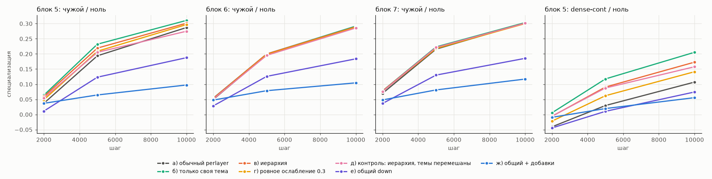

# Раунд 28, этапы 1–2: что мешает экспертам различаться (обучение, r21 perlayer, дома)

Все варианты — как perlayer r21: старт с A-mix, 10k шагов, те же окна и план lr, тот же маршрут по книгам слоёв. В б–д меняется только градиент, который доходит до записей экспертов в K / V внимания верхних блоков от чужих позиций (вес пары по темам — экспертам блока 5); прямой проход тот же. е — общий down на блок; ж — общий FFN A-mix из 1056 нейронов + добавки по 352 у каждого эксперта (down = 0 на старте).

## Шаг 0

| вариант | val CE на шаге 0 (256 окон) | A-mix | разница |
|---|---|---|---|
| а) обычный perlayer | 2.34055 | 2.34059 | -0.00004 |
| б) только своя тема | 2.34055 | 2.34059 | -0.00004 |
| в) иерархия | 2.34055 | 2.34059 | -0.00004 |
| г) ровное ослабление 0.3 | 2.34055 | 2.34059 | -0.00004 |
| д) контроль: иерархия, темы перемешаны | 2.34055 | 2.34059 | -0.00004 |
| е) общий down | 2.34060 | 2.34059 | +0.00002 |
| ж) общий + добавки | 2.44457 | 2.34059 | +0.10398 |

## Качество (полный val)

| вариант | val CE | Википедия / код / сказки | Δ к а) (наш perlayer) ± 2 SE | Δ к dense-cont ± 2 SE | Δ к perlayer r21 ± 2 SE |
|---|---|---|---|---|---|
| а) обычный perlayer | 2.2685 | 3.8589 / 1.4193 / 1.5272 | — | -0.0314 ± 0.0004 | -0.0001 ± 0.0000 |
| б) только своя тема | 2.2764 | 3.8682 / 1.4259 / 1.5351 | +0.0079 ± 0.0002 | -0.0235 ± 0.0004 | +0.0079 ± 0.0002 |
| в) иерархия | 2.2734 | 3.8641 / 1.4237 / 1.5324 | +0.0049 ± 0.0001 | -0.0265 ± 0.0004 | +0.0048 ± 0.0001 |
| г) ровное ослабление 0.3 | 2.2717 | 3.8626 / 1.4218 / 1.5308 | +0.0033 ± 0.0001 | -0.0282 ± 0.0004 | +0.0032 ± 0.0001 |
| д) контроль: иерархия, темы перемешаны | 2.2740 | 3.8649 / 1.4251 / 1.5320 | +0.0055 ± 0.0002 | -0.0259 ± 0.0004 | +0.0054 ± 0.0002 |
| е) общий down | 2.2783 | 3.8700 / 1.4273 / 1.5376 | +0.0098 ± 0.0002 | -0.0216 ± 0.0003 | +0.0097 ± 0.0002 |
| ж) общий + добавки | 2.3014 | 3.9002 / 1.4443 / 1.5596 | +0.0329 ± 0.0004 | +0.0015 ± 0.0003 | +0.0328 ± 0.0004 |
| г) ровное ослабление 0.3, сид 1 | 2.2725 | 3.8637 / 1.4229 / 1.5309 | +0.0040 ± 0.0004 | -0.0274 ± 0.0005 | +0.0039 ± 0.0004 |

Сид 1 против сида 0 того же варианта: +0.0008 ± 0.0004.

## Специализация по ходу обучения (сохранения 2k / 5k / 10k; 256 окон val, 512 окон калибровки)

Специализация = (чужой − свой) / (ноль − свой) = чужой / ноль (свой — сама модель); dense-cont / ноль — то же с FFN dense-cont вместо чужого эксперта; «снято подбором» — доля разницы «свой против чужого», которую снимает подбор down под выход своего эксперта (2 чужих на эксперта); косинус сдвигов — между экспертами одного блока (сдвиг = веса − веса на шаге 0). ± 2 SE у «чужой / ноль» на этих 256 окнах (дельта-метод, как в этапе 0) — 0.005–0.023: в блоках 5–7 у а–д около 0.01–0.02, в блоке 8 около 0.015; у е и ж меньше.

| вариант | блок | чужой / ноль: 2k / 5k / 10k | dense-cont / ноль: 2k / 5k / 10k | снято подбором: 2k / 5k / 10k | косинус сдвигов: 2k / 5k / 10k | без добавок (ж): рост CE 2k / 5k / 10k |
|---|---|---|---|---|---|---|
| а) обычный perlayer | 5 | 0.037 / 0.194 / 0.287 | -0.041 / 0.030 / 0.107 | 6.171 / 0.516 / 0.600 | 0.067 / 0.135 / 0.188 | — |
| а) обычный perlayer | 6 | 0.049 / 0.197 / 0.287 | 0.002 / 0.050 / 0.113 | 0.120 / 0.508 / 0.602 | 0.075 / 0.155 / 0.216 | — |
| а) обычный perlayer | 7 | 0.070 / 0.216 / 0.302 | 0.033 / 0.069 / 0.116 | 0.489 / 0.598 / 0.604 | 0.056 / 0.121 / 0.175 | — |
| а) обычный perlayer | 8 | 0.197 / 0.154 / 0.316 | 0.896 / 0.506 / 0.045 | 0.965 / 0.820 / 0.914 | 0.081 / 0.150 / 0.207 | — |
| б) только своя тема | 5 | 0.064 / 0.232 / 0.311 | 0.005 / 0.117 / 0.205 | 0.197 / 0.572 / 0.654 | 0.069 / 0.137 / 0.188 | — |
| б) только своя тема | 6 | 0.054 / 0.200 / 0.292 | 0.009 / 0.061 / 0.129 | 0.195 / 0.519 / 0.578 | 0.079 / 0.161 / 0.220 | — |
| б) только своя тема | 7 | 0.078 / 0.223 / 0.303 | 0.043 / 0.082 / 0.124 | 0.588 / 0.590 / 0.602 | 0.056 / 0.120 / 0.174 | — |
| б) только своя тема | 8 | 0.186 / 0.154 / 0.319 | 0.888 / 0.496 / 0.046 | 0.966 / 0.818 / 0.915 | 0.081 / 0.151 / 0.207 | — |
| в) иерархия | 5 | 0.059 / 0.219 / 0.301 | -0.006 / 0.091 / 0.173 | -0.138 / 0.545 / 0.630 | 0.068 / 0.136 / 0.188 | — |
| в) иерархия | 6 | 0.054 / 0.200 / 0.290 | 0.008 / 0.058 / 0.123 | 0.141 / 0.519 / 0.639 | 0.079 / 0.162 / 0.222 | — |
| в) иерархия | 7 | 0.078 / 0.221 / 0.302 | 0.041 / 0.079 / 0.120 | 0.565 / 0.591 / 0.594 | 0.056 / 0.121 / 0.175 | — |
| в) иерархия | 8 | 0.190 / 0.154 / 0.320 | 0.892 / 0.501 / 0.045 | 0.965 / 0.819 / 0.918 | 0.081 / 0.151 / 0.208 | — |
| г) ровное ослабление 0.3 | 5 | 0.049 / 0.209 / 0.297 | -0.022 / 0.062 / 0.141 | -1.571 / 0.529 / 0.612 | 0.067 / 0.136 / 0.188 | — |
| г) ровное ослабление 0.3 | 6 | 0.051 / 0.197 / 0.288 | 0.005 / 0.055 / 0.121 | 0.140 / 0.529 / 0.651 | 0.079 / 0.161 / 0.222 | — |
| г) ровное ослабление 0.3 | 7 | 0.076 / 0.218 / 0.300 | 0.040 / 0.075 / 0.118 | 0.558 / 0.586 / 0.591 | 0.056 / 0.121 / 0.175 | — |
| г) ровное ослабление 0.3 | 8 | 0.192 / 0.152 / 0.319 | 0.892 / 0.500 / 0.045 | 0.967 / 0.819 / 0.916 | 0.081 / 0.151 / 0.209 | — |
| д) контроль: иерархия, темы перемешаны | 5 | 0.055 / 0.205 / 0.275 | -0.005 / 0.087 / 0.158 | -0.504 / 0.564 / 0.629 | 0.067 / 0.135 / 0.187 | — |
| д) контроль: иерархия, темы перемешаны | 6 | 0.051 / 0.195 / 0.286 | 0.005 / 0.057 / 0.121 | 0.072 / 0.515 / 0.626 | 0.080 / 0.162 / 0.222 | — |
| д) контроль: иерархия, темы перемешаны | 7 | 0.076 / 0.221 / 0.301 | 0.041 / 0.081 / 0.122 | 0.564 / 0.594 / 0.597 | 0.056 / 0.120 / 0.173 | — |
| д) контроль: иерархия, темы перемешаны | 8 | 0.191 / 0.155 / 0.322 | 0.874 / 0.497 / 0.046 | 0.966 / 0.817 / 0.918 | 0.081 / 0.151 / 0.207 | — |
| е) общий down | 5 | 0.011 / 0.123 / 0.188 | -0.044 / 0.010 / 0.074 | 2.032 / 0.235 / 0.379 | 0.057 / 0.124 / 0.180 | — |
| е) общий down | 6 | 0.028 / 0.126 / 0.184 | -0.004 / 0.025 / 0.073 | -0.254 / 0.261 / 0.388 | 0.065 / 0.142 / 0.204 | — |
| е) общий down | 7 | 0.036 / 0.130 / 0.185 | 0.026 / 0.037 / 0.074 | 0.158 / 0.353 / 0.410 | 0.048 / 0.111 / 0.166 | — |
| е) общий down | 8 | 0.064 / 0.086 / 0.128 | 0.980 / 0.557 / 0.024 | 0.878 / 0.698 / 0.717 | 0.062 / 0.129 / 0.185 | — |
| ж) общий + добавки | 5 | 0.037 / 0.065 / 0.097 | -0.009 / 0.020 / 0.056 | 0.942 / 0.723 / 0.727 | 0.061 / 0.085 / 0.100 | 0.004 / 0.007 / 0.010 |
| ж) общий + добавки | 6 | 0.048 / 0.079 / 0.104 | 0.010 / 0.032 / 0.057 | 0.924 / 0.754 / 0.737 | 0.058 / 0.091 / 0.110 | 0.006 / 0.009 / 0.013 |
| ж) общий + добавки | 7 | 0.048 / 0.081 / 0.117 | 0.032 / 0.049 / 0.064 | 0.879 / 0.751 / 0.749 | 0.061 / 0.085 / 0.099 | 0.009 / 0.015 / 0.022 |
| ж) общий + добавки | 8 | 0.103 / 0.042 / 0.134 | 1.725 / 1.076 / 0.160 | 0.988 / 0.852 / 0.961 | 0.071 / 0.099 / 0.114 | 0.101 / 0.042 / 0.151 |

## Доля чужого градиента экспертов (начало / конец; естественная и с весами варианта)

| вариант | естественная, начало: блоки 5 / 6 / 7 | с весами варианта, начало | естественная, конец | с весами варианта, конец |
|---|---|---|---|---|
| а) обычный perlayer | 0.63 / 0.51 / 0.35 | 0.63 / 0.51 / 0.35 | 0.62 / 0.53 / 0.37 | 0.62 / 0.53 / 0.37 |
| б) только своя тема | 0.63 / 0.51 / 0.35 | 0.31 / 0.31 / 0.18 | 0.59 / 0.53 / 0.37 | 0.30 / 0.32 / 0.19 |
| в) иерархия | 0.63 / 0.51 / 0.35 | 0.34 / 0.32 / 0.20 | 0.60 / 0.53 / 0.37 | 0.32 / 0.33 / 0.21 |
| г) ровное ослабление 0.3 | 0.63 / 0.51 / 0.35 | 0.38 / 0.34 / 0.21 | 0.60 / 0.53 / 0.37 | 0.37 / 0.35 / 0.23 |
| д) контроль: иерархия, темы перемешаны | 0.63 / 0.51 / 0.35 | 0.40 / 0.35 / 0.18 | 0.60 / 0.53 / 0.37 | 0.38 / 0.36 / 0.20 |
| е) общий down | 0.62 / 0.51 / 0.33 | 0.62 / 0.51 / 0.33 | 0.61 / 0.52 / 0.34 | 0.61 / 0.52 / 0.34 |
| ж) общий + добавки | 0.64 / 0.55 / 0.42 | 0.64 / 0.55 / 0.42 | 0.61 / 0.48 / 0.35 | 0.61 / 0.48 / 0.35 |

## Этап 2: специализация на 10k с ± 2 SE (1024 окна val; калибровка 1024 окна)

Среднее по экспертам с весом доли токенов; ± 2 SE отношения — дельта-метод без учёта корреляции числителя и знаменателя (с запасом), как в этапе 0. Разница двух вариантов значима, если она больше √(a² + b²) из их ± 2 SE. У ж «чужой» меняет только добавку (общая часть та же), поэтому его чужой / ноль не сравним с остальными; для ж сравнимая мера — подмена добавок / отключение добавок.

| вариант | блок | чужой эксперт | ноль | чужой / ноль ± 2 SE | dense-cont / ноль ± 2 SE | снято подбором | косинус сдвигов | ‖сдвиг‖ / ‖A-mix‖ | ж: отключение добавок | ж: подмена добавок / отключение ± 2 SE |
|---|---|---|---|---|---|---|---|---|---|---|
| а) обычный perlayer | 5 | +0.0203 | +0.0709 | 0.287 ± 0.011 | 0.110 ± 0.006 | 0.608 | 0.188 | 0.311 | — | — |
| а) обычный perlayer | 6 | +0.0302 | +0.1057 | 0.285 ± 0.009 | 0.104 ± 0.005 | 0.637 | 0.216 | 0.298 | — | — |
| а) обычный perlayer | 7 | +0.0494 | +0.1628 | 0.304 ± 0.007 | 0.115 ± 0.004 | 0.616 | 0.175 | 0.314 | — | — |
| а) обычный perlayer | 8 | +0.2062 | +0.6670 | 0.309 ± 0.009 | 0.046 ± 0.001 | 0.903 | 0.207 | 0.306 | — | — |
| б) только своя тема | 5 | +0.0259 | +0.0841 | 0.308 ± 0.011 | 0.208 ± 0.009 | 0.664 | 0.188 | 0.316 | — | — |
| б) только своя тема | 6 | +0.0313 | +0.1074 | 0.291 ± 0.009 | 0.122 ± 0.005 | 0.620 | 0.220 | 0.296 | — | — |
| б) только своя тема | 7 | +0.0513 | +0.1678 | 0.306 ± 0.007 | 0.123 ± 0.004 | 0.611 | 0.174 | 0.315 | — | — |
| б) только своя тема | 8 | +0.2038 | +0.6534 | 0.312 ± 0.009 | 0.047 ± 0.001 | 0.903 | 0.207 | 0.306 | — | — |
| в) иерархия | 5 | +0.0234 | +0.0782 | 0.299 ± 0.011 | 0.174 ± 0.008 | 0.634 | 0.188 | 0.314 | — | — |
| в) иерархия | 6 | +0.0309 | +0.1069 | 0.289 ± 0.009 | 0.118 ± 0.005 | 0.689 | 0.222 | 0.296 | — | — |
| в) иерархия | 7 | +0.0506 | +0.1663 | 0.304 ± 0.007 | 0.121 ± 0.004 | 0.606 | 0.175 | 0.314 | — | — |
| в) иерархия | 8 | +0.2047 | +0.6553 | 0.312 ± 0.009 | 0.046 ± 0.001 | 0.904 | 0.208 | 0.306 | — | — |
| г) ровное ослабление 0.3 | 5 | +0.0222 | +0.0754 | 0.294 ± 0.011 | 0.145 ± 0.007 | 0.616 | 0.188 | 0.312 | — | — |
| г) ровное ослабление 0.3 | 6 | +0.0306 | +0.1067 | 0.287 ± 0.009 | 0.115 ± 0.005 | 0.703 | 0.222 | 0.295 | — | — |
| г) ровное ослабление 0.3 | 7 | +0.0503 | +0.1657 | 0.304 ± 0.007 | 0.119 ± 0.004 | 0.603 | 0.175 | 0.314 | — | — |
| г) ровное ослабление 0.3 | 8 | +0.2040 | +0.6556 | 0.311 ± 0.009 | 0.046 ± 0.001 | 0.904 | 0.209 | 0.306 | — | — |
| д) контроль: иерархия, темы перемешаны | 5 | +0.0234 | +0.0862 | 0.272 ± 0.010 | 0.157 ± 0.007 | 0.627 | 0.187 | 0.314 | — | — |
| д) контроль: иерархия, темы перемешаны | 6 | +0.0305 | +0.1067 | 0.286 ± 0.009 | 0.117 ± 0.005 | 0.674 | 0.222 | 0.295 | — | — |
| д) контроль: иерархия, темы перемешаны | 7 | +0.0508 | +0.1675 | 0.303 ± 0.007 | 0.122 ± 0.004 | 0.608 | 0.173 | 0.314 | — | — |
| д) контроль: иерархия, темы перемешаны | 8 | +0.2053 | +0.6537 | 0.314 ± 0.009 | 0.046 ± 0.001 | 0.905 | 0.207 | 0.306 | — | — |
| е) общий down | 5 | +0.0133 | +0.0719 | 0.186 ± 0.008 | 0.076 ± 0.005 | 0.413 | 0.180 | 0.303 | — | — |
| е) общий down | 6 | +0.0201 | +0.1096 | 0.183 ± 0.006 | 0.068 ± 0.003 | 0.391 | 0.204 | 0.298 | — | — |
| е) общий down | 7 | +0.0314 | +0.1672 | 0.188 ± 0.005 | 0.075 ± 0.003 | 0.427 | 0.166 | 0.315 | — | — |
| е) общий down | 8 | +0.0898 | +0.7113 | 0.126 ± 0.003 | 0.024 ± 0.001 | 0.713 | 0.185 | 0.316 | — | — |
| ж) общий + добавки | 5 | +0.0071 | +0.0743 | 0.095 ± 0.006 | 0.051 ± 0.005 | 0.705 | 0.100 | 0.450 | +0.0101 | 0.703 ± 0.053 |
| ж) общий + добавки | 6 | +0.0126 | +0.1179 | 0.107 ± 0.004 | 0.055 ± 0.004 | 0.716 | 0.110 | 0.412 | +0.0129 | 0.980 ± 0.051 |
| ж) общий + добавки | 7 | +0.0197 | +0.1739 | 0.113 ± 0.004 | 0.058 ± 0.003 | 0.754 | 0.099 | 0.439 | +0.0211 | 0.934 ± 0.039 |
| ж) общий + добавки | 8 | +0.1016 | +0.7932 | 0.128 ± 0.004 | 0.156 ± 0.005 | 0.961 | 0.114 | 0.438 | +0.1445 | 0.703 ± 0.031 |
| г) ровное ослабление 0.3, сид 1 | 5 | +0.0224 | +0.0758 | 0.296 ± 0.011 | 0.151 ± 0.007 | 0.618 | 0.188 | 0.312 | — | — |
| г) ровное ослабление 0.3, сид 1 | 6 | +0.0307 | +0.1072 | 0.287 ± 0.009 | 0.120 ± 0.005 | 0.707 | 0.222 | 0.295 | — | — |
| г) ровное ослабление 0.3, сид 1 | 7 | +0.0506 | +0.1659 | 0.305 ± 0.007 | 0.123 ± 0.004 | 0.603 | 0.175 | 0.314 | — | — |
| г) ровное ослабление 0.3, сид 1 | 8 | +0.2079 | +0.6602 | 0.315 ± 0.008 | 0.052 ± 0.001 | 0.908 | 0.209 | 0.306 | — | — |

## Этап 2: полные матрицы на 10k (1024 окна val, 1024 окна калибровки, все пары)

| вариант | чужой / ноль: блоки 5 / 6 / 7 / 8 | dense-cont / ноль | снято подбором | все блоки сразу: чужой / ноль |
|---|---|---|---|---|
| а) обычный perlayer | 0.287 / 0.285 / 0.304 / 0.309 | 0.110 / 0.103 / 0.116 / 0.045 | 0.608 / 0.637 / 0.616 / 0.903 | 0.313 |
| б) только своя тема | 0.308 / 0.291 / 0.306 / 0.312 | 0.208 / 0.122 / 0.123 / 0.047 | 0.664 / 0.620 / 0.611 / 0.903 | 0.315 |
| в) иерархия | 0.299 / 0.289 / 0.304 / 0.312 | 0.174 / 0.118 / 0.121 / 0.046 | 0.634 / 0.689 / 0.606 / 0.904 | 0.316 |
| г) ровное ослабление 0.3 | 0.294 / 0.287 / 0.303 / 0.311 | 0.145 / 0.115 / 0.119 / 0.046 | 0.616 / 0.703 / 0.603 / 0.904 | 0.315 |
| д) контроль: иерархия, темы перемешаны | 0.272 / 0.286 / 0.303 / 0.314 | 0.157 / 0.117 / 0.122 / 0.046 | 0.627 / 0.674 / 0.608 / 0.905 | 0.313 |
| е) общий down | 0.185 / 0.183 / 0.188 / 0.126 | 0.076 / 0.068 / 0.075 / 0.024 | 0.413 / 0.391 / 0.427 / 0.713 | 0.142 |
| ж) общий + добавки | 0.095 / 0.107 / 0.113 / 0.128 | 0.051 / 0.055 / 0.058 / 0.156 | 0.705 / 0.716 / 0.754 / 0.961 | 0.133 |
| г) ровное ослабление 0.3, сид 1 | 0.296 / 0.287 / 0.305 / 0.315 | 0.150 / 0.120 / 0.123 / 0.052 | 0.618 / 0.707 / 0.603 / 0.908 | 0.319 |

